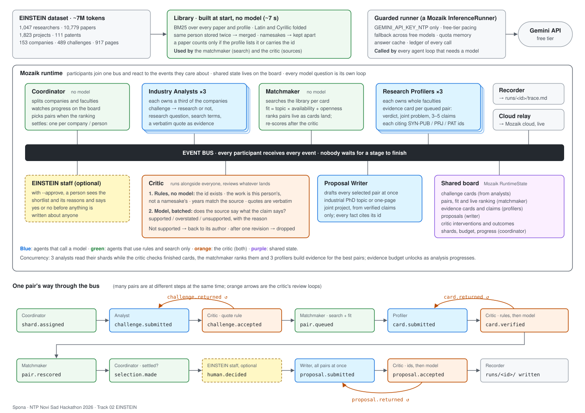

# Spona

Spona (Serbian for "link" or "clasp") is a team of AI agents on [Mozaik](https://github.com/jigjoy-ai/mozaik) that reads the whole EINSTEIN Matchmaker dataset, finds University of Novi Sad researcher × NTP Novi Sad company pairs worth a meeting, and drafts an industrial PhD topic or a one-page joint project for the best of them. Every claim about a person or a company cites the record it came from, and a critic agent checks those claims while the other agents are still working.

NTP Novi Sad Hackathon 2026 (JigJoy × Mozaik), Track 02 EINSTEIN. Team SmarTies (Jannet Ekka), online.

**The showcase run:** [runs/FINAL_RUN/](runs/FINAL_RUN/) has the proposals, the [trace](runs/FINAL_RUN/trace.md) with every place the critic stepped in, the [ranking of pairs](runs/FINAL_RUN/ranking.md) and [every challenge with its outcome](runs/FINAL_RUN/challenges.md).

## What it does

Input: the [synthetic dataset](https://github.com/jigjoy-ai/einstein-matchmaker-data). 1,047 researcher records, 10,779 publications, 1,823 projects, 111 patents, 153 companies with 489 challenges and 917 company pages. About 7M tokens, in English, Serbian Latin and Serbian Cyrillic, with duplicates, namesakes and stale profiles left in on purpose.

Output, in `runs/<id>/`:

| File | What's in it |
| --- | --- |
| `proposals/*.md` | One proposal per selected pair, in the shape of the dataset's example: the problem, research questions, a plan with a result per step, what each side brings, why this pair, open questions for the first meeting, publication and IP terms. Below each proposal: the evidence the critic checked, what it sent back and what happened, and the cited sources. |
| `ranking.md` | Pairs ranked by fit, with the reasons for each score, and the pairs that were not proposed and why. |
| `challenges.md` | All challenges: research, engineering with a research angle, or not research, the research question in academic terms, and the outcome. A challenge with no good match at the university says so. |
| `trace.md` | One run, end to end: a chart of which agent loops ran at the same time, a table of every critic intervention with its outcome, one pair followed from start to finish, and the full event timeline. |
| `trace.jsonl`, `loops.json`, `ledger.json` | Raw events from the Mozaik bus, loop timings, and every model call with its model, tokens and time. |

Every agent loop also streams live to Mozaik cloud when `MOZAIK_API_KEY` is set.

## Architecture



All participants join one Mozaik runtime. They don't call each other. Each one registers situation handlers for the events it cares about and publishes new events when it has something; the runtime delivers every event to every participant without waiting for anyone. Shared state lives on a board in the runtime state (Mozaik's `RuntimeState`): challenge cards, pairs and their fit, evidence cards and claims, proposals and the critic's interventions.

| Participant | Model | Owns | Reacts to | Publishes |
| --- | --- | --- | --- | --- |
| Coordinator | none | the shard plan, progress, selection | `run.requested`, progress events, `proposal.accepted` | `shard.assigned`, `selection.made`, `run.finished` |
| Industry Analyst ×3 | gemini-3.5-flash-lite | a third of the companies each | `shard.assigned`, `challenge.returned` | `challenge.submitted` |
| Matchmaker | none | pairs and the live ranking | `challenge.accepted`, `card.verified` | `pair.queued`, `pair.excluded`, `pair.rescored`, `ranking.updated` |
| Research Profiler ×3 | gemini-3.5-flash-lite | whole faculties each (balanced by head count) | `pair.queued`, `card.returned` | `card.submitted` |
| Critic | gemini-3-flash-preview, after rule checks | nothing; it reviews | `challenge.submitted`, `card.submitted`, `proposal.submitted` | `…accepted`, `…returned`, `card.verified`, `critic.intervened` |
| Proposal Writer | gemini-3.5-flash | the drafts | `selection.made`, `proposal.returned` | `proposal.submitted` |
| Recorder, Cloud relay | none | the trace; the Mozaik cloud session | every event | files in `runs/<id>/`; events to Mozaik cloud |

Each model question is its own Mozaik loop (`runLoop`) with a fresh context, so two loops of one agent never share memory. An `InterceptionHandler` on the loop's `model_message` transition hands the answer back to the agent that asked. Models are called through a custom `InferenceRunner` (see [free tier](#cheap-search-first-and-the-free-tier)).

### Why it's concurrent and not a pipeline

- The three analysts read their shards in parallel, two batches at a time each. As each batch lands, its cards go to the critic, then to the matchmaker, which searches and ranks immediately. Profilers start on the best pairs while analysts are still reading.
- The critic runs next to everyone. It checks challenge cards, evidence cards and proposals as they arrive, and sends unsupported ones back. Authors revise while other work goes on.
- The evidence budget opens up as analysis progresses, so the first results can't use it all: a profiler may only take a pair that ranks inside the unlocked budget on the whole board.
- The writer drafts every selected pair at once, and the critic reviews each draft as it lands.

The [trace](runs/FINAL_RUN/trace.md) has a Gantt chart of every loop. In the showcase run up to N loops ran at the same time.

### Review loops

The critic checks three things, each in two steps. Rules come first because they cost nothing and can't be talked round:

| What | Rule checks (no model) | Model check | If it fails |
| --- | --- | --- | --- |
| Challenge cards | the quote is copied verbatim from the company's own text (any script); enough search terms | none | back to the analyst with the reason; accepted without the quote after one revision |
| Evidence cards | every cited id exists; a cited paper, project or patent is this person's (listed on their profile or carrying their researcher id, never a name match alone); years in the claim match the source | batched: does the cited text say what the claim says? supported, overstated or unsupported | back to the profiler, who revises or withdraws; still unsupported after one revision → dropped. A pair needs two surviving claims to be proposed. |
| Proposals | every cited id belongs to this pair; the researcher and company are named; every person named is in the sources, spelled the same way | does any statement of fact go beyond the sources? (invented staff, data volumes, equipment, numbers, dates) | back to the writer, up to two revisions; anything still open is printed under the proposal |

## How to run

You need Node 20 or later, git, and a Gemini API key from [AI Studio](https://aistudio.google.com/apikey). The free tier is enough.

```bash
git clone https://github.com/JannetEkka/spona && cd spona
```

```bash
npm install
```

```bash
npm run data
```

That clones the dataset into `data/` (39 MB). Then set the key. Spona reads `GEMINI_API_KEY_NTP` and passes it to Mozaik's Gemini endpoint explicitly; it deletes `GEMINI_API_KEY` from its own process at start so nothing can fall back to another key.

```bash
cp .env.example .env
```

Put your key in `.env` as `GEMINI_API_KEY_NTP=...`, and optionally `MOZAIK_API_KEY` and `MOZAIK_PROJECT_ID` to watch the run live in Mozaik cloud. Then:

```bash
npm start
```

That is a full run: all 153 companies, 4 proposals, about N model requests and N minutes. For a quick look, `npm run small` runs the first 12 companies. Options:

| Flag | Default | |
| --- | --- | --- |
| `--companies N` | all | only the first N companies |
| `--proposals N` | 4 | how many pairs get a proposal |
| `--profile-budget N` | 24 | how many pairs get an evidence card (the main driver of model calls) |
| `--max-calls N` | 120 | hard cap on model requests |
| `--approve` | off | a person approves the shortlist in the terminal before any proposal is written |
| `--fresh` | off | ignore the answer cache in `.cache/llm` |
| `--run-id ID` | a timestamp | output goes to `runs/ID/` |

To ask the other way round, which company challenges fit one researcher's work, run a reverse search. It uses the library only, no model:

```bash
npm run reverse -- R1008
```

`npm test` runs the rule checks against the real dataset (namesakes, duplicates, departures, quote matching, and that fit doesn't change with title or publication count). `npm run typecheck` checks the types.

## Cheap search first, and the free tier

The Gemini API free tier allows about **20 requests per day per model** (quota id `GenerateRequestsPerDayPerProjectPerModel-FreeTier`). Spona is built around that:

- The library indexes every paper and profile with BM25 at start, in about 7 seconds, with no model call. Latin and Cyrillic are folded to one form, so `Јелена Марковић` and `Jelena Marković` match. The matchmaker searches it for every challenge, and the critic reads sources from it.
- Models only see what search surfaced: a challenge, one researcher, and their three best-matching papers plus matching projects and patents.
- Calls are batched: ten companies per analyst call, four pairs per profiler call, up to eight evidence cards per critic call, revisions collected for a few seconds and sent together.
- The runner (`src/llm/runner.ts`, a Mozaik `InferenceRunner`) paces each model, retries on rate limits, and moves to the next free model when one is out of daily quota, overloaded or hanging. It remembers exhausted models in `.cache/quota.json` until their quota resets. Every call goes into a ledger.

In the showcase run the models read about N tokens in total, a small part of the ~7M in the dataset. The rest was handled by search and rules.

## Accuracy and transparency

- Everything has an id and everything cites one: researchers `R0001`, companies `C001`, challenges `C001-CH1`, publications `SYN-PUB-00001`, projects `SYN-PRJ-0001`, patents `SYN-PAT-001`. Company pages don't have ids in the dataset, so Spona numbers them per company in file order: `C001-P3` is the third line for `C001` in `company-pages.jsonl`.
- A claim cites only what its author was shown, and the critic checks it against exactly that text.
- Each proposal ends with the evidence the critic checked (✅ kept, ❌ dropped and why), everything the critic sent back with its outcome, and the cited sources.
- `ranking.md` gives every pair's score broken into its parts, with the words that matched.
- What the checks don't guarantee: the model check is a model. It can miss an overstatement or flag a fair paraphrase. The rule checks are exact but narrow. Treat a proposal as a well-sourced first draft for a meeting, not as a verified fact sheet.

## Responsible use of data

- **Pairs, not people.** Fit belongs to a pair: how much of this challenge's vocabulary appears in this person's own work, whether they say they're open to this kind of collaboration, whether they're available, and how much of the evidence survived the critic. Title, seniority, publication counts, citations, venues, age, gender, nationality and the language of the record are not inputs, and a test checks that fit doesn't move with title or publication count. Only a person's three best-matching papers count, so a long publication list doesn't win on its own.
- **Stale and messy records are handled, not guessed.** Someone who left the university (R0068) is never proposed and the ranking says why. Retired and emeritus researchers are consulting-only. The two people stored twice (R0556 = R0976, R0894 = R0929) are merged; the two pairs of namesakes (R0128/R0881, R0191/R0435) are kept apart. Unlinked papers that only share a name with a researcher (90 for one common name) are never attributed to them. Notes that open with someone else's name are not used.
- **What people said they're open to is respected.** The researcher's `open_to` feeds fit; availability notes (sabbaticals, limited capacity) go into the proposal.
- **Only work-related data goes to the model**, and only for the pairs that need it. Nothing is scraped. The dataset is synthetic.
- **Mozaik cloud receives full prompts and answers by default.** For real data, set `MOZAIK_REDACTION=content` to send event shapes and sizes only.
- **People decide.** A proposal is a draft for a first meeting. With `--approve` a person sees the shortlist and its reasons before anything is written. Nobody is contacted by Spona.

## How Spona plugs into the EINSTEIN network and EINSTEIN Stars

EINSTEIN is the University of Novi Sad's Horizon Europe excellence project (CORDIS [101136377](https://cordis.europa.eu/project/id/101136377), 2024–2028). Its consortium includes the university, Science and Technology Park Novi Sad, the Vojvodina ICT Cluster, the Vojvodina Organic Cluster, Business on High Heels, New Hospital, and partner universities in Linz (JKU), Wageningen and Denmark (DTU). The brief doesn't define "EINSTEIN network" or "EINSTEIN Stars", so this section says what we assumed.

**EINSTEIN network: the researchers, companies and partners EINSTEIN brings together.** Spona would run as the network's matchmaking service:

1. **Data in.** Researcher profiles from the university's research information system or ORCID and OpenAlex (`I170726198` is UNS), with each researcher's consent and their own `open_to`. Company challenges from NTP's member intake form and the clusters' members, in the company's own words and language. Spona already reads both scripts and both languages.
2. **A run per intake round**, or whenever a new company joins. The library rebuilds in seconds, so a new company costs a few model calls, not a full run.
3. **A person in the loop.** The network's coordinator gets the ranking with its reasons, approves a shortlist (`--approve`), and only then are proposals drafted. They decide who gets introduced.
4. **Partners as shards.** Profilers own faculties, so adding JKU, Wageningen or DTU researchers means adding a profiler for that institution. Nothing else changes.
5. **Both directions.** A researcher can ask which company challenges fit their work: the same library, queried with their profile.
6. **Feedback.** Whether a proposed pair met, and whether it became a project, goes back as a label on the pair, never on the person, to tune the fit weights.
7. **The output is ready to send.** Each proposal is a one-page Markdown file with sources; `ranking.md` and `challenges.md` show EINSTEIN staff which company needs have no match at the university yet, which is useful for planning hires or calls.

**EINSTEIN Stars: we assume this is EINSTEIN's programme for highlighting researchers or young talent (for example future industrial PhD candidates).** Spona must not be used to choose Stars: it never ranks people by worth, and its fit score isn't a measure of anyone. What it can do once EINSTEIN has chosen its Stars by its own process:

- For each Star, find the company challenges that fit their work and draft an industrial PhD topic or joint project they could take to the company.
- For a Star who is a PhD student or early-career researcher, propose co-supervision with a senior colleague and a company host, as the writer already does.
- Report outcomes as pairs that met and projects that started, so a Star's profile can show collaborations rather than a score.

If "EINSTEIN Stars" means something else, the integration points above (a shortlist a person approves, proposals per pair, reverse search per researcher) still apply.

## Repository layout

```
src/
  main.ts               starts the runtime, joins the participants, writes runs/<id>/
  runtime.ts            Mozaik runtime, the on() handler helper, makeAgent()
  state.ts              the shared board
  config.ts             models, fallback chains, budgets
  data/                 loading, text folding, BM25, the library, people rules
  llm/                  the guarded runner (InferenceRunner) and ask() (one loop per question)
  agents/               coordinator, analyst, matchmaker, profiler, critic, writer, recorder, fit
  trace/report.ts       trace.md, ranking.md, challenges.md, proposals
docs/architecture.svg   the diagram above
runs/                   recorded runs
test/rules.test.ts      rule checks against the real dataset
scripts/                dataset fetch, model and Mozaik cloud probes
```

## Limitations

- Free-tier quotas decide the call budget, so only the top pairs get evidence cards. Raise `--profile-budget` on a paid key to profile more pairs per challenge.
- Search is lexical. A Serbian-only profile matches through the Serbian terms analysts add to each challenge, which works but is not as good as multilingual embeddings would be.
- The critic's model check can be wrong in both directions; the rule checks are narrow but exact.

MIT licence.
