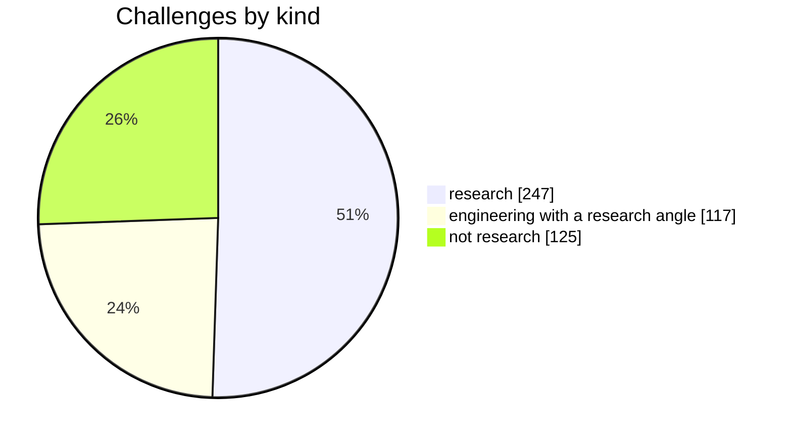
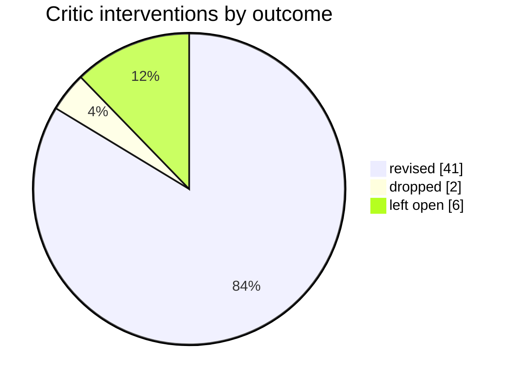

# What the run found — run 2026-10-31-full

Every number here is counted from this run's board; [challenges.md](challenges.md) has the line behind each one.

## What the companies asked for

The three analysts classified 489 of 489 challenges. 125 (26%) are not research problems, so Spona writes no proposal for them and gives the reason, for example C001-CH3: "Calculating financial risk exposure and pricing vulnerabilities in euros is a business and risk management task rather than a scientific re…" and C004-CH4: "Navigating regulatory licensing applications and legal representative procedures with a foreign financial authority is legal and administra…".

## What happened to each challenge

| outcome | challenges | |
|---|---:|---|
| proposal written | 4 | █ |
| a fit with checked evidence, not among the proposals | 20 | ██ |
| a close match, not profiled within this run's budget | 276 | ████████████████████████ |
| no close match at the university | 64 | ██████ |
| not a research problem | 125 | ███████████ |

"A close match, not profiled" means search found a researcher whose work covers enough of the challenge's terms, but the run's evidence budget (24 evidence cards) went to closer pairs first. A larger budget profiles more of them.

## Where the university has no close match yet

64 of the 364 research and engineering challenges have no researcher whose own work covers at least 40% of the challenge's terms. By the company's sector (the 15 of 27 sectors with the most):

| sector | challenges with no close match | |
|---|---:|---|
| Custom software and IT services for EU clients | 8 | ████████████████████████ |
| AI and data consultancies | 5 | ███████████████ |
| Energy, solar and grid services | 4 | ████████████ |
| Agri-tech (farm software, sensing, drones) | 4 | ████████████ |
| Logistics, transport and e-commerce | 4 | ████████████ |
| Tourism, sport and wellness tech | 4 | ████████████ |
| Robotics and industrial automation | 3 | █████████ |
| Medtech and digital health | 3 | █████████ |
| Biotech, diagnostics and lab services | 3 | █████████ |
| Marketing tech, media and creative studios | 3 | █████████ |
| Cybersecurity | 2 | ██████ |
| Food production and food tech | 2 | ██████ |
| Cleantech, recycling and water | 2 | ██████ |
| IoT and electronics hardware | 2 | ██████ |
| Game development | 2 | ██████ |

For EINSTEIN this is a list of company needs the university can't yet meet from its own published work: input for hiring, calls and partner universities. A missing match can also mean the right person's profile doesn't use the company's words, so each one is worth a human look.

## What the critic did

| stage and check | interventions | |
|---|---:|---|
| challenge, rule check | 10 | █████████ |
| evidence, model check | 13 | ████████████ |
| proposal, model check | 26 | ████████████████████████ |

Rule checks cost nothing and can't be argued with: an id that doesn't exist, a paper that isn't the person's, a quote that isn't verbatim. Model checks judge whether a source says what the claim says.
