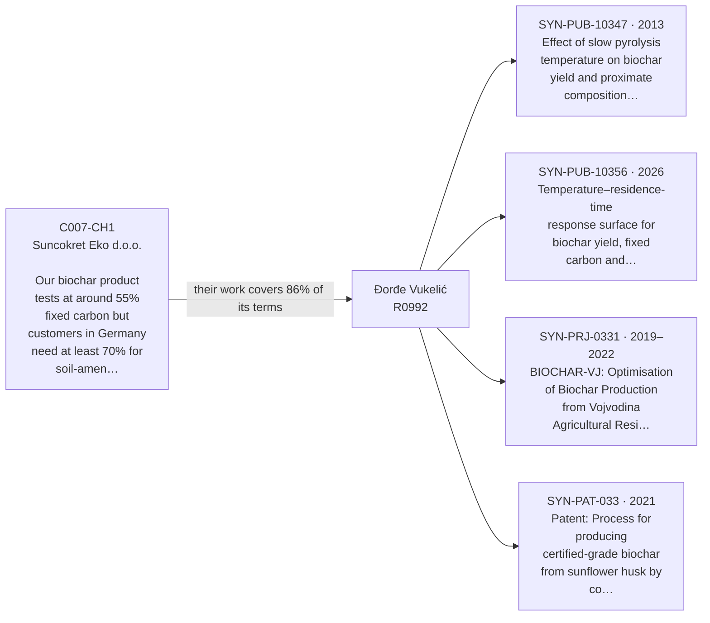
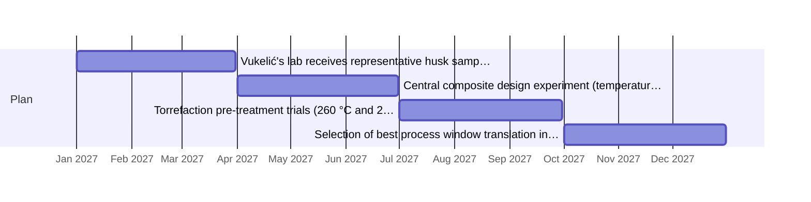
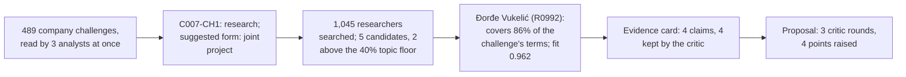

> **Spona proposal 1** · pair `C007-CH1~R0992` · fit 0.962 (topic 0.86: biochar, slow, pyrolysi, fixed, carbon, content, temperature, yield; open to this: "joint project applications (industry or EU funding)"; profiler: strong; evidence: 4 of 4 claims survived the critic)
> Draft by the Proposal Writer, reviewed by the Critic in 3 round(s). A starting point for a first meeting, not a commitment by either side.

## Reaching 70% Fixed Carbon in Sunflower-Husk Biochar Without Killing the Yield

**Company:** Suncokret Eko d.o.o., NTP Novi Sad **Faculty:** Faculty of Technology, University of Novi Sad, Department of Applied and Engineering Chemistry **Researcher:** Đorđe Vukelić (Ђорђе Вукелић), Associate Professor **Company contacts:** Dragan Ostojić (process lead), Milica Vranić (head of procurement)

### Why this pair, at a glance

### The problem

Suncokret Eko runs a batch slow-pyrolysis reactor at 500–520 °C and gets a mass yield of roughly 28% with fixed carbon around 55 wt%. German and Dutch buyers need at least 70% fixed carbon for soil-amendment certification. Pushing temperature to 650 °C hits the 70% threshold but drops yield below 20%, requiring about 40% more feedstock per tonne of certified biochar—enough to erase the price premium [C007-CH1]. Extending hold time at lower temperatures has given only modest fixed-carbon gains [C007-CH1]. The company has two years of batch logs (temperature profiles, feedstock moisture, particle size, output quality) and a reactor rated to 700 °C [C007, C007-CH1].

Vukelić's fixed-bed experiments with wheat straw showed that fixed carbon increases from 38 wt% at 300 °C to 72 wt% at 700 °C while yield falls to 24.7%, with BET surface area peaking at 600 °C before declining slightly at 700 °C [SYN-PUB-10347]. A central composite design he ran on corn stover identified conditions where a composite desirability function combining high fixed carbon (≥60 wt%) and high BET surface area was maximised while keeping yield above 28%—showing the yield–quality trade-off is not fixed and depends on the temperature–residence-time combination [SYN-PUB-10356]. He holds a granted patent for a sunflower-husk pyrolysis process that uses staged heating at 8–12 K min⁻¹ to 580–640 °C with an isothermal hold of 55–80 minutes controlled by thermocouple feedback [SYN-PAT-033]. That process addresses almost exactly Suncokret Eko's feedstock and quality target.

### Research questions

1. At what combinations of peak temperature (530–630 °C), heating rate (5–15 K min⁻¹), and isothermal hold time (30–90 min) does sunflower-husk biochar from Suncokret Eko's feedstock simultaneously reach ≥70 wt% fixed carbon and ≥25% mass yield?
2. Does a mild torrefaction pre-treatment (260–290 °C, 30 min) of the incoming husks shift the fixed-carbon–yield response surface enough to relax the peak-temperature requirement while staying above the 25% yield floor?
3. Can a process protocol derived from laboratory results be transferred to the company's batch reactor and reproduce the target quality within ±3 wt% fixed carbon across five consecutive production batches?

### Plan

| Period | Work | Deliverable |
|---|---|---|
| Jan–Mar 2027 | Vukelić's lab receives representative husk samples from Suncokret Eko's current feedstock contracts; TGA-DSC characterisation to determine decomposition kinetics; review of company's two-year batch logs to identify patterns | Kinetic parameters for current feedstock; annotated log analysis |
| Apr–Jun 2027 | Central composite design experiment (temperature 530–630 °C × hold time 30–90 min, fixed heating rate 10 K min⁻¹) on laboratory fixed-bed reactor; proximate and ultimate analysis of all samples; BET and FTIR on selected points | Response surface models for fixed carbon, volatile matter, and yield |
| Jul–Sep 2027 | Torrefaction pre-treatment trials (260 °C and 290 °C, 30 min) on same feedstock followed by pyrolysis at conditions identified in Q2; comparison against untreated baseline | Assessment of whether pre-treatment shifts optimum to a lower peak temperature |
| Oct–Dec 2027 | Selection of best process window; translation into operating instructions for Suncokret Eko's batch reactor; five validation batches run by Dragan Ostojić using the protocol, with Vukelić's team analysing outputs | Validated protocol; fixed-carbon and yield data from production-scale batches; joint technical report |

### What each side brings

**Suncokret Eko:** feedstock supply (sunflower husks from fourteen contracted farms) [C007]; two years of batch pyrolysis logs [C007-CH1]; batch reactor rated 400–700 °C with temperature logging [C007]; two technically trained staff to run production-scale validation trials [C007]; proximate analysis capability on site [C007].

**Vukelić / Faculty of Technology:** TGA-DSC, fixed-bed reactor, BET, FTIR, and Raman instrumentation [R0992]; prior response-surface work on corn stover pyrolysis [SYN-PUB-10356]; sunflower-husk pyrolysis patent covering the 580–640 °C staged-heating approach [SYN-PAT-033]; decision-support matrix from the Vojvodina biochar project covering over 200 characterised samples [SYN-PRJ-0331]; PYROLINK consortium partners across Italy, Germany, Hungary, and Serbia working on harmonised kinetic datasets and Raman-based certification screening [SYN-PRJ-0332]. Vukelić has limited availability for this project given his current ~0.8 FTE PYROLINK commitments and full teaching load [R0992]; experimental work will be carried out with a graduate student or research assistant under his supervision.

### Why this pair

The company's feedstock is sunflower husks—the exact material covered by Vukelić's patent [SYN-PAT-033]. His wheat-straw data already show that 72 wt% fixed carbon is reachable at 700 °C and that the yield–temperature curve is steep enough to make a well-chosen operating point matter [SYN-PUB-10347]. His corn-stover response-surface study confirms that temperature and residence time interact in ways that a simple one-variable temperature sweep misses [SYN-PUB-10356], which is precisely what Suncokret Eko has been doing without resolution [C007-CH1]. The torrefaction pre-treatment angle is supported by his published two-step torrefaction–pyrolysis work on sunflower husks [SYN-PUB-10354]. Suncokret Eko has a production reactor, feedstock under direct procurement control, and detailed process logs that give the project real industrial grounding from day one [C007, C007-CH1].

### Open questions for the first meeting

1. The patent process specifies pre-drying to below 10 wt% moisture [SYN-PAT-033]; what is the typical moisture range arriving at Suncokret Eko's gate, and is the rotary drum dryer able to hit that target consistently?
2. The company's batch logs cover temperature profiles and feedstock moisture—do they also record heating rate and hold time independently, or is the current reactor controlled only by a fixed end-temperature setpoint?
3. If torrefaction pre-treatment proves beneficial, is there space and budget in the current facility layout to add a torrefaction step, or should that route be treated as a longer-term option?

### Agreed up front (proposal)

**Publications:** Results may be published in peer-reviewed journals. Suncokret Eko reviews drafts 30 days before submission and may request a 6-month delay to allow patent filing; after that period publication proceeds regardless. **IP:** Any process protocol developed that goes beyond the scope of the existing patent [SYN-PAT-033] is jointly owned. Vukelić's pre-existing methods, data, and the patent itself remain his. The company may use the validated protocol commercially without royalty; any licensing to third parties requires written agreement from both sides.

---
### How Spona found this pair

### Evidence the critic checked
- ✅ Đorđe Vukelić produced wheat straw biochar in a laboratory fixed-bed tube furnace at final temperatures from 300 to 700 °C, observing that fixed carbon content increased from 38 to 72 wt% while biochar yield decreased from 39.2% to 24.7%. [SYN-PUB-10347]
- ✅ A central composite design applied to fixed-bed slow pyrolysis of corn stover mapped responses including biochar yield, fixed carbon content, and BET surface area across pyrolysis temperatures and residence times. [SYN-PUB-10356]
- ✅ The project led by Vukelić systematically mapped the pyrolysis parameter space—temperature, residence time, and feedstock type—for Vojvodina agricultural residues, producing over 200 characterised biochar samples and a decision-support matrix. [SYN-PRJ-0331]
- ✅ Vukelić holds a granted patent for a process to produce certified-grade biochar from sunflower husk by controlled slow pyrolysis with integrated temperature-residence-time feedback. [SYN-PAT-033]

### What the critic sent back
- round 0, model check: "Vukelić is available at approximately 0.2 FTE for this project given his current PYROLINK commitments" — Source R0992 states he is committed at roughly 0.8 FTE research capacity due to PYROLINK, leaving limited availability, but never states the residual availability is 0.2 FTE. Fix: Remove the 0.2 FTE figure or replace with 'limited availability given his current ~0.8 FTE PYROLINK commitments, as not… → **revised**
- round 0, model check: "PYROLINK network contacts in Germany who work on biochar certification screening" — SYN-PRJ-0332 names partners in Italy, Germany, Hungary, and Serbia but does not describe any of them as working on biochar certification screening; the certification screening protocol (Raman-based) is described as the Novi Sad team's own goal, not a German partner's focus. Fix: Remove the characte… → **revised**
- round 0, model check: "fixed carbon reaches 72 wt% at 700 °C, but yield falls to 24.7%; at 600 °C fixed carbon was already above 60 wt% with better yield retention" — SYN-PUB-10347 confirms 72 wt% fixed carbon at 700 °C and 24.7% yield, but does not explicitly state that fixed carbon at 600 °C was 'above 60 wt%'—the abstract only reports the endpoints (38 wt% at 300 °C, 72 wt% at 700 °C) without giving the 600 °C fixed-carbon value. Fix: Remove the specific clai… → **revised**
- round 1, model check: "PYROLINK network contacts across Italy, Germany, Hungary, and Serbia working on harmonised kinetic datasets and Raman-based certification screening" — SYN-PRJ-0332 describes partners covering feedstocks from those countries but does not describe them as 'contacts' Vukelić personally holds; the draft frames this as a personal network asset rather than a consortium partnership. Fix: Rephrase as 'PYROLINK consortium partners across Italy, Germany, H… → **revised**

### Sources cited
- **C007-CH1**: C007-CH1 (Suncokret Eko d.o.o.): Our biochar product tests at around 55% fixed carbon but customers in Germany need at least 70% for soil-amendment certification; we've tried raising pyrolysis temperature but that cuts …
- **C007**: C007 Suncokret Eko d.o.o. (Cleantech — biomass and organic waste valorisation; 31 people; founded 2017; Novi Sad). About: Suncokret Eko d.o.o. was founded in 2017 in Novi Sad by a small group of agricultural engineers a…
- **SYN-PUB-10347**: SYN-PUB-10347 (2013, journal, Biomass Conversion and Utilisation) "Effect of slow pyrolysis temperature on biochar yield and proximate composition from wheat straw". Authors: Đorđe Vukelić, Mirjana Stojković, Tamara Hor…
- **SYN-PUB-10356**: SYN-PUB-10356 (2026, journal, Industrial Crops and Products) "Temperature–residence-time response surface for biochar yield, fixed carbon and BET surface area: a central composite design study with corn stover". Authors…
- **SYN-PAT-033**: SYN-PAT-033 (2021, granted) "Process for producing certified-grade biochar from sunflower husk by controlled slow pyrolysis with integrated temperature–residence-time feedback". Inventors: Đorđe Vukelić. A process for p…
- **R0992**: R0992: Đorđe Vukelić, Associate Professor, Faculty of Technology, Department of Applied and Engineering Chemistry Fields: Chemical and Process Engineering; Biomass and Bioenergy; Materials Characterisation; Agricultural…
- **SYN-PRJ-0331**: SYN-PRJ-0331 (2019–2022, Provincial Secretariat for Higher Education and Scientific Research) "Optimisation of Biochar Production from Vojvodina Agricultural Residues for Soil Amendment and Carbon Sequestration". Partic…
- **SYN-PRJ-0332**: SYN-PRJ-0332 (2023–2027, Horizon Europe) "Linking Thermochemical Conversion Kinetics to Biochar Functional Properties Across European Lignocellulosic Feedstocks". Participants: R0992 Đorđe Vukelić (work package leader).…
- **SYN-PUB-10354**: SYN-PUB-10354 (2023, journal, Bioresource Technology) "Torrefaction pre-treatment of sunflower husks: mass and energy yields, grindability and subsequent pyrolysis kinetics". Authors: Ivana Rađenović, Đorđe Vukelić, Pét…
