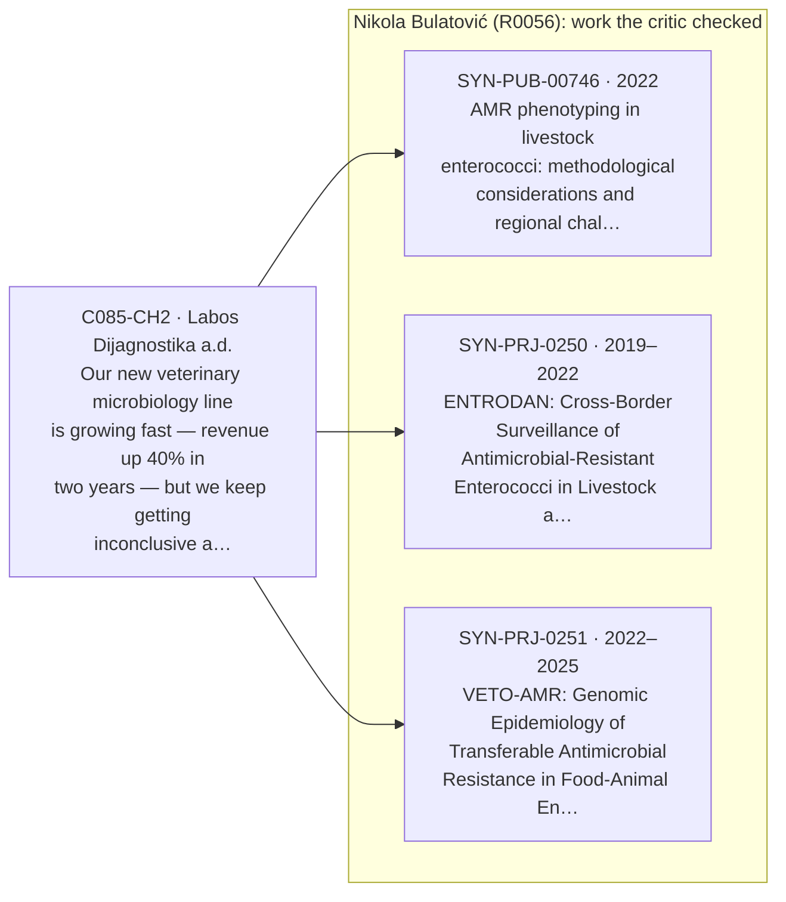
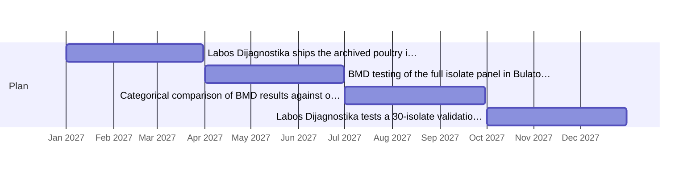
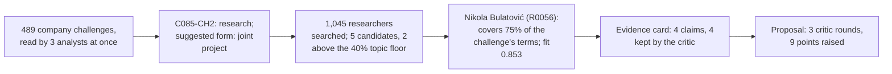

> **Spona proposal 2** · pair `C085-CH2~R0056` · fit 0.853 (topic 0.75: antimicrobial, enterococcu, strain, eucast, minimum, inhibitory, concentration, resistance; open to this: "Joint project applications in livestock AMR surveillance"; profiler: strong; evidence: 4 of 4 claims survived the critic)
> Draft by the Proposal Writer, reviewed by the Critic in 3 round(s). A starting point for a first meeting, not a commitment by either side.

## Resolving inconclusive antimicrobial susceptibility results for poultry Enterococcus isolates at Labos Dijagnostika

**Company:** Labos Dijagnostika a.d., Subotica [C085] 
**Faculty:** Faculty of Agriculture, University of Novi Sad, Department of Veterinary Medicine 
**Company contact:** Dragana Molnar, senior microbiologist [C085] 
**Academic lead:** Nikola Bulatović (Никола Булатовић), Associate Professor [R0056] 
**Suggested duration:** 12 months, January–December 2027

---

### Why this pair, at a glance

### The problem

Labos Dijagnostika's veterinary microbiology line has grown 40% in revenue over two years, driven mainly by poultry farms in the Subotica and Senta areas [C085-CH2]. Enterococcus strains from those farms repeatedly return inconclusive or borderline susceptibility results on the company's card-based automated system. The company suspects this is because the breakpoints currently applied come from human clinical guidelines rather than veterinary-specific references, but no one on staff has practical experience with EUCAST veterinary breakpoint tables or epidemiological cut-off values (ECOFFs) for livestock isolates [C085-CH2]. Labos Dijagnostika holds archived poultry Enterococcus isolates going back 18 months that have not been systematically re-tested [C085-CH2].

Bulatović's group applies EUCAST clinical breakpoints and ECOFFs to field isolates of Enterococcus faecalis and Enterococcus faecium from swine, poultry, and cattle in Vojvodina [R0056]. A 2022 book chapter co-authored by Bulatović addresses exactly the interpretive gap Labos Dijagnostika faces: the limited availability of veterinary-specific breakpoints and the methodological pitfalls of applying clinical criteria to food-animal isolates [SYN-PUB-00746]. His 2015 study demonstrated BMD as the reference method for resolving disk diffusion errors for a specific drug–pathogen combination (nitrofurantoin/Enterococcus), where disk diffusion produced very-major error rates above 10% [SYN-PUB-00740].

---

### Research questions

1. For which antimicrobial agents does the card-based system at Labos Dijagnostika produce categorical disagreement of more than 10% relative to BMD reference results, when tested on the archived poultry Enterococcus isolates?
2. Which EUCAST ECOFFs or veterinary-specific breakpoints, substituted for the current human clinical breakpoints, reduce the proportion of inconclusive calls to below 5% for those agents?
3. Do the archived isolates carry resistance genes (e.g. tet(M), erm(B), vancomycin-resistance determinants) that predict phenotypic MIC distributions deviating from the patterns observed in the VETO-AMR genomic dataset for Vojvodina livestock Enterococcus [SYN-PRJ-0251]?

---

### Plan

| Period | Activity | Deliverable |
|---|---|---|
| Jan–Mar 2027 | Labos Dijagnostika ships the archived poultry isolates (up to 18 months of stock) to Bulatović's lab; joint selection of a representative panel of ≥150 isolates by species (E. faecalis / E. faecium) and farm origin; agree the BMD panel (antimicrobial agents and concentration ranges) | Signed material transfer agreement; finalised BMD panel list |
| Apr–Jun 2027 | BMD testing of the full isolate panel in Bulatović's lab using cation-adjusted Mueller–Hinton broth with lysed horse blood, EUCAST quality control strains, and the agreed concentration ranges; PCR or targeted sequencing for key resistance genes | BMD MIC dataset; resistance gene screening results |
| Jul–Sep 2027 | Categorical comparison of BMD results against original card-based results from Labos Dijagnostika's LIMS; identification of agents with very-major or major error rates above 10%; draft revised interpretive criteria using EUCAST ECOFFs | Comparative error-rate table; draft breakpoint recommendations |
| Oct–Dec 2027 | Labos Dijagnostika tests a 30-isolate validation set using the revised interpretive criteria on its card system, with Molnar and Bulatović reviewing results; Bulatović drafts a standard operating procedure (SOP) for Enterococcus AST interpretation in the veterinary section; final report prepared | Validated SOP; final project report; draft manuscript for submission |

---

### What each side brings

**Labos Dijagnostika** provides the archived poultry Enterococcus isolates and their original card-based susceptibility records, access to the Deltasoft LabCenter LIMS for export of historical results [C085], staff time from Dragana Molnar and up to two laboratory specialists for the validation phase [C085], and knowledge of the operational constraints of a high-throughput diagnostic setting.

**Bulatović's group** provides BMD reference testing capacity, EUCAST quality control protocols, and access to genomic and resistance gene data from the VETO-AMR project covering swine, cattle, and poultry isolates from Vojvodina [SYN-PRJ-0251], as well as the joint resistance database generated through the ENTRODAN cross-border surveillance work [SYN-PRJ-0250]. Bulatović led the work package responsible for harmonising broth microdilution panels and EUCAST ECOFF application across partner laboratories [SYN-PRJ-0250] and has co-authored work on the methodological challenges of applying clinical breakpoints to food-animal Enterococcus [SYN-PUB-00746].

---

### Why this pair

The specific gap at Labos Dijagnostika — card-system results interpreted against human clinical breakpoints for poultry enterococci — maps directly onto Bulatović's documented expertise. He has applied EUCAST ECOFFs to E. faecalis and E. faecium from livestock in Vojvodina [R0056], co-authored a methodological reference on breakpoint interpretation for food-animal isolates [SYN-PUB-00746], demonstrated BMD as the reference method for resolving disk diffusion errors for a specific drug–pathogen combination (nitrofurantoin/Enterococcus) where very-major error rates exceeded 10% [SYN-PUB-00740], and led the work package responsible for harmonising broth microdilution panels and EUCAST application across partner laboratories [SYN-PRJ-0250]. The VETO-AMR project, which runs through 2025, includes poultry farms and generates whole-genome sequencing data on livestock Enterococcus that will provide a genomic comparison baseline for interpreting resistance gene findings [SYN-PRJ-0251]. Both parties are based in Vojvodina, which simplifies isolate transfer and site visits. Bulatović has stated a preference for clearly scoped collaborations with defined deliverables, which matches the structured nature of this project [R0056].

---

### Open questions for the first meeting

1. How many of the archived isolates have species-level identification (E. faecalis vs. E. faecium) already confirmed, and what antimicrobial agents were included in the original card panel? This determines whether re-identification is needed before BMD testing.
2. Which antimicrobial agents matter most to the poultry farm clients — for example, is ampicillin, tetracycline, or a specific aminoglycoside causing the most operational problems — so the BMD panel can be prioritised accordingly?
3. Does Labos Dijagnostika's ISO 15189 scope currently cover BMD as a method, or would adding it require an accreditation extension that could affect how the validated SOP is deployed?

---

### Agreed up front (proposed)

**Publications:** Both parties are listed as co-authors on any manuscript arising from the project. Labos Dijagnostika reviews the manuscript before submission and may request a 60-day delay if commercially sensitive data are involved.

**IP:** The revised interpretive criteria and SOP are jointly owned. Labos Dijagnostika may implement them in its diagnostic operations without restriction. Bulatović's group may use the anonymised MIC dataset for academic publication and for comparison with the VETO-AMR genomic dataset [SYN-PRJ-0251], with Labos Dijagnostika's agreement on the anonymisation approach.

---
### How Spona found this pair

### Evidence the critic checked
- ✅ Nikola Bulatović has research experience focusing on antimicrobial resistance phenotyping and genotyping in livestock-associated Enterococcus faecalis and Enterococcus faecium, applying EUCAST clinical breakpoints and epidemiological cut-off values. [R0056]
- ✅ A book chapter co-authored by Bulatović discusses practical and interpretive challenges in applying EUCAST clinical breakpoints and epidemiological cut-off values to Enterococcus spp. isolated from food-producing animals, including broth microdilution methods and the limited availability of veterinary-specific breakpoints. [SYN-PUB-00746]
- ✅ Bulatović led a cross-border surveillance project work package responsible for microbiological methods harmonisation, ensuring partner laboratories used identical broth microdilution panels and applied EUCAST ECOFF values consistently. [SYN-PRJ-0250]
- ✅ Bulatović serves as principal investigator on a national research project addressing the genomic epidemiology of transferable antimicrobial resistance in food-animal Enterococcus spp. in Serbia. [SYN-PRJ-0251]

### What the critic sent back
- round 0, model check: "His 2015 study established that broth microdilution (BMD) should be the primary method for certain drug–pathogen combinations where automated card systems prod…" — The 2015 study (SYN-PUB-00740) compared disk diffusion vs. BMD, not automated card systems vs. BMD. It recommended BMD over disk diffusion for nitrofurantoin; it says nothing about card-based automated systems. Fix: Change to: 'His 2015 study established that BMD should be the primary method for ce… → **revised**
- round 0, model check: "led interlaboratory harmonisation of broth microdilution panels and EUCAST application across international partners [SYN-PRJ-0250]" — SYN-PRJ-0250 describes Bulatović as work package leader for methods harmonisation, not as overall project lead. 'Led interlaboratory harmonisation' overstates his role relative to source. Fix: Change to 'led the methods harmonisation work package' or 'led the work package responsible for harmonisin… → **revised**
- round 0, model check: "access to MIC distribution data from poultry isolates collected under the VETO-AMR project [SYN-PRJ-0251] and the ENTRODAN cross-border surveillance work [SYN-…" — SYN-PRJ-0250 (ENTRODAN) describes collection of environmental and animal samples and a joint resistance database, but does not specifically mention MIC distribution data as an output. SYN-PRJ-0251 (VETO-AMR) focuses on genomic/WGS data, not MIC distributions specifically. Fix: Remove the specific c… → **revised**
- round 0, model check: "swine-derived reference ranges established in the VETO-AMR dataset" — VETO-AMR (SYN-PRJ-0251) covers swine, cattle, and poultry and is primarily a WGS/genomic dataset. The source does not describe it as producing 'swine-derived reference ranges' or MIC reference ranges at all. Fix: Remove 'swine-derived' and do not characterise VETO-AMR as providing MIC reference ran… → **revised**
- round 1, model check: "His 2015 study established that BMD should be the primary method for certain drug–pathogen combinations where disk diffusion produces high very-major error rat…" — The source (SYN-PUB-00740) identifies only one specific drug–pathogen combination (nitrofurantoin/Enterococcus) with very major error rates exceeding 10%, not 'certain drug–pathogen combinations' (plural). Fix: Narrow to 'the nitrofurantoin–Enterococcus combination where disk diffusion produced ver… → **revised**
- round 1, model check: "His 2022 book chapter addresses exactly the interpretive gap Labos Dijagnostika faces: the limited availability of veterinary-specific breakpoints and the meth…" — The chapter (SYN-PUB-00746) discusses these issues but Bulatović is the third-listed author, not the lead; calling it 'his' chapter overstates his role. Fix: Refer to it as 'a 2022 book chapter co-authored by Bulatović'. → **revised**
- round 1, model check: "demonstrated BMD as the reference method for resolving disk diffusion errors for specific drug–pathogen combinations" — Same as above — the source shows only one combination (nitrofurantoin), not plural 'combinations'. Fix: Change to 'a specific drug–pathogen combination (nitrofurantoin/Enterococcus)'. → **revised**
- round 2, model check: "His 2015 study demonstrated BMD as the reference method for resolving disk diffusion errors for a specific drug–pathogen combination (nitrofurantoin/Enterococc…" — The 2015 study (SYN-PUB-00740) was conducted on cattle isolates, not a generic Enterococcus study. The draft omits this specificity, implying broader applicability than the source states. Fix: Specify that the study used cattle Enterococcus isolates: 'his 2015 study on cattle Enterococcus isolates … → **left open**
- round 2, model check: "Bulatović led the work package responsible for harmonising broth microdilution panels and EUCAST ECOFF application across partner laboratories [SYN-PRJ-0250]" — SYN-PRJ-0250 says Bulatović led the work package for 'microbiological methods harmonisation', not specifically 'harmonising broth microdilution panels and EUCAST ECOFF application'. The draft adds specificity not stated in the source. Fix: Use the source's language: 'led the work package responsibl… → **left open**

### Critic's notes still open
- "His 2015 study demonstrated BMD as the reference method for resolving disk diffusion errors for a specific drug–pathogen combination (nitrofurantoin/Enterococcus), where disk diffusion produced very-major error rates above 10%": The 2015 study (SYN-PUB-00740) was conducted on cattle isolates, not a generic Enterococcus study. The draft omits this specificity, implying broader applicability than the source states. Fix: Specify that the study used cattle Enterococcus isolates: 'his 2015 study on cattle Enterococcus isolates demonstrated BMD as the reference method…'
- "Bulatović led the work package responsible for harmonising broth microdilution panels and EUCAST ECOFF application across partner laboratories [SYN-PRJ-0250]": SYN-PRJ-0250 says Bulatović led the work package for 'microbiological methods harmonisation', not specifically 'harmonising broth microdilution panels and EUCAST ECOFF application'. The draft adds specificity not stated in the source. Fix: Use the source's language: 'led the work package responsible for microbiological methods harmonisation, ensuring identical broth microdilution panels and consistent EUCAST ECOFF application'.

### Sources cited
- **C085**: C085 Labos Dijagnostika a.d. (Biotech, diagnostics and lab services; 187 people; founded 1983; Subotica). About: Labos Dijagnostika a.d. has been operating in Subotica since 1983, making us one of the oldest independent…
- **R0056**: R0056: Nikola Bulatović, Associate Professor, Faculty of Agriculture, Department of Veterinary Medicine Fields: Veterinary microbiology; Antimicrobial resistance; Molecular epidemiology; Livestock health Keywords: Enter…
- **C085-CH2**: C085-CH2 (Labos Dijagnostika a.d.): Our new veterinary microbiology line is growing fast — revenue up 40% in two years — but we keep getting inconclusive antimicrobial susceptibility results for Enterococcus strains com…
- **SYN-PUB-00746**: SYN-PUB-00746 (2022, book chapter, Handbook of Veterinary Antimicrobial Resistance Diagnostics (edited volume, published by Agromed Press, Novi Sad)) "AMR phenotyping in livestock enterococci: methodological considerati…
- **SYN-PUB-00740**: SYN-PUB-00740 (2015, journal, Acta Veterinaria Balkanica) "Comparison of disk diffusion and broth microdilution for susceptibility testing of Enterococcus spp. from cattle: agreement with EUCAST interpretive criteria". …
- **SYN-PRJ-0251**: SYN-PRJ-0251 (2022–2025, Science Fund of the Republic of Serbia (PROMIS, IDEAS, Prizma)) "Genomic Epidemiology of Transferable Antimicrobial Resistance in Food-Animal Enterococcus spp. in Serbia". Participants: R0056 Ni…
- **SYN-PRJ-0250**: SYN-PRJ-0250 (2019–2022, Interreg IPA Hungary–Serbia) "Cross-Border Surveillance of Antimicrobial-Resistant Enterococci in Livestock and the Environment Across the Danube Region". Participants: R0056 Nikola Bulatović (w…
