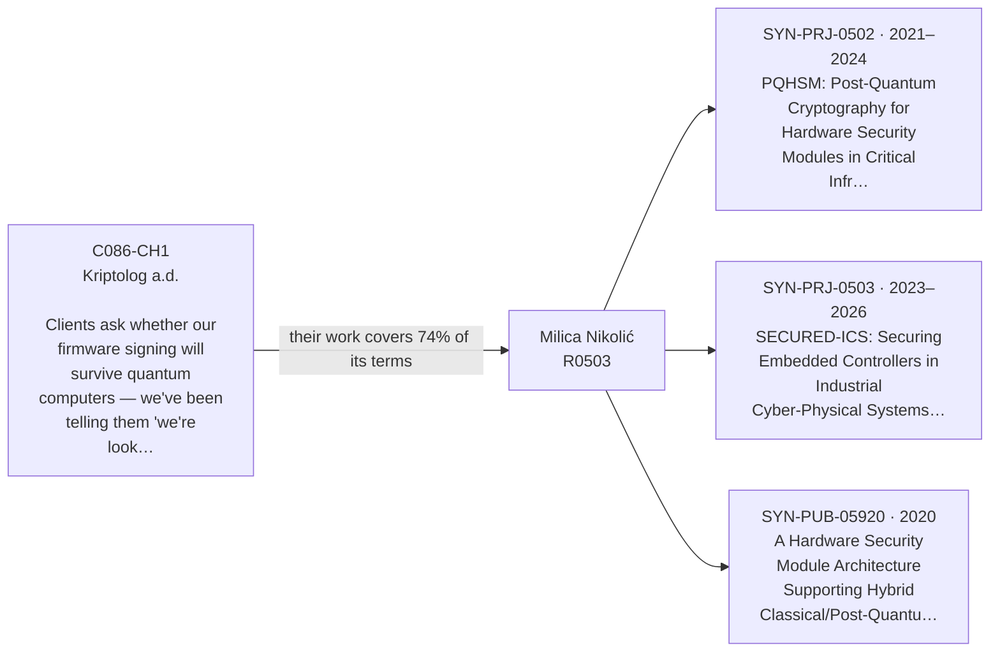
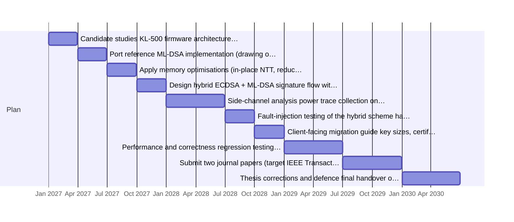
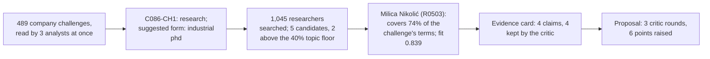

> **Spona proposal 3** · pair `C086-CH1~R0503` · fit 0.839 (topic 0.74: post, quantum, hsm, implementation, microcontroller, hybrid, classical, hardware; open to this: "industrial PhD supervision for candidates employed at NTP Novi Sad member companies"; profiler: strong; evidence: 4 of 4 claims survived the critic)
> Draft by the Proposal Writer, reviewed by the Critic in 3 round(s). A starting point for a first meeting, not a commitment by either side.

## ML-DSA and Hybrid Signature Integration for the KL-HSM Firmware on ARM Cortex-M7

**Company:** Kriptolog a.d., Novi Sad [C086] 
**Faculty:** Faculty of Technical Sciences, University of Novi Sad, Department of Computing and Control Engineering 
**Academic supervisor:** Milica Nikolić (Милица Николић), Full Professor [R0503] 
**Industrial supervisor:** the company's lead cryptographic firmware engineer, to be named 
**PhD candidate:** to be recruited from Kriptolog's engineering team or as a new hire through the NTP Novi Sad industrial PhD scheme

---

### Why this pair, at a glance

### The problem

Kriptolog's KL-HSM product line — specifically the KL-300 and KL-500 series — uses RSA and ECDSA for all firmware signing operations [C086]. The firmware runs on an ARM Cortex-M7 microcontroller with constrained flash and RAM [C086-P2]. Two national-level agencies and a payment network operator have formally asked, in writing, whether these signing operations will remain secure against quantum-capable adversaries [C086-CH1]. Kriptolog has had one engineer studying the NIST post-quantum standardisation documents and doing prototype work with ML-DSA, but the firmware architecture has not been changed to handle the larger key material and different signature flows that ML-DSA requires [C086-CH1]. A straight drop-in replacement is not possible on the current microcontroller [C086-CH1]. Without a tested, documented migration path, Kriptolog cannot give a credible answer to clients who are planning five- to ten-year infrastructure cycles [C086-CH1], and its planned post-quantum-ready firmware branch remains blocked [C086].

Nikolić's research group focuses precisely on implementing and benchmarking post-quantum cryptographic primitives — particularly lattice-based schemes — on microcontrollers and dedicated hardware security modules with tight memory and power budgets [R0503]. She served as principal investigator on a Science Fund project investigating performance and security constraints of deploying post-quantum algorithms on hardware security modules in Serbian critical infrastructure [SYN-PRJ-0502], and she leads Work Package 3 of SECURED-ICS, a Horizon Europe project covering hardware-level implementation and benchmarking of NIST-standardised post-quantum schemes on programmable logic controllers and remote terminal units [SYN-PRJ-0503]. She has co-authored work on a hybrid classical/post-quantum HSM architecture using an Infineon SLE97 secure microcontroller paired with an FPGA for Kyber-768 key encapsulation [SYN-PUB-05920], and has surveyed implementation strategies for post-quantum algorithms on devices with under 64 kB RAM and under 256 kB flash [SYN-PUB-05918].

---

### Research questions

1. What memory layout and arithmetic optimisations allow ML-DSA (FIPS 204) signing and verification to run within the KL-500's Cortex-M7 flash and RAM budget while meeting Kriptolog's latency targets for PKCS#11 sign operations — and how do those figures compare to the same operations measured with the PQBench-Embed methodology across its four targets (Cortex-M0+, Cortex-M4, RISC-V RV32IMC, and ESP32) [SYN-PUB-05923]?

2. What hybrid signature scheme — combining ECDSA with ML-DSA in a single PKCS#11 transaction — minimises the backward-compatibility disruption for existing clients while satisfying the security claims needed for Common Criteria EAL4+ documentation [C086], and can the design be validated against the test-vector and timing datasets produced in SYN-PRJ-0503?

3. Which side-channel countermeasures (masking, shuffling, constant-time modular reduction) are necessary and sufficient for ML-DSA on the KL-500 hardware at the threat level assumed in a Common Criteria EAL4+ evaluation, and what is the measurable cost of each countermeasure in cycles and stack bytes?

---

### Plan

| Period | Activity | Deliverable |
|---|---|---|
| Q1 2027 | Candidate studies KL-500 firmware architecture; Nikolić's lab and Kriptolog jointly define memory budget, latency targets, and PKCS#11 interface constraints; select two or three candidate ML-DSA parameter sets for evaluation | Written requirements document signed off by both supervisors |
| Q2 2027 | Port reference ML-DSA implementation (drawing on the open-source libraries from SYN-PRJ-0502) to Cortex-M7 bare-metal; profile stack usage, flash footprint, and signing latency using PQBench-Embed harness [SYN-PUB-05923]; identify bottlenecks | Benchmark report with raw numbers for each parameter set |
| Q3 2027 | Apply memory optimisations (in-place NTT, reduced-width polynomial arithmetic, stack-reuse across subroutines); re-benchmark; compare against Q2 baseline | Optimised C implementation committed to project repository; updated benchmark table |
| Q4 2027 | Design hybrid ECDSA + ML-DSA signature flow within PKCS#11 command set; implement prototype; test against Kriptolog's existing client-side software | Prototype hybrid signing firmware running on KL-500 evaluation board; test report |
| Q1–Q2 2028 | Side-channel analysis: power trace collection on KL-500 hardware; assess leakage in polynomial arithmetic; implement and measure cost of countermeasures identified in research question 3 | Side-channel evaluation report; hardened implementation |
| Q3 2028 | Fault-injection testing of the hybrid scheme; harden where needed; produce cryptographic design rationale document in the format required for Common Criteria evidence | CC-ready design rationale document; fault-injection test report |
| Q4 2028 | Client-facing migration guide: key sizes, certificate profile changes, hybrid operation period, rollback procedure; internal firmware integration into KL-500 release branch | Draft migration guide reviewed by Kriptolog's two agency clients; firmware branch merged |
| Q1–Q2 2029 | Performance and correctness regression testing using the toolchain-aware harness approach from EMBIVAL [SYN-PRJ-0353]; write up PhD thesis chapters 1–3 | Regression test suite; draft chapters |
| Q3–Q4 2029 | Submit two journal papers (target: IEEE Transactions on Information Forensics and Security; ACM Transactions on Embedded Computing Systems); complete thesis; internal review | Submitted manuscripts; full thesis draft |
| Q1–Q2 2030 | Thesis corrections and defence; final handover of firmware and documentation to Kriptolog | Defended PhD thesis; production-ready post-quantum firmware branch |

---

### What each side brings

**Kriptolog a.d.** provides: the KL-500 evaluation hardware and its firmware source code; access to the PKCS#11 test suite and client-side software used in production; the engineer who has already done prototype ML-DSA work [C086-CH1], who is the natural candidate or first collaborator; Common Criteria evaluation methodology expertise [C086]; and the company's relationship with two national agencies and a payment network operator, which creates a realistic validation context for the migration guide.

**Milica Nikolić and her lab** provide: the open-source libraries and benchmarking dataset from SYN-PRJ-0502 [SYN-PRJ-0502]; the PQBench-Embed suite and its baseline data covering Cortex-M0+, Cortex-M4, RISC-V RV32IMC, and ESP32, which will serve as cross-architecture reference points [SYN-PUB-05923]; the hybrid HSM architecture design experience from SYN-PUB-05920 [SYN-PUB-05920]; side-channel and fault-injection evaluation infrastructure developed over the SECURED-ICS project [SYN-PRJ-0503]; and supervision capacity for a fifth industrial PhD from late 2025 onward [R0503].

Kriptolog should supply at least two KL-500 evaluation boards to the university lab. Nikolić's lab has limited availability of Infineon SLE97 kits (two units) [R0503]; the Cortex-M7 boards from Kriptolog would fill that gap directly.

---

### Why this pair

Nikolić's group has been working the exact problem Kriptolog faces — post-quantum algorithms on memory-constrained HSM hardware — from the academic side for several years. She led a national project on deploying post-quantum algorithms on HSMs used in critical infrastructure [SYN-PRJ-0502] and currently leads the hardware implementation work package in a Horizon Europe project targeting the same hardware class [SYN-PRJ-0503]. The hybrid HSM architecture she co-authored combines a secure microcontroller (Infineon SLE97) with FPGA acceleration for post-quantum operations and achieved 38 ms end-to-end hybrid key exchange for a Kyber-768 KEM scheme [SYN-PUB-05920] — an analogous, though not identical, engineering problem to the signing integration Kriptolog needs. Her survey of PQC on constrained devices [SYN-PUB-05918] covers the sub-64 kB RAM, sub-256 kB flash regime that maps onto the KL-HSM constraints. Kriptolog brings the production hardware, the client validation context, and the Common Criteria documentation requirement that will make the PhD output immediately usable rather than a proof of concept.

---

### Open questions for the first meeting

1. What are the exact flash and RAM figures available for the cryptographic stack on the KL-500 Cortex-M7, and what is the maximum acceptable latency for a PKCS#11 C_Sign call in the clients' integration environments?

2. Do the two agency clients and the payment network operator have a deadline — contractual or regulatory — by which a post-quantum migration plan must be submitted, and does that deadline constrain the PhD timeline or require an interim technical report before the full work is complete?

3. PQBench-Embed covers four targets — Cortex-M0+, Cortex-M4, RISC-V RV32IMC, and ESP32 [SYN-PUB-05923]; how much of that data can be reused as baselines for the Cortex-M7, and will Kriptolog make the KL-500 board available to the lab within the first quarter so joint benchmarking can begin in Q2 2027?

---

### Agreed up front (publication and IP, as a proposal)

**IP:** Optimised firmware code written by the candidate and integrated into the KL-500 release branch is Kriptolog's proprietary work product. Algorithmic methods, benchmarking data, and side-channel evaluation results that do not disclose firmware implementation details or product-specific constants may be published freely.

**Publication:** The candidate and Nikolić may publish journal and conference papers based on the benchmarking, optimisation, and side-channel work. Kriptolog reviews manuscripts within 30 days and may request redaction of specific implementation details that would compromise Common Criteria evaluation confidentiality or client security. Neither party may unreasonably withhold consent to publish after redaction.

**Thesis:** The PhD thesis may describe all technical work. Kriptolog may designate specific appendices (e.g., firmware memory maps, client interface specifications) as confidential, to be held by the university under standard restricted-access rules for a period of three years after defence.

---
### How Spona found this pair

### Evidence the critic checked
- ✅ Milica Nikolić leads research on implementing and benchmarking post-quantum cryptographic primitives on microcontrollers, smart cards, and dedicated hardware security modules. [R0503]
- ✅ The researcher has investigated performance and security constraints of deploying post-quantum cryptographic algorithms on hardware security modules as principal investigator on a Science Fund project. [SYN-PRJ-0502]
- ✅ She leads Work Package 3 of a Horizon Europe project covering hardware-level implementation and benchmarking of NIST-standardised post-quantum schemes on programmable logic controllers and remote terminal units. [SYN-PRJ-0503]
- ✅ Co-authored work on a hardware security module architecture combining a secure microcontroller with an FPGA for hybrid key exchange, demonstrating efficient cryptographic operations on constrained hardware. [SYN-PUB-05920]

### What the critic sent back
- round 0, model check: "the PQBench-Embed suite and its Cortex-M4 and Cortex-M0+ baseline data" — SYN-PUB-05923 specifies four targets: Cortex-M0+, Cortex-M4, RISC-V RV32IMC, and ESP32. The draft omits RISC-V and ESP32, implying only two targets. Fix: List all four targets or say 'including Cortex-M4 and Cortex-M0+ baselines'. → **revised**
- round 0, model check: "Nikolić's lab benchmarks cover Cortex-M0+ and Cortex-M4 targets [SYN-PUB-05923]" — Same issue: PQBench-Embed covers four targets, not just two. Fix: State all four targets covered by PQBench-Embed. → **revised**
- round 1, model check: "the open-source post-quantum library and benchmarking dataset from SYN-PRJ-0502" — SYN-PRJ-0502 mentions 'two software libraries released under an open-source licence' and 'an open benchmarking dataset' but does not specifically describe a single 'post-quantum library'; calling it 'the open-source post-quantum library' (singular, definite) adds specificity not in the source. Fix:… → **revised**
- round 1, model check: "achieved 38 ms end-to-end hybrid key exchange [SYN-PUB-05920] — a directly comparable engineering problem to what Kriptolog needs for signing" — The 38 ms figure is supported, but the source covers key exchange (Kyber-768 KEM), not signing. Calling it 'directly comparable' to signing overstates the relevance. Fix: Note that the work covers hybrid key exchange, not signing, and is an analogous (not directly comparable) engineering problem. → **revised**
- round 2, model check: "the open-source libraries and benchmarking dataset from SYN-PRJ-0502" — SYN-PRJ-0502 outputs include an open benchmarking dataset and two software libraries, but the source does not describe them as having been used for ML-DSA or as directly portable to Cortex-M7. The claim that these are what the lab 'provides' to this project is a plan, not a fact — acceptable. Howev… → **left open**
- round 2, model check: "side-channel and fault-injection evaluation infrastructure developed over the SECURED-ICS project" — SYN-PRJ-0503 does not mention side-channel or fault-injection evaluation infrastructure. Side-channel and fault-injection work is mentioned in SYN-PRJ-0502, not SYN-PRJ-0503. Fix: Attribute side-channel and fault-injection infrastructure to SYN-PRJ-0502, not SYN-PRJ-0503. → **left open**

### Critic's notes still open
- "the open-source libraries and benchmarking dataset from SYN-PRJ-0502": SYN-PRJ-0502 outputs include an open benchmarking dataset and two software libraries, but the source does not describe them as having been used for ML-DSA or as directly portable to Cortex-M7. The claim that these are what the lab 'provides' to this project is a plan, not a fact — acceptable. However the draft also says 'drawing on the open-source libraries from SYN-PRJ-0502' in the plan table as if those libraries contain ML-DSA implementations; the source only says two software libraries were released, not that they cover ML-DSA. Fix: Do not specify that the SYN-PRJ-0502 libraries contain ML-DSA implementations; just refer to them as the project's open-source cryptographic libraries.
- "side-channel and fault-injection evaluation infrastructure developed over the SECURED-ICS project": SYN-PRJ-0503 does not mention side-channel or fault-injection evaluation infrastructure. Side-channel and fault-injection work is mentioned in SYN-PRJ-0502, not SYN-PRJ-0503. Fix: Attribute side-channel and fault-injection infrastructure to SYN-PRJ-0502, not SYN-PRJ-0503.

### Sources cited
- **C086**: C086 Kriptolog a.d. (Cybersecurity; 140 people; founded 1997; Novi Sad). About: Kriptolog a.d. has been building security infrastructure since 1997, when a small team of network engineers in Novi Sad started integrating…
- **R0503**: R0503: Milica Nikolić, Full Professor, Faculty of Technical Sciences, Department of Computing and Control Engineering Fields: Cryptography and Information Security; Embedded Systems and Hardware Engineering; Computer En…
- **C086-P2**: C086-P2 (job, 2024-02-12) "Cryptographic Engineer — HSM Firmware (KL-500 Post-Quantum Project)": We are looking for an engineer to join the team working on the KL-500 firmware. The immediate priority is evaluating and i…
- **C086-CH1**: C086-CH1 (Kriptolog a.d.): Clients ask whether our firmware signing will survive quantum computers — we've been telling them 'we're looking at it' for eighteen months and that answer is wearing thin; we need a concrete …
- **SYN-PRJ-0502**: SYN-PRJ-0502 (2021–2024, Science Fund of the Republic of Serbia (PROMIS, IDEAS, Prizma)) "Post-Quantum Cryptography for Hardware Security Modules in Critical Infrastructure". Participants: R0503 Milica Nikolić (principa…
- **SYN-PRJ-0503**: SYN-PRJ-0503 (2023–2026, Horizon Europe) "Securing Embedded Controllers in Industrial Cyber-Physical Systems Against Quantum-Capable Adversaries". Participants: R0503 Milica Nikolić (work package leader), R0641 Branisla…
- **SYN-PUB-05920**: SYN-PUB-05920 (2020, journal, IEEE Transactions on Industrial Informatics – Special Section on Industrial Cyber-Physical Security) "A Hardware Security Module Architecture Supporting Hybrid Classical/Post-Quantum Key Ex…
- **SYN-PUB-05918**: SYN-PUB-05918 (2018, book chapter, Advances in Applied Cryptography for Embedded Systems (Springer-Verlag)) "Post-Quantum Cryptography on Constrained Devices: Implementation Strategies and Open Challenges". Authors: Mar…
- **SYN-PUB-05923**: SYN-PUB-05923 (2023, journal, ACM Transactions on Embedded Computing Systems) "Towards a Standardised Benchmarking Suite for Post-Quantum Cryptography on Embedded Targets". Authors: Nikola Đorđević, Thibault Marin, Bran…
- **SYN-PRJ-0353**: SYN-PRJ-0353 (2023–2025, Provincial Secretariat for Higher Education and Scientific Research) "Toolchain-Aware Validation Methods for Safety-Critical Embedded Firmware". Participants: R0148 Rastko Zorić (principal inves…
