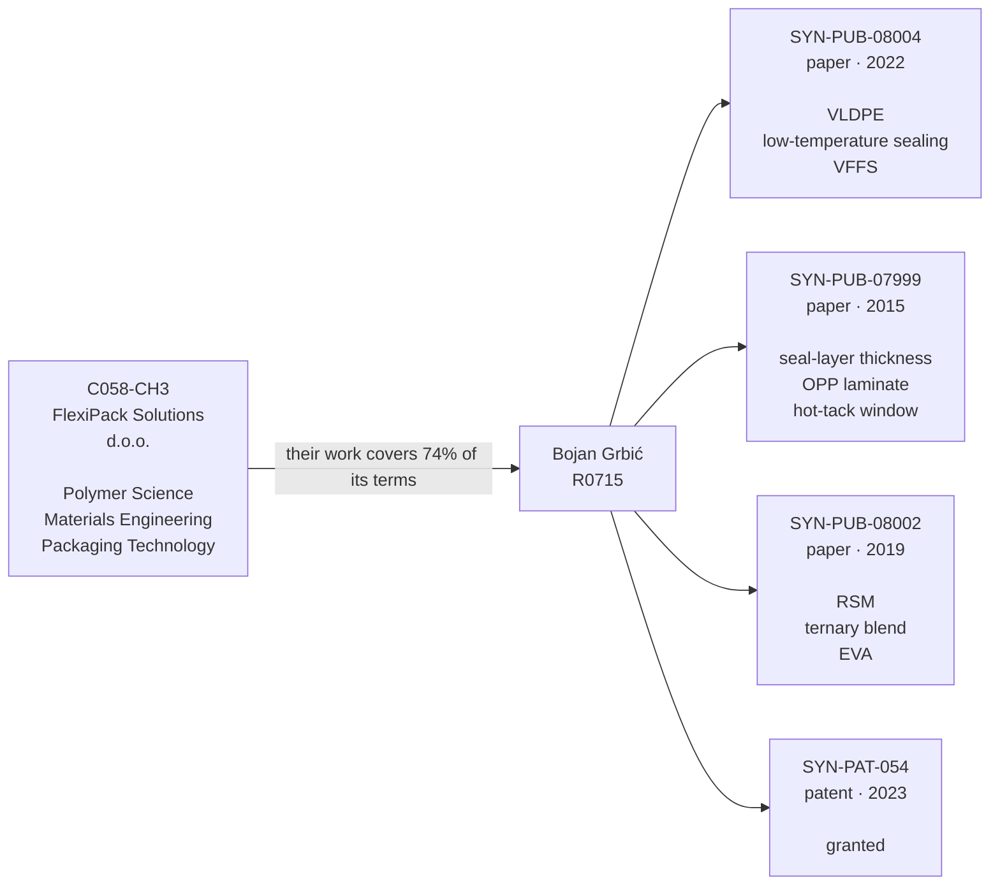
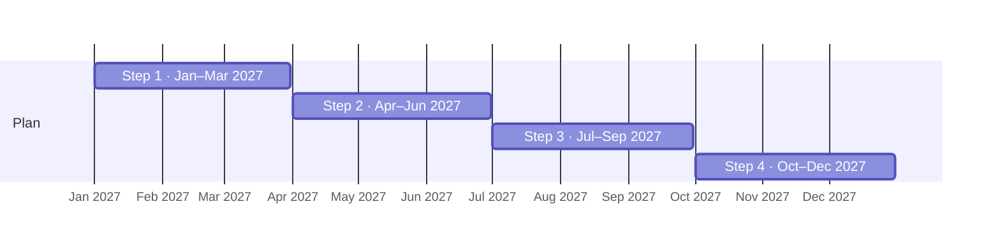
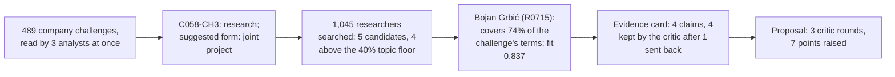

> **Spona proposal 4** · pair `C058-CH3~R0715` · fit 0.837 (topic 0.74: seal, integrity, mlldpe, window, hot, tack, strength, performance; open to this: "student internships from packaging industry partners"; profiler: strong; evidence: 4 of 4 claims survived the critic)
> Draft by the Proposal Writer, reviewed by the Critic in 3 round(s). A starting point for a first meeting, not a commitment by either side.

## Widening the mLLDPE Seal Window from 8°C to at Least 20°C for High-Speed VFFS Lines

**Company:** FlexiPack Solutions d.o.o., Novi Sad **Faculty:** Faculty of Technology, University of Novi Sad, Department of Chemical Engineering **Researcher:** Bojan Grbić (Бојан Грбић), Senior Research Associate **Company contact:** Jovana Mirković, founder and technical director

### Why this pair, at a glance

### The problem

FlexiPack's current seal layer is an mLLDPE sourced from an Austrian supplier [C058]. Acceptable seal strength (measured in N/15 mm) is achieved only between 130 and 138°C — a window of 8°C [C058-CH3]. Below 130°C the bond is unreliable; above 138°C the film deforms and cannot be peeled by the end user. Customers running VFFS lines faster than FlexiPack's film can handle need shorter jaw dwell times, which in practice means higher jaw temperatures, pushing the process outside the current window [C058-CH3]. FlexiPack has tested two mLLDPE types and one blend with LDPE with no significant improvement, and holds DSC curves and seal-strength data (N/15 mm vs. temperature and dwell time) for all three formulations [C058-CH3].

### Research questions

1. Which blend addition — VLDPE at 10–25 wt%, EVA at 10–20 wt%, or a combination — reduces seal-initiation temperature (SIT) by at least 5°C relative to FlexiPack's current mLLDPE while keeping plateau seal strength above 25 N/25 mm, as measured on a laboratory gradient heat-sealer at 0.4 s dwell and 0.3 N/mm² jaw pressure?
2. Does increasing the seal-layer thickness from the current gauge to 20 µm in a coextruded structure provide an additive reduction in SIT on top of the blend modification, as determined by comparing films extruded on both the Faculty cast-film line and FlexiPack's pilot extrusion line?
3. Can a response-surface model (central composite design, ≥15 runs) over the blend-ratio space predict a formulation that delivers a usable sealing window of ≥20°C (target: 125–145°C) with peel force remaining below 15 N/25 mm at 145°C?

### Plan

| Period | Activity | Result |
|---|---|---|
| **Step 1** · Jan–Mar 2027 | Grbić's group characterises FlexiPack's three existing formulations by DSC and capillary rheometry; FlexiPack transfers all existing seal-strength and DSC data [C058-CH3] | Baseline rheological and thermal profiles for all three starting materials; identified gap vs. target window |
| **Step 2** · Apr–Jun 2027 | Faculty cast-film line produces binary blends (mLLDPE + VLDPE at 10, 15, 20 wt%; mLLDPE + EVA at 10, 15, 20 wt%) at fixed 40 µm gauge; gradient heat-sealer measures SIT and plateau seal strength for each | Screening data set; two or three candidate blend directions selected |
| **Step 3** · Jul–Sep 2027 | Central composite design (RSM) over selected blend-ratio space; 15–20 cast-film runs on Faculty line; heat-seal and hot-tack testing; peel-mode analysis at upper temperature limit | RSM model with R² target ≥0.90 for SIT and plateau seal strength; identification of optimal blend region |
| **Step 4** · Oct–Dec 2027 | FlexiPack extrudes optimal blend on its pilot extrusion line [C058] at two seal-layer thicknesses; seal-strength and peel testing under conditions matching customer VFFS dwell times; Grbić's group provides rheological support | Validation data set confirming whether ≥20°C window and peel-ability targets are met at production-representative conditions |

### What each side brings

**FlexiPack** provides: the current mLLDPE granulate and supplier datasheets [C058]; DSC curves and seal-strength data for three tested formulations [C058-CH3]; pilot extrusion and lamination line for production-representative film trials [C058]; Jovana Mirković's direct knowledge of the VFFS customer requirements.

**Grbić's group** provides: laboratory cast-film line (45 mm screw), gradient heat-sealer, Brabender plastograph, and capillary rheometer [R0715]; RSM experimental design and statistical modelling expertise demonstrated in ternary mLLDPE/EVA/LDPE work [SYN-PUB-08002]; prior data showing that VLDPE at 20 wt% lowered SIT by 9°C and enabled 26 N/25 mm plateau seal strength at 108°C in mLLDPE films [SYN-PUB-08004]; hot-tack window data from OPP/tie/mLLDPE structures across seal-layer thicknesses [SYN-PUB-07999]; a granted patent covering blend compositions that achieve SIT below 100°C in cast polyolefin films [SYN-PAT-054].

### Why this pair

Grbić's group has worked directly on the two mechanisms most relevant to FlexiPack's problem. In a documented formulation development exercise, VLDPE at 20 wt% lowered SIT by 9°C and enabled 26 N/25 mm plateau seal strength at 108°C in a commercial mLLDPE monolayer film [SYN-PUB-08004]. RSM over ternary polyolefin blends produced regression models with R² above 0.91 for SIT, plateau seal strength, and hot-tack [SYN-PUB-08002]. Seal-layer thickness as an independent variable has also been quantified: a 20 µm seal layer in a three-layer laminate produced a 28°C hot-tack window, compared with 16°C at 10 µm [SYN-PUB-07999]. FlexiPack's existing DSC data and granulate samples give the project a defined starting point rather than a blank-slate materials search. Grbić has noted a preference for collaborations that can access production-scale extrusion equipment [R0715], and FlexiPack's pilot extrusion and lamination line addresses that directly [C058].

### Open questions for the first meeting

1. FlexiPack's seal-strength data are in N/15 mm; Grbić's published work uses N/25 mm. Which strip width will be the project standard, and does FlexiPack's heat-seal tester support both?
2. The Austrian mLLDPE supplier may have technical data on comonomer type and distribution — can FlexiPack share the full resin datasheet, and is the supplier open to discussing alternative grades directly?
3. FlexiPack's customers require easy-peel performance; is there a defined upper peel-force limit (in N/15 mm or N/25 mm) already in a customer specification, or does this need to be established during the project?

### Agreed up front (proposal)

**Publications:** Results may be published in peer-reviewed journals after a 90-day review period during which FlexiPack can request redaction of specific formulation details it considers commercially sensitive. Authorship follows contribution; Jovana Mirković or a named FlexiPack technologist is included if they contribute to experimental design or data collection.

**IP:** Any new blend formulation developed and validated specifically on FlexiPack's materials during this project belongs to FlexiPack. Background IP (including [SYN-PAT-054] and prior published methods) remains with the Faculty. If the project produces a patentable result that builds directly on the Faculty's background IP, a co-ownership arrangement with a negotiated licence fee for commercial use by FlexiPack is the proposed default.

---
### How Spona found this pair

### Evidence the critic checked
- ✅ Bojan Grbić investigated formulation developments starting from a commercial 40 µm mLLDPE monolayer film, evaluating partial substitution with VLDPE and increasing seal-layer thickness to broaden the usable sealing window. [SYN-PUB-08004]
- ✅ Grbić evaluated the effect of seal-layer thickness on the hot-tack window and plateau seal strength in three-layer OPP/tie/mLLDPE films using a laboratory gradient heat-sealer. [SYN-PUB-07999]
- ✅ A central composite design was used to map response surfaces of seal-initiation temperature, plateau seal strength, and hot-tack peak force for ternary mLLDPE/EVA/LDPE seal-layer blends. [SYN-PUB-08002]
- ✅ Grbić is the inventor of a patented blend composition for heat-sealable cast polyolefin films comprising metallocene linear low-density polyethylene, very-low-density polyethylene, and low-density polyethylene with a reduced seal-initiation temperature. [SYN-PAT-054]

### What the critic sent back
- round 0, model check: "Grbić is the inventor of a patented blend composition for heat-sealable cast polyolefin films comprising mLLDPE, VLDPE, and LDPE with a reduced seal-initiation…" — overstated: SYN-PAT-054 lists mLLDPE, VLDPE, and LDPE—so LDPE is present—claim is actually consistent. Re-checking: the claim states mLLDPE, VLDPE, and LDPE which matches the patent. All details supported. (not in the source: LDPE as a component of the patented blend) → **revised**
- round 0, model check: "prior data on VLDPE substitution effects on SIT and seal window in mLLDPE films [SYN-PUB-08004]" — The source reports SIT reduction and seal strength at specific conditions but does not report a 'seal window' extension as a separate measured outcome attributed to VLDPE alone; the usable window result comes from the combination of VLDPE and thickness increase. Fix: Limit the claim to what the sou… → **revised**
- round 0, model check: "FlexiPack has tested two mLLDPE types and one mLLDPE/LDPE binary blend" — The source (C058-CH3) says 'jedan blend sa LDPE' (one blend with LDPE) but does not specify it is a binary blend; it could include other components. Fix: Say 'one blend with LDPE' without specifying 'binary'. → **revised**
- round 0, model check: "thickness-window interaction data from OPP/tie/mLLDPE structures [SYN-PUB-07999]" — The source measures hot-tack window, not a general 'seal window'; the draft's phrasing 'thickness-window interaction' is a reasonable paraphrase but attributing it to 'seal window' broadly goes slightly beyond the hot-tack window finding. Fix: Specify 'hot-tack window' as reported in the source. → **revised**
- round 0, model check: "VLDPE substitution in mLLDPE films lowered SIT by 9°C and extended the usable sealing window in a documented case study [SYN-PUB-08004]" — The source reports SIT lowered by 9°C for VLDPE at 20 wt%, but the 'extended usable sealing window' is not explicitly stated as a standalone result for VLDPE alone in the abstract provided; the window extension is associated with the combination result. Fix: State only that VLDPE at 20 wt% lowered … → **revised**
- round 1, model check: "pilot blown-film extruder for production-representative film trials [C058]" — C058 mentions a 'pilot ekstrudersku liniju i laminiranje' (pilot extrusion and lamination line) but does not specify it is a blown-film extruder. Fix: Remove 'blown-film' or cite a source that specifies the extruder type. → **revised**
- round 2, model check: "RSM over ternary polyolefin blends produced regression models with R² above 0.91 for SIT, plateau seal strength, and hot-tack [SYN-PUB-08002]" — The source says R² above 0.91 was obtained for all three responses but the blend is mLLDPE/EVA/LDPE, not generically 'ternary polyolefin blends' — EVA is not a polyolefin. Minor but the label 'polyolefin blends' mischaracterises the system. Fix: Change 'ternary polyolefin blends' to 'ternary mLLDPE… → **left open**
- round 2, model check: "gradient heat-sealer, Brabender plastograph, and capillary rheometer [R0715]" — R0715 lists equipment as 'cast-film line, heat-seal tester, Brabender plastograph, capillary rheometer' — it says 'heat-seal tester', not specifically 'gradient heat-sealer'. Fix: Use 'heat-seal tester' or verify the specific instrument name from the source. → **left open**

### Critic's notes still open
- "RSM over ternary polyolefin blends produced regression models with R² above 0.91 for SIT, plateau seal strength, and hot-tack [SYN-PUB-08002]": The source says R² above 0.91 was obtained for all three responses but the blend is mLLDPE/EVA/LDPE, not generically 'ternary polyolefin blends' — EVA is not a polyolefin. Minor but the label 'polyolefin blends' mischaracterises the system. Fix: Change 'ternary polyolefin blends' to 'ternary mLLDPE/EVA/LDPE blends'.
- "gradient heat-sealer, Brabender plastograph, and capillary rheometer [R0715]": R0715 lists equipment as 'cast-film line, heat-seal tester, Brabender plastograph, capillary rheometer' — it says 'heat-seal tester', not specifically 'gradient heat-sealer'. Fix: Use 'heat-seal tester' or verify the specific instrument name from the source.

### Sources cited
- **C058**: C058 FlexiPack Solutions d.o.o. (Manufacturing – flexible plastic packaging (multilayer films, pouches, thermoformed trays for food and non-food); 19 people; founded 2019; Novi Sad). About: FlexiPack Solutions d.o.o. je…
- **C058-CH3**: C058-CH3 (FlexiPack Solutions d.o.o.): Our sealing layer is an mLLDPE and we get a narrow process window — seal strength is acceptable between 130–138°C but outside that range it either fails to bond or makes the film i…
- **R0715**: R0715: Bojan Grbić, Senior Research Associate, Faculty of Technology, Department of Chemical Engineering Fields: Polymer Science and Engineering; Food and Industrial Packaging Technology; Rheology; Chemical Engineering …
- **SYN-PUB-08002**: SYN-PUB-08002 (2019, journal, Journal of Applied Polymer and Process Engineering) "Formulation of ternary mLLDPE/EVA/LDPE Seal-Layer Blends Using Response Surface Methodology". Authors: Bojan Grbić, Ivan Lukač, László F…
- **SYN-PUB-08004**: SYN-PUB-08004 (2022, journal, Flexible Packaging and Film Technology) "Seal-Layer Composition Adjustments for Improved Performance at Low Jaw Temperatures on High-Speed VFFS Lines: A Case Study". Authors: Bojan Grbić, I…
- **SYN-PUB-07999**: SYN-PUB-07999 (2015, conference, Packaging Film Technology Conference, Proceedings (Prague)) "Effect of Seal-Layer Thickness on Thermal Processing Window in Three-Layer OPP/tie/mLLDPE Films". Authors: Bojan Grbić, Sonja…
- **SYN-PAT-054**: SYN-PAT-054 (2023, granted) "Seal-Layer Blend Composition for Heat-Sealable Cast Polyolefin Films with Reduced Seal-Initiation Temperature". Inventors: Bojan Grbić. A blend composition for the seal layer of cast polyole…
