# Trace of run 2026-10-31-full

- **Data:** 153 companies, 489 challenges, 1047 researcher records, 10779 publications, 1823 projects, 111 patents, 917 company pages, indexed in 6.2 s with no model call.
- **Duration:** 297.0 s · **agent loops:** 73 · **most loops running at once:** 15 (at 96.4 s)
- **Model requests:** 76 (gemini-3.5-flash-lite: 45 calls, 325,317 in / 139,947 out tokens; claude-sonnet-4-6: 28 calls, 146,234 in / 33,111 out tokens (of the input, 144,428 written to and 0 read from the gateway's prompt cache)). Gemini on the free tier; Claude from the hackathon's gateway credit, about $1.04 at list prices.
- **Mozaik cloud:** run events at https://app.jigjoy.ai/?s=spona_2026_10_31_full; each of the 73 agent loops also streamed live as its own session (first: https://app.jigjoy.ai/?s=loop_140b8b37a583486d884cca7b36e1501e).
- **Critic interventions:** 30 (challenge: 16, evidence: 10, proposal: 4; rule: 16, model: 14 checks; outcomes revised: 24, left open: 4, dropped: 2)
- **Proposals:** 4: [Correcting Extended-Size Grading for Indigo Atelier Studio Using Parametric Rules and 3D Virtual Fit](proposals/01-C035-R0325.md), [Post-Quantum Firmware Architecture for the KL-HSM Line: Integrating ML-DSA into a Resource-Constrained ARM Cortex-M HSM](proposals/02-C086-R0503.md), [Eliminating Residual Datum Offsets Between MGI 1901 and ETRS89 in UrbanVizion's DataBridge Pipeline](proposals/03-C076-R0971.md), [Reducing Word-Error Rate for Serbian Child Speech in a Maths-Problem Reading Feature](proposals/04-C127-R0131.md)

## What ran at the same time

Each bar is one Mozaik agent loop (one model question with its own context). Analysts, profilers and the critic overlap: cards are checked while other shards are still being read, and the matchmaker re-ranks as each result lands.

```mermaid
gantt
    dateFormat x
    axisFormat %M:%S
    todayMarker off
    section analyst-1
    analyse C001 C004 C007 C010 C013 C016… : 15, 21196
    analyse C031 C034 C037 C040 C043 C046… : 17, 23399
    analyse C061 C064 C067 C070 C073 C076… : 21214, 47953
    analyse C091 C094 C097 C100 C103 C106… : 23409, 51453
    analyse C121 C124 C127 C130 C133 C136… : 47975, 105759
    revise C085-CH3 : 50309, 92037
    analyse C151 : 51461, 97446
    section analyst-2
    analyse C002 C005 C008 C011 C014 C017… : 19, 28531
    analyse C032 C035 C038 C041 C044 C047… : 21, 31731
    analyse C062 C065 C068 C071 C074 C077… : 28546, 78277
    revise C017-CH1 : 30760, 59875
    analyse C092 C095 C098 C101 C104 C107… : 31741, 81300
    analyse C122 C125 C128 C131 C134 C137… : 78291, 128413
    revise C065-CH2 C068-CH4 C077-CH2 : 80379, 113208
    analyse C152 : 81318, 153069
    revise C098-CH3 C110-CH1 C116-CH1 : 83507, 128989
    revise C131-CH2 C143-CH4 : 130588, 168363
    section analyst-3
    analyse C003 C006 C009 C012 C015 C018… : 23, 42365
    analyse C033 C036 C039 C042 C045 C048… : 25, 43975
    analyse C063 C066 C069 C072 C075 C078… : 42377, 94195
    analyse C093 C096 C099 C102 C105 C108… : 43992, 136751
    revise C006-CH4 C027-CH3 : 44494, 80704
    analyse C123 C126 C129 C132 C135 C138… : 94206, 174273
    revise C075-CH1 C084-CH1 : 96407, 144417
    analyse C153 : 136780, 177228
    revise C105-CH1 C117-CH1 : 139036, 180254
    section profiler-1
    evidence C025-CH1~R0637 C019-CH2~R074… : 25223, 46189
    evidence C035-CH1~R0325 C029-CH3~R037… : 32549, 77857
    evidence C032-CH2~R0503 C039-CH2~R076… : 46382, 86003
    evidence C086-CH1~R0503 C076-CH3~R097… : 81863, 142808
    revise evidence C019-CH2~R0749 : 83377, 123133
    revise evidence C035-CH1~R0325 C029-C… : 93623, 131477
    evidence C103-CH3~R0681 : 96040, 140280
    revise evidence C032-CH2~R0503 : 112711, 159324
    evidence C127-CH3~R0131 : 140783, 184132
    revise evidence C086-CH1~R0503 : 164736, 191282
    section profiler-2
    evidence C010-CH2~R0127 : 25225, 47716
    evidence C086-CH2~R0217 : 101450, 148203
    evidence C151-CH3~R0671 : 109771, 187690
    revise evidence C151-CH3~R0671 : 199666, 200528
    section profiler-3
    evidence C007-CH1~R0992 C058-CH3~R071… : 25226, 54670
    evidence C085-CH2~R0056 C041-CH1~R0855 : 51978, 101152
    revise evidence C085-CH2~R0056 C041-C… : 117415, 163469
    evidence C062-CH1~R1023 : 132429, 172182
    revise evidence C062-CH1~R1023 : 185732, 195222
    section critic
    check 16 claims : 52193, 80376
    check 15 claims : 60673, 74768
    check 9 claims : 83860, 90622
    check 15 claims : 92005, 109710
    check 8 claims : 107157, 114414
    check 1 claims : 129135, 130578
    check 2 claims : 137478, 139188
    check 19 claims : 146282, 161733
    check 4 claims : 154209, 156821
    check 3 claims : 165325, 167167
    check 5 claims : 178185, 182730
    check 9 claims : 190133, 196658
    check 2 claims : 197283, 199103
    check 1 claims : 206531, 208704
    review proposal C035-CH1~R0325 round 0 : 232106, 245925
    review proposal C127-CH3~R0131 round 0 : 239448, 250979
    review proposal C076-CH3~R0971 round 0 : 240104, 253109
    review proposal C086-CH1~R0503 round 0 : 243498, 259924
    review proposal C035-CH1~R0325 round 1 : 270359, 281970
    review proposal C127-CH3~R0131 round 1 : 275657, 294180
    review proposal C076-CH3~R0971 round 1 : 280659, 296971
    section writer
    draft C035-CH1~R0325 : 208730, 232086
    draft C086-CH1~R0503 : 208739, 243486
    draft C076-CH3~R0971 : 208744, 240092
    draft C127-CH3~R0131 : 208748, 239430
    revise C035-CH1~R0325 round 1 : 245929, 270342
    revise C127-CH3~R0131 round 1 : 250980, 275643
    revise C076-CH3~R0971 round 1 : 253115, 280645
```

## Where the critic stepped in

Rule checks need no model: the cited id exists, the work is really this person's (a namesake's paper is caught here), years match, quotes are verbatim. Model checks judge whether the source says what the claim says.

| time | stage | item | author | check | claim | critic's reason | outcome |
|---|---|---|---|---|---|---|---|
| 28.5 s | challenge | C017-CH1 | analyst-2 | rule | clients whose njive uz Tisu — na primer kooperativa 'Ravnica Agro' iz Novog Bečeja — stalno nam javljaju da im suncokret propadne na delovi… | the quote "clients whose njive uz Tisu — na primer kooperativa 'Ravnica Agro' iz Novog Bečeja — stalno nam javljaju da im suncokret propadne na delovima parcele koji na mapi izgledaju dobro." does not appear in C017-CH1… | revised |
| 42.4 s | challenge | C006-CH4 | analyst-3 | rule | average search response time climbed from 0.4 seconds to 3.1 seconds since we crossed 2 million documents | the quote "average search response time climbed from 0.4 seconds to 3.1 seconds since we crossed 2 million documents" does not appear in C006-CH4 or the company record; copy words exactly | revised |
| 42.4 s | challenge | C027-CH3 | analyst-3 | rule | kontaktirala radnička veća uz pozivanje na odredbe Zákonníka práce i na GDPR član 88 | the quote "kontaktirala radnička veća uz pozivanje na odredbe Zákonníka práce i na GDPR član 88" does not appear in C027-CH3 or the company record; copy words exactly | revised |
| 48.0 s | challenge | C085-CH3 | analyst-1 | rule | We need to upgrade our laboratory information management system to comply with the new national e-health interoperability standard... neith… | the quote "We need to upgrade our laboratory information management system to comply with the new national e-health interoperability standard... neither has worked with FHIR before and vendor quotes are 120,000–180,000 … | revised |
| 78.3 s | challenge | C065-CH2 | analyst-2 | rule | We want to understand whether there is a sensible approach — maybe content-based signals from product descriptions or category metadata — t… | the quote "We want to understand whether there is a sensible approach — maybe content-based signals from product descriptions or category metadata — that would give meaningfully better results" does not appear in C065-C… | revised |
| 78.3 s | challenge | C068-CH4 | analyst-2 | rule | What we want is an alert system that flags a possible delamination event and pauses the machine so an operator can check | the quote "What we want is an alert system that flags a possible delamination event and pauses the machine so an operator can check" does not appear in C068-CH4 or the company record; copy words exactly | revised |
| 78.3 s | challenge | C077-CH2 | analyst-2 | rule | Ne tražimo gotov softverski paket — tražimo metodologiju ili alat koji bi nam skratio programiranje na ispod nedelju dana po ćeliji | the quote "Ne tražimo gotov softverski paket — tražimo metodologiju ili alat koji bi nam skratio programiranje na ispod nedelju dana po ćeliji" does not appear in C077-CH2 or the company record; copy words exactly | revised |
| 80.4 s | evidence | C019-CH2~R0749#4 | profiler-1 | model | Led work packages focused on dynamic routing models and deployable routing engines within cross-border freight optimisation projects. | overstated: SYN-PRJ-0463 shows Vranješ leads a single work package (WP3); the claim implies multiple work packages. (not in the source: work packages (plural)) | revised |
| 81.3 s | challenge | C098-CH3 | analyst-2 | rule | Ali nemamo način da sve to automatski povežemo i ukažemo na tačku u lancu gde je najverovatnije nastao problem. | the quote "Ali nemamo način da sve to automatski povežemo i ukažemo na tačku u lancu gde je najverovatnije nastao problem." does not appear in C098-CH3 or the company record; copy words exactly | left open |
| 81.3 s | challenge | C110-CH1 | analyst-2 | rule | auditors say that feature-importance numbers are not the same as a documented decision trail. | the quote "auditors say that feature-importance numbers are not the same as a documented decision trail." does not appear in C110-CH1 or the company record; copy words exactly | left open |
| 81.3 s | challenge | C116-CH1 | analyst-2 | rule | The problem starts when students write longer argumentative responses, anything above roughly 200 words... drop below 60% [agreement] | the quote "The problem starts when students write longer argumentative responses, anything above roughly 200 words... drop below 60% [agreement]" does not appear in C116-CH1 or the company record; copy words exactly | left open |
| 90.6 s | evidence | C035-CH1~R0325#2 | profiler-1 | model | She coordinated a project that supported small apparel manufacturers in adopting 3D body scanning and CLO3D for pre-production virtual samp… | overstated: SYN-PRJ-0624 mentions adaptation of existing pattern libraries to digital formats but does not specifically describe 'pattern adaptation' as a distinct deliverable; otherwise supported. Minor addition but cl… | revised |
| 90.6 s | evidence | C029-CH3~R0376#1 | profiler-1 | model | Đuro Ranković has investigated the preparation of Type III Environmental Product Declarations for precast concrete products in accordance w… | overstated: SYN-PUB-03493 covers EPD for prestressed hollow-core slabs specifically, not precast concrete products in general. (not in the source: precast concrete products (general)) | revised |
| 94.2 s | challenge | C075-CH1 | analyst-3 | rule | Our network planning tool was designed for one-way power flow and simply does not handle this [voltage rising above 253 V from solar integr… | the quote "Our network planning tool was designed for one-way power flow and simply does not handle this [voltage rising above 253 V from solar integration]" does not appear in C075-CH1 or the company record; copy words… | revised |
| 94.2 s | challenge | C084-CH1 | analyst-3 | rule | we want a tool — something Tito or a dispatcher can actually use on a laptop the evening before — that suggests a loading plan and flags wh… | the quote "we want a tool — something Tito or a dispatcher can actually use on a laptop the evening before — that suggests a loading plan and flags when a route is near capacity" does not appear in C084-CH1 or the compa… | left open |
| 109.7 s | evidence | C032-CH2~R0503#1 | profiler-1 | model | Surveyed post-quantum cryptographic implementations on microcontrollers, smart cards, and IoT gateways, categorising lattice-based schemes … | overstated: The source categorises four algorithm families; the claim implies only lattice-based schemes were categorised, misrepresenting the scope. (not in the source: categorising lattice-based schemes only (source c… | revised |
| 114.4 s | evidence | C085-CH2~R0056#3 | profiler-3 | model | Bulatović led a work package responsible for microbiological methods harmonisation in an Interreg IPA project, ensuring that partner labora… | overstated: not in the source: cross-border surveillance of enterococci in livestock (specific framing of the work package scope) | revised |
| 114.4 s | evidence | C041-CH1~R0855#2 | profiler-3 | model | Ivanović served as principal investigator on a project combining laboratory accelerated testing and a two-year field burial study to model … | overstated: not in the source: two-year field burial study (claim states this specifically to model protective coatings on buried infrastructure across Vojvodina soil types) | revised |
| 128.4 s | challenge | C131-CH2 | analyst-2 | rule | What we want is content that adapts to where someone is in their session, what they have done before, and something about their stated goal… | the quote "What we want is content that adapts to where someone is in their session, what they have done before, and something about their stated goals when they signed up... The constraint is that the output must be sh… | revised |
| 128.4 s | challenge | C143-CH4 | analyst-2 | rule | Problem su računi sa nepravilnim prihodima: freelanceri, sezonski biznis, firme sa projektnim fakturisanjem. Na toj grupi... srednja apsolu… | the quote "Problem su računi sa nepravilnim prihodima: freelanceri, sezonski biznis, firme sa projektnim fakturisanjem. Na toj grupi... srednja apsolutna procentualna greška iznosi 18%." does not appear in C143-CH4 or t… | revised |
| 136.8 s | challenge | C105-CH1 | analyst-3 | rule | Our CYP2C19 and CYP2D6 panel works well in the lab, but we're getting allele dropout in about 3% of samples with degraded DNA — typically s… | the quote "Our CYP2C19 and CYP2D6 panel works well in the lab, but we're getting allele dropout in about 3% of samples with degraded DNA — typically saliva collected at pharmacy kiosks — and we don't yet understand whet… | revised |
| 136.8 s | challenge | C117-CH1 | analyst-3 | rule | Koristimo Polyspace Bug Finder kao osnovu naše statičke analize i pri svakom releazu dobijamo oko 900 upozorenja. Nemaju sva istra težinu..… | the quote "Koristimo Polyspace Bug Finder kao osnovu naše statičke analize i pri svakom releazu dobijamo oko 900 upozorenja. Nemaju sva istra težinu... Problem je što naš tim trenutno nema automatizovan način da ih razv… | revised |
| 161.7 s | evidence | C086-CH1~R0503#2 | profiler-1 | model | She led the design and prototyping of a hardware security module combining an Infineon SLE97 secure microcontroller with a separate FPGA fa… | overstated: SYN-PUB-05920 describes the HSM design and prototyping but lists Nikolić as fourth author; the claim that she led the work is not supported by the source. (not in the source: She led the design and prototypi… | revised |
| 182.7 s | evidence | C062-CH1~R1023#3 | profiler-3 | model | She is the inventor of a patented computer-implemented method for automated localisation of buried elongated objects in GPR B-scan imagery … | overstated: The patent source confirms background subtraction and CNN probability heatmaps, but the claim omits that the method also extracts amplitude envelope images and applies non-maximum suppression — however the c… | revised |
| 196.7 s | evidence | C151-CH3~R0671#2 | profiler-2 | model | She co-authored a study developing a stress-testing framework for retail loan default rates using a factor-augmented panel data model estim… | overstated: Source specifies retail mortgage default rates, not retail loan default rates broadly. | dropped |
| 208.7 s | evidence | C151-CH3~R0671#2 | profiler-2 | model | She co-authored a study developing a stress-testing framework for retail mortgage default rates using a factor-augmented panel data model e… | overstated: not in the source: quarterly banking data (source says quarterly data from three Serbian banks, not generically 'banking data') | dropped |
| 245.9 s | proposal | C035-CH1~R0325@0 | writer | model | Čolić's 2022 study defined five proportional body categories for women with bust circumference above 100 cm, directly corresponding to the … | The source defines categories by bust circumference above 100 cm; it says nothing about these categories 'directly corresponding to the EU 46–52 range'. That EU size mapping is added by the draft. Fix: Remove the EU siz… | revised |
| 245.9 s | proposal | C035-CH1~R0325@0 | writer | model | Her project with Vojvodina SMEs already demonstrated that a small manufacturer can integrate 3D scanning and CLO 3D into pre-production wor… | SYN-PRJ-0624 ran 2020–2022 and involved three manufacturers; its duration is not stated as twelve months. The 'twelve-month implementation project' language comes from R0325, but there it describes a scan-based made-to-… | revised |
| 251.0 s | proposal | C127-CH3~R0131@0 | writer | model | CMLLR adaptation reached 26.1% WER with as few as ten utterances per speaker in an earlier isolated-word study | SYN-PUB-01727 says MLLR with ten utterances per child reached 28.7% WER, and CMLLR reached 26.1% WER, but does not state that the CMLLR result was achieved with ten utterances specifically. The draft merges the ten-utte… | revised |
| 253.1 s | proposal | C076-CH3~R0971@0 | writer | model | advisory contacts with municipal cadastral offices in Vojvodina who may be able to identify additional dual-system control points | The source (R0971) says only that Đorđević has 'informal advisory contacts with several municipal cadastral offices in Vojvodina.' The claim that those contacts may be able to identify 'additional dual-system control po… | revised |

## One pair from start to finish: Indigo Atelier Studio d.o.o. (C035-CH1) × Marija Čolić (R0325)

| time | agent | event | details |
|---|---|---|---|
| 31.7 s | analyst-2 | challenge.submitted | {"challengeId":"C035-CH1","round":0,"kind":"research"} |
| 31.7 s | critic | challenge.accepted | {"challengeId":"C035-CH1","kind":"research","collaboration":"joint_project"} |
| 31.8 s | matchmaker | pair.queued | {"pair":"C035-CH1~R0325","fit":0.941,"profiler":"profiler-1"} |
| 31.8 s | matchmaker | pairs.ranked | {"challengeId":"C035-CH1","candidates":[{"pair":"C035-CH1~R0325","fit":0.941,"topic":0.841,"status":"queued"},{"pair":"C035-CH1~R0221","fit":0.627,"topic":0.527,"status":"ranked"},{"pair":"C035-CH1~R0775","fit":0.418,"topic":0.318,"status":"ranked"},{"pair":"… |
| 77.9 s | profiler-1 | card.submitted | {"pair":"C035-CH1~R0325","verdict":"strong","claims":3,"round":0} |
| 90.6 s | critic | critic.intervened | {"at":90622,"stage":"evidence","targetId":"C035-CH1~R0325#2","author":"profiler-1","check":"model","claim":"She coordinated a project that supported small apparel manufacturers in adopting 3D body scanning and CLO3D for pre-production virtual sampling and pat… |
| 90.6 s | critic | card.returned | {"pair":"C035-CH1~R0325","claims":[{"id":"C035-CH1~R0325#2","reason":"overstated: SYN-PRJ-0624 mentions adaptation of existing pattern libraries to digital formats but does not specifically describe 'pattern adaptation' as a distinct deliverable; otherwise su… |
| 131.5 s | profiler-1 | card.submitted | {"pair":"C035-CH1~R0325","verdict":"strong","claims":3,"round":1} |
| 139.2 s | critic | card.verified | {"pair":"C035-CH1~R0325","supported":3,"dropped":0} |
| 139.2 s | matchmaker | pair.rescored | {"pair":"C035-CH1~R0325","before":0.941,"after":0.941,"status":"verified"} |
| 208.7 s | coordinator | selection.made | {"pairs":["C035-CH1~R0325","C086-CH1~R0503","C076-CH3~R0971","C127-CH3~R0131"],"late":false,"considered":24,"rule":"highest fit first (engineering challenges weighted 0.85 against research ones); at most one proposal per company and per researcher"} |
| 232.1 s | writer | proposal.submitted | {"pair":"C035-CH1~R0325","round":0,"title":"Correcting Extended-Size Grading for Indigo Atelier Studio Using Parametric Rules and 3D Virtual Fit","chars":6851} |
| 245.9 s | critic | critic.intervened | {"at":245924,"stage":"proposal","targetId":"C035-CH1~R0325@0","author":"writer","check":"model","claim":"Čolić's 2022 study defined five proportional body categories for women with bust circumference above 100 cm, directly corresponding to the EU 46–52 range … |
| 245.9 s | critic | critic.intervened | {"at":245925,"stage":"proposal","targetId":"C035-CH1~R0325@0","author":"writer","check":"model","claim":"Her project with Vojvodina SMEs already demonstrated that a small manufacturer can integrate 3D scanning and CLO 3D into pre-production workflow within a … |
| 245.9 s | critic | proposal.returned | {"pair":"C035-CH1~R0325","problems":[{"quote":"Čolić's 2022 study defined five proportional body categories for women with bust circumference above 100 cm, directly corresponding to the EU 46–52 range where Indigo Atelier's grading fails [SYN-PUB-04023].","pr… |
| 270.3 s | writer | proposal.submitted | {"pair":"C035-CH1~R0325","round":1,"title":"Correcting Extended-Size Grading for Indigo Atelier Studio Using Parametric Rules and 3D Virtual Fit","chars":7151} |
| 282.0 s | critic | proposal.accepted | {"pair":"C035-CH1~R0325","round":1,"openIssues":0} |

## Timeline

Every domain event on the Mozaik bus (loop events are in trace.jsonl)

| time | agent | event | details |
|---|---|---|---|
| 0.0 s | coordinator | run.requested | {} |
| 0.0 s | coordinator | run.started | {"runId":"2026-10-31-full","companies":153,"challenges":489,"researchers":1045,"publications":10779,"profileBudget":24,"proposals":4} |
| 0.0 s | coordinator | shard.assigned | {"agentId":"analyst-1","kind":"companies","companyIds":["C001","C004","C007","C010","C013","C016","C019","C022","C025","C028","C031","C034","… 39 more"]} |
| 0.0 s | coordinator | shard.assigned | {"agentId":"analyst-2","kind":"companies","companyIds":["C002","C005","C008","C011","C014","C017","C020","C023","C026","C029","C032","C035","… 39 more"]} |
| 0.0 s | coordinator | shard.assigned | {"agentId":"analyst-3","kind":"companies","companyIds":["C003","C006","C009","C012","C015","C018","C021","C024","C027","C030","C033","C036","… 39 more"]} |
| 0.0 s | coordinator | shard.assigned | {"agentId":"profiler-1","kind":"researchers","count":393,"faculties":["faculty of technical sciences"]} |
| 0.0 s | coordinator | shard.assigned | {"agentId":"profiler-2","kind":"researchers","count":325,"faculties":["faculty of sciences","faculty of medicine","faculty of economics in subotica","faculty of civil engineering subotica","faculty o… |
| 0.0 s | coordinator | shard.assigned | {"agentId":"profiler-3","kind":"researchers","count":327,"faculties":["faculty of technology","faculty of agriculture","faculty of philosophy","biosense institute","institute of food technology (fins… |
| 21.2 s | analyst-1 | challenge.submitted | {"challengeId":"C001-CH1","round":0,"kind":"research"} |
| 21.2 s | analyst-1 | challenge.submitted | {"challengeId":"C001-CH2","round":0,"kind":"engineering"} |
| 21.2 s | analyst-1 | challenge.submitted | {"challengeId":"C001-CH3","round":0,"kind":"not_research"} |
| 21.2 s | analyst-1 | challenge.submitted | {"challengeId":"C001-CH4","round":0,"kind":"engineering"} |
| 21.2 s | analyst-1 | challenge.submitted | {"challengeId":"C004-CH1","round":0,"kind":"research"} |
| 21.2 s | analyst-1 | challenge.submitted | {"challengeId":"C004-CH2","round":0,"kind":"engineering"} |
| 21.2 s | analyst-1 | challenge.submitted | {"challengeId":"C004-CH3","round":0,"kind":"research"} |
| 21.2 s | analyst-1 | challenge.submitted | {"challengeId":"C004-CH4","round":0,"kind":"not_research"} |
| 21.2 s | analyst-1 | challenge.submitted | {"challengeId":"C007-CH1","round":0,"kind":"research"} |
| 21.2 s | analyst-1 | challenge.submitted | {"challengeId":"C007-CH2","round":0,"kind":"not_research"} |
| 21.2 s | analyst-1 | challenge.submitted | {"challengeId":"C007-CH3","round":0,"kind":"engineering"} |
| 21.2 s | analyst-1 | challenge.submitted | {"challengeId":"C010-CH1","round":0,"kind":"research"} |
| 21.2 s | analyst-1 | challenge.submitted | {"challengeId":"C010-CH2","round":0,"kind":"research"} |
| 21.2 s | analyst-1 | challenge.submitted | {"challengeId":"C013-CH1","round":0,"kind":"research"} |
| 21.2 s | analyst-1 | challenge.submitted | {"challengeId":"C013-CH2","round":0,"kind":"research"} |
| 21.2 s | analyst-1 | challenge.submitted | {"challengeId":"C013-CH3","round":0,"kind":"not_research"} |
| 21.2 s | analyst-1 | challenge.submitted | {"challengeId":"C016-CH1","round":0,"kind":"research"} |
| 21.2 s | analyst-1 | challenge.submitted | {"challengeId":"C016-CH2","round":0,"kind":"engineering"} |
| 21.2 s | analyst-1 | challenge.submitted | {"challengeId":"C016-CH3","round":0,"kind":"not_research"} |
| 21.2 s | analyst-1 | challenge.submitted | {"challengeId":"C019-CH1","round":0,"kind":"engineering"} |
| 21.2 s | analyst-1 | challenge.submitted | {"challengeId":"C019-CH2","round":0,"kind":"research"} |
| 21.2 s | analyst-1 | challenge.submitted | {"challengeId":"C019-CH3","round":0,"kind":"not_research"} |
| 21.2 s | analyst-1 | challenge.submitted | {"challengeId":"C019-CH4","round":0,"kind":"engineering"} |
| 21.2 s | analyst-1 | challenge.submitted | {"challengeId":"C022-CH1","round":0,"kind":"research"} |
| 21.2 s | analyst-1 | challenge.submitted | {"challengeId":"C022-CH2","round":0,"kind":"engineering"} |
| 21.2 s | analyst-1 | challenge.submitted | {"challengeId":"C022-CH3","round":0,"kind":"research"} |
| 21.2 s | analyst-1 | challenge.submitted | {"challengeId":"C025-CH1","round":0,"kind":"research"} |
| 21.2 s | analyst-1 | challenge.submitted | {"challengeId":"C025-CH2","round":0,"kind":"not_research"} |
| 21.2 s | analyst-1 | challenge.submitted | {"challengeId":"C025-CH3","round":0,"kind":"not_research"} |
| 21.2 s | analyst-1 | challenge.submitted | {"challengeId":"C025-CH4","round":0,"kind":"research"} |
| 21.2 s | analyst-1 | challenge.submitted | {"challengeId":"C028-CH1","round":0,"kind":"research"} |
| 21.2 s | analyst-1 | challenge.submitted | {"challengeId":"C028-CH2","round":0,"kind":"not_research"} |
| 21.2 s | analyst-1 | challenge.submitted | {"challengeId":"C028-CH3","round":0,"kind":"research"} |
| 21.2 s | analyst-1 | challenge.submitted | {"challengeId":"C028-CH4","round":0,"kind":"not_research"} |
| 21.2 s | critic | challenge.accepted | {"challengeId":"C001-CH1","kind":"research","collaboration":"joint_project"} |
| 21.2 s | critic | challenge.accepted | {"challengeId":"C001-CH2","kind":"engineering","collaboration":"contract_research"} |
| 21.2 s | critic | challenge.accepted | {"challengeId":"C001-CH3","kind":"not_research","collaboration":"none"} |
| 21.2 s | critic | challenge.accepted | {"challengeId":"C001-CH4","kind":"engineering","collaboration":"contract_research"} |
| 21.2 s | critic | challenge.accepted | {"challengeId":"C004-CH1","kind":"research","collaboration":"joint_project"} |
| 21.2 s | critic | challenge.accepted | {"challengeId":"C004-CH2","kind":"engineering","collaboration":"contract_research"} |
| 21.2 s | critic | challenge.accepted | {"challengeId":"C004-CH3","kind":"research","collaboration":"industrial_phd"} |
| 21.2 s | critic | challenge.accepted | {"challengeId":"C004-CH4","kind":"not_research","collaboration":"none"} |
| 21.2 s | critic | challenge.accepted | {"challengeId":"C007-CH1","kind":"research","collaboration":"joint_project"} |
| 21.2 s | critic | challenge.accepted | {"challengeId":"C007-CH2","kind":"not_research","collaboration":"none"} |
| 21.2 s | critic | challenge.accepted | {"challengeId":"C007-CH3","kind":"engineering","collaboration":"contract_research"} |
| 21.2 s | critic | challenge.accepted | {"challengeId":"C010-CH1","kind":"research","collaboration":"industrial_phd"} |
| 21.2 s | critic | challenge.accepted | {"challengeId":"C010-CH2","kind":"research","collaboration":"joint_project"} |
| 21.2 s | critic | challenge.accepted | {"challengeId":"C013-CH1","kind":"research","collaboration":"industrial_phd"} |
| 21.2 s | critic | challenge.accepted | {"challengeId":"C013-CH2","kind":"research","collaboration":"joint_project"} |
| 21.2 s | critic | challenge.accepted | {"challengeId":"C013-CH3","kind":"not_research","collaboration":"none"} |
| 21.2 s | critic | challenge.accepted | {"challengeId":"C016-CH1","kind":"research","collaboration":"joint_project"} |
| 21.2 s | critic | challenge.accepted | {"challengeId":"C016-CH2","kind":"engineering","collaboration":"contract_research"} |
| 21.2 s | critic | challenge.accepted | {"challengeId":"C016-CH3","kind":"not_research","collaboration":"none"} |
| 21.2 s | critic | challenge.accepted | {"challengeId":"C019-CH1","kind":"engineering","collaboration":"joint_project"} |
| 21.2 s | critic | challenge.accepted | {"challengeId":"C019-CH2","kind":"research","collaboration":"industrial_phd"} |
| 21.2 s | critic | challenge.accepted | {"challengeId":"C019-CH3","kind":"not_research","collaboration":"none"} |
| 21.2 s | critic | challenge.accepted | {"challengeId":"C019-CH4","kind":"engineering","collaboration":"contract_research"} |
| 21.2 s | critic | challenge.accepted | {"challengeId":"C022-CH1","kind":"research","collaboration":"joint_project"} |
| 21.2 s | critic | challenge.accepted | {"challengeId":"C022-CH2","kind":"engineering","collaboration":"contract_research"} |
| 21.2 s | critic | challenge.accepted | {"challengeId":"C022-CH3","kind":"research","collaboration":"industrial_phd"} |
| 21.2 s | critic | challenge.accepted | {"challengeId":"C025-CH1","kind":"research","collaboration":"joint_project"} |
| 21.2 s | critic | challenge.accepted | {"challengeId":"C025-CH2","kind":"not_research","collaboration":"none"} |
| 21.2 s | critic | challenge.accepted | {"challengeId":"C025-CH3","kind":"not_research","collaboration":"none"} |
| 21.2 s | critic | challenge.accepted | {"challengeId":"C025-CH4","kind":"research","collaboration":"industrial_phd"} |
| 21.2 s | critic | challenge.accepted | {"challengeId":"C028-CH1","kind":"research","collaboration":"industrial_phd"} |
| 21.2 s | critic | challenge.accepted | {"challengeId":"C028-CH2","kind":"not_research","collaboration":"none"} |
| 21.2 s | critic | challenge.accepted | {"challengeId":"C028-CH3","kind":"research","collaboration":"joint_project"} |
| 21.2 s | critic | challenge.accepted | {"challengeId":"C028-CH4","kind":"not_research","collaboration":"none"} |
| 21.3 s | matchmaker | pair.queued | {"pair":"C001-CH1~R1008","fit":0.63,"profiler":"profiler-1"} |
| 21.3 s | matchmaker | pairs.ranked | {"challengeId":"C001-CH1","candidates":[{"pair":"C001-CH1~R1008","fit":0.63,"topic":0.53,"status":"queued"},{"pair":"C001-CH1~R1015","fit":0.543,"topic":0.443,"status":"ranked"},{"pair":"C001-CH1~R05… |
| 21.3 s | matchmaker | challenge.no_match | {"challengeId":"C001-CH2","reason":"closest work covers 39% of the challenge's terms (R0503); below the 40% floor"} |
| 21.3 s | matchmaker | pairs.ranked | {"challengeId":"C001-CH2","candidates":[{"pair":"C001-CH2~R0286","fit":0.425,"topic":0.325,"status":"ranked"},{"pair":"C001-CH2~R0164","fit":0.473,"topic":0.373,"status":"ranked"},{"pair":"C001-CH2~R… |
| 21.3 s | matchmaker | challenge.no_match | {"challengeId":"C001-CH3","reason":"not a research problem: This is a business and risk consulting task using existing industry cost data and compliance frameworks, not a scientific research problem.… |
| 21.3 s | matchmaker | pair.queued | {"pair":"C001-CH4~R0233","fit":0.601,"profiler":"profiler-1"} |
| 21.3 s | matchmaker | pairs.ranked | {"challengeId":"C001-CH4","candidates":[{"pair":"C001-CH4~R0233","fit":0.601,"topic":0.501,"status":"queued"},{"pair":"C001-CH4~R0193","fit":0.376,"topic":0.376,"status":"ranked"},{"pair":"C001-CH4~R… |
| 21.3 s | matchmaker | pair.queued | {"pair":"C004-CH1~R0700","fit":0.556,"profiler":"profiler-3"} |
| 21.3 s | matchmaker | pair.queued | {"pair":"C004-CH1~R0364","fit":0.539,"profiler":"profiler-3"} |
| 21.3 s | matchmaker | pairs.ranked | {"challengeId":"C004-CH1","candidates":[{"pair":"C004-CH1~R0364","fit":0.539,"topic":0.439,"status":"queued"},{"pair":"C004-CH1~R0700","fit":0.556,"topic":0.456,"status":"queued"},{"pair":"C004-CH1~R… |
| 21.3 s | matchmaker | pair.queued | {"pair":"C004-CH2~R0152","fit":0.573,"profiler":"profiler-2"} |
| 21.3 s | matchmaker | pairs.ranked | {"challengeId":"C004-CH2","candidates":[{"pair":"C004-CH2~R0571","fit":0.483,"topic":0.383,"status":"ranked"},{"pair":"C004-CH2~R0152","fit":0.573,"topic":0.473,"status":"queued"},{"pair":"C004-CH2~R… |
| 21.3 s | matchmaker | pair.queued | {"pair":"C004-CH3~R0422","fit":0.686,"profiler":"profiler-2"} |
| 21.3 s | matchmaker | pair.queued | {"pair":"C004-CH3~R0842","fit":0.663,"profiler":"profiler-2"} |
| 21.3 s | matchmaker | pairs.ranked | {"challengeId":"C004-CH3","candidates":[{"pair":"C004-CH3~R0842","fit":0.663,"topic":0.563,"status":"queued"},{"pair":"C004-CH3~R0261","fit":0.647,"topic":0.547,"status":"ranked"},{"pair":"C004-CH3~R… |
| 21.3 s | matchmaker | challenge.no_match | {"challengeId":"C004-CH4","reason":"not a research problem: This is a regulatory compliance and legal paperwork issue regarding insurance intermediary licensing in Austria."} |
| 21.4 s | matchmaker | pair.queued | {"pair":"C007-CH1~R0992","fit":0.8,"profiler":"profiler-3"} |
| 21.4 s | matchmaker | pairs.ranked | {"challengeId":"C007-CH1","candidates":[{"pair":"C007-CH1~R0992","fit":0.8,"topic":0.7,"status":"queued"},{"pair":"C007-CH1~R0151","fit":0.605,"topic":0.505,"status":"ranked"},{"pair":"C007-CH1~R0176… |
| 21.4 s | matchmaker | challenge.no_match | {"challengeId":"C007-CH2","reason":"not a research problem: This is administrative certification paperwork, technical writing, and audit preparation rather than scientific research."} |
| 21.4 s | matchmaker | pair.queued | {"pair":"C007-CH3~R0135","fit":0.51,"profiler":"profiler-1"} |
| 21.4 s | matchmaker | pairs.ranked | {"challengeId":"C007-CH3","candidates":[{"pair":"C007-CH3~R0135","fit":0.51,"topic":0.41,"status":"queued"},{"pair":"C007-CH3~R0992","fit":0.402,"topic":0.302,"status":"ranked"},{"pair":"C007-CH3~R06… |
| 21.4 s | matchmaker | pair.queued | {"pair":"C010-CH1~R0801","fit":0.581,"profiler":"profiler-2"} |
| 21.4 s | matchmaker | pairs.ranked | {"challengeId":"C010-CH1","candidates":[{"pair":"C010-CH1~R0801","fit":0.581,"topic":0.481,"status":"queued"},{"pair":"C010-CH1~R0671","fit":0.45,"topic":0.35,"status":"ranked"},{"pair":"C010-CH1~R01… |
| 21.4 s | matchmaker | pair.queued | {"pair":"C010-CH2~R0127","fit":0.766,"profiler":"profiler-2"} |
| 21.4 s | matchmaker | pair.queued | {"pair":"C010-CH2~R0801","fit":0.7,"profiler":"profiler-2"} |
| 21.4 s | matchmaker | pairs.ranked | {"challengeId":"C010-CH2","candidates":[{"pair":"C010-CH2~R0801","fit":0.7,"topic":0.6,"status":"queued"},{"pair":"C010-CH2~R0127","fit":0.766,"topic":0.666,"status":"queued"},{"pair":"C010-CH2~R0251… |
| 21.4 s | matchmaker | pair.queued | {"pair":"C013-CH1~R0261","fit":0.646,"profiler":"profiler-2"} |
| 21.4 s | matchmaker | pairs.ranked | {"challengeId":"C013-CH1","candidates":[{"pair":"C013-CH1~R0261","fit":0.646,"topic":0.546,"status":"queued"},{"pair":"C013-CH1~R0671","fit":0.408,"topic":0.308,"status":"ranked"},{"pair":"C013-CH1~R… |
| 21.4 s | matchmaker | challenge.no_match | {"challengeId":"C013-CH2","reason":"closest work covers 31% of the challenge's terms (R0364); below the 40% floor"} |
| 21.4 s | matchmaker | pairs.ranked | {"challengeId":"C013-CH2","candidates":[{"pair":"C013-CH2~R0364","fit":0.408,"topic":0.308,"status":"ranked"},{"pair":"C013-CH2~R0700","fit":0.384,"topic":0.284,"status":"ranked"},{"pair":"C013-CH2~R… |
| 21.4 s | matchmaker | challenge.no_match | {"challengeId":"C013-CH3","reason":"not a research problem: This is regulatory reporting, actuarial documentation compliance, and standard capital model validation under Solvency II, not research."} |
| 21.5 s | matchmaker | pair.queued | {"pair":"C016-CH1~R0767","fit":0.621,"profiler":"profiler-3"} |
| 21.5 s | matchmaker | pair.queued | {"pair":"C016-CH1~R0957","fit":0.616,"profiler":"profiler-3"} |
| 21.5 s | matchmaker | pairs.ranked | {"challengeId":"C016-CH1","candidates":[{"pair":"C016-CH1~R0957","fit":0.616,"topic":0.516,"status":"queued"},{"pair":"C016-CH1~R0767","fit":0.621,"topic":0.521,"status":"queued"},{"pair":"C016-CH1~R… |
| 21.5 s | matchmaker | pair.queued | {"pair":"C016-CH2~R0273","fit":0.672,"profiler":"profiler-2"} |
| 21.5 s | matchmaker | pairs.ranked | {"challengeId":"C016-CH2","candidates":[{"pair":"C016-CH2~R0273","fit":0.672,"topic":0.572,"status":"queued"},{"pair":"C016-CH2~R0238","fit":0.457,"topic":0.357,"status":"ranked"},{"pair":"C016-CH2~R… |
| 21.5 s | matchmaker | challenge.no_match | {"challengeId":"C016-CH3","reason":"not a research problem: This is a corporate financing, equipment purchasing, and small business credit eligibility issue."} |
| 21.5 s | matchmaker | pair.queued | {"pair":"C019-CH1~R0602","fit":0.571,"profiler":"profiler-1"} |
| 21.5 s | matchmaker | pair.queued | {"pair":"C019-CH1~R0531","fit":0.514,"profiler":"profiler-1"} |
| 21.5 s | matchmaker | pairs.ranked | {"challengeId":"C019-CH1","candidates":[{"pair":"C019-CH1~R0602","fit":0.571,"topic":0.471,"status":"queued"},{"pair":"C019-CH1~R0521","fit":0.478,"topic":0.378,"status":"ranked"},{"pair":"C019-CH1~R… |
| 21.5 s | matchmaker | pair.queued | {"pair":"C019-CH2~R0749","fit":0.755,"profiler":"profiler-1"} |
| 21.5 s | matchmaker | pair.queued | {"pair":"C019-CH2~R0498","fit":0.72,"profiler":"profiler-2"} |
| 21.5 s | matchmaker | pairs.ranked | {"challengeId":"C019-CH2","candidates":[{"pair":"C019-CH2~R0498","fit":0.72,"topic":0.62,"status":"queued"},{"pair":"C019-CH2~R0749","fit":0.755,"topic":0.655,"status":"queued"},{"pair":"C019-CH2~R07… |
| 21.5 s | matchmaker | challenge.no_match | {"challengeId":"C019-CH3","reason":"not a research problem: Driver turnover, shift flexibility, and labor market compensation constraints represent an HR management and organizational design problem.… |
| 21.5 s | matchmaker | pair.queued | {"pair":"C019-CH4~R0117","fit":0.527,"profiler":"profiler-2"} |
| 21.5 s | matchmaker | pairs.ranked | {"challengeId":"C019-CH4","candidates":[{"pair":"C019-CH4~R0117","fit":0.527,"topic":0.427,"status":"queued"},{"pair":"C019-CH4~R0894","fit":0.354,"topic":0.354,"status":"ranked"},{"pair":"C019-CH4~R… |
| 21.5 s | matchmaker | pair.excluded | {"pair":"C022-CH1~R0068","reason":"not proposed: Left the University of Novi Sad in March 2026; now a postdoctoral researcher at a university in Austria."} |
| 21.5 s | matchmaker | pair.queued | {"pair":"C022-CH1~R0971","fit":0.548,"profiler":"profiler-1"} |
| 21.5 s | matchmaker | pairs.ranked | {"challengeId":"C022-CH1","candidates":[{"pair":"C022-CH1~R0971","fit":0.548,"topic":0.448,"status":"queued"},{"pair":"C022-CH1~R0596","fit":0.484,"topic":0.384,"status":"ranked"},{"pair":"C022-CH1~R… |
| 21.6 s | matchmaker | challenge.no_match | {"challengeId":"C022-CH2","reason":"closest work covers 40% of the challenge's terms (R0312); below the 40% floor"} |
| 21.6 s | matchmaker | pairs.ranked | {"challengeId":"C022-CH2","candidates":[{"pair":"C022-CH2~R0312","fit":0.499,"topic":0.399,"status":"ranked"},{"pair":"C022-CH2~R0205","fit":0.392,"topic":0.292,"status":"ranked"},{"pair":"C022-CH2~R… |
| 21.6 s | matchmaker | pair.queued | {"pair":"C022-CH3~R1047","fit":0.721,"profiler":"profiler-3"} |
| 21.6 s | matchmaker | pairs.ranked | {"challengeId":"C022-CH3","candidates":[{"pair":"C022-CH3~R1047","fit":0.721,"topic":0.721,"status":"queued"},{"pair":"C022-CH3~R0662","fit":0.578,"topic":0.478,"status":"ranked"},{"pair":"C022-CH3~R… |
| 21.6 s | matchmaker | pair.queued | {"pair":"C025-CH1~R0637","fit":0.756,"profiler":"profiler-1"} |
| 21.6 s | matchmaker | pairs.ranked | {"challengeId":"C025-CH1","candidates":[{"pair":"C025-CH1~R0637","fit":0.756,"topic":0.656,"status":"queued"},{"pair":"C025-CH1~R0660","fit":0.654,"topic":0.554,"status":"ranked"},{"pair":"C025-CH1~R… |
| 21.6 s | matchmaker | challenge.no_match | {"challengeId":"C025-CH2","reason":"not a research problem: Creating a Failure Modes, Effects and Diagnostic Analysis (FMEDA) document for ISO 26262 compliance is safety engineering standardization w… |
| 21.6 s | matchmaker | challenge.no_match | {"challengeId":"C025-CH3","reason":"not a research problem: Navigating regulatory audit procedures and quality management system requirements for MDR Annex IX compliance is compliance paperwork, not … |
| 21.6 s | matchmaker | pair.queued | {"pair":"C025-CH4~R0437","fit":0.689,"profiler":"profiler-1"} |
| 21.6 s | matchmaker | pairs.ranked | {"challengeId":"C025-CH4","candidates":[{"pair":"C025-CH4~R0437","fit":0.689,"topic":0.589,"status":"queued"},{"pair":"C025-CH4~R0496","fit":0.533,"topic":0.533,"status":"ranked"},{"pair":"C025-CH4~R… |
| 21.6 s | matchmaker | pair.queued | {"pair":"C028-CH1~R0124","fit":0.508,"profiler":"profiler-1"} |
| 21.6 s | matchmaker | pairs.ranked | {"challengeId":"C028-CH1","candidates":[{"pair":"C028-CH1~R0426","fit":0.43,"topic":0.43,"status":"ranked"},{"pair":"C028-CH1~R0124","fit":0.508,"topic":0.408,"status":"queued"},{"pair":"C028-CH1~R05… |
| 21.6 s | matchmaker | challenge.no_match | {"challengeId":"C028-CH2","reason":"not a research problem: Implementing an environmental management system and preparing documentation for ISO 14001 certification is an industrial auditing and envir… |
| 21.6 s | matchmaker | pair.queued | {"pair":"C028-CH3~R0862","fit":0.669,"profiler":"profiler-1"} |
| 21.6 s | matchmaker | pairs.ranked | {"challengeId":"C028-CH3","candidates":[{"pair":"C028-CH3~R0862","fit":0.669,"topic":0.569,"status":"queued"},{"pair":"C028-CH3~R0760","fit":0.542,"topic":0.442,"status":"ranked"},{"pair":"C028-CH3~R… |
| 21.6 s | matchmaker | challenge.no_match | {"challengeId":"C028-CH4","reason":"not a research problem: Navigating grant application status inquiries, public funding rules, and commercial contract negotiations is business strategy and legal an… |
| 23.4 s | analyst-1 | challenge.submitted | {"challengeId":"C031-CH1","round":0,"kind":"research"} |
| 23.4 s | analyst-1 | challenge.submitted | {"challengeId":"C031-CH2","round":0,"kind":"engineering"} |
| 23.4 s | analyst-1 | challenge.submitted | {"challengeId":"C031-CH3","round":0,"kind":"research"} |
| 23.4 s | analyst-1 | challenge.submitted | {"challengeId":"C031-CH4","round":0,"kind":"not_research"} |
| 23.4 s | analyst-1 | challenge.submitted | {"challengeId":"C034-CH1","round":0,"kind":"research"} |
| 23.4 s | analyst-1 | challenge.submitted | {"challengeId":"C034-CH2","round":0,"kind":"research"} |
| 23.4 s | analyst-1 | challenge.submitted | {"challengeId":"C034-CH3","round":0,"kind":"not_research"} |
| 23.4 s | analyst-1 | challenge.submitted | {"challengeId":"C037-CH1","round":0,"kind":"research"} |
| 23.4 s | analyst-1 | challenge.submitted | {"challengeId":"C037-CH2","round":0,"kind":"not_research"} |
| 23.4 s | analyst-1 | challenge.submitted | {"challengeId":"C040-CH1","round":0,"kind":"research"} |
| 23.4 s | analyst-1 | challenge.submitted | {"challengeId":"C040-CH2","round":0,"kind":"not_research"} |
| 23.4 s | analyst-1 | challenge.submitted | {"challengeId":"C040-CH3","round":0,"kind":"research"} |
| 23.4 s | analyst-1 | challenge.submitted | {"challengeId":"C043-CH1","round":0,"kind":"research"} |
| 23.4 s | analyst-1 | challenge.submitted | {"challengeId":"C043-CH2","round":0,"kind":"engineering"} |
| 23.4 s | analyst-1 | challenge.submitted | {"challengeId":"C043-CH3","round":0,"kind":"not_research"} |
| 23.4 s | analyst-1 | challenge.submitted | {"challengeId":"C046-CH1","round":0,"kind":"research"} |
| 23.4 s | analyst-1 | challenge.submitted | {"challengeId":"C046-CH2","round":0,"kind":"not_research"} |
| 23.4 s | analyst-1 | challenge.submitted | {"challengeId":"C046-CH3","round":0,"kind":"not_research"} |
| 23.4 s | analyst-1 | challenge.submitted | {"challengeId":"C049-CH1","round":0,"kind":"engineering"} |
| 23.4 s | analyst-1 | challenge.submitted | {"challengeId":"C049-CH2","round":0,"kind":"research"} |
| 23.4 s | analyst-1 | challenge.submitted | {"challengeId":"C049-CH3","round":0,"kind":"research"} |
| 23.4 s | analyst-1 | challenge.submitted | {"challengeId":"C052-CH1","round":0,"kind":"research"} |
| 23.4 s | analyst-1 | challenge.submitted | {"challengeId":"C052-CH2","round":0,"kind":"research"} |
| 23.4 s | analyst-1 | challenge.submitted | {"challengeId":"C052-CH3","round":0,"kind":"not_research"} |
| 23.4 s | analyst-1 | challenge.submitted | {"challengeId":"C052-CH4","round":0,"kind":"engineering"} |
| 23.4 s | analyst-1 | challenge.submitted | {"challengeId":"C055-CH1","round":0,"kind":"research"} |
| 23.4 s | analyst-1 | challenge.submitted | {"challengeId":"C055-CH2","round":0,"kind":"research"} |
| 23.4 s | analyst-1 | challenge.submitted | {"challengeId":"C055-CH3","round":0,"kind":"not_research"} |
| 23.4 s | analyst-1 | challenge.submitted | {"challengeId":"C058-CH1","round":0,"kind":"research"} |
| 23.4 s | analyst-1 | challenge.submitted | {"challengeId":"C058-CH2","round":0,"kind":"not_research"} |
| 23.4 s | analyst-1 | challenge.submitted | {"challengeId":"C058-CH3","round":0,"kind":"research"} |
| 23.4 s | analyst-1 | challenge.submitted | {"challengeId":"C058-CH4","round":0,"kind":"research"} |
| 23.4 s | critic | challenge.accepted | {"challengeId":"C031-CH1","kind":"research","collaboration":"joint_project"} |
| 23.4 s | critic | challenge.accepted | {"challengeId":"C031-CH2","kind":"engineering","collaboration":"contract_research"} |
| 23.4 s | critic | challenge.accepted | {"challengeId":"C031-CH3","kind":"research","collaboration":"joint_project"} |
| 23.4 s | critic | challenge.accepted | {"challengeId":"C031-CH4","kind":"not_research","collaboration":"none"} |
| 23.4 s | critic | challenge.accepted | {"challengeId":"C034-CH1","kind":"research","collaboration":"contract_research"} |
| 23.4 s | critic | challenge.accepted | {"challengeId":"C034-CH2","kind":"research","collaboration":"joint_project"} |
| 23.4 s | critic | challenge.accepted | {"challengeId":"C034-CH3","kind":"not_research","collaboration":"none"} |
| 23.4 s | critic | challenge.accepted | {"challengeId":"C037-CH1","kind":"research","collaboration":"joint_project"} |
| 23.4 s | critic | challenge.accepted | {"challengeId":"C037-CH2","kind":"not_research","collaboration":"none"} |
| 23.4 s | critic | challenge.accepted | {"challengeId":"C040-CH1","kind":"research","collaboration":"industrial_phd"} |
| 23.4 s | critic | challenge.accepted | {"challengeId":"C040-CH2","kind":"not_research","collaboration":"none"} |
| 23.4 s | critic | challenge.accepted | {"challengeId":"C040-CH3","kind":"research","collaboration":"joint_project"} |
| 23.4 s | critic | challenge.accepted | {"challengeId":"C043-CH1","kind":"research","collaboration":"joint_project"} |
| 23.4 s | critic | challenge.accepted | {"challengeId":"C043-CH2","kind":"engineering","collaboration":"contract_research"} |
| 23.4 s | critic | challenge.accepted | {"challengeId":"C043-CH3","kind":"not_research","collaboration":"none"} |
| 23.4 s | critic | challenge.accepted | {"challengeId":"C046-CH1","kind":"research","collaboration":"joint_project"} |
| 23.4 s | critic | challenge.accepted | {"challengeId":"C046-CH2","kind":"not_research","collaboration":"none"} |
| 23.4 s | critic | challenge.accepted | {"challengeId":"C046-CH3","kind":"not_research","collaboration":"none"} |
| 23.4 s | critic | challenge.accepted | {"challengeId":"C049-CH1","kind":"engineering","collaboration":"contract_research"} |
| 23.4 s | critic | challenge.accepted | {"challengeId":"C049-CH2","kind":"research","collaboration":"joint_project"} |
| 23.4 s | critic | challenge.accepted | {"challengeId":"C049-CH3","kind":"research","collaboration":"joint_project"} |
| 23.4 s | critic | challenge.accepted | {"challengeId":"C052-CH1","kind":"research","collaboration":"industrial_phd"} |
| 23.4 s | critic | challenge.accepted | {"challengeId":"C052-CH2","kind":"research","collaboration":"joint_project"} |
| 23.4 s | critic | challenge.accepted | {"challengeId":"C052-CH3","kind":"not_research","collaboration":"none"} |
| 23.4 s | critic | challenge.accepted | {"challengeId":"C052-CH4","kind":"engineering","collaboration":"contract_research"} |
| 23.4 s | critic | challenge.accepted | {"challengeId":"C055-CH1","kind":"research","collaboration":"industrial_phd"} |
| 23.4 s | critic | challenge.accepted | {"challengeId":"C055-CH2","kind":"research","collaboration":"joint_project"} |
| 23.4 s | critic | challenge.accepted | {"challengeId":"C055-CH3","kind":"not_research","collaboration":"none"} |
| 23.4 s | critic | challenge.accepted | {"challengeId":"C058-CH1","kind":"research","collaboration":"industrial_phd"} |
| 23.4 s | critic | challenge.accepted | {"challengeId":"C058-CH2","kind":"not_research","collaboration":"none"} |
| 23.4 s | critic | challenge.accepted | {"challengeId":"C058-CH3","kind":"research","collaboration":"joint_project"} |
| 23.4 s | critic | challenge.accepted | {"challengeId":"C058-CH4","kind":"research","collaboration":"contract_research"} |
| 23.4 s | matchmaker | challenge.no_match | {"challengeId":"C031-CH1","reason":"closest work covers 40% of the challenge's terms (R1031); below the 40% floor"} |
| 23.4 s | matchmaker | pairs.ranked | {"challengeId":"C031-CH1","candidates":[{"pair":"C031-CH1~R1031","fit":0.496,"topic":0.396,"status":"ranked"},{"pair":"C031-CH1~R0931","fit":0.495,"topic":0.395,"status":"ranked"},{"pair":"C031-CH1~R… |
| 23.5 s | matchmaker | pair.queued | {"pair":"C031-CH2~R0363","fit":0.581,"profiler":"profiler-1"} |
| 23.5 s | matchmaker | pair.queued | {"pair":"C031-CH2~R0341","fit":0.542,"profiler":"profiler-1"} |
| 23.5 s | matchmaker | pairs.ranked | {"challengeId":"C031-CH2","candidates":[{"pair":"C031-CH2~R0571","fit":0.496,"topic":0.396,"status":"ranked"},{"pair":"C031-CH2~R0363","fit":0.581,"topic":0.481,"status":"queued"},{"pair":"C031-CH2~R… |
| 23.5 s | matchmaker | pair.queued | {"pair":"C031-CH3~R0238","fit":0.566,"profiler":"profiler-3"} |
| 23.5 s | matchmaker | pair.queued | {"pair":"C031-CH3~R0421","fit":0.554,"profiler":"profiler-3"} |
| 23.5 s | matchmaker | pairs.ranked | {"challengeId":"C031-CH3","candidates":[{"pair":"C031-CH3~R0949","fit":0.459,"topic":0.359,"status":"ranked"},{"pair":"C031-CH3~R0238","fit":0.566,"topic":0.466,"status":"queued"},{"pair":"C031-CH3~R… |
| 23.5 s | matchmaker | challenge.no_match | {"challengeId":"C031-CH4","reason":"not a research problem: This is an operational budgeting, capital investment, and physical archiving problem rather than a scientific or technical research challen… |
| 23.5 s | matchmaker | pair.queued | {"pair":"C034-CH1~R0708","fit":0.538,"profiler":"profiler-2"} |
| 23.5 s | matchmaker | pair.queued | {"pair":"C034-CH1~R0509","fit":0.536,"profiler":"profiler-2"} |
| 23.5 s | matchmaker | pairs.ranked | {"challengeId":"C034-CH1","candidates":[{"pair":"C034-CH1~R0509","fit":0.536,"topic":0.436,"status":"queued"},{"pair":"C034-CH1~R0708","fit":0.538,"topic":0.438,"status":"queued"},{"pair":"C034-CH1~R… |
| 23.5 s | matchmaker | pair.queued | {"pair":"C034-CH2~R0149","fit":0.715,"profiler":"profiler-3"} |
| 23.5 s | matchmaker | pairs.ranked | {"challengeId":"C034-CH2","candidates":[{"pair":"C034-CH2~R0149","fit":0.715,"topic":0.615,"status":"queued"},{"pair":"C034-CH2~R0670","fit":0.62,"topic":0.52,"status":"ranked"},{"pair":"C034-CH2~R02… |
| 23.5 s | matchmaker | challenge.no_match | {"challengeId":"C034-CH3","reason":"not a research problem: Writing administrative documentation and compliance procedures for food safety management is standard quality assurance paperwork rather th… |
| 23.5 s | matchmaker | pair.queued | {"pair":"C037-CH1~R0588","fit":0.708,"profiler":"profiler-1"} |
| 23.5 s | matchmaker | pair.queued | {"pair":"C037-CH1~R0458","fit":0.679,"profiler":"profiler-1"} |
| 23.5 s | matchmaker | pairs.ranked | {"challengeId":"C037-CH1","candidates":[{"pair":"C037-CH1~R0298","fit":0.64,"topic":0.54,"status":"ranked"},{"pair":"C037-CH1~R0588","fit":0.708,"topic":0.608,"status":"queued"},{"pair":"C037-CH1~R04… |
| 23.5 s | matchmaker | challenge.no_match | {"challengeId":"C037-CH2","reason":"not a research problem: Securing corporate financing and inventory procurement strategies are commercial and financial business activities, not research tasks."} |
| 23.5 s | matchmaker | pair.queued | {"pair":"C040-CH1~R0961","fit":0.521,"profiler":"profiler-1"} |
| 23.5 s | matchmaker | pairs.ranked | {"challengeId":"C040-CH1","candidates":[{"pair":"C040-CH1~R0961","fit":0.521,"topic":0.421,"status":"queued"},{"pair":"C040-CH1~R0735","fit":0.471,"topic":0.371,"status":"ranked"},{"pair":"C040-CH1~R… |
| 23.5 s | matchmaker | challenge.no_match | {"challengeId":"C040-CH2","reason":"not a research problem: Structuring equity rounds, convertible notes, and finding venture capital co-investors are financial and legal business operations."} |
| 23.5 s | matchmaker | pair.queued | {"pair":"C040-CH3~R0960","fit":0.647,"profiler":"profiler-1"} |
| 23.6 s | matchmaker | pairs.ranked | {"challengeId":"C040-CH3","candidates":[{"pair":"C040-CH3~R0960","fit":0.647,"topic":0.547,"status":"queued"},{"pair":"C040-CH3~R0987","fit":0.529,"topic":0.429,"status":"ranked"},{"pair":"C040-CH3~R… |
| 23.6 s | matchmaker | pair.queued | {"pair":"C043-CH1~R0481","fit":0.718,"profiler":"profiler-1"} |
| 23.6 s | matchmaker | pairs.ranked | {"challengeId":"C043-CH1","candidates":[{"pair":"C043-CH1~R0481","fit":0.718,"topic":0.618,"status":"queued"},{"pair":"C043-CH1~R0512","fit":0.539,"topic":0.439,"status":"ranked"},{"pair":"C043-CH1~R… |
| 23.6 s | matchmaker | pair.queued | {"pair":"C043-CH2~R0512","fit":0.698,"profiler":"profiler-1"} |
| 23.6 s | matchmaker | pairs.ranked | {"challengeId":"C043-CH2","candidates":[{"pair":"C043-CH2~R0512","fit":0.698,"topic":0.598,"status":"queued"},{"pair":"C043-CH2~R0371","fit":0.521,"topic":0.421,"status":"ranked"},{"pair":"C043-CH2~R… |
| 23.6 s | matchmaker | challenge.no_match | {"challengeId":"C043-CH3","reason":"not a research problem: Raising venture capital and building international sales networks are business development and commercial expansion activities."} |
| 23.6 s | matchmaker | pair.queued | {"pair":"C046-CH1~R0699","fit":0.611,"profiler":"profiler-1"} |
| 23.6 s | matchmaker | pair.queued | {"pair":"C046-CH1~R0319","fit":0.56,"profiler":"profiler-2"} |
| 23.6 s | matchmaker | pairs.ranked | {"challengeId":"C046-CH1","candidates":[{"pair":"C046-CH1~R0699","fit":0.611,"topic":0.511,"status":"queued"},{"pair":"C046-CH1~R0319","fit":0.56,"topic":0.46,"status":"queued"},{"pair":"C046-CH1~R10… |
| 23.6 s | matchmaker | challenge.no_match | {"challengeId":"C046-CH2","reason":"not a research problem: Legal contract negotiation and compliance interpretation of international data protection regulations are legal and advisory services."} |
| 23.6 s | matchmaker | challenge.no_match | {"challengeId":"C046-CH3","reason":"not a research problem: Recruitment, talent retention, and human resource management in competitive labor markets are business operations challenges."} |
| 23.6 s | matchmaker | pair.queued | {"pair":"C049-CH1~R0152","fit":0.681,"profiler":"profiler-2"} |
| 23.6 s | matchmaker | pairs.ranked | {"challengeId":"C049-CH1","candidates":[{"pair":"C049-CH1~R0152","fit":0.681,"topic":0.581,"status":"queued"},{"pair":"C049-CH1~R0341","fit":0.566,"topic":0.466,"status":"ranked"},{"pair":"C049-CH1~R… |
| 23.6 s | matchmaker | pair.queued | {"pair":"C049-CH2~R0552","fit":0.553,"profiler":"profiler-1"} |
| 23.6 s | matchmaker | pair.queued | {"pair":"C049-CH2~R0987","fit":0.548,"profiler":"profiler-1"} |
| 23.6 s | matchmaker | pairs.ranked | {"challengeId":"C049-CH2","candidates":[{"pair":"C049-CH2~R0552","fit":0.553,"topic":0.453,"status":"queued"},{"pair":"C049-CH2~R0987","fit":0.548,"topic":0.448,"status":"queued"},{"pair":"C049-CH2~R… |
| 23.6 s | matchmaker | pair.queued | {"pair":"C049-CH3~R0291","fit":0.537,"profiler":"profiler-3"} |
| 23.6 s | matchmaker | pair.queued | {"pair":"C049-CH3~R0369","fit":0.529,"profiler":"profiler-3"} |
| 23.6 s | matchmaker | pairs.ranked | {"challengeId":"C049-CH3","candidates":[{"pair":"C049-CH3~R0369","fit":0.529,"topic":0.429,"status":"queued"},{"pair":"C049-CH3~R0755","fit":0.516,"topic":0.416,"status":"ranked"},{"pair":"C049-CH3~R… |
| 23.7 s | matchmaker | challenge.no_match | {"challengeId":"C052-CH1","reason":"closest work covers 40% of the challenge's terms (R0705); below the 40% floor"} |
| 23.7 s | matchmaker | pairs.ranked | {"challengeId":"C052-CH1","candidates":[{"pair":"C052-CH1~R0601","fit":0.436,"topic":0.436,"status":"ranked"},{"pair":"C052-CH1~R0705","fit":0.496,"topic":0.396,"status":"ranked"},{"pair":"C052-CH1~R… |
| 23.7 s | matchmaker | pair.queued | {"pair":"C052-CH2~R0749","fit":0.712,"profiler":"profiler-1"} |
| 23.7 s | matchmaker | pairs.ranked | {"challengeId":"C052-CH2","candidates":[{"pair":"C052-CH2~R0592","fit":0.522,"topic":0.422,"status":"ranked"},{"pair":"C052-CH2~R0749","fit":0.712,"topic":0.612,"status":"queued"},{"pair":"C052-CH2~R… |
| 23.7 s | matchmaker | challenge.no_match | {"challengeId":"C052-CH3","reason":"not a research problem: Building financial models, assessing market entry strategies, and preparing investor reports are financial and business advisory activities… |
| 23.7 s | matchmaker | pair.queued | {"pair":"C052-CH4~R0868","fit":0.577,"profiler":"profiler-1"} |
| 23.7 s | matchmaker | pairs.ranked | {"challengeId":"C052-CH4","candidates":[{"pair":"C052-CH4~R0868","fit":0.577,"topic":0.477,"status":"queued"},{"pair":"C052-CH4~R0909","fit":0.5,"topic":0.4,"status":"ranked"},{"pair":"C052-CH4~R0073… |
| 23.7 s | matchmaker | pair.queued | {"pair":"C055-CH1~R0851","fit":0.716,"profiler":"profiler-1"} |
| 23.7 s | matchmaker | pairs.ranked | {"challengeId":"C055-CH1","candidates":[{"pair":"C055-CH1~R0851","fit":0.716,"topic":0.616,"status":"queued"},{"pair":"C055-CH1~R0445","fit":0.634,"topic":0.534,"status":"ranked"},{"pair":"C055-CH1~R… |
| 23.7 s | matchmaker | challenge.no_match | {"challengeId":"C055-CH2","reason":"closest work covers 36% of the challenge's terms (R0165); below the 40% floor"} |
| 23.7 s | matchmaker | pairs.ranked | {"challengeId":"C055-CH2","candidates":[{"pair":"C055-CH2~R0805","fit":0.396,"topic":0.296,"status":"ranked"},{"pair":"C055-CH2~R0937","fit":0.449,"topic":0.349,"status":"ranked"},{"pair":"C055-CH2~R… |
| 23.7 s | matchmaker | challenge.no_match | {"challengeId":"C055-CH3","reason":"not a research problem: Preparing CE compliance documentation and risk assessments for machinery directives is standard technical certification and quality assuran… |
| 23.7 s | matchmaker | pair.queued | {"pair":"C058-CH1~R0172","fit":0.722,"profiler":"profiler-3"} |
| 23.7 s | matchmaker | pairs.ranked | {"challengeId":"C058-CH1","candidates":[{"pair":"C058-CH1~R0172","fit":0.722,"topic":0.622,"status":"queued"},{"pair":"C058-CH1~R0274","fit":0.53,"topic":0.43,"status":"ranked"},{"pair":"C058-CH1~R10… |
| 23.7 s | matchmaker | challenge.no_match | {"challengeId":"C058-CH2","reason":"not a research problem: Laboratory certification testing against regulatory standards and commercial testing services are analytical testing operations, not academ… |
| 23.8 s | matchmaker | pair.queued | {"pair":"C058-CH3~R0715","fit":0.785,"profiler":"profiler-3"} |
| 23.8 s | matchmaker | pairs.ranked | {"challengeId":"C058-CH3","candidates":[{"pair":"C058-CH3~R0715","fit":0.785,"topic":0.685,"status":"queued"},{"pair":"C058-CH3~R1044","fit":0.632,"topic":0.532,"status":"ranked"},{"pair":"C058-CH3~R… |
| 23.8 s | matchmaker | pair.queued | {"pair":"C058-CH4~R0862","fit":0.74,"profiler":"profiler-1"} |
| 23.8 s | matchmaker | pair.queued | {"pair":"C058-CH4~R0187","fit":0.681,"profiler":"profiler-1"} |
| 23.8 s | matchmaker | pairs.ranked | {"challengeId":"C058-CH4","candidates":[{"pair":"C058-CH4~R0187","fit":0.681,"topic":0.581,"status":"queued"},{"pair":"C058-CH4~R0862","fit":0.74,"topic":0.64,"status":"queued"},{"pair":"C058-CH4~R05… |
| 28.5 s | analyst-2 | challenge.submitted | {"challengeId":"C002-CH1","round":0,"kind":"research"} |
| 28.5 s | analyst-2 | challenge.submitted | {"challengeId":"C002-CH2","round":0,"kind":"research"} |
| 28.5 s | analyst-2 | challenge.submitted | {"challengeId":"C002-CH3","round":0,"kind":"not_research"} |
| 28.5 s | analyst-2 | challenge.submitted | {"challengeId":"C005-CH1","round":0,"kind":"engineering"} |
| 28.5 s | analyst-2 | challenge.submitted | {"challengeId":"C005-CH2","round":0,"kind":"research"} |
| 28.5 s | analyst-2 | challenge.submitted | {"challengeId":"C005-CH3","round":0,"kind":"not_research"} |
| 28.5 s | analyst-2 | challenge.submitted | {"challengeId":"C008-CH1","round":0,"kind":"research"} |
| 28.5 s | analyst-2 | challenge.submitted | {"challengeId":"C008-CH2","round":0,"kind":"engineering"} |
| 28.5 s | analyst-2 | challenge.submitted | {"challengeId":"C008-CH3","round":0,"kind":"not_research"} |
| 28.5 s | analyst-2 | challenge.submitted | {"challengeId":"C008-CH4","round":0,"kind":"research"} |
| 28.5 s | analyst-2 | challenge.submitted | {"challengeId":"C011-CH1","round":0,"kind":"engineering"} |
| 28.5 s | analyst-2 | challenge.submitted | {"challengeId":"C011-CH2","round":0,"kind":"not_research"} |
| 28.5 s | analyst-2 | challenge.submitted | {"challengeId":"C011-CH3","round":0,"kind":"engineering"} |
| 28.5 s | analyst-2 | challenge.submitted | {"challengeId":"C011-CH4","round":0,"kind":"research"} |
| 28.5 s | analyst-2 | challenge.submitted | {"challengeId":"C014-CH1","round":0,"kind":"research"} |
| 28.5 s | analyst-2 | challenge.submitted | {"challengeId":"C014-CH2","round":0,"kind":"not_research"} |
| 28.5 s | analyst-2 | challenge.submitted | {"challengeId":"C014-CH3","round":0,"kind":"research"} |
| 28.5 s | analyst-2 | challenge.submitted | {"challengeId":"C014-CH4","round":0,"kind":"research"} |
| 28.5 s | analyst-2 | challenge.submitted | {"challengeId":"C017-CH1","round":0,"kind":"research"} |
| 28.5 s | analyst-2 | challenge.submitted | {"challengeId":"C017-CH2","round":0,"kind":"engineering"} |
| 28.5 s | analyst-2 | challenge.submitted | {"challengeId":"C017-CH3","round":0,"kind":"research"} |
| 28.5 s | analyst-2 | challenge.submitted | {"challengeId":"C020-CH1","round":0,"kind":"research"} |
| 28.5 s | analyst-2 | challenge.submitted | {"challengeId":"C020-CH2","round":0,"kind":"engineering"} |
| 28.5 s | analyst-2 | challenge.submitted | {"challengeId":"C023-CH1","round":0,"kind":"research"} |
| 28.5 s | analyst-2 | challenge.submitted | {"challengeId":"C023-CH2","round":0,"kind":"engineering"} |
| 28.5 s | analyst-2 | challenge.submitted | {"challengeId":"C026-CH1","round":0,"kind":"research"} |
| 28.5 s | analyst-2 | challenge.submitted | {"challengeId":"C026-CH2","round":0,"kind":"not_research"} |
| 28.5 s | analyst-2 | challenge.submitted | {"challengeId":"C026-CH3","round":0,"kind":"engineering"} |
| 28.5 s | analyst-2 | challenge.submitted | {"challengeId":"C029-CH1","round":0,"kind":"research"} |
| 28.5 s | analyst-2 | challenge.submitted | {"challengeId":"C029-CH2","round":0,"kind":"research"} |
| 28.5 s | analyst-2 | challenge.submitted | {"challengeId":"C029-CH3","round":0,"kind":"engineering"} |
| 28.5 s | analyst-2 | challenge.submitted | {"challengeId":"C029-CH4","round":0,"kind":"engineering"} |
| 28.5 s | critic | challenge.accepted | {"challengeId":"C002-CH1","kind":"research","collaboration":"joint_project"} |
| 28.5 s | critic | challenge.accepted | {"challengeId":"C002-CH2","kind":"research","collaboration":"joint_project"} |
| 28.5 s | critic | challenge.accepted | {"challengeId":"C002-CH3","kind":"not_research","collaboration":"none"} |
| 28.5 s | critic | challenge.accepted | {"challengeId":"C005-CH1","kind":"engineering","collaboration":"contract_research"} |
| 28.5 s | critic | challenge.accepted | {"challengeId":"C005-CH2","kind":"research","collaboration":"industrial_phd"} |
| 28.5 s | critic | challenge.accepted | {"challengeId":"C005-CH3","kind":"not_research","collaboration":"none"} |
| 28.5 s | critic | challenge.accepted | {"challengeId":"C008-CH1","kind":"research","collaboration":"joint_project"} |
| 28.5 s | critic | challenge.accepted | {"challengeId":"C008-CH2","kind":"engineering","collaboration":"joint_project"} |
| 28.5 s | critic | challenge.accepted | {"challengeId":"C008-CH3","kind":"not_research","collaboration":"none"} |
| 28.5 s | critic | challenge.accepted | {"challengeId":"C008-CH4","kind":"research","collaboration":"contract_research"} |
| 28.5 s | critic | challenge.accepted | {"challengeId":"C011-CH1","kind":"engineering","collaboration":"joint_project"} |
| 28.5 s | critic | challenge.accepted | {"challengeId":"C011-CH2","kind":"not_research","collaboration":"none"} |
| 28.5 s | critic | challenge.accepted | {"challengeId":"C011-CH3","kind":"engineering","collaboration":"joint_project"} |
| 28.5 s | critic | challenge.accepted | {"challengeId":"C011-CH4","kind":"research","collaboration":"joint_project"} |
| 28.5 s | critic | challenge.accepted | {"challengeId":"C014-CH1","kind":"research","collaboration":"industrial_phd"} |
| 28.5 s | critic | challenge.accepted | {"challengeId":"C014-CH2","kind":"not_research","collaboration":"none"} |
| 28.5 s | critic | challenge.accepted | {"challengeId":"C014-CH3","kind":"research","collaboration":"joint_project"} |
| 28.5 s | critic | challenge.accepted | {"challengeId":"C014-CH4","kind":"research","collaboration":"joint_project"} |
| 28.5 s | critic | critic.intervened | {"at":28540,"stage":"challenge","targetId":"C017-CH1","author":"analyst-2","check":"rule","claim":"clients whose njive uz Tisu — na primer kooperativa 'Ravnica Agro' iz Novog Bečeja — stalno nam javl… |
| 28.5 s | critic | challenge.returned | {"challengeId":"C017-CH1","reason":"the quote \"clients whose njive uz Tisu — na primer kooperativa 'Ravnica Agro' iz Novog Bečeja — stalno nam javljaju da im suncokret propadne na delovima parcele k… |
| 28.5 s | critic | challenge.accepted | {"challengeId":"C017-CH2","kind":"engineering","collaboration":"contract_research"} |
| 28.5 s | critic | challenge.accepted | {"challengeId":"C017-CH3","kind":"research","collaboration":"joint_project"} |
| 28.5 s | critic | challenge.accepted | {"challengeId":"C020-CH1","kind":"research","collaboration":"industrial_phd"} |
| 28.5 s | critic | challenge.accepted | {"challengeId":"C020-CH2","kind":"engineering","collaboration":"contract_research"} |
| 28.5 s | critic | challenge.accepted | {"challengeId":"C023-CH1","kind":"research","collaboration":"industrial_phd"} |
| 28.5 s | critic | challenge.accepted | {"challengeId":"C023-CH2","kind":"engineering","collaboration":"joint_project"} |
| 28.5 s | critic | challenge.accepted | {"challengeId":"C026-CH1","kind":"research","collaboration":"joint_project"} |
| 28.5 s | critic | challenge.accepted | {"challengeId":"C026-CH2","kind":"not_research","collaboration":"none"} |
| 28.5 s | critic | challenge.accepted | {"challengeId":"C026-CH3","kind":"engineering","collaboration":"contract_research"} |
| 28.5 s | critic | challenge.accepted | {"challengeId":"C029-CH1","kind":"research","collaboration":"industrial_phd"} |
| 28.5 s | critic | challenge.accepted | {"challengeId":"C029-CH2","kind":"research","collaboration":"industrial_phd"} |
| 28.5 s | critic | challenge.accepted | {"challengeId":"C029-CH3","kind":"engineering","collaboration":"contract_research"} |
| 28.5 s | critic | challenge.accepted | {"challengeId":"C029-CH4","kind":"engineering","collaboration":"joint_project"} |
| 28.6 s | matchmaker | pair.queued | {"pair":"C002-CH1~R0322","fit":0.559,"profiler":"profiler-3"} |
| 28.6 s | matchmaker | pairs.ranked | {"challengeId":"C002-CH1","candidates":[{"pair":"C002-CH1~R0322","fit":0.559,"topic":0.459,"status":"queued"},{"pair":"C002-CH1~R1006","fit":0.448,"topic":0.348,"status":"ranked"},{"pair":"C002-CH1~R… |
| 28.6 s | matchmaker | pair.queued | {"pair":"C002-CH2~R0207","fit":0.558,"profiler":"profiler-2"} |
| 28.6 s | matchmaker | pairs.ranked | {"challengeId":"C002-CH2","candidates":[{"pair":"C002-CH2~R0207","fit":0.558,"topic":0.458,"status":"queued"},{"pair":"C002-CH2~R1043","fit":0.479,"topic":0.379,"status":"ranked"},{"pair":"C002-CH2~R… |
| 28.6 s | matchmaker | challenge.no_match | {"challengeId":"C002-CH3","reason":"not a research problem: This is purely administrative paperwork and grant application management, not involving new scientific or engineering knowledge."} |
| 28.6 s | matchmaker | pair.queued | {"pair":"C005-CH1~R0905","fit":0.537,"profiler":"profiler-1"} |
| 28.6 s | matchmaker | pairs.ranked | {"challengeId":"C005-CH1","candidates":[{"pair":"C005-CH1~R0905","fit":0.537,"topic":0.437,"status":"queued"},{"pair":"C005-CH1~R0771","fit":0.249,"topic":0.249,"status":"ranked"},{"pair":"C005-CH1~R… |
| 28.6 s | matchmaker | pair.queued | {"pair":"C005-CH2~R0057","fit":0.537,"profiler":"profiler-2"} |
| 28.6 s | matchmaker | pairs.ranked | {"challengeId":"C005-CH2","candidates":[{"pair":"C005-CH2~R0057","fit":0.537,"topic":0.437,"status":"queued"},{"pair":"C005-CH2~R1038","fit":0.448,"topic":0.348,"status":"ranked"},{"pair":"C005-CH2~R… |
| 28.6 s | matchmaker | challenge.no_match | {"challengeId":"C005-CH3","reason":"not a research problem: This is regulatory compliance documentation and quality management system auditing under medical device standards."} |
| 28.6 s | matchmaker | pair.queued | {"pair":"C008-CH1~R0811","fit":0.612,"profiler":"profiler-1"} |
| 28.6 s | matchmaker | pair.queued | {"pair":"C008-CH1~R0800","fit":0.583,"profiler":"profiler-1"} |
| 28.6 s | matchmaker | pairs.ranked | {"challengeId":"C008-CH1","candidates":[{"pair":"C008-CH1~R0811","fit":0.612,"topic":0.512,"status":"queued"},{"pair":"C008-CH1~R0800","fit":0.583,"topic":0.483,"status":"queued"},{"pair":"C008-CH1~R… |
| 28.6 s | matchmaker | challenge.no_match | {"challengeId":"C008-CH2","reason":"closest work covers 37% of the challenge's terms (R0593); below the 40% floor"} |
| 28.6 s | matchmaker | pairs.ranked | {"challengeId":"C008-CH2","candidates":[{"pair":"C008-CH2~R0593","fit":0.469,"topic":0.369,"status":"ranked"},{"pair":"C008-CH2~R0352","fit":0.421,"topic":0.421,"status":"ranked"},{"pair":"C008-CH2~R… |
| 28.6 s | matchmaker | challenge.no_match | {"challengeId":"C008-CH3","reason":"not a research problem: This is a matter of legal consulting, market research, and international trade compliance rather than R&D."} |
| 28.7 s | matchmaker | pair.queued | {"pair":"C008-CH4~R1022","fit":0.664,"profiler":"profiler-1"} |
| 28.7 s | matchmaker | pairs.ranked | {"challengeId":"C008-CH4","candidates":[{"pair":"C008-CH4~R1022","fit":0.664,"topic":0.564,"status":"queued"},{"pair":"C008-CH4~R0375","fit":0.524,"topic":0.424,"status":"ranked"},{"pair":"C008-CH4~R… |
| 28.7 s | matchmaker | challenge.no_match | {"challengeId":"C011-CH1","reason":"closest work covers 37% of the challenge's terms (R0195); below the 40% floor"} |
| 28.7 s | matchmaker | pairs.ranked | {"challengeId":"C011-CH1","candidates":[{"pair":"C011-CH1~R0039","fit":0.449,"topic":0.349,"status":"ranked"},{"pair":"C011-CH1~R0195","fit":0.465,"topic":0.365,"status":"ranked"},{"pair":"C011-CH1~R… |
| 28.7 s | matchmaker | challenge.no_match | {"challengeId":"C011-CH2","reason":"not a research problem: Reviewing standard client data processing agreements and legal contracts is a legal and business process task, not a technical research cha… |
| 28.7 s | matchmaker | pair.queued | {"pair":"C011-CH3~R0833","fit":0.575,"profiler":"profiler-1"} |
| 28.7 s | matchmaker | pairs.ranked | {"challengeId":"C011-CH3","candidates":[{"pair":"C011-CH3~R0833","fit":0.575,"topic":0.475,"status":"queued"},{"pair":"C011-CH3~R0233","fit":0.437,"topic":0.337,"status":"ranked"},{"pair":"C011-CH3~R… |
| 28.7 s | matchmaker | pair.queued | {"pair":"C011-CH4~R0242","fit":0.606,"profiler":"profiler-1"} |
| 28.7 s | matchmaker | pairs.ranked | {"challengeId":"C011-CH4","candidates":[{"pair":"C011-CH4~R0242","fit":0.606,"topic":0.506,"status":"queued"},{"pair":"C011-CH4~R0347","fit":0.521,"topic":0.421,"status":"ranked"},{"pair":"C011-CH4~R… |
| 28.7 s | matchmaker | challenge.no_match | {"challengeId":"C014-CH1","reason":"closest work covers 35% of the challenge's terms (R0094); below the 40% floor"} |
| 28.7 s | matchmaker | pairs.ranked | {"challengeId":"C014-CH1","candidates":[{"pair":"C014-CH1~R0094","fit":0.451,"topic":0.351,"status":"ranked"},{"pair":"C014-CH1~R0571","fit":0.375,"topic":0.275,"status":"ranked"},{"pair":"C014-CH1~R… |
| 28.7 s | matchmaker | challenge.no_match | {"challengeId":"C014-CH2","reason":"not a research problem: Implementing an Information Security Management System (ISMS) for ISO 27001 certification is an administrative and auditing process rather … |
| 28.7 s | matchmaker | challenge.no_match | {"challengeId":"C014-CH3","reason":"closest work covers 37% of the challenge's terms (R0651); below the 40% floor"} |
| 28.7 s | matchmaker | pairs.ranked | {"challengeId":"C014-CH3","candidates":[{"pair":"C014-CH3~R0651","fit":0.472,"topic":0.372,"status":"ranked"},{"pair":"C014-CH3~R0797","fit":0.289,"topic":0.189,"status":"ranked"},{"pair":"C014-CH3~R… |
| 28.8 s | matchmaker | pair.queued | {"pair":"C014-CH4~R0990","fit":0.611,"profiler":"profiler-2"} |
| 28.8 s | matchmaker | pairs.ranked | {"challengeId":"C014-CH4","candidates":[{"pair":"C014-CH4~R0990","fit":0.611,"topic":0.511,"status":"queued"},{"pair":"C014-CH4~R0552","fit":0.504,"topic":0.404,"status":"ranked"},{"pair":"C014-CH4~R… |
| 28.8 s | matchmaker | pair.queued | {"pair":"C017-CH2~R0460","fit":0.558,"profiler":"profiler-1"} |
| 28.8 s | matchmaker | pair.queued | {"pair":"C017-CH2~R0043","fit":0.532,"profiler":"profiler-1"} |
| 28.8 s | matchmaker | pairs.ranked | {"challengeId":"C017-CH2","candidates":[{"pair":"C017-CH2~R0460","fit":0.558,"topic":0.458,"status":"queued"},{"pair":"C017-CH2~R0043","fit":0.532,"topic":0.432,"status":"queued"},{"pair":"C017-CH2~R… |
| 28.8 s | matchmaker | pair.queued | {"pair":"C017-CH3~R0013","fit":0.701,"profiler":"profiler-3"} |
| 28.8 s | matchmaker | pairs.ranked | {"challengeId":"C017-CH3","candidates":[{"pair":"C017-CH3~R0013","fit":0.701,"topic":0.601,"status":"queued"},{"pair":"C017-CH3~R0121","fit":0.537,"topic":0.437,"status":"ranked"},{"pair":"C017-CH3~R… |
| 28.8 s | matchmaker | pair.queued | {"pair":"C020-CH1~R0193","fit":0.693,"profiler":"profiler-1"} |
| 28.8 s | matchmaker | pairs.ranked | {"challengeId":"C020-CH1","candidates":[{"pair":"C020-CH1~R0193","fit":0.693,"topic":0.593,"status":"queued"},{"pair":"C020-CH1~R0375","fit":0.616,"topic":0.516,"status":"ranked"},{"pair":"C020-CH1~R… |
| 28.8 s | matchmaker | pair.queued | {"pair":"C020-CH2~R0356","fit":0.742,"profiler":"profiler-1"} |
| 28.8 s | matchmaker | pairs.ranked | {"challengeId":"C020-CH2","candidates":[{"pair":"C020-CH2~R0356","fit":0.742,"topic":0.642,"status":"queued"},{"pair":"C020-CH2~R0193","fit":0.55,"topic":0.55,"status":"ranked"},{"pair":"C020-CH2~R08… |
| 28.9 s | matchmaker | pair.queued | {"pair":"C023-CH1~R0548","fit":0.6,"profiler":"profiler-1"} |
| 28.9 s | matchmaker | pairs.ranked | {"challengeId":"C023-CH1","candidates":[{"pair":"C023-CH1~R0548","fit":0.6,"topic":0.5,"status":"queued"},{"pair":"C023-CH1~R0496","fit":0.499,"topic":0.499,"status":"ranked"},{"pair":"C023-CH1~R0437… |
| 28.9 s | matchmaker | pair.queued | {"pair":"C023-CH2~R0548","fit":0.561,"profiler":"profiler-1"} |
| 28.9 s | matchmaker | pairs.ranked | {"challengeId":"C023-CH2","candidates":[{"pair":"C023-CH2~R0548","fit":0.561,"topic":0.461,"status":"queued"},{"pair":"C023-CH2~R0179","fit":0.474,"topic":0.374,"status":"ranked"},{"pair":"C023-CH2~R… |
| 28.9 s | matchmaker | pair.queued | {"pair":"C026-CH1~R0521","fit":0.809,"profiler":"profiler-1"} |
| 28.9 s | matchmaker | pairs.ranked | {"challengeId":"C026-CH1","candidates":[{"pair":"C026-CH1~R0521","fit":0.809,"topic":0.709,"status":"queued"},{"pair":"C026-CH1~R0219","fit":0.507,"topic":0.407,"status":"ranked"},{"pair":"C026-CH1~R… |
| 28.9 s | matchmaker | challenge.no_match | {"challengeId":"C026-CH2","reason":"not a research problem: Preparing investor information memoranda, credit ratings, and corporate financial structuring for bond issuance is financial advisory and a… |
| 28.9 s | matchmaker | pair.queued | {"pair":"C026-CH3~R0212","fit":0.721,"profiler":"profiler-1"} |
| 28.9 s | matchmaker | pairs.ranked | {"challengeId":"C026-CH3","candidates":[{"pair":"C026-CH3~R0212","fit":0.721,"topic":0.621,"status":"queued"},{"pair":"C026-CH3~R0342","fit":0.421,"topic":0.321,"status":"ranked"},{"pair":"C026-CH3~R… |
| 29.0 s | matchmaker | pair.queued | {"pair":"C029-CH1~R0821","fit":0.528,"profiler":"profiler-3"} |
| 29.0 s | matchmaker | pairs.ranked | {"challengeId":"C029-CH1","candidates":[{"pair":"C029-CH1~R0821","fit":0.528,"topic":0.528,"status":"queued"},{"pair":"C029-CH1~R0938","fit":0.432,"topic":0.432,"status":"ranked"},{"pair":"C029-CH1~R… |
| 29.0 s | matchmaker | pair.queued | {"pair":"C029-CH2~R0889","fit":0.524,"profiler":"profiler-1"} |
| 29.0 s | matchmaker | pair.queued | {"pair":"C029-CH2~R0809","fit":0.512,"profiler":"profiler-2"} |
| 29.0 s | matchmaker | pairs.ranked | {"challengeId":"C029-CH2","candidates":[{"pair":"C029-CH2~R0809","fit":0.512,"topic":0.512,"status":"queued"},{"pair":"C029-CH2~R0889","fit":0.524,"topic":0.424,"status":"queued"},{"pair":"C029-CH2~R… |
| 29.0 s | matchmaker | pair.queued | {"pair":"C029-CH3~R0376","fit":0.926,"profiler":"profiler-1"} |
| 29.0 s | matchmaker | pairs.ranked | {"challengeId":"C029-CH3","candidates":[{"pair":"C029-CH3~R0376","fit":0.926,"topic":0.826,"status":"queued"},{"pair":"C029-CH3~R0473","fit":0.714,"topic":0.614,"status":"ranked"},{"pair":"C029-CH3~R… |
| 29.0 s | matchmaker | pair.queued | {"pair":"C029-CH4~R0651","fit":0.541,"profiler":"profiler-1"} |
| 29.0 s | matchmaker | pairs.ranked | {"challengeId":"C029-CH4","candidates":[{"pair":"C029-CH4~R0937","fit":0.498,"topic":0.398,"status":"ranked"},{"pair":"C029-CH4~R0651","fit":0.541,"topic":0.441,"status":"queued"},{"pair":"C029-CH4~R… |
| 31.7 s | analyst-2 | challenge.submitted | {"challengeId":"C032-CH1","round":0,"kind":"research"} |
| 31.7 s | analyst-2 | challenge.submitted | {"challengeId":"C032-CH2","round":0,"kind":"engineering"} |
| 31.7 s | analyst-2 | challenge.submitted | {"challengeId":"C035-CH1","round":0,"kind":"research"} |
| 31.7 s | analyst-2 | challenge.submitted | {"challengeId":"C035-CH2","round":0,"kind":"not_research"} |
| 31.7 s | analyst-2 | challenge.submitted | {"challengeId":"C035-CH3","round":0,"kind":"engineering"} |
| 31.7 s | analyst-2 | challenge.submitted | {"challengeId":"C035-CH4","round":0,"kind":"not_research"} |
| 31.7 s | analyst-2 | challenge.submitted | {"challengeId":"C038-CH1","round":0,"kind":"research"} |
| 31.7 s | analyst-2 | challenge.submitted | {"challengeId":"C038-CH2","round":0,"kind":"research"} |
| 31.7 s | analyst-2 | challenge.submitted | {"challengeId":"C038-CH3","round":0,"kind":"not_research"} |
| 31.7 s | analyst-2 | challenge.submitted | {"challengeId":"C038-CH4","round":0,"kind":"engineering"} |
| 31.7 s | analyst-2 | challenge.submitted | {"challengeId":"C041-CH1","round":0,"kind":"research"} |
| 31.7 s | analyst-2 | challenge.submitted | {"challengeId":"C041-CH2","round":0,"kind":"research"} |
| 31.7 s | analyst-2 | challenge.submitted | {"challengeId":"C041-CH3","round":0,"kind":"research"} |
| 31.7 s | analyst-2 | challenge.submitted | {"challengeId":"C041-CH4","round":0,"kind":"engineering"} |
| 31.7 s | analyst-2 | challenge.submitted | {"challengeId":"C044-CH1","round":0,"kind":"research"} |
| 31.7 s | analyst-2 | challenge.submitted | {"challengeId":"C044-CH2","round":0,"kind":"engineering"} |
| 31.7 s | analyst-2 | challenge.submitted | {"challengeId":"C044-CH3","round":0,"kind":"not_research"} |
| 31.7 s | analyst-2 | challenge.submitted | {"challengeId":"C047-CH1","round":0,"kind":"research"} |
| 31.7 s | analyst-2 | challenge.submitted | {"challengeId":"C047-CH2","round":0,"kind":"research"} |
| 31.7 s | analyst-2 | challenge.submitted | {"challengeId":"C050-CH1","round":0,"kind":"research"} |
| 31.7 s | analyst-2 | challenge.submitted | {"challengeId":"C050-CH2","round":0,"kind":"engineering"} |
| 31.7 s | analyst-2 | challenge.submitted | {"challengeId":"C050-CH3","round":0,"kind":"not_research"} |
| 31.7 s | analyst-2 | challenge.submitted | {"challengeId":"C050-CH4","round":0,"kind":"engineering"} |
| 31.7 s | analyst-2 | challenge.submitted | {"challengeId":"C053-CH1","round":0,"kind":"research"} |
| 31.7 s | analyst-2 | challenge.submitted | {"challengeId":"C053-CH2","round":0,"kind":"engineering"} |
| 31.7 s | analyst-2 | challenge.submitted | {"challengeId":"C053-CH3","round":0,"kind":"not_research"} |
| 31.7 s | analyst-2 | challenge.submitted | {"challengeId":"C053-CH4","round":0,"kind":"research"} |
| 31.7 s | analyst-2 | challenge.submitted | {"challengeId":"C056-CH1","round":0,"kind":"research"} |
| 31.7 s | analyst-2 | challenge.submitted | {"challengeId":"C056-CH2","round":0,"kind":"research"} |
| 31.7 s | analyst-2 | challenge.submitted | {"challengeId":"C056-CH3","round":0,"kind":"not_research"} |
| 31.7 s | analyst-2 | challenge.submitted | {"challengeId":"C059-CH1","round":0,"kind":"research"} |
| 31.7 s | analyst-2 | challenge.submitted | {"challengeId":"C059-CH2","round":0,"kind":"research"} |
| 31.7 s | analyst-2 | challenge.submitted | {"challengeId":"C059-CH3","round":0,"kind":"not_research"} |
| 31.7 s | critic | challenge.accepted | {"challengeId":"C032-CH1","kind":"research","collaboration":"joint_project"} |
| 31.7 s | critic | challenge.accepted | {"challengeId":"C032-CH2","kind":"engineering","collaboration":"contract_research"} |
| 31.7 s | critic | challenge.accepted | {"challengeId":"C035-CH1","kind":"research","collaboration":"joint_project"} |
| 31.7 s | critic | challenge.accepted | {"challengeId":"C035-CH2","kind":"not_research","collaboration":"none"} |
| 31.7 s | critic | challenge.accepted | {"challengeId":"C035-CH3","kind":"engineering","collaboration":"contract_research"} |
| 31.7 s | critic | challenge.accepted | {"challengeId":"C035-CH4","kind":"not_research","collaboration":"none"} |
| 31.7 s | critic | challenge.accepted | {"challengeId":"C038-CH1","kind":"research","collaboration":"industrial_phd"} |
| 31.7 s | critic | challenge.accepted | {"challengeId":"C038-CH2","kind":"research","collaboration":"contract_research"} |
| 31.7 s | critic | challenge.accepted | {"challengeId":"C038-CH3","kind":"not_research","collaboration":"none"} |
| 31.7 s | critic | challenge.accepted | {"challengeId":"C038-CH4","kind":"engineering","collaboration":"joint_project"} |
| 31.7 s | critic | challenge.accepted | {"challengeId":"C041-CH1","kind":"research","collaboration":"industrial_phd"} |
| 31.7 s | critic | challenge.accepted | {"challengeId":"C041-CH2","kind":"research","collaboration":"industrial_phd"} |
| 31.7 s | critic | challenge.accepted | {"challengeId":"C041-CH3","kind":"research","collaboration":"joint_project"} |
| 31.7 s | critic | challenge.accepted | {"challengeId":"C041-CH4","kind":"engineering","collaboration":"joint_project"} |
| 31.7 s | critic | challenge.accepted | {"challengeId":"C044-CH1","kind":"research","collaboration":"joint_project"} |
| 31.7 s | critic | challenge.accepted | {"challengeId":"C044-CH2","kind":"engineering","collaboration":"joint_project"} |
| 31.7 s | critic | challenge.accepted | {"challengeId":"C044-CH3","kind":"not_research","collaboration":"none"} |
| 31.7 s | critic | challenge.accepted | {"challengeId":"C047-CH1","kind":"research","collaboration":"industrial_phd"} |
| 31.7 s | critic | challenge.accepted | {"challengeId":"C047-CH2","kind":"research","collaboration":"joint_project"} |
| 31.7 s | critic | challenge.accepted | {"challengeId":"C050-CH1","kind":"research","collaboration":"joint_project"} |
| 31.7 s | critic | challenge.accepted | {"challengeId":"C050-CH2","kind":"engineering","collaboration":"contract_research"} |
| 31.7 s | critic | challenge.accepted | {"challengeId":"C050-CH3","kind":"not_research","collaboration":"none"} |
| 31.7 s | critic | challenge.accepted | {"challengeId":"C050-CH4","kind":"engineering","collaboration":"contract_research"} |
| 31.7 s | critic | challenge.accepted | {"challengeId":"C053-CH1","kind":"research","collaboration":"joint_project"} |
| 31.7 s | critic | challenge.accepted | {"challengeId":"C053-CH2","kind":"engineering","collaboration":"contract_research"} |
| 31.7 s | critic | challenge.accepted | {"challengeId":"C053-CH3","kind":"not_research","collaboration":"none"} |
| 31.7 s | critic | challenge.accepted | {"challengeId":"C053-CH4","kind":"research","collaboration":"industrial_phd"} |
| 31.7 s | critic | challenge.accepted | {"challengeId":"C056-CH1","kind":"research","collaboration":"industrial_phd"} |
| 31.7 s | critic | challenge.accepted | {"challengeId":"C056-CH2","kind":"research","collaboration":"joint_project"} |
| 31.7 s | critic | challenge.accepted | {"challengeId":"C056-CH3","kind":"not_research","collaboration":"none"} |
| 31.7 s | critic | challenge.accepted | {"challengeId":"C059-CH1","kind":"research","collaboration":"industrial_phd"} |
| 31.7 s | critic | challenge.accepted | {"challengeId":"C059-CH2","kind":"research","collaboration":"industrial_phd"} |
| 31.7 s | critic | challenge.accepted | {"challengeId":"C059-CH3","kind":"not_research","collaboration":"none"} |
| 31.8 s | matchmaker | pair.queued | {"pair":"C032-CH1~R1008","fit":0.526,"profiler":"profiler-1"} |
| 31.8 s | matchmaker | pair.queued | {"pair":"C032-CH1~R1015","fit":0.525,"profiler":"profiler-1"} |
| 31.8 s | matchmaker | pairs.ranked | {"challengeId":"C032-CH1","candidates":[{"pair":"C032-CH1~R1015","fit":0.525,"topic":0.425,"status":"queued"},{"pair":"C032-CH1~R1008","fit":0.526,"topic":0.426,"status":"queued"},{"pair":"C032-CH1~R… |
| 31.8 s | matchmaker | pair.queued | {"pair":"C032-CH2~R0503","fit":0.799,"profiler":"profiler-1"} |
| 31.8 s | matchmaker | pairs.ranked | {"challengeId":"C032-CH2","candidates":[{"pair":"C032-CH2~R0503","fit":0.799,"topic":0.699,"status":"queued"},{"pair":"C032-CH2~R0286","fit":0.71,"topic":0.61,"status":"ranked"},{"pair":"C032-CH2~R02… |
| 31.8 s | matchmaker | pair.queued | {"pair":"C035-CH1~R0325","fit":0.941,"profiler":"profiler-1"} |
| 31.8 s | matchmaker | pairs.ranked | {"challengeId":"C035-CH1","candidates":[{"pair":"C035-CH1~R0325","fit":0.941,"topic":0.841,"status":"queued"},{"pair":"C035-CH1~R0221","fit":0.627,"topic":0.527,"status":"ranked"},{"pair":"C035-CH1~R… |
| 31.8 s | matchmaker | challenge.no_match | {"challengeId":"C035-CH2","reason":"not a research problem: This is a digital marketing and conversion rate optimization problem solved through standard e-commerce auditing and UX practices."} |
| 31.8 s | matchmaker | pair.queued | {"pair":"C035-CH3~R0055","fit":0.62,"profiler":"profiler-1"} |
| 31.8 s | matchmaker | pair.queued | {"pair":"C035-CH3~R0221","fit":0.62,"profiler":"profiler-1"} |
| 31.8 s | matchmaker | pairs.ranked | {"challengeId":"C035-CH3","candidates":[{"pair":"C035-CH3~R0055","fit":0.62,"topic":0.52,"status":"queued"},{"pair":"C035-CH3~R0347","fit":0.556,"topic":0.456,"status":"ranked"},{"pair":"C035-CH3~R02… |
| 31.8 s | matchmaker | challenge.no_match | {"challengeId":"C035-CH4","reason":"not a research problem: This is standard corporate finance, bookkeeping remediation, and fundraising preparation."} |
| 31.8 s | matchmaker | challenge.no_match | {"challengeId":"C038-CH1","reason":"closest work covers 30% of the challenge's terms (R0707); below the 40% floor"} |
| 31.8 s | matchmaker | pairs.ranked | {"challengeId":"C038-CH1","candidates":[{"pair":"C038-CH1~R0931","fit":0.374,"topic":0.374,"status":"ranked"},{"pair":"C038-CH1~R0990","fit":0.375,"topic":0.275,"status":"ranked"},{"pair":"C038-CH1~R… |
| 31.8 s | matchmaker | pair.queued | {"pair":"C038-CH2~R0196","fit":0.6,"profiler":"profiler-3"} |
| 31.8 s | matchmaker | pair.queued | {"pair":"C038-CH2~R0627","fit":0.548,"profiler":"profiler-3"} |
| 31.8 s | matchmaker | pairs.ranked | {"challengeId":"C038-CH2","candidates":[{"pair":"C038-CH2~R0196","fit":0.6,"topic":0.5,"status":"queued"},{"pair":"C038-CH2~R0627","fit":0.548,"topic":0.448,"status":"queued"},{"pair":"C038-CH2~R0622… |
| 31.8 s | matchmaker | challenge.no_match | {"challengeId":"C038-CH3","reason":"not a research problem: Conducting data protection impact assessments and verifying GDPR compliance are legal and administrative tasks."} |
| 31.9 s | matchmaker | pair.queued | {"pair":"C038-CH4~R0741","fit":0.591,"profiler":"profiler-1"} |
| 31.9 s | matchmaker | pairs.ranked | {"challengeId":"C038-CH4","candidates":[{"pair":"C038-CH4~R0741","fit":0.591,"topic":0.491,"status":"queued"},{"pair":"C038-CH4~R0039","fit":0.433,"topic":0.333,"status":"ranked"},{"pair":"C038-CH4~R… |
| 31.9 s | matchmaker | pair.queued | {"pair":"C041-CH1~R0855","fit":0.744,"profiler":"profiler-3"} |
| 31.9 s | matchmaker | pairs.ranked | {"challengeId":"C041-CH1","candidates":[{"pair":"C041-CH1~R0855","fit":0.744,"topic":0.644,"status":"queued"},{"pair":"C041-CH1~R0038","fit":0.63,"topic":0.53,"status":"ranked"},{"pair":"C041-CH1~R06… |
| 31.9 s | matchmaker | challenge.no_match | {"challengeId":"C041-CH2","reason":"closest work covers 26% of the challenge's terms (R0765); below the 40% floor"} |
| 31.9 s | matchmaker | pairs.ranked | {"challengeId":"C041-CH2","candidates":[{"pair":"C041-CH2~R0459","fit":0.326,"topic":0.326,"status":"ranked"},{"pair":"C041-CH2~R0765","fit":0.359,"topic":0.259,"status":"ranked"},{"pair":"C041-CH2~R… |
| 31.9 s | matchmaker | pair.queued | {"pair":"C041-CH3~R0420","fit":0.641,"profiler":"profiler-3"} |
| 31.9 s | matchmaker | pair.queued | {"pair":"C041-CH3~R0459","fit":0.59,"profiler":"profiler-3"} |
| 31.9 s | matchmaker | pairs.ranked | {"challengeId":"C041-CH3","candidates":[{"pair":"C041-CH3~R0420","fit":0.641,"topic":0.541,"status":"queued"},{"pair":"C041-CH3~R0459","fit":0.59,"topic":0.49,"status":"queued"},{"pair":"C041-CH3~R02… |
| 31.9 s | matchmaker | pair.queued | {"pair":"C041-CH4~R0261","fit":0.507,"profiler":"profiler-2"} |
| 31.9 s | matchmaker | pairs.ranked | {"challengeId":"C041-CH4","candidates":[{"pair":"C041-CH4~R0261","fit":0.507,"topic":0.407,"status":"queued"},{"pair":"C041-CH4~R0641","fit":0.444,"topic":0.344,"status":"ranked"},{"pair":"C041-CH4~R… |
| 31.9 s | matchmaker | pair.queued | {"pair":"C044-CH1~R0322","fit":0.531,"profiler":"profiler-3"} |
| 31.9 s | matchmaker | pair.queued | {"pair":"C044-CH1~R0415","fit":0.51,"profiler":"profiler-3"} |
| 31.9 s | matchmaker | pairs.ranked | {"challengeId":"C044-CH1","candidates":[{"pair":"C044-CH1~R0322","fit":0.531,"topic":0.431,"status":"queued"},{"pair":"C044-CH1~R0415","fit":0.51,"topic":0.41,"status":"queued"},{"pair":"C044-CH1~R02… |
| 32.0 s | matchmaker | pair.queued | {"pair":"C044-CH2~R0155","fit":0.652,"profiler":"profiler-1"} |
| 32.0 s | matchmaker | pairs.ranked | {"challengeId":"C044-CH2","candidates":[{"pair":"C044-CH2~R0155","fit":0.652,"topic":0.552,"status":"queued"},{"pair":"C044-CH2~R0366","fit":0.546,"topic":0.446,"status":"ranked"},{"pair":"C044-CH2~R… |
| 32.0 s | matchmaker | challenge.no_match | {"challengeId":"C044-CH3","reason":"not a research problem: Grant application errors and administrative funding navigation are business management tasks."} |
| 32.0 s | matchmaker | pair.queued | {"pair":"C047-CH1~R0689","fit":0.612,"profiler":"profiler-1"} |
| 32.0 s | matchmaker | pairs.ranked | {"challengeId":"C047-CH1","candidates":[{"pair":"C047-CH1~R0689","fit":0.612,"topic":0.512,"status":"queued"},{"pair":"C047-CH1~R1000","fit":0.202,"topic":0.404,"status":"ranked"},{"pair":"C047-CH1~R… |
| 32.0 s | matchmaker | pair.queued | {"pair":"C047-CH2~R0904","fit":0.713,"profiler":"profiler-1"} |
| 32.0 s | matchmaker | pairs.ranked | {"challengeId":"C047-CH2","candidates":[{"pair":"C047-CH2~R0904","fit":0.713,"topic":0.613,"status":"queued"},{"pair":"C047-CH2~R0696","fit":0.603,"topic":0.503,"status":"ranked"},{"pair":"C047-CH2~R… |
| 32.0 s | matchmaker | pair.queued | {"pair":"C050-CH1~R0117","fit":0.609,"profiler":"profiler-2"} |
| 32.0 s | matchmaker | pairs.ranked | {"challengeId":"C050-CH1","candidates":[{"pair":"C050-CH1~R0117","fit":0.609,"topic":0.509,"status":"queued"},{"pair":"C050-CH1~R0110","fit":0.447,"topic":0.347,"status":"ranked"},{"pair":"C050-CH1~R… |
| 32.0 s | matchmaker | pair.queued | {"pair":"C050-CH2~R0683","fit":0.724,"profiler":"profiler-1"} |
| 32.0 s | matchmaker | pairs.ranked | {"challengeId":"C050-CH2","candidates":[{"pair":"C050-CH2~R0683","fit":0.724,"topic":0.624,"status":"queued"},{"pair":"C050-CH2~R0085","fit":0.455,"topic":0.355,"status":"ranked"},{"pair":"C050-CH2~R… |
| 32.0 s | matchmaker | challenge.no_match | {"challengeId":"C050-CH3","reason":"not a research problem: Navigating EU product safety regulations and identifying responsible economic operators are legal and compliance tasks."} |
| 32.1 s | matchmaker | challenge.no_match | {"challengeId":"C050-CH4","reason":"closest work covers 39% of the challenge's terms (R0290); below the 40% floor"} |
| 32.1 s | matchmaker | pairs.ranked | {"challengeId":"C050-CH4","candidates":[{"pair":"C050-CH4~R0290","fit":0.494,"topic":0.394,"status":"ranked"},{"pair":"C050-CH4~R0438","fit":0.441,"topic":0.341,"status":"ranked"},{"pair":"C050-CH4~R… |
| 32.1 s | matchmaker | pair.queued | {"pair":"C053-CH1~R0353","fit":0.561,"profiler":"profiler-3"} |
| 32.1 s | matchmaker | pair.queued | {"pair":"C053-CH1~R0254","fit":0.555,"profiler":"profiler-3"} |
| 32.1 s | matchmaker | pairs.ranked | {"challengeId":"C053-CH1","candidates":[{"pair":"C053-CH1~R0353","fit":0.561,"topic":0.461,"status":"queued"},{"pair":"C053-CH1~R0254","fit":0.555,"topic":0.455,"status":"queued"},{"pair":"C053-CH1~R… |
| 32.1 s | matchmaker | challenge.no_match | {"challengeId":"C053-CH2","reason":"closest work covers 39% of the challenge's terms (R0224); below the 40% floor"} |
| 32.1 s | matchmaker | pairs.ranked | {"challengeId":"C053-CH2","candidates":[{"pair":"C053-CH2~R0224","fit":0.485,"topic":0.385,"status":"ranked"},{"pair":"C053-CH2~R0805","fit":0.34,"topic":0.24,"status":"ranked"},{"pair":"C053-CH2~R01… |
| 32.1 s | matchmaker | challenge.no_match | {"challengeId":"C053-CH3","reason":"not a research problem: Navigating administrative waste management licensing procedures and legal partnership structuring are legal and compliance tasks."} |
| 32.1 s | matchmaker | pair.queued | {"pair":"C053-CH4~R0799","fit":0.591,"profiler":"profiler-2"} |
| 32.1 s | matchmaker | pairs.ranked | {"challengeId":"C053-CH4","candidates":[{"pair":"C053-CH4~R0224","fit":0.494,"topic":0.394,"status":"ranked"},{"pair":"C053-CH4~R0799","fit":0.591,"topic":0.491,"status":"queued"},{"pair":"C053-CH4~R… |
| 32.1 s | matchmaker | pair.queued | {"pair":"C056-CH1~R0542","fit":0.547,"profiler":"profiler-2"} |
| 32.1 s | matchmaker | pairs.ranked | {"challengeId":"C056-CH1","candidates":[{"pair":"C056-CH1~R0542","fit":0.547,"topic":0.447,"status":"queued"},{"pair":"C056-CH1~R0355","fit":0.413,"topic":0.413,"status":"ranked"},{"pair":"C056-CH1~R… |
| 32.1 s | matchmaker | pair.queued | {"pair":"C056-CH2~R0890","fit":0.632,"profiler":"profiler-1"} |
| 32.1 s | matchmaker | pairs.ranked | {"challengeId":"C056-CH2","candidates":[{"pair":"C056-CH2~R0890","fit":0.632,"topic":0.532,"status":"queued"},{"pair":"C056-CH2~R0844","fit":0.43,"topic":0.33,"status":"ranked"},{"pair":"C056-CH2~R09… |
| 32.1 s | matchmaker | challenge.no_match | {"challengeId":"C056-CH3","reason":"not a research problem: Negotiating cross-border intellectual property clauses in commercial publishing contracts is a legal and business affairs task."} |
| 32.2 s | matchmaker | challenge.no_match | {"challengeId":"C059-CH1","reason":"closest work covers 35% of the challenge's terms (R0634); below the 40% floor"} |
| 32.2 s | matchmaker | pairs.ranked | {"challengeId":"C059-CH1","candidates":[{"pair":"C059-CH1~R0634","fit":0.448,"topic":0.348,"status":"ranked"},{"pair":"C059-CH1~R0738","fit":0.426,"topic":0.326,"status":"ranked"},{"pair":"C059-CH1~R… |
| 32.2 s | matchmaker | pair.queued | {"pair":"C059-CH2~R0803","fit":0.6,"profiler":"profiler-2"} |
| 32.2 s | matchmaker | pairs.ranked | {"challengeId":"C059-CH2","candidates":[{"pair":"C059-CH2~R0803","fit":0.6,"topic":0.6,"status":"queued"},{"pair":"C059-CH2~R0190","fit":0.534,"topic":0.434,"status":"ranked"},{"pair":"C059-CH2~R0916… |
| 32.2 s | matchmaker | challenge.no_match | {"challengeId":"C059-CH3","reason":"not a research problem: Implementing payroll software or selecting enterprise resource planning systems is an IT procurement and business administration task."} |
| 42.4 s | analyst-3 | challenge.submitted | {"challengeId":"C003-CH1","round":0,"kind":"research"} |
| 42.4 s | analyst-3 | challenge.submitted | {"challengeId":"C003-CH2","round":0,"kind":"engineering"} |
| 42.4 s | analyst-3 | challenge.submitted | {"challengeId":"C003-CH3","round":0,"kind":"not_research"} |
| 42.4 s | analyst-3 | challenge.submitted | {"challengeId":"C003-CH4","round":0,"kind":"engineering"} |
| 42.4 s | analyst-3 | challenge.submitted | {"challengeId":"C006-CH1","round":0,"kind":"research"} |
| 42.4 s | analyst-3 | challenge.submitted | {"challengeId":"C006-CH2","round":0,"kind":"not_research"} |
| 42.4 s | analyst-3 | challenge.submitted | {"challengeId":"C006-CH3","round":0,"kind":"research"} |
| 42.4 s | analyst-3 | challenge.submitted | {"challengeId":"C006-CH4","round":0,"kind":"engineering"} |
| 42.4 s | analyst-3 | challenge.submitted | {"challengeId":"C009-CH1","round":0,"kind":"research"} |
| 42.4 s | analyst-3 | challenge.submitted | {"challengeId":"C009-CH2","round":0,"kind":"research"} |
| 42.4 s | analyst-3 | challenge.submitted | {"challengeId":"C012-CH1","round":0,"kind":"engineering"} |
| 42.4 s | analyst-3 | challenge.submitted | {"challengeId":"C012-CH2","round":0,"kind":"not_research"} |
| 42.4 s | analyst-3 | challenge.submitted | {"challengeId":"C012-CH3","round":0,"kind":"not_research"} |
| 42.4 s | analyst-3 | challenge.submitted | {"challengeId":"C015-CH1","round":0,"kind":"research"} |
| 42.4 s | analyst-3 | challenge.submitted | {"challengeId":"C015-CH2","round":0,"kind":"engineering"} |
| 42.4 s | analyst-3 | challenge.submitted | {"challengeId":"C018-CH1","round":0,"kind":"engineering"} |
| 42.4 s | analyst-3 | challenge.submitted | {"challengeId":"C018-CH2","round":0,"kind":"research"} |
| 42.4 s | analyst-3 | challenge.submitted | {"challengeId":"C018-CH3","round":0,"kind":"not_research"} |
| 42.4 s | analyst-3 | challenge.submitted | {"challengeId":"C021-CH1","round":0,"kind":"engineering"} |
| 42.4 s | analyst-3 | challenge.submitted | {"challengeId":"C021-CH2","round":0,"kind":"research"} |
| 42.4 s | analyst-3 | challenge.submitted | {"challengeId":"C021-CH3","round":0,"kind":"not_research"} |
| 42.4 s | analyst-3 | challenge.submitted | {"challengeId":"C024-CH1","round":0,"kind":"engineering"} |
| 42.4 s | analyst-3 | challenge.submitted | {"challengeId":"C024-CH2","round":0,"kind":"research"} |
| 42.4 s | analyst-3 | challenge.submitted | {"challengeId":"C024-CH3","round":0,"kind":"research"} |
| 42.4 s | analyst-3 | challenge.submitted | {"challengeId":"C027-CH1","round":0,"kind":"research"} |
| 42.4 s | analyst-3 | challenge.submitted | {"challengeId":"C027-CH2","round":0,"kind":"research"} |
| 42.4 s | analyst-3 | challenge.submitted | {"challengeId":"C027-CH3","round":0,"kind":"not_research"} |
| 42.4 s | analyst-3 | challenge.submitted | {"challengeId":"C027-CH4","round":0,"kind":"research"} |
| 42.4 s | analyst-3 | challenge.submitted | {"challengeId":"C030-CH1","round":0,"kind":"research"} |
| 42.4 s | analyst-3 | challenge.submitted | {"challengeId":"C030-CH2","round":0,"kind":"research"} |
| 42.4 s | analyst-3 | challenge.submitted | {"challengeId":"C030-CH3","round":0,"kind":"not_research"} |
| 42.4 s | analyst-3 | challenge.submitted | {"challengeId":"C030-CH4","round":0,"kind":"research"} |
| 42.4 s | critic | challenge.accepted | {"challengeId":"C003-CH1","kind":"research","collaboration":"contract_research"} |
| 42.4 s | critic | challenge.accepted | {"challengeId":"C003-CH2","kind":"engineering","collaboration":"joint_project"} |
| 42.4 s | critic | challenge.accepted | {"challengeId":"C003-CH3","kind":"not_research","collaboration":"none"} |
| 42.4 s | critic | challenge.accepted | {"challengeId":"C003-CH4","kind":"engineering","collaboration":"contract_research"} |
| 42.4 s | critic | challenge.accepted | {"challengeId":"C006-CH1","kind":"research","collaboration":"joint_project"} |
| 42.4 s | critic | challenge.accepted | {"challengeId":"C006-CH2","kind":"not_research","collaboration":"none"} |
| 42.4 s | critic | challenge.accepted | {"challengeId":"C006-CH3","kind":"research","collaboration":"industrial_phd"} |
| 42.4 s | critic | critic.intervened | {"at":42368,"stage":"challenge","targetId":"C006-CH4","author":"analyst-3","check":"rule","claim":"average search response time climbed from 0.4 seconds to 3.1 seconds since we crossed 2 million docu… |
| 42.4 s | critic | challenge.returned | {"challengeId":"C006-CH4","reason":"the quote \"average search response time climbed from 0.4 seconds to 3.1 seconds since we crossed 2 million documents\" does not appear in C006-CH4 or the company … |
| 42.4 s | critic | challenge.accepted | {"challengeId":"C009-CH1","kind":"research","collaboration":"industrial_phd"} |
| 42.4 s | critic | challenge.accepted | {"challengeId":"C009-CH2","kind":"research","collaboration":"joint_project"} |
| 42.4 s | critic | challenge.accepted | {"challengeId":"C012-CH1","kind":"engineering","collaboration":"contract_research"} |
| 42.4 s | critic | challenge.accepted | {"challengeId":"C012-CH2","kind":"not_research","collaboration":"none"} |
| 42.4 s | critic | challenge.accepted | {"challengeId":"C012-CH3","kind":"not_research","collaboration":"none"} |
| 42.4 s | critic | challenge.accepted | {"challengeId":"C015-CH1","kind":"research","collaboration":"contract_research"} |
| 42.4 s | critic | challenge.accepted | {"challengeId":"C015-CH2","kind":"engineering","collaboration":"contract_research"} |
| 42.4 s | critic | challenge.accepted | {"challengeId":"C018-CH1","kind":"engineering","collaboration":"joint_project"} |
| 42.4 s | critic | challenge.accepted | {"challengeId":"C018-CH2","kind":"research","collaboration":"industrial_phd"} |
| 42.4 s | critic | challenge.accepted | {"challengeId":"C018-CH3","kind":"not_research","collaboration":"none"} |
| 42.4 s | critic | challenge.accepted | {"challengeId":"C021-CH1","kind":"engineering","collaboration":"joint_project"} |
| 42.4 s | critic | challenge.accepted | {"challengeId":"C021-CH2","kind":"research","collaboration":"joint_project"} |
| 42.4 s | critic | challenge.accepted | {"challengeId":"C021-CH3","kind":"not_research","collaboration":"none"} |
| 42.4 s | critic | challenge.accepted | {"challengeId":"C024-CH1","kind":"engineering","collaboration":"contract_research"} |
| 42.4 s | critic | challenge.accepted | {"challengeId":"C024-CH2","kind":"research","collaboration":"contract_research"} |
| 42.4 s | critic | challenge.accepted | {"challengeId":"C024-CH3","kind":"research","collaboration":"industrial_phd"} |
| 42.4 s | critic | challenge.accepted | {"challengeId":"C027-CH1","kind":"research","collaboration":"joint_project"} |
| 42.4 s | critic | challenge.accepted | {"challengeId":"C027-CH2","kind":"research","collaboration":"industrial_phd"} |
| 42.4 s | critic | critic.intervened | {"at":42375,"stage":"challenge","targetId":"C027-CH3","author":"analyst-3","check":"rule","claim":"kontaktirala radnička veća uz pozivanje na odredbe Zákonníka práce i na GDPR član 88","reason":"the … |
| 42.4 s | critic | challenge.returned | {"challengeId":"C027-CH3","reason":"the quote \"kontaktirala radnička veća uz pozivanje na odredbe Zákonníka práce i na GDPR član 88\" does not appear in C027-CH3 or the company record; copy words ex… |
| 42.4 s | critic | challenge.accepted | {"challengeId":"C027-CH4","kind":"research","collaboration":"joint_project"} |
| 42.4 s | critic | challenge.accepted | {"challengeId":"C030-CH1","kind":"research","collaboration":"industrial_phd"} |
| 42.4 s | critic | challenge.accepted | {"challengeId":"C030-CH2","kind":"research","collaboration":"industrial_phd"} |
| 42.4 s | critic | challenge.accepted | {"challengeId":"C030-CH3","kind":"not_research","collaboration":"none"} |
| 42.4 s | critic | challenge.accepted | {"challengeId":"C030-CH4","kind":"research","collaboration":"joint_project"} |
| 42.4 s | matchmaker | pair.queued | {"pair":"C003-CH1~R0365","fit":0.574,"profiler":"profiler-1"} |
| 42.4 s | matchmaker | pairs.ranked | {"challengeId":"C003-CH1","candidates":[{"pair":"C003-CH1~R0365","fit":0.574,"topic":0.474,"status":"queued"},{"pair":"C003-CH1~R0796","fit":0.435,"topic":0.335,"status":"ranked"},{"pair":"C003-CH1~R… |
| 42.4 s | matchmaker | challenge.no_match | {"challengeId":"C003-CH2","reason":"closest work covers 38% of the challenge's terms (R0026); below the 40% floor"} |
| 42.4 s | matchmaker | pairs.ranked | {"challengeId":"C003-CH2","candidates":[{"pair":"C003-CH2~R0995","fit":0.458,"topic":0.358,"status":"ranked"},{"pair":"C003-CH2~R0026","fit":0.48,"topic":0.38,"status":"ranked"},{"pair":"C003-CH2~R10… |
| 42.4 s | matchmaker | challenge.no_match | {"challengeId":"C003-CH3","reason":"not a research problem: Preparing financial models for a bank loan application is standard business accounting and corporate finance, not research or technical dev… |
| 42.4 s | matchmaker | pair.queued | {"pair":"C003-CH4~R0567","fit":0.657,"profiler":"profiler-1"} |
| 42.4 s | matchmaker | pair.queued | {"pair":"C003-CH4~R0611","fit":0.638,"profiler":"profiler-1"} |
| 42.4 s | matchmaker | pairs.ranked | {"challengeId":"C003-CH4","candidates":[{"pair":"C003-CH4~R0611","fit":0.638,"topic":0.538,"status":"queued"},{"pair":"C003-CH4~R0567","fit":0.657,"topic":0.557,"status":"queued"},{"pair":"C003-CH4~R… |
| 42.5 s | matchmaker | pair.queued | {"pair":"C006-CH1~R0552","fit":0.622,"profiler":"profiler-1"} |
| 42.5 s | matchmaker | pair.queued | {"pair":"C006-CH1~R0484","fit":0.619,"profiler":"profiler-1"} |
| 42.5 s | matchmaker | pairs.ranked | {"challengeId":"C006-CH1","candidates":[{"pair":"C006-CH1~R0484","fit":0.619,"topic":0.519,"status":"queued"},{"pair":"C006-CH1~R0552","fit":0.622,"topic":0.522,"status":"queued"},{"pair":"C006-CH1~R… |
| 42.5 s | matchmaker | challenge.no_match | {"challengeId":"C006-CH2","reason":"not a research problem: Restructuring convertible notes and corporate cap tables is legal and corporate advisory work, not scientific research."} |
| 42.5 s | matchmaker | pair.queued | {"pair":"C006-CH3~R0127","fit":0.659,"profiler":"profiler-2"} |
| 42.5 s | matchmaker | pairs.ranked | {"challengeId":"C006-CH3","candidates":[{"pair":"C006-CH3~R0127","fit":0.659,"topic":0.559,"status":"queued"},{"pair":"C006-CH3~R0552","fit":0.492,"topic":0.392,"status":"ranked"},{"pair":"C006-CH3~R… |
| 42.5 s | matchmaker | pair.queued | {"pair":"C009-CH1~R0349","fit":0.68,"profiler":"profiler-2"} |
| 42.5 s | matchmaker | pairs.ranked | {"challengeId":"C009-CH1","candidates":[{"pair":"C009-CH1~R0349","fit":0.68,"topic":0.58,"status":"queued"},{"pair":"C009-CH1~R0767","fit":0.504,"topic":0.404,"status":"ranked"},{"pair":"C009-CH1~R09… |
| 42.5 s | matchmaker | pair.queued | {"pair":"C009-CH2~R0131","fit":0.688,"profiler":"profiler-1"} |
| 42.5 s | matchmaker | pair.queued | {"pair":"C009-CH2~R0083","fit":0.642,"profiler":"profiler-1"} |
| 42.5 s | matchmaker | pairs.ranked | {"challengeId":"C009-CH2","candidates":[{"pair":"C009-CH2~R0083","fit":0.642,"topic":0.542,"status":"queued"},{"pair":"C009-CH2~R0131","fit":0.688,"topic":0.588,"status":"queued"},{"pair":"C009-CH2~R… |
| 42.5 s | matchmaker | pair.queued | {"pair":"C012-CH1~R0564","fit":0.701,"profiler":"profiler-1"} |
| 42.5 s | matchmaker | pairs.ranked | {"challengeId":"C012-CH1","candidates":[{"pair":"C012-CH1~R0564","fit":0.701,"topic":0.601,"status":"queued"},{"pair":"C012-CH1~R0164","fit":0.489,"topic":0.389,"status":"ranked"},{"pair":"C012-CH1~R… |
| 42.5 s | matchmaker | challenge.no_match | {"challengeId":"C012-CH2","reason":"not a research problem: Designing educational curricula and teaching cybersecurity awareness to non-technical staff is instructional design and training, not resea… |
| 42.5 s | matchmaker | challenge.no_match | {"challengeId":"C012-CH3","reason":"not a research problem: Navigating administrative paperwork and regulatory compliance submissions is legal/administrative bureaucracy, not research."} |
| 42.6 s | matchmaker | pair.queued | {"pair":"C015-CH1~R0799","fit":0.713,"profiler":"profiler-2"} |
| 42.6 s | matchmaker | pairs.ranked | {"challengeId":"C015-CH1","candidates":[{"pair":"C015-CH1~R0799","fit":0.713,"topic":0.613,"status":"queued"},{"pair":"C015-CH1~R0105","fit":0.538,"topic":0.438,"status":"ranked"},{"pair":"C015-CH1~R… |
| 42.6 s | matchmaker | pair.queued | {"pair":"C015-CH2~R0679","fit":0.636,"profiler":"profiler-3"} |
| 42.6 s | matchmaker | pairs.ranked | {"challengeId":"C015-CH2","candidates":[{"pair":"C015-CH2~R0679","fit":0.636,"topic":0.536,"status":"queued"},{"pair":"C015-CH2~R0708","fit":0.478,"topic":0.378,"status":"ranked"},{"pair":"C015-CH2~R… |
| 42.6 s | matchmaker | challenge.no_match | {"challengeId":"C018-CH1","reason":"closest work covers 39% of the challenge's terms (R1045); below the 40% floor"} |
| 42.6 s | matchmaker | pairs.ranked | {"challengeId":"C018-CH1","candidates":[{"pair":"C018-CH1~R0948","fit":0.451,"topic":0.351,"status":"ranked"},{"pair":"C018-CH1~R1039","fit":0.454,"topic":0.354,"status":"ranked"},{"pair":"C018-CH1~R… |
| 42.6 s | matchmaker | pair.queued | {"pair":"C018-CH2~R0919","fit":0.68,"profiler":"profiler-1"} |
| 42.6 s | matchmaker | pairs.ranked | {"challengeId":"C018-CH2","candidates":[{"pair":"C018-CH2~R0919","fit":0.68,"topic":0.58,"status":"queued"},{"pair":"C018-CH2~R0193","fit":0.544,"topic":0.444,"status":"ranked"},{"pair":"C018-CH2~R02… |
| 42.6 s | matchmaker | challenge.no_match | {"challengeId":"C018-CH3","reason":"not a research problem: Developing internal employee training modules and documentation to onboard junior engineers is human resources and vocational training, not… |
| 42.6 s | matchmaker | pair.queued | {"pair":"C021-CH1~R1020","fit":0.556,"profiler":"profiler-1"} |
| 42.6 s | matchmaker | pair.queued | {"pair":"C021-CH1~R0571","fit":0.526,"profiler":"profiler-1"} |
| 42.6 s | matchmaker | pairs.ranked | {"challengeId":"C021-CH1","candidates":[{"pair":"C021-CH1~R1020","fit":0.556,"topic":0.456,"status":"queued"},{"pair":"C021-CH1~R0571","fit":0.526,"topic":0.426,"status":"queued"},{"pair":"C021-CH1~R… |
| 42.7 s | matchmaker | pair.queued | {"pair":"C021-CH2~R0717","fit":0.518,"profiler":"profiler-2"} |
| 42.7 s | matchmaker | pairs.ranked | {"challengeId":"C021-CH2","candidates":[{"pair":"C021-CH2~R0894","fit":0.459,"topic":0.459,"status":"ranked"},{"pair":"C021-CH2~R0717","fit":0.518,"topic":0.418,"status":"queued"},{"pair":"C021-CH2~R… |
| 42.7 s | matchmaker | challenge.no_match | {"challengeId":"C021-CH3","reason":"not a research problem: Drafting and reviewing B2B SaaS contracts and ensuring GDPR compliance regarding data processing terms is legal advisory work, not research… |
| 42.7 s | matchmaker | pair.queued | {"pair":"C024-CH1~R0109","fit":0.534,"profiler":"profiler-1"} |
| 42.7 s | matchmaker | pair.queued | {"pair":"C024-CH1~R0539","fit":0.506,"profiler":"profiler-1"} |
| 42.7 s | matchmaker | pairs.ranked | {"challengeId":"C024-CH1","candidates":[{"pair":"C024-CH1~R0539","fit":0.506,"topic":0.406,"status":"queued"},{"pair":"C024-CH1~R0109","fit":0.534,"topic":0.434,"status":"queued"},{"pair":"C024-CH1~R… |
| 42.7 s | matchmaker | pair.queued | {"pair":"C024-CH2~R0926","fit":0.563,"profiler":"profiler-1"} |
| 42.7 s | matchmaker | pairs.ranked | {"challengeId":"C024-CH2","candidates":[{"pair":"C024-CH2~R0926","fit":0.563,"topic":0.463,"status":"queued"},{"pair":"C024-CH2~R0786","fit":0.501,"topic":0.401,"status":"ranked"},{"pair":"C024-CH2~R… |
| 42.7 s | matchmaker | pair.queued | {"pair":"C024-CH3~R0979","fit":0.69,"profiler":"profiler-1"} |
| 42.7 s | matchmaker | pairs.ranked | {"challengeId":"C024-CH3","candidates":[{"pair":"C024-CH3~R0979","fit":0.69,"topic":0.59,"status":"queued"},{"pair":"C024-CH3~R0987","fit":0.536,"topic":0.436,"status":"ranked"},{"pair":"C024-CH3~R04… |
| 42.7 s | matchmaker | challenge.no_match | {"challengeId":"C027-CH1","reason":"closest work covers 40% of the challenge's terms (R0832); below the 40% floor"} |
| 42.7 s | matchmaker | pairs.ranked | {"challengeId":"C027-CH1","candidates":[{"pair":"C027-CH1~R0489","fit":0.491,"topic":0.391,"status":"ranked"},{"pair":"C027-CH1~R0834","fit":0.451,"topic":0.351,"status":"ranked"},{"pair":"C027-CH1~R… |
| 42.7 s | matchmaker | pair.queued | {"pair":"C027-CH2~R0369","fit":0.612,"profiler":"profiler-3"} |
| 42.7 s | matchmaker | pairs.ranked | {"challengeId":"C027-CH2","candidates":[{"pair":"C027-CH2~R0369","fit":0.612,"topic":0.512,"status":"queued"},{"pair":"C027-CH2~R0196","fit":0.543,"topic":0.443,"status":"ranked"},{"pair":"C027-CH2~R… |
| 42.8 s | matchmaker | pair.queued | {"pair":"C027-CH4~R0787","fit":0.536,"profiler":"profiler-2"} |
| 42.8 s | matchmaker | pairs.ranked | {"challengeId":"C027-CH4","candidates":[{"pair":"C027-CH4~R0787","fit":0.536,"topic":0.436,"status":"queued"},{"pair":"C027-CH4~R0940","fit":0.353,"topic":0.253,"status":"ranked"},{"pair":"C027-CH4~R… |
| 42.8 s | matchmaker | challenge.no_match | {"challengeId":"C030-CH1","reason":"closest work covers 31% of the challenge's terms (R0611); below the 40% floor"} |
| 42.8 s | matchmaker | pairs.ranked | {"challengeId":"C030-CH1","candidates":[{"pair":"C030-CH1~R0567","fit":0.274,"topic":0.274,"status":"ranked"},{"pair":"C030-CH1~R0344","fit":0.333,"topic":0.333,"status":"ranked"},{"pair":"C030-CH1~R… |
| 42.8 s | matchmaker | pair.queued | {"pair":"C030-CH2~R0530","fit":0.559,"profiler":"profiler-1"} |
| 42.8 s | matchmaker | pairs.ranked | {"challengeId":"C030-CH2","candidates":[{"pair":"C030-CH2~R0530","fit":0.559,"topic":0.459,"status":"queued"},{"pair":"C030-CH2~R0253","fit":0.44,"topic":0.34,"status":"ranked"},{"pair":"C030-CH2~R06… |
| 42.8 s | matchmaker | challenge.no_match | {"challengeId":"C030-CH3","reason":"not a research problem: Navigating foreign regulatory certification processes and technical standards compliance for grid equipment is regulatory affairs and legal… |
| 42.8 s | matchmaker | pair.queued | {"pair":"C030-CH4~R1045","fit":0.565,"profiler":"profiler-1"} |
| 42.8 s | matchmaker | pairs.ranked | {"challengeId":"C030-CH4","candidates":[{"pair":"C030-CH4~R1045","fit":0.565,"topic":0.465,"status":"queued"},{"pair":"C030-CH4~R0441","fit":0.478,"topic":0.378,"status":"ranked"},{"pair":"C030-CH4~R… |
| 44.0 s | analyst-3 | challenge.submitted | {"challengeId":"C033-CH1","round":0,"kind":"engineering"} |
| 44.0 s | analyst-3 | challenge.submitted | {"challengeId":"C033-CH2","round":0,"kind":"not_research"} |
| 44.0 s | analyst-3 | challenge.submitted | {"challengeId":"C033-CH3","round":0,"kind":"not_research"} |
| 44.0 s | analyst-3 | challenge.submitted | {"challengeId":"C036-CH1","round":0,"kind":"research"} |
| 44.0 s | analyst-3 | challenge.submitted | {"challengeId":"C036-CH2","round":0,"kind":"research"} |
| 44.0 s | analyst-3 | challenge.submitted | {"challengeId":"C039-CH1","round":0,"kind":"engineering"} |
| 44.0 s | analyst-3 | challenge.submitted | {"challengeId":"C039-CH2","round":0,"kind":"research"} |
| 44.0 s | analyst-3 | challenge.submitted | {"challengeId":"C039-CH3","round":0,"kind":"not_research"} |
| 44.0 s | analyst-3 | challenge.submitted | {"challengeId":"C039-CH4","round":0,"kind":"research"} |
| 44.0 s | analyst-3 | challenge.submitted | {"challengeId":"C042-CH1","round":0,"kind":"engineering"} |
| 44.0 s | analyst-3 | challenge.submitted | {"challengeId":"C042-CH2","round":0,"kind":"research"} |
| 44.0 s | analyst-3 | challenge.submitted | {"challengeId":"C042-CH3","round":0,"kind":"not_research"} |
| 44.0 s | analyst-3 | challenge.submitted | {"challengeId":"C045-CH1","round":0,"kind":"research"} |
| 44.0 s | analyst-3 | challenge.submitted | {"challengeId":"C045-CH2","round":0,"kind":"not_research"} |
| 44.0 s | analyst-3 | challenge.submitted | {"challengeId":"C045-CH3","round":0,"kind":"engineering"} |
| 44.0 s | analyst-3 | challenge.submitted | {"challengeId":"C045-CH4","round":0,"kind":"not_research"} |
| 44.0 s | analyst-3 | challenge.submitted | {"challengeId":"C048-CH1","round":0,"kind":"engineering"} |
| 44.0 s | analyst-3 | challenge.submitted | {"challengeId":"C048-CH2","round":0,"kind":"engineering"} |
| 44.0 s | analyst-3 | challenge.submitted | {"challengeId":"C048-CH3","round":0,"kind":"research"} |
| 44.0 s | analyst-3 | challenge.submitted | {"challengeId":"C051-CH1","round":0,"kind":"research"} |
| 44.0 s | analyst-3 | challenge.submitted | {"challengeId":"C051-CH2","round":0,"kind":"engineering"} |
| 44.0 s | analyst-3 | challenge.submitted | {"challengeId":"C051-CH3","round":0,"kind":"not_research"} |
| 44.0 s | analyst-3 | challenge.submitted | {"challengeId":"C051-CH4","round":0,"kind":"engineering"} |
| 44.0 s | analyst-3 | challenge.submitted | {"challengeId":"C054-CH1","round":0,"kind":"engineering"} |
| 44.0 s | analyst-3 | challenge.submitted | {"challengeId":"C054-CH2","round":0,"kind":"research"} |
| 44.0 s | analyst-3 | challenge.submitted | {"challengeId":"C057-CH1","round":0,"kind":"research"} |
| 44.0 s | analyst-3 | challenge.submitted | {"challengeId":"C057-CH2","round":0,"kind":"research"} |
| 44.0 s | analyst-3 | challenge.submitted | {"challengeId":"C060-CH1","round":0,"kind":"research"} |
| 44.0 s | analyst-3 | challenge.submitted | {"challengeId":"C060-CH2","round":0,"kind":"research"} |
| 44.0 s | analyst-3 | challenge.submitted | {"challengeId":"C060-CH3","round":0,"kind":"not_research"} |
| 44.0 s | critic | challenge.accepted | {"challengeId":"C033-CH1","kind":"engineering","collaboration":"contract_research"} |
| 44.0 s | critic | challenge.accepted | {"challengeId":"C033-CH2","kind":"not_research","collaboration":"none"} |
| 44.0 s | critic | challenge.accepted | {"challengeId":"C033-CH3","kind":"not_research","collaboration":"none"} |
| 44.0 s | critic | challenge.accepted | {"challengeId":"C036-CH1","kind":"research","collaboration":"joint_project"} |
| 44.0 s | critic | challenge.accepted | {"challengeId":"C036-CH2","kind":"research","collaboration":"joint_project"} |
| 44.0 s | critic | challenge.accepted | {"challengeId":"C039-CH1","kind":"engineering","collaboration":"contract_research"} |
| 44.0 s | critic | challenge.accepted | {"challengeId":"C039-CH2","kind":"research","collaboration":"joint_project"} |
| 44.0 s | critic | challenge.accepted | {"challengeId":"C039-CH3","kind":"not_research","collaboration":"none"} |
| 44.0 s | critic | challenge.accepted | {"challengeId":"C039-CH4","kind":"research","collaboration":"industrial_phd"} |
| 44.0 s | critic | challenge.accepted | {"challengeId":"C042-CH1","kind":"engineering","collaboration":"contract_research"} |
| 44.0 s | critic | challenge.accepted | {"challengeId":"C042-CH2","kind":"research","collaboration":"joint_project"} |
| 44.0 s | critic | challenge.accepted | {"challengeId":"C042-CH3","kind":"not_research","collaboration":"none"} |
| 44.0 s | critic | challenge.accepted | {"challengeId":"C045-CH1","kind":"research","collaboration":"joint_project"} |
| 44.0 s | critic | challenge.accepted | {"challengeId":"C045-CH2","kind":"not_research","collaboration":"none"} |
| 44.0 s | critic | challenge.accepted | {"challengeId":"C045-CH3","kind":"engineering","collaboration":"contract_research"} |
| 44.0 s | critic | challenge.accepted | {"challengeId":"C045-CH4","kind":"not_research","collaboration":"none"} |
| 44.0 s | critic | challenge.accepted | {"challengeId":"C048-CH1","kind":"engineering","collaboration":"contract_research"} |
| 44.0 s | critic | challenge.accepted | {"challengeId":"C048-CH2","kind":"engineering","collaboration":"contract_research"} |
| 44.0 s | critic | challenge.accepted | {"challengeId":"C048-CH3","kind":"research","collaboration":"joint_project"} |
| 44.0 s | critic | challenge.accepted | {"challengeId":"C051-CH1","kind":"research","collaboration":"joint_project"} |
| 44.0 s | critic | challenge.accepted | {"challengeId":"C051-CH2","kind":"engineering","collaboration":"contract_research"} |
| 44.0 s | critic | challenge.accepted | {"challengeId":"C051-CH3","kind":"not_research","collaboration":"none"} |
| 44.0 s | critic | challenge.accepted | {"challengeId":"C051-CH4","kind":"engineering","collaboration":"contract_research"} |
| 44.0 s | critic | challenge.accepted | {"challengeId":"C054-CH1","kind":"engineering","collaboration":"contract_research"} |
| 44.0 s | critic | challenge.accepted | {"challengeId":"C054-CH2","kind":"research","collaboration":"joint_project"} |
| 44.0 s | critic | challenge.accepted | {"challengeId":"C057-CH1","kind":"research","collaboration":"joint_project"} |
| 44.0 s | critic | challenge.accepted | {"challengeId":"C057-CH2","kind":"research","collaboration":"industrial_phd"} |
| 44.0 s | critic | challenge.accepted | {"challengeId":"C060-CH1","kind":"research","collaboration":"joint_project"} |
| 44.0 s | critic | challenge.accepted | {"challengeId":"C060-CH2","kind":"research","collaboration":"joint_project"} |
| 44.0 s | critic | challenge.accepted | {"challengeId":"C060-CH3","kind":"not_research","collaboration":"none"} |
| 44.0 s | matchmaker | pair.queued | {"pair":"C033-CH1~R1018","fit":0.589,"profiler":"profiler-1"} |
| 44.0 s | matchmaker | pair.queued | {"pair":"C033-CH1~R0800","fit":0.587,"profiler":"profiler-1"} |
| 44.0 s | matchmaker | pairs.ranked | {"challengeId":"C033-CH1","candidates":[{"pair":"C033-CH1~R1018","fit":0.589,"topic":0.489,"status":"queued"},{"pair":"C033-CH1~R0800","fit":0.587,"topic":0.487,"status":"queued"},{"pair":"C033-CH1~R… |
| 44.0 s | matchmaker | challenge.no_match | {"challengeId":"C033-CH2","reason":"not a research problem: This is a manufacturing process improvement and quality control issue rather than a new scientific or technical research problem."} |
| 44.0 s | matchmaker | challenge.no_match | {"challengeId":"C033-CH3","reason":"not a research problem: Navigating regulatory compliance and CE marking paperwork is administrative and legal rather than research."} |
| 44.0 s | matchmaker | pair.queued | {"pair":"C036-CH1~R0556","fit":0.534,"profiler":"profiler-3"} |
| 44.0 s | matchmaker | pairs.ranked | {"challengeId":"C036-CH1","candidates":[{"pair":"C036-CH1~R0556","fit":0.534,"topic":0.534,"status":"queued"},{"pair":"C036-CH1~R0172","fit":0.41,"topic":0.31,"status":"ranked"},{"pair":"C036-CH1~R02… |
| 44.1 s | matchmaker | pair.queued | {"pair":"C036-CH2~R0274","fit":0.535,"profiler":"profiler-3"} |
| 44.1 s | matchmaker | pair.queued | {"pair":"C036-CH2~R1044","fit":0.522,"profiler":"profiler-3"} |
| 44.1 s | matchmaker | pairs.ranked | {"challengeId":"C036-CH2","candidates":[{"pair":"C036-CH2~R0274","fit":0.535,"topic":0.435,"status":"queued"},{"pair":"C036-CH2~R1044","fit":0.522,"topic":0.422,"status":"queued"},{"pair":"C036-CH2~R… |
| 44.1 s | matchmaker | pair.queued | {"pair":"C039-CH1~R0713","fit":0.59,"profiler":"profiler-3"} |
| 44.1 s | matchmaker | pairs.ranked | {"challengeId":"C039-CH1","candidates":[{"pair":"C039-CH1~R0713","fit":0.59,"topic":0.49,"status":"queued"},{"pair":"C039-CH1~R0640","fit":0.418,"topic":0.318,"status":"ranked"},{"pair":"C039-CH1~R09… |
| 44.1 s | matchmaker | pair.queued | {"pair":"C039-CH2~R0762","fit":0.747,"profiler":"profiler-1"} |
| 44.1 s | matchmaker | pairs.ranked | {"challengeId":"C039-CH2","candidates":[{"pair":"C039-CH2~R0762","fit":0.747,"topic":0.647,"status":"queued"},{"pair":"C039-CH2~R0461","fit":0.474,"topic":0.374,"status":"ranked"},{"pair":"C039-CH2~R… |
| 44.1 s | matchmaker | challenge.no_match | {"challengeId":"C039-CH3","reason":"not a research problem: Implementing standard health informatics APIs and data mapping is software integration work rather than research."} |
| 44.1 s | matchmaker | pair.queued | {"pair":"C039-CH4~R0812","fit":0.624,"profiler":"profiler-2"} |
| 44.1 s | matchmaker | pairs.ranked | {"challengeId":"C039-CH4","candidates":[{"pair":"C039-CH4~R0812","fit":0.624,"topic":0.524,"status":"queued"},{"pair":"C039-CH4~R0762","fit":0.465,"topic":0.465,"status":"ranked"},{"pair":"C039-CH4~R… |
| 44.1 s | matchmaker | pair.queued | {"pair":"C042-CH1~R0592","fit":0.527,"profiler":"profiler-1"} |
| 44.1 s | matchmaker | pairs.ranked | {"challengeId":"C042-CH1","candidates":[{"pair":"C042-CH1~R0592","fit":0.527,"topic":0.427,"status":"queued"},{"pair":"C042-CH1~R0004","fit":0.464,"topic":0.364,"status":"ranked"},{"pair":"C042-CH1~R… |
| 44.1 s | matchmaker | challenge.no_match | {"challengeId":"C042-CH2","reason":"closest work covers 40% of the challenge's terms (R0480); below the 40% floor"} |
| 44.1 s | matchmaker | pairs.ranked | {"challengeId":"C042-CH2","candidates":[{"pair":"C042-CH2~R0480","fit":0.496,"topic":0.396,"status":"ranked"},{"pair":"C042-CH2~R0868","fit":0.471,"topic":0.371,"status":"ranked"},{"pair":"C042-CH2~R… |
| 44.1 s | matchmaker | challenge.no_match | {"challengeId":"C042-CH3","reason":"not a research problem: Navigating international aviation regulations and GDPR data processing agreements is legal and administrative work, not research."} |
| 44.2 s | matchmaker | challenge.no_match | {"challengeId":"C045-CH1","reason":"closest work covers 32% of the challenge's terms (R1022); below the 40% floor"} |
| 44.2 s | matchmaker | pairs.ranked | {"challengeId":"C045-CH1","candidates":[{"pair":"C045-CH1~R0983","fit":0.392,"topic":0.292,"status":"ranked"},{"pair":"C045-CH1~R0233","fit":0.382,"topic":0.282,"status":"ranked"},{"pair":"C045-CH1~R… |
| 44.2 s | matchmaker | challenge.no_match | {"challengeId":"C045-CH2","reason":"not a research problem: Recruitment difficulties and labor market compensation gaps are human resources and business strategy issues, not technical research."} |
| 44.2 s | matchmaker | pair.queued | {"pair":"C045-CH3~R0785","fit":0.549,"profiler":"profiler-2"} |
| 44.2 s | matchmaker | pair.queued | {"pair":"C045-CH3~R1020","fit":0.53,"profiler":"profiler-1"} |
| 44.2 s | matchmaker | pairs.ranked | {"challengeId":"C045-CH3","candidates":[{"pair":"C045-CH3~R0785","fit":0.549,"topic":0.449,"status":"queued"},{"pair":"C045-CH3~R1020","fit":0.53,"topic":0.43,"status":"queued"},{"pair":"C045-CH3~R01… |
| 44.2 s | matchmaker | challenge.no_match | {"challengeId":"C045-CH4","reason":"not a research problem: Applying established greenhouse gas accounting methodologies to IT utility logs is carbon footprint accounting and ESG reporting work."} |
| 44.2 s | matchmaker | pair.queued | {"pair":"C048-CH1~R0926","fit":0.516,"profiler":"profiler-1"} |
| 44.2 s | matchmaker | pairs.ranked | {"challengeId":"C048-CH1","candidates":[{"pair":"C048-CH1~R0926","fit":0.516,"topic":0.416,"status":"queued"},{"pair":"C048-CH1~R0771","fit":0.413,"topic":0.413,"status":"ranked"},{"pair":"C048-CH1~R… |
| 44.2 s | matchmaker | pair.queued | {"pair":"C048-CH2~R0588","fit":0.583,"profiler":"profiler-1"} |
| 44.2 s | matchmaker | pair.queued | {"pair":"C048-CH2~R0199","fit":0.566,"profiler":"profiler-1"} |
| 44.2 s | matchmaker | pairs.ranked | {"challengeId":"C048-CH2","candidates":[{"pair":"C048-CH2~R0588","fit":0.583,"topic":0.483,"status":"queued"},{"pair":"C048-CH2~R0199","fit":0.566,"topic":0.466,"status":"queued"},{"pair":"C048-CH2~R… |
| 44.2 s | matchmaker | pair.queued | {"pair":"C048-CH3~R0270","fit":0.576,"profiler":"profiler-3"} |
| 44.2 s | matchmaker | pair.queued | {"pair":"C048-CH3~R0218","fit":0.537,"profiler":"profiler-3"} |
| 44.2 s | matchmaker | pairs.ranked | {"challengeId":"C048-CH3","candidates":[{"pair":"C048-CH3~R0270","fit":0.576,"topic":0.476,"status":"queued"},{"pair":"C048-CH3~R0218","fit":0.537,"topic":0.437,"status":"queued"},{"pair":"C048-CH3~R… |
| 44.3 s | matchmaker | challenge.no_match | {"challengeId":"C051-CH1","reason":"closest work covers 36% of the challenge's terms (R0059); below the 40% floor"} |
| 44.3 s | matchmaker | pairs.ranked | {"challengeId":"C051-CH1","candidates":[{"pair":"C051-CH1~R0059","fit":0.457,"topic":0.357,"status":"ranked"},{"pair":"C051-CH1~R0939","fit":0.333,"topic":0.233,"status":"ranked"},{"pair":"C051-CH1~R… |
| 44.3 s | matchmaker | challenge.no_match | {"challengeId":"C051-CH2","reason":"closest work covers 33% of the challenge's terms (R0174); below the 40% floor"} |
| 44.3 s | matchmaker | pairs.ranked | {"challengeId":"C051-CH2","candidates":[{"pair":"C051-CH2~R0587","fit":0.329,"topic":0.229,"status":"ranked"},{"pair":"C051-CH2~R0356","fit":0.336,"topic":0.236,"status":"ranked"},{"pair":"C051-CH2~R… |
| 44.3 s | matchmaker | challenge.no_match | {"challengeId":"C051-CH3","reason":"not a research problem: Structuring corporate financial models and unit economics for venture capital investors is financial advisory and accounting work."} |
| 44.3 s | matchmaker | pair.queued | {"pair":"C051-CH4~R0831","fit":0.625,"profiler":"profiler-2"} |
| 44.3 s | matchmaker | pair.queued | {"pair":"C051-CH4~R0087","fit":0.604,"profiler":"profiler-2"} |
| 44.3 s | matchmaker | pairs.ranked | {"challengeId":"C051-CH4","candidates":[{"pair":"C051-CH4~R0087","fit":0.604,"topic":0.504,"status":"queued"},{"pair":"C051-CH4~R0831","fit":0.625,"topic":0.525,"status":"queued"},{"pair":"C051-CH4~R… |
| 44.3 s | matchmaker | challenge.no_match | {"challengeId":"C054-CH1","reason":"closest work covers 33% of the challenge's terms (R0826); below the 40% floor"} |
| 44.3 s | matchmaker | pairs.ranked | {"challengeId":"C054-CH1","candidates":[{"pair":"C054-CH1~R0771","fit":0.346,"topic":0.346,"status":"ranked"},{"pair":"C054-CH1~R0826","fit":0.433,"topic":0.333,"status":"ranked"},{"pair":"C054-CH1~R… |
| 44.3 s | matchmaker | challenge.no_match | {"challengeId":"C054-CH2","reason":"closest work covers 40% of the challenge's terms (R0166); below the 40% floor"} |
| 44.3 s | matchmaker | pairs.ranked | {"challengeId":"C054-CH2","candidates":[{"pair":"C054-CH2~R0166","fit":0.495,"topic":0.395,"status":"ranked"},{"pair":"C054-CH2~R0548","fit":0.382,"topic":0.282,"status":"ranked"},{"pair":"C054-CH2~R… |
| 44.3 s | matchmaker | pair.excluded | {"pair":"C057-CH1~R0068","reason":"not proposed: Left the University of Novi Sad in March 2026; now a postdoctoral researcher at a university in Austria."} |
| 44.3 s | matchmaker | pair.queued | {"pair":"C057-CH1~R0765","fit":0.619,"profiler":"profiler-3"} |
| 44.3 s | matchmaker | pairs.ranked | {"challengeId":"C057-CH1","candidates":[{"pair":"C057-CH1~R0765","fit":0.619,"topic":0.519,"status":"queued"},{"pair":"C057-CH1~R0068","fit":0.1,"topic":0.481,"status":"excluded"},{"pair":"C057-CH1~R… |
| 44.4 s | matchmaker | pair.queued | {"pair":"C057-CH2~R0765","fit":0.584,"profiler":"profiler-3"} |
| 44.4 s | matchmaker | pair.queued | {"pair":"C057-CH2~R0700","fit":0.535,"profiler":"profiler-3"} |
| 44.4 s | matchmaker | pairs.ranked | {"challengeId":"C057-CH2","candidates":[{"pair":"C057-CH2~R0765","fit":0.584,"topic":0.484,"status":"queued"},{"pair":"C057-CH2~R0700","fit":0.535,"topic":0.435,"status":"queued"},{"pair":"C057-CH2~R… |
| 44.4 s | matchmaker | pair.queued | {"pair":"C060-CH1~R0901","fit":0.59,"profiler":"profiler-2"} |
| 44.4 s | matchmaker | pairs.ranked | {"challengeId":"C060-CH1","candidates":[{"pair":"C060-CH1~R0901","fit":0.59,"topic":0.49,"status":"queued"},{"pair":"C060-CH1~R0213","fit":0.509,"topic":0.409,"status":"ranked"},{"pair":"C060-CH1~R08… |
| 44.4 s | matchmaker | pair.queued | {"pair":"C060-CH2~R0146","fit":0.613,"profiler":"profiler-1"} |
| 44.4 s | matchmaker | pairs.ranked | {"challengeId":"C060-CH2","candidates":[{"pair":"C060-CH2~R0146","fit":0.613,"topic":0.513,"status":"queued"},{"pair":"C060-CH2~R0271","fit":0.451,"topic":0.351,"status":"ranked"},{"pair":"C060-CH2~R… |
| 44.4 s | matchmaker | challenge.no_match | {"challengeId":"C060-CH3","reason":"not a research problem: Designing cross-border data-residency architectures compliant with dual-jurisdiction transport laws and GDPR is legal and systems complianc… |
| 46.2 s | profiler-1 | card.submitted | {"pair":"C025-CH1~R0637","verdict":"strong","claims":4,"round":0} |
| 46.2 s | profiler-1 | card.submitted | {"pair":"C019-CH2~R0749","verdict":"strong","claims":4,"round":0} |
| 46.2 s | profiler-1 | card.submitted | {"pair":"C058-CH4~R0862","verdict":"plausible","claims":3,"round":0} |
| 47.7 s | profiler-2 | card.submitted | {"pair":"C010-CH2~R0127","verdict":"strong","claims":5,"round":0} |
| 48.0 s | analyst-1 | challenge.submitted | {"challengeId":"C061-CH1","round":0,"kind":"research"} |
| 48.0 s | analyst-1 | challenge.submitted | {"challengeId":"C061-CH2","round":0,"kind":"engineering"} |
| 48.0 s | analyst-1 | challenge.submitted | {"challengeId":"C061-CH3","round":0,"kind":"not_research"} |
| 48.0 s | analyst-1 | challenge.submitted | {"challengeId":"C064-CH1","round":0,"kind":"research"} |
| 48.0 s | analyst-1 | challenge.submitted | {"challengeId":"C064-CH2","round":0,"kind":"engineering"} |
| 48.0 s | analyst-1 | challenge.submitted | {"challengeId":"C064-CH3","round":0,"kind":"not_research"} |
| 48.0 s | analyst-1 | challenge.submitted | {"challengeId":"C067-CH1","round":0,"kind":"research"} |
| 48.0 s | analyst-1 | challenge.submitted | {"challengeId":"C067-CH2","round":0,"kind":"not_research"} |
| 48.0 s | analyst-1 | challenge.submitted | {"challengeId":"C067-CH3","round":0,"kind":"research"} |
| 48.0 s | analyst-1 | challenge.submitted | {"challengeId":"C070-CH1","round":0,"kind":"research"} |
| 48.0 s | analyst-1 | challenge.submitted | {"challengeId":"C070-CH2","round":0,"kind":"research"} |
| 48.0 s | analyst-1 | challenge.submitted | {"challengeId":"C070-CH3","round":0,"kind":"engineering"} |
| 48.0 s | analyst-1 | challenge.submitted | {"challengeId":"C070-CH4","round":0,"kind":"not_research"} |
| 48.0 s | analyst-1 | challenge.submitted | {"challengeId":"C073-CH1","round":0,"kind":"research"} |
| 48.0 s | analyst-1 | challenge.submitted | {"challengeId":"C073-CH2","round":0,"kind":"not_research"} |
| 48.0 s | analyst-1 | challenge.submitted | {"challengeId":"C073-CH3","round":0,"kind":"research"} |
| 48.0 s | analyst-1 | challenge.submitted | {"challengeId":"C073-CH4","round":0,"kind":"not_research"} |
| 48.0 s | analyst-1 | challenge.submitted | {"challengeId":"C076-CH1","round":0,"kind":"research"} |
| 48.0 s | analyst-1 | challenge.submitted | {"challengeId":"C076-CH2","round":0,"kind":"research"} |
| 48.0 s | analyst-1 | challenge.submitted | {"challengeId":"C076-CH3","round":0,"kind":"research"} |
| 48.0 s | analyst-1 | challenge.submitted | {"challengeId":"C076-CH4","round":0,"kind":"not_research"} |
| 48.0 s | analyst-1 | challenge.submitted | {"challengeId":"C079-CH1","round":0,"kind":"research"} |
| 48.0 s | analyst-1 | challenge.submitted | {"challengeId":"C079-CH2","round":0,"kind":"engineering"} |
| 48.0 s | analyst-1 | challenge.submitted | {"challengeId":"C079-CH3","round":0,"kind":"not_research"} |
| 48.0 s | analyst-1 | challenge.submitted | {"challengeId":"C082-CH1","round":0,"kind":"research"} |
| 48.0 s | analyst-1 | challenge.submitted | {"challengeId":"C082-CH2","round":0,"kind":"research"} |
| 48.0 s | analyst-1 | challenge.submitted | {"challengeId":"C082-CH3","round":0,"kind":"not_research"} |
| 48.0 s | analyst-1 | challenge.submitted | {"challengeId":"C085-CH1","round":0,"kind":"research"} |
| 48.0 s | analyst-1 | challenge.submitted | {"challengeId":"C085-CH2","round":0,"kind":"research"} |
| 48.0 s | analyst-1 | challenge.submitted | {"challengeId":"C085-CH3","round":0,"kind":"engineering"} |
| 48.0 s | analyst-1 | challenge.submitted | {"challengeId":"C088-CH1","round":0,"kind":"research"} |
| 48.0 s | analyst-1 | challenge.submitted | {"challengeId":"C088-CH2","round":0,"kind":"research"} |
| 48.0 s | critic | challenge.accepted | {"challengeId":"C061-CH1","kind":"research","collaboration":"joint_project"} |
| 48.0 s | critic | challenge.accepted | {"challengeId":"C061-CH2","kind":"engineering","collaboration":"contract_research"} |
| 48.0 s | critic | challenge.accepted | {"challengeId":"C061-CH3","kind":"not_research","collaboration":"none"} |
| 48.0 s | critic | challenge.accepted | {"challengeId":"C064-CH1","kind":"research","collaboration":"joint_project"} |
| 48.0 s | critic | challenge.accepted | {"challengeId":"C064-CH2","kind":"engineering","collaboration":"contract_research"} |
| 48.0 s | critic | challenge.accepted | {"challengeId":"C064-CH3","kind":"not_research","collaboration":"none"} |
| 48.0 s | critic | challenge.accepted | {"challengeId":"C067-CH1","kind":"research","collaboration":"industrial_phd"} |
| 48.0 s | critic | challenge.accepted | {"challengeId":"C067-CH2","kind":"not_research","collaboration":"none"} |
| 48.0 s | critic | challenge.accepted | {"challengeId":"C067-CH3","kind":"research","collaboration":"joint_project"} |
| 48.0 s | critic | challenge.accepted | {"challengeId":"C070-CH1","kind":"research","collaboration":"joint_project"} |
| 48.0 s | critic | challenge.accepted | {"challengeId":"C070-CH2","kind":"research","collaboration":"industrial_phd"} |
| 48.0 s | critic | challenge.accepted | {"challengeId":"C070-CH3","kind":"engineering","collaboration":"contract_research"} |
| 48.0 s | critic | challenge.accepted | {"challengeId":"C070-CH4","kind":"not_research","collaboration":"none"} |
| 48.0 s | critic | challenge.accepted | {"challengeId":"C073-CH1","kind":"research","collaboration":"industrial_phd"} |
| 48.0 s | critic | challenge.accepted | {"challengeId":"C073-CH2","kind":"not_research","collaboration":"none"} |
| 48.0 s | critic | challenge.accepted | {"challengeId":"C073-CH3","kind":"research","collaboration":"industrial_phd"} |
| 48.0 s | critic | challenge.accepted | {"challengeId":"C073-CH4","kind":"not_research","collaboration":"none"} |
| 48.0 s | critic | challenge.accepted | {"challengeId":"C076-CH1","kind":"research","collaboration":"joint_project"} |
| 48.0 s | critic | challenge.accepted | {"challengeId":"C076-CH2","kind":"research","collaboration":"industrial_phd"} |
| 48.0 s | critic | challenge.accepted | {"challengeId":"C076-CH3","kind":"research","collaboration":"contract_research"} |
| 48.0 s | critic | challenge.accepted | {"challengeId":"C076-CH4","kind":"not_research","collaboration":"none"} |
| 48.0 s | critic | challenge.accepted | {"challengeId":"C079-CH1","kind":"research","collaboration":"industrial_phd"} |
| 48.0 s | critic | challenge.accepted | {"challengeId":"C079-CH2","kind":"engineering","collaboration":"contract_research"} |
| 48.0 s | critic | challenge.accepted | {"challengeId":"C079-CH3","kind":"not_research","collaboration":"none"} |
| 48.0 s | critic | challenge.accepted | {"challengeId":"C082-CH1","kind":"research","collaboration":"industrial_phd"} |
| 48.0 s | critic | challenge.accepted | {"challengeId":"C082-CH2","kind":"research","collaboration":"industrial_phd"} |
| 48.0 s | critic | challenge.accepted | {"challengeId":"C082-CH3","kind":"not_research","collaboration":"none"} |
| 48.0 s | critic | challenge.accepted | {"challengeId":"C085-CH1","kind":"research","collaboration":"industrial_phd"} |
| 48.0 s | critic | challenge.accepted | {"challengeId":"C085-CH2","kind":"research","collaboration":"joint_project"} |
| 48.0 s | critic | critic.intervened | {"at":47974,"stage":"challenge","targetId":"C085-CH3","author":"analyst-1","check":"rule","claim":"We need to upgrade our laboratory information management system to comply with the new national e-he… |
| 48.0 s | critic | challenge.returned | {"challengeId":"C085-CH3","reason":"the quote \"We need to upgrade our laboratory information management system to comply with the new national e-health interoperability standard... neither has worke… |
| 48.0 s | critic | challenge.accepted | {"challengeId":"C088-CH1","kind":"research","collaboration":"joint_project"} |
| 48.0 s | critic | challenge.accepted | {"challengeId":"C088-CH2","kind":"research","collaboration":"industrial_phd"} |
| 48.0 s | matchmaker | pair.queued | {"pair":"C061-CH1~R0231","fit":0.714,"profiler":"profiler-3"} |
| 48.0 s | matchmaker | pairs.ranked | {"challengeId":"C061-CH1","candidates":[{"pair":"C061-CH1~R0231","fit":0.714,"topic":0.614,"status":"queued"},{"pair":"C061-CH1~R0128","fit":0.631,"topic":0.531,"status":"ranked"},{"pair":"C061-CH1~R… |
| 48.0 s | matchmaker | pair.queued | {"pair":"C061-CH2~R0654","fit":0.688,"profiler":"profiler-3"} |
| 48.0 s | matchmaker | pairs.ranked | {"challengeId":"C061-CH2","candidates":[{"pair":"C061-CH2~R0654","fit":0.688,"topic":0.588,"status":"queued"},{"pair":"C061-CH2~R0583","fit":0.445,"topic":0.345,"status":"ranked"},{"pair":"C061-CH2~R… |
| 48.0 s | matchmaker | challenge.no_match | {"challengeId":"C061-CH3","reason":"not a research problem: This is a regulatory compliance and administrative communication issue with a certification body, not a scientific research problem."} |
| 48.0 s | matchmaker | pair.queued | {"pair":"C064-CH1~R0318","fit":0.695,"profiler":"profiler-1"} |
| 48.0 s | matchmaker | pairs.ranked | {"challengeId":"C064-CH1","candidates":[{"pair":"C064-CH1~R0318","fit":0.695,"topic":0.595,"status":"queued"},{"pair":"C064-CH1~R0341","fit":0.583,"topic":0.483,"status":"ranked"},{"pair":"C064-CH1~R… |
| 48.1 s | matchmaker | pair.queued | {"pair":"C064-CH2~R0271","fit":0.51,"profiler":"profiler-1"} |
| 48.1 s | matchmaker | pairs.ranked | {"challengeId":"C064-CH2","candidates":[{"pair":"C064-CH2~R0271","fit":0.51,"topic":0.41,"status":"queued"},{"pair":"C064-CH2~R0341","fit":0.452,"topic":0.352,"status":"ranked"},{"pair":"C064-CH2~R05… |
| 48.1 s | matchmaker | challenge.no_match | {"challengeId":"C064-CH3","reason":"not a research problem: This is a sales training and executive communication coaching requirement, not a technical or scientific research challenge."} |
| 48.1 s | matchmaker | pair.queued | {"pair":"C067-CH1~R0524","fit":0.568,"profiler":"profiler-2"} |
| 48.1 s | matchmaker | pair.queued | {"pair":"C067-CH1~R0957","fit":0.556,"profiler":"profiler-3"} |
| 48.1 s | matchmaker | pairs.ranked | {"challengeId":"C067-CH1","candidates":[{"pair":"C067-CH1~R0524","fit":0.568,"topic":0.468,"status":"queued"},{"pair":"C067-CH1~R0552","fit":0.54,"topic":0.44,"status":"ranked"},{"pair":"C067-CH1~R09… |
| 48.1 s | matchmaker | challenge.no_match | {"challengeId":"C067-CH2","reason":"not a research problem: Venture capital fundraising, investor relations, and financial planning are business operations activities, not research tasks."} |
| 48.1 s | matchmaker | pair.queued | {"pair":"C067-CH3~R0216","fit":0.505,"profiler":"profiler-2"} |
| 48.1 s | matchmaker | pairs.ranked | {"challengeId":"C067-CH3","candidates":[{"pair":"C067-CH3~R0216","fit":0.505,"topic":0.405,"status":"queued"},{"pair":"C067-CH3~R0090","fit":0.234,"topic":0.467,"status":"ranked"},{"pair":"C067-CH3~R… |
| 48.1 s | matchmaker | pair.queued | {"pair":"C070-CH1~R0697","fit":0.53,"profiler":"profiler-1"} |
| 48.1 s | matchmaker | pairs.ranked | {"challengeId":"C070-CH1","candidates":[{"pair":"C070-CH1~R0697","fit":0.53,"topic":0.43,"status":"queued"},{"pair":"C070-CH1~R0200","fit":0.39,"topic":0.29,"status":"ranked"},{"pair":"C070-CH1~R0119… |
| 48.1 s | matchmaker | pair.queued | {"pair":"C070-CH2~R0297","fit":0.569,"profiler":"profiler-3"} |
| 48.1 s | matchmaker | pairs.ranked | {"challengeId":"C070-CH2","candidates":[{"pair":"C070-CH2~R0297","fit":0.569,"topic":0.469,"status":"queued"},{"pair":"C070-CH2~R0895","fit":0.482,"topic":0.382,"status":"ranked"},{"pair":"C070-CH2~R… |
| 48.1 s | matchmaker | pair.queued | {"pair":"C070-CH3~R0366","fit":0.699,"profiler":"profiler-1"} |
| 48.1 s | matchmaker | pairs.ranked | {"challengeId":"C070-CH3","candidates":[{"pair":"C070-CH3~R0366","fit":0.699,"topic":0.599,"status":"queued"},{"pair":"C070-CH3~R0155","fit":0.581,"topic":0.481,"status":"ranked"},{"pair":"C070-CH3~R… |
| 48.1 s | matchmaker | challenge.no_match | {"challengeId":"C070-CH4","reason":"not a research problem: Organizing formal validation studies and administrative vocational certification procedures are institutional partnership and compliance ta… |
| 48.2 s | matchmaker | challenge.no_match | {"challengeId":"C073-CH1","reason":"closest work covers 29% of the challenge's terms (R0437); below the 40% floor"} |
| 48.2 s | matchmaker | pairs.ranked | {"challengeId":"C073-CH1","candidates":[{"pair":"C073-CH1~R0894","fit":0.341,"topic":0.341,"status":"ranked"},{"pair":"C073-CH1~R0437","fit":0.388,"topic":0.288,"status":"ranked"},{"pair":"C073-CH1~R… |
| 48.2 s | matchmaker | challenge.no_match | {"challengeId":"C073-CH2","reason":"not a research problem: Translating technical model metrics into legal compliance documentation for the EU AI Act is a legal and regulatory compliance task."} |
| 48.2 s | matchmaker | challenge.no_match | {"challengeId":"C073-CH3","reason":"closest work covers 34% of the challenge's terms (R0033); below the 40% floor"} |
| 48.2 s | matchmaker | pairs.ranked | {"challengeId":"C073-CH3","candidates":[{"pair":"C073-CH3~R0033","fit":0.441,"topic":0.341,"status":"ranked"},{"pair":"C073-CH3~R0480","fit":0.275,"topic":0.275,"status":"ranked"},{"pair":"C073-CH3~R… |
| 48.2 s | matchmaker | challenge.no_match | {"challengeId":"C073-CH4","reason":"not a research problem: International recruitment, executive search, and sales management hiring are human resources and business development activities."} |
| 48.2 s | matchmaker | pair.queued | {"pair":"C076-CH1~R0395","fit":0.586,"profiler":"profiler-1"} |
| 48.2 s | matchmaker | pairs.ranked | {"challengeId":"C076-CH1","candidates":[{"pair":"C076-CH1~R0395","fit":0.586,"topic":0.486,"status":"queued"},{"pair":"C076-CH1~R0870","fit":0.437,"topic":0.337,"status":"ranked"},{"pair":"C076-CH1~R… |
| 48.2 s | matchmaker | pair.queued | {"pair":"C076-CH2~R0870","fit":0.531,"profiler":"profiler-1"} |
| 48.2 s | matchmaker | pairs.ranked | {"challengeId":"C076-CH2","candidates":[{"pair":"C076-CH2~R0870","fit":0.531,"topic":0.531,"status":"queued"},{"pair":"C076-CH2~R0705","fit":0.461,"topic":0.361,"status":"ranked"},{"pair":"C076-CH2~R… |
| 48.2 s | matchmaker | pair.queued | {"pair":"C076-CH3~R0971","fit":0.851,"profiler":"profiler-1"} |
| 48.2 s | matchmaker | pairs.ranked | {"challengeId":"C076-CH3","candidates":[{"pair":"C076-CH3~R0971","fit":0.851,"topic":0.751,"status":"queued"},{"pair":"C076-CH3~R0150","fit":0.643,"topic":0.543,"status":"ranked"},{"pair":"C076-CH3~R… |
| 48.2 s | matchmaker | challenge.no_match | {"challengeId":"C076-CH4","reason":"not a research problem: Restating financial statements into IFRS accounting standards for due diligence is a specialized accounting and corporate finance task."} |
| 48.2 s | matchmaker | pair.queued | {"pair":"C079-CH1~R0928","fit":0.443,"profiler":"profiler-3"} |
| 48.2 s | matchmaker | pairs.ranked | {"challengeId":"C079-CH1","candidates":[{"pair":"C079-CH1~R0928","fit":0.443,"topic":0.443,"status":"queued"},{"pair":"C079-CH1~R0036","fit":0.392,"topic":0.392,"status":"ranked"},{"pair":"C079-CH1~R… |
| 48.2 s | matchmaker | pair.queued | {"pair":"C079-CH2~R0943","fit":0.59,"profiler":"profiler-2"} |
| 48.2 s | matchmaker | pair.queued | {"pair":"C079-CH2~R0414","fit":0.56,"profiler":"profiler-3"} |
| 48.2 s | matchmaker | pairs.ranked | {"challengeId":"C079-CH2","candidates":[{"pair":"C079-CH2~R0943","fit":0.59,"topic":0.49,"status":"queued"},{"pair":"C079-CH2~R0414","fit":0.56,"topic":0.46,"status":"queued"},{"pair":"C079-CH2~R0573… |
| 48.2 s | matchmaker | challenge.no_match | {"challengeId":"C079-CH3","reason":"not a research problem: Recruiting software engineers in a competitive labor market is a human resources and talent acquisition challenge, not research."} |
| 48.3 s | matchmaker | pair.queued | {"pair":"C082-CH1~R0722","fit":0.717,"profiler":"profiler-3"} |
| 48.3 s | matchmaker | pairs.ranked | {"challengeId":"C082-CH1","candidates":[{"pair":"C082-CH1~R0722","fit":0.717,"topic":0.617,"status":"queued"},{"pair":"C082-CH1~R0038","fit":0.571,"topic":0.471,"status":"ranked"},{"pair":"C082-CH1~R… |
| 48.3 s | matchmaker | pair.queued | {"pair":"C082-CH2~R0825","fit":0.705,"profiler":"profiler-1"} |
| 48.3 s | matchmaker | pairs.ranked | {"challengeId":"C082-CH2","candidates":[{"pair":"C082-CH2~R0825","fit":0.705,"topic":0.605,"status":"queued"},{"pair":"C082-CH2~R0632","fit":0.417,"topic":0.317,"status":"ranked"},{"pair":"C082-CH2~R… |
| 48.3 s | matchmaker | challenge.no_match | {"challengeId":"C082-CH3","reason":"not a research problem: Drafting commercial supply agreements, reviewing intellectual property clauses, and managing legal contracts are legal services tasks."} |
| 48.3 s | matchmaker | challenge.no_match | {"challengeId":"C085-CH1","reason":"closest work covers 37% of the challenge's terms (R0511); below the 40% floor"} |
| 48.3 s | matchmaker | pairs.ranked | {"challengeId":"C085-CH1","candidates":[{"pair":"C085-CH1~R0595","fit":0.453,"topic":0.353,"status":"ranked"},{"pair":"C085-CH1~R0511","fit":0.469,"topic":0.369,"status":"ranked"},{"pair":"C085-CH1~R… |
| 48.3 s | matchmaker | pair.queued | {"pair":"C085-CH2~R0056","fit":0.812,"profiler":"profiler-3"} |
| 48.3 s | matchmaker | pairs.ranked | {"challengeId":"C085-CH2","candidates":[{"pair":"C085-CH2~R0056","fit":0.812,"topic":0.712,"status":"queued"},{"pair":"C085-CH2~R0334","fit":0.53,"topic":0.43,"status":"ranked"},{"pair":"C085-CH2~R04… |
| 48.3 s | matchmaker | pair.queued | {"pair":"C088-CH1~R0947","fit":0.713,"profiler":"profiler-2"} |
| 48.3 s | matchmaker | pairs.ranked | {"challengeId":"C088-CH1","candidates":[{"pair":"C088-CH1~R0947","fit":0.713,"topic":0.613,"status":"queued"},{"pair":"C088-CH1~R0185","fit":0.572,"topic":0.472,"status":"ranked"},{"pair":"C088-CH1~R… |
| 48.3 s | matchmaker | pair.queued | {"pair":"C088-CH2~R0745","fit":0.584,"profiler":"profiler-3"} |
| 48.3 s | matchmaker | pairs.ranked | {"challengeId":"C088-CH2","candidates":[{"pair":"C088-CH2~R0745","fit":0.584,"topic":0.484,"status":"queued"},{"pair":"C088-CH2~R0269","fit":0.497,"topic":0.397,"status":"ranked"},{"pair":"C088-CH2~R… |
| 51.5 s | analyst-1 | challenge.submitted | {"challengeId":"C091-CH1","round":0,"kind":"research"} |
| 51.5 s | analyst-1 | challenge.submitted | {"challengeId":"C091-CH2","round":0,"kind":"not_research"} |
| 51.5 s | analyst-1 | challenge.submitted | {"challengeId":"C094-CH1","round":0,"kind":"research"} |
| 51.5 s | analyst-1 | challenge.submitted | {"challengeId":"C097-CH1","round":0,"kind":"research"} |
| 51.5 s | analyst-1 | challenge.submitted | {"challengeId":"C097-CH2","round":0,"kind":"not_research"} |
| 51.5 s | analyst-1 | challenge.submitted | {"challengeId":"C097-CH3","round":0,"kind":"engineering"} |
| 51.5 s | analyst-1 | challenge.submitted | {"challengeId":"C100-CH1","round":0,"kind":"engineering"} |
| 51.5 s | analyst-1 | challenge.submitted | {"challengeId":"C100-CH2","round":0,"kind":"research"} |
| 51.5 s | analyst-1 | challenge.submitted | {"challengeId":"C100-CH3","round":0,"kind":"not_research"} |
| 51.5 s | analyst-1 | challenge.submitted | {"challengeId":"C103-CH1","round":0,"kind":"research"} |
| 51.5 s | analyst-1 | challenge.submitted | {"challengeId":"C103-CH2","round":0,"kind":"engineering"} |
| 51.5 s | analyst-1 | challenge.submitted | {"challengeId":"C103-CH3","round":0,"kind":"engineering"} |
| 51.5 s | analyst-1 | challenge.submitted | {"challengeId":"C106-CH1","round":0,"kind":"research"} |
| 51.5 s | analyst-1 | challenge.submitted | {"challengeId":"C106-CH2","round":0,"kind":"not_research"} |
| 51.5 s | analyst-1 | challenge.submitted | {"challengeId":"C106-CH3","round":0,"kind":"research"} |
| 51.5 s | analyst-1 | challenge.submitted | {"challengeId":"C106-CH4","round":0,"kind":"research"} |
| 51.5 s | analyst-1 | challenge.submitted | {"challengeId":"C109-CH1","round":0,"kind":"research"} |
| 51.5 s | analyst-1 | challenge.submitted | {"challengeId":"C109-CH2","round":0,"kind":"research"} |
| 51.5 s | analyst-1 | challenge.submitted | {"challengeId":"C109-CH3","round":0,"kind":"not_research"} |
| 51.5 s | analyst-1 | challenge.submitted | {"challengeId":"C112-CH1","round":0,"kind":"research"} |
| 51.5 s | analyst-1 | challenge.submitted | {"challengeId":"C112-CH2","round":0,"kind":"research"} |
| 51.5 s | analyst-1 | challenge.submitted | {"challengeId":"C112-CH3","round":0,"kind":"not_research"} |
| 51.5 s | analyst-1 | challenge.submitted | {"challengeId":"C112-CH4","round":0,"kind":"research"} |
| 51.5 s | analyst-1 | challenge.submitted | {"challengeId":"C115-CH1","round":0,"kind":"research"} |
| 51.5 s | analyst-1 | challenge.submitted | {"challengeId":"C115-CH2","round":0,"kind":"engineering"} |
| 51.5 s | analyst-1 | challenge.submitted | {"challengeId":"C115-CH3","round":0,"kind":"research"} |
| 51.5 s | analyst-1 | challenge.submitted | {"challengeId":"C115-CH4","round":0,"kind":"not_research"} |
| 51.5 s | analyst-1 | challenge.submitted | {"challengeId":"C118-CH1","round":0,"kind":"research"} |
| 51.5 s | analyst-1 | challenge.submitted | {"challengeId":"C118-CH2","round":0,"kind":"research"} |
| 51.5 s | critic | challenge.accepted | {"challengeId":"C091-CH1","kind":"research","collaboration":"joint_project"} |
| 51.5 s | critic | challenge.accepted | {"challengeId":"C091-CH2","kind":"not_research","collaboration":"none"} |
| 51.5 s | critic | challenge.accepted | {"challengeId":"C094-CH1","kind":"research","collaboration":"industrial_phd"} |
| 51.5 s | critic | challenge.accepted | {"challengeId":"C097-CH1","kind":"research","collaboration":"joint_project"} |
| 51.5 s | critic | challenge.accepted | {"challengeId":"C097-CH2","kind":"not_research","collaboration":"none"} |
| 51.5 s | critic | challenge.accepted | {"challengeId":"C097-CH3","kind":"engineering","collaboration":"contract_research"} |
| 51.5 s | critic | challenge.accepted | {"challengeId":"C100-CH1","kind":"engineering","collaboration":"contract_research"} |
| 51.5 s | critic | challenge.accepted | {"challengeId":"C100-CH2","kind":"research","collaboration":"joint_project"} |
| 51.5 s | critic | challenge.accepted | {"challengeId":"C100-CH3","kind":"not_research","collaboration":"none"} |
| 51.5 s | critic | challenge.accepted | {"challengeId":"C103-CH1","kind":"research","collaboration":"joint_project"} |
| 51.5 s | critic | challenge.accepted | {"challengeId":"C103-CH2","kind":"engineering","collaboration":"contract_research"} |
| 51.5 s | critic | challenge.accepted | {"challengeId":"C103-CH3","kind":"engineering","collaboration":"contract_research"} |
| 51.5 s | critic | challenge.accepted | {"challengeId":"C106-CH1","kind":"research","collaboration":"joint_project"} |
| 51.5 s | critic | challenge.accepted | {"challengeId":"C106-CH2","kind":"not_research","collaboration":"none"} |
| 51.5 s | critic | challenge.accepted | {"challengeId":"C106-CH3","kind":"research","collaboration":"joint_project"} |
| 51.5 s | critic | challenge.accepted | {"challengeId":"C106-CH4","kind":"research","collaboration":"industrial_phd"} |
| 51.5 s | critic | challenge.accepted | {"challengeId":"C109-CH1","kind":"research","collaboration":"joint_project"} |
| 51.5 s | critic | challenge.accepted | {"challengeId":"C109-CH2","kind":"research","collaboration":"industrial_phd"} |
| 51.5 s | critic | challenge.accepted | {"challengeId":"C109-CH3","kind":"not_research","collaboration":"none"} |
| 51.5 s | critic | challenge.accepted | {"challengeId":"C112-CH1","kind":"research","collaboration":"joint_project"} |
| 51.5 s | critic | challenge.accepted | {"challengeId":"C112-CH2","kind":"research","collaboration":"joint_project"} |
| 51.5 s | critic | challenge.accepted | {"challengeId":"C112-CH3","kind":"not_research","collaboration":"none"} |
| 51.5 s | critic | challenge.accepted | {"challengeId":"C112-CH4","kind":"research","collaboration":"joint_project"} |
| 51.5 s | critic | challenge.accepted | {"challengeId":"C115-CH1","kind":"research","collaboration":"industrial_phd"} |
| 51.5 s | critic | challenge.accepted | {"challengeId":"C115-CH2","kind":"engineering","collaboration":"contract_research"} |
| 51.5 s | critic | challenge.accepted | {"challengeId":"C115-CH3","kind":"research","collaboration":"joint_project"} |
| 51.5 s | critic | challenge.accepted | {"challengeId":"C115-CH4","kind":"not_research","collaboration":"none"} |
| 51.5 s | critic | challenge.accepted | {"challengeId":"C118-CH1","kind":"research","collaboration":"industrial_phd"} |
| 51.5 s | critic | challenge.accepted | {"challengeId":"C118-CH2","kind":"research","collaboration":"joint_project"} |
| 51.5 s | matchmaker | pair.queued | {"pair":"C091-CH1~R0906","fit":0.693,"profiler":"profiler-1"} |
| 51.5 s | matchmaker | pairs.ranked | {"challengeId":"C091-CH1","candidates":[{"pair":"C091-CH1~R0906","fit":0.693,"topic":0.593,"status":"queued"},{"pair":"C091-CH1~R1038","fit":0.581,"topic":0.481,"status":"ranked"},{"pair":"C091-CH1~R… |
| 51.5 s | matchmaker | challenge.no_match | {"challengeId":"C091-CH2","reason":"not a research problem: This is a regulatory compliance and clinical trial management task rather than a scientific research problem."} |
| 51.5 s | matchmaker | challenge.no_match | {"challengeId":"C094-CH1","reason":"closest work covers 40% of the challenge's terms (R0199); below the 40% floor"} |
| 51.5 s | matchmaker | pairs.ranked | {"challengeId":"C094-CH1","candidates":[{"pair":"C094-CH1~R0704","fit":0.36,"topic":0.52,"status":"ranked"},{"pair":"C094-CH1~R0178","fit":0.477,"topic":0.477,"status":"ranked"},{"pair":"C094-CH1~R02… |
| 51.5 s | matchmaker | challenge.no_match | {"challengeId":"C097-CH1","reason":"closest work covers 37% of the challenge's terms (R0446); below the 40% floor"} |
| 51.5 s | matchmaker | pairs.ranked | {"challengeId":"C097-CH1","candidates":[{"pair":"C097-CH1~R0446","fit":0.473,"topic":0.373,"status":"ranked"},{"pair":"C097-CH1~R0219","fit":0.452,"topic":0.352,"status":"ranked"},{"pair":"C097-CH1~R… |
| 51.5 s | matchmaker | challenge.no_match | {"challengeId":"C097-CH2","reason":"not a research problem: This is purely an accounting, financial auditing, and administrative compliance challenge."} |
| 51.5 s | matchmaker | pair.queued | {"pair":"C097-CH3~R0293","fit":0.629,"profiler":"profiler-1"} |
| 51.5 s | matchmaker | pairs.ranked | {"challengeId":"C097-CH3","candidates":[{"pair":"C097-CH3~R0293","fit":0.629,"topic":0.529,"status":"queued"},{"pair":"C097-CH3~R0784","fit":0.473,"topic":0.373,"status":"ranked"},{"pair":"C097-CH3~R… |
| 51.5 s | matchmaker | pair.queued | {"pair":"C100-CH1~R1002","fit":0.623,"profiler":"profiler-1"} |
| 51.5 s | matchmaker | pairs.ranked | {"challengeId":"C100-CH1","candidates":[{"pair":"C100-CH1~R0043","fit":0.559,"topic":0.459,"status":"ranked"},{"pair":"C100-CH1~R1002","fit":0.623,"topic":0.523,"status":"queued"},{"pair":"C100-CH1~R… |
| 51.6 s | matchmaker | pair.queued | {"pair":"C100-CH2~R0552","fit":0.509,"profiler":"profiler-1"} |
| 51.6 s | matchmaker | pairs.ranked | {"challengeId":"C100-CH2","candidates":[{"pair":"C100-CH2~R0960","fit":0.463,"topic":0.363,"status":"ranked"},{"pair":"C100-CH2~R0552","fit":0.509,"topic":0.409,"status":"queued"},{"pair":"C100-CH2~R… |
| 51.6 s | matchmaker | challenge.no_match | {"challengeId":"C100-CH3","reason":"not a research problem: This is a business strategy, sales channel development, and market positioning problem rather than a research challenge."} |
| 51.6 s | matchmaker | pair.queued | {"pair":"C103-CH1~R0529","fit":0.552,"profiler":"profiler-1"} |
| 51.6 s | matchmaker | pair.queued | {"pair":"C103-CH1~R0873","fit":0.526,"profiler":"profiler-1"} |
| 51.6 s | matchmaker | pairs.ranked | {"challengeId":"C103-CH1","candidates":[{"pair":"C103-CH1~R0873","fit":0.526,"topic":0.426,"status":"queued"},{"pair":"C103-CH1~R0529","fit":0.552,"topic":0.452,"status":"queued"},{"pair":"C103-CH1~R… |
| 51.6 s | matchmaker | pair.queued | {"pair":"C103-CH2~R0387","fit":0.511,"profiler":"profiler-2"} |
| 51.6 s | matchmaker | pair.queued | {"pair":"C103-CH2~R0333","fit":0.508,"profiler":"profiler-2"} |
| 51.6 s | matchmaker | pairs.ranked | {"challengeId":"C103-CH2","candidates":[{"pair":"C103-CH2~R0387","fit":0.511,"topic":0.411,"status":"queued"},{"pair":"C103-CH2~R0016","fit":0.386,"topic":0.286,"status":"ranked"},{"pair":"C103-CH2~R… |
| 51.6 s | matchmaker | pair.queued | {"pair":"C103-CH3~R0681","fit":0.76,"profiler":"profiler-1"} |
| 51.6 s | matchmaker | pairs.ranked | {"challengeId":"C103-CH3","candidates":[{"pair":"C103-CH3~R0681","fit":0.76,"topic":0.66,"status":"queued"},{"pair":"C103-CH3~R0530","fit":0.593,"topic":0.493,"status":"ranked"},{"pair":"C103-CH3~R00… |
| 51.6 s | matchmaker | pair.queued | {"pair":"C106-CH1~R0030","fit":0.606,"profiler":"profiler-1"} |
| 51.6 s | matchmaker | pair.queued | {"pair":"C106-CH1~R0071","fit":0.599,"profiler":"profiler-1"} |
| 51.6 s | matchmaker | pairs.ranked | {"challengeId":"C106-CH1","candidates":[{"pair":"C106-CH1~R0030","fit":0.606,"topic":0.506,"status":"queued"},{"pair":"C106-CH1~R0071","fit":0.599,"topic":0.499,"status":"queued"},{"pair":"C106-CH1~R… |
| 51.6 s | matchmaker | challenge.no_match | {"challengeId":"C106-CH2","reason":"not a research problem: This is an external legal advisory, data residency compliance, and cybersecurity auditing task rather than a research problem."} |
| 51.6 s | matchmaker | pair.queued | {"pair":"C106-CH3~R0890","fit":0.532,"profiler":"profiler-1"} |
| 51.6 s | matchmaker | pairs.ranked | {"challengeId":"C106-CH3","candidates":[{"pair":"C106-CH3~R0181","fit":0.437,"topic":0.337,"status":"ranked"},{"pair":"C106-CH3~R0890","fit":0.532,"topic":0.432,"status":"queued"},{"pair":"C106-CH3~R… |
| 51.7 s | matchmaker | pair.queued | {"pair":"C106-CH4~R0990","fit":0.616,"profiler":"profiler-2"} |
| 51.7 s | matchmaker | pair.queued | {"pair":"C106-CH4~R0552","fit":0.592,"profiler":"profiler-1"} |
| 51.7 s | matchmaker | pairs.ranked | {"challengeId":"C106-CH4","candidates":[{"pair":"C106-CH4~R0990","fit":0.616,"topic":0.516,"status":"queued"},{"pair":"C106-CH4~R0524","fit":0.559,"topic":0.459,"status":"ranked"},{"pair":"C106-CH4~R… |
| 51.7 s | matchmaker | pair.queued | {"pair":"C109-CH1~R0575","fit":0.597,"profiler":"profiler-1"} |
| 51.7 s | matchmaker | pairs.ranked | {"challengeId":"C109-CH1","candidates":[{"pair":"C109-CH1~R0575","fit":0.597,"topic":0.497,"status":"queued"},{"pair":"C109-CH1~R0033","fit":0.479,"topic":0.379,"status":"ranked"},{"pair":"C109-CH1~R… |
| 51.7 s | matchmaker | pair.queued | {"pair":"C109-CH2~R0461","fit":0.645,"profiler":"profiler-2"} |
| 51.7 s | matchmaker | pairs.ranked | {"challengeId":"C109-CH2","candidates":[{"pair":"C109-CH2~R0461","fit":0.645,"topic":0.545,"status":"queued"},{"pair":"C109-CH2~R0817","fit":0.424,"topic":0.324,"status":"ranked"},{"pair":"C109-CH2~R… |
| 51.7 s | matchmaker | challenge.no_match | {"challengeId":"C109-CH3","reason":"not a research problem: This is a corporate law, intellectual property structuring, and grant eligibility compliance challenge."} |
| 51.7 s | matchmaker | pair.queued | {"pair":"C112-CH1~R0300","fit":0.592,"profiler":"profiler-1"} |
| 51.7 s | matchmaker | pairs.ranked | {"challengeId":"C112-CH1","candidates":[{"pair":"C112-CH1~R0300","fit":0.592,"topic":0.492,"status":"queued"},{"pair":"C112-CH1~R0828","fit":0.454,"topic":0.354,"status":"ranked"},{"pair":"C112-CH1~R… |
| 51.7 s | matchmaker | pair.queued | {"pair":"C112-CH2~R0738","fit":0.669,"profiler":"profiler-1"} |
| 51.7 s | matchmaker | pairs.ranked | {"challengeId":"C112-CH2","candidates":[{"pair":"C112-CH2~R0738","fit":0.669,"topic":0.569,"status":"queued"},{"pair":"C112-CH2~R0634","fit":0.47,"topic":0.37,"status":"ranked"},{"pair":"C112-CH2~R09… |
| 51.7 s | matchmaker | challenge.no_match | {"challengeId":"C112-CH3","reason":"not a research problem: This is a cybersecurity framework mapping, software process standardisation, and legal compliance task rather than research."} |
| 51.7 s | matchmaker | challenge.no_match | {"challengeId":"C112-CH4","reason":"closest work covers 36% of the challenge's terms (R1014); below the 40% floor"} |
| 51.7 s | matchmaker | pairs.ranked | {"challengeId":"C112-CH4","candidates":[{"pair":"C112-CH4~R1014","fit":0.46,"topic":0.36,"status":"ranked"},{"pair":"C112-CH4~R0738","fit":0.455,"topic":0.355,"status":"ranked"},{"pair":"C112-CH4~R05… |
| 51.8 s | matchmaker | pair.queued | {"pair":"C115-CH1~R0856","fit":0.596,"profiler":"profiler-1"} |
| 51.8 s | matchmaker | pairs.ranked | {"challengeId":"C115-CH1","candidates":[{"pair":"C115-CH1~R0856","fit":0.596,"topic":0.496,"status":"queued"},{"pair":"C115-CH1~R0948","fit":0.432,"topic":0.332,"status":"ranked"},{"pair":"C115-CH1~R… |
| 51.8 s | matchmaker | pair.queued | {"pair":"C115-CH2~R0785","fit":0.502,"profiler":"profiler-2"} |
| 51.8 s | matchmaker | pairs.ranked | {"challengeId":"C115-CH2","candidates":[{"pair":"C115-CH2~R0785","fit":0.502,"topic":0.402,"status":"queued"},{"pair":"C115-CH2~R0123","fit":0.472,"topic":0.372,"status":"ranked"},{"pair":"C115-CH2~R… |
| 51.8 s | matchmaker | pair.queued | {"pair":"C115-CH3~R0538","fit":0.713,"profiler":"profiler-2"} |
| 51.8 s | matchmaker | pair.queued | {"pair":"C115-CH3~R0448","fit":0.673,"profiler":"profiler-2"} |
| 51.8 s | matchmaker | pairs.ranked | {"challengeId":"C115-CH3","candidates":[{"pair":"C115-CH3~R0538","fit":0.713,"topic":0.613,"status":"queued"},{"pair":"C115-CH3~R0448","fit":0.673,"topic":0.573,"status":"queued"},{"pair":"C115-CH3~R… |
| 51.8 s | matchmaker | challenge.no_match | {"challengeId":"C115-CH4","reason":"not a research problem: This is a human resources recruitment, salary competitiveness, and talent acquisition challenge rather than a research problem."} |
| 51.8 s | matchmaker | pair.queued | {"pair":"C118-CH1~R0010","fit":0.691,"profiler":"profiler-2"} |
| 51.8 s | matchmaker | pairs.ranked | {"challengeId":"C118-CH1","candidates":[{"pair":"C118-CH1~R0010","fit":0.691,"topic":0.591,"status":"queued"},{"pair":"C118-CH1~R0396","fit":0.198,"topic":0.396,"status":"ranked"},{"pair":"C118-CH1~R… |
| 51.8 s | matchmaker | challenge.no_match | {"challengeId":"C118-CH2","reason":"closest work covers 39% of the challenge's terms (R0882); below the 40% floor"} |
| 51.8 s | matchmaker | pairs.ranked | {"challengeId":"C118-CH2","candidates":[{"pair":"C118-CH2~R0117","fit":0.359,"topic":0.259,"status":"ranked"},{"pair":"C118-CH2~R0904","fit":0.409,"topic":0.309,"status":"ranked"},{"pair":"C118-CH2~R… |
| 54.7 s | profiler-3 | card.submitted | {"pair":"C007-CH1~R0992","verdict":"strong","claims":5,"round":0} |
| 54.7 s | profiler-3 | card.submitted | {"pair":"C058-CH3~R0715","verdict":"strong","claims":5,"round":0} |
| 54.7 s | profiler-3 | card.submitted | {"pair":"C058-CH1~R0172","verdict":"strong","claims":5,"round":0} |
| 59.9 s | analyst-2 | challenge.submitted | {"challengeId":"C017-CH1","round":1,"kind":"research"} |
| 59.9 s | critic | challenge.accepted | {"challengeId":"C017-CH1","kind":"research","collaboration":"joint_project"} |
| 59.9 s | matchmaker | pair.queued | {"pair":"C017-CH1~R0746","fit":0.549,"profiler":"profiler-3"} |
| 59.9 s | matchmaker | pair.queued | {"pair":"C017-CH1~R0645","fit":0.538,"profiler":"profiler-3"} |
| 59.9 s | matchmaker | pairs.ranked | {"challengeId":"C017-CH1","candidates":[{"pair":"C017-CH1~R0746","fit":0.549,"topic":0.449,"status":"queued"},{"pair":"C017-CH1~R0645","fit":0.538,"topic":0.438,"status":"queued"},{"pair":"C017-CH1~R… |
| 74.8 s | critic | card.verified | {"pair":"C007-CH1~R0992","supported":5,"dropped":0} |
| 74.8 s | critic | card.verified | {"pair":"C058-CH3~R0715","supported":5,"dropped":0} |
| 74.8 s | critic | card.verified | {"pair":"C058-CH1~R0172","supported":5,"dropped":0} |
| 74.8 s | matchmaker | pair.rescored | {"pair":"C007-CH1~R0992","before":0.8,"after":0.8,"status":"verified"} |
| 74.8 s | matchmaker | pair.rescored | {"pair":"C058-CH3~R0715","before":0.785,"after":0.785,"status":"verified"} |
| 74.8 s | matchmaker | pair.rescored | {"pair":"C058-CH1~R0172","before":0.722,"after":0.722,"status":"verified"} |
| 77.9 s | profiler-1 | card.submitted | {"pair":"C035-CH1~R0325","verdict":"strong","claims":3,"round":0} |
| 77.9 s | profiler-1 | card.submitted | {"pair":"C029-CH3~R0376","verdict":"strong","claims":3,"round":0} |
| 77.9 s | profiler-1 | card.submitted | {"pair":"C026-CH1~R0521","verdict":"strong","claims":3,"round":0} |
| 78.3 s | analyst-2 | challenge.submitted | {"challengeId":"C062-CH1","round":0,"kind":"research"} |
| 78.3 s | analyst-2 | challenge.submitted | {"challengeId":"C062-CH2","round":0,"kind":"research"} |
| 78.3 s | analyst-2 | challenge.submitted | {"challengeId":"C062-CH3","round":0,"kind":"not_research"} |
| 78.3 s | analyst-2 | challenge.submitted | {"challengeId":"C065-CH1","round":0,"kind":"research"} |
| 78.3 s | analyst-2 | challenge.submitted | {"challengeId":"C065-CH2","round":0,"kind":"research"} |
| 78.3 s | analyst-2 | challenge.submitted | {"challengeId":"C065-CH3","round":0,"kind":"not_research"} |
| 78.3 s | analyst-2 | challenge.submitted | {"challengeId":"C068-CH1","round":0,"kind":"research"} |
| 78.3 s | analyst-2 | challenge.submitted | {"challengeId":"C068-CH2","round":0,"kind":"research"} |
| 78.3 s | analyst-2 | challenge.submitted | {"challengeId":"C068-CH3","round":0,"kind":"not_research"} |
| 78.3 s | analyst-2 | challenge.submitted | {"challengeId":"C068-CH4","round":0,"kind":"engineering"} |
| 78.3 s | analyst-2 | challenge.submitted | {"challengeId":"C071-CH1","round":0,"kind":"research"} |
| 78.3 s | analyst-2 | challenge.submitted | {"challengeId":"C071-CH2","round":0,"kind":"engineering"} |
| 78.3 s | analyst-2 | challenge.submitted | {"challengeId":"C071-CH3","round":0,"kind":"not_research"} |
| 78.3 s | analyst-2 | challenge.submitted | {"challengeId":"C071-CH4","round":0,"kind":"engineering"} |
| 78.3 s | analyst-2 | challenge.submitted | {"challengeId":"C074-CH1","round":0,"kind":"research"} |
| 78.3 s | analyst-2 | challenge.submitted | {"challengeId":"C074-CH2","round":0,"kind":"engineering"} |
| 78.3 s | analyst-2 | challenge.submitted | {"challengeId":"C074-CH3","round":0,"kind":"research"} |
| 78.3 s | analyst-2 | challenge.submitted | {"challengeId":"C074-CH4","round":0,"kind":"not_research"} |
| 78.3 s | analyst-2 | challenge.submitted | {"challengeId":"C077-CH1","round":0,"kind":"research"} |
| 78.3 s | analyst-2 | challenge.submitted | {"challengeId":"C077-CH2","round":0,"kind":"engineering"} |
| 78.3 s | analyst-2 | challenge.submitted | {"challengeId":"C077-CH3","round":0,"kind":"not_research"} |
| 78.3 s | analyst-2 | challenge.submitted | {"challengeId":"C077-CH4","round":0,"kind":"research"} |
| 78.3 s | analyst-2 | challenge.submitted | {"challengeId":"C080-CH1","round":0,"kind":"research"} |
| 78.3 s | analyst-2 | challenge.submitted | {"challengeId":"C080-CH2","round":0,"kind":"research"} |
| 78.3 s | analyst-2 | challenge.submitted | {"challengeId":"C080-CH3","round":0,"kind":"not_research"} |
| 78.3 s | analyst-2 | challenge.submitted | {"challengeId":"C080-CH4","round":0,"kind":"research"} |
| 78.3 s | analyst-2 | challenge.submitted | {"challengeId":"C083-CH1","round":0,"kind":"research"} |
| 78.3 s | analyst-2 | challenge.submitted | {"challengeId":"C083-CH2","round":0,"kind":"research"} |
| 78.3 s | analyst-2 | challenge.submitted | {"challengeId":"C086-CH1","round":0,"kind":"research"} |
| 78.3 s | analyst-2 | challenge.submitted | {"challengeId":"C086-CH2","round":0,"kind":"engineering"} |
| 78.3 s | analyst-2 | challenge.submitted | {"challengeId":"C086-CH3","round":0,"kind":"not_research"} |
| 78.3 s | analyst-2 | challenge.submitted | {"challengeId":"C086-CH4","round":0,"kind":"research"} |
| 78.3 s | analyst-2 | challenge.submitted | {"challengeId":"C089-CH1","round":0,"kind":"research"} |
| 78.3 s | analyst-2 | challenge.submitted | {"challengeId":"C089-CH2","round":0,"kind":"research"} |
| 78.3 s | analyst-2 | challenge.submitted | {"challengeId":"C089-CH3","round":0,"kind":"research"} |
| 78.3 s | critic | challenge.accepted | {"challengeId":"C062-CH1","kind":"research","collaboration":"joint_project"} |
| 78.3 s | critic | challenge.accepted | {"challengeId":"C062-CH2","kind":"research","collaboration":"contract_research"} |
| 78.3 s | critic | challenge.accepted | {"challengeId":"C062-CH3","kind":"not_research","collaboration":"none"} |
| 78.3 s | critic | challenge.accepted | {"challengeId":"C065-CH1","kind":"research","collaboration":"joint_project"} |
| 78.3 s | critic | critic.intervened | {"at":78279,"stage":"challenge","targetId":"C065-CH2","author":"analyst-2","check":"rule","claim":"We want to understand whether there is a sensible approach — maybe content-based signals from produc… |
| 78.3 s | critic | challenge.returned | {"challengeId":"C065-CH2","reason":"the quote \"We want to understand whether there is a sensible approach — maybe content-based signals from product descriptions or category metadata — that would gi… |
| 78.3 s | critic | challenge.accepted | {"challengeId":"C065-CH3","kind":"not_research","collaboration":"none"} |
| 78.3 s | critic | challenge.accepted | {"challengeId":"C068-CH1","kind":"research","collaboration":"industrial_phd"} |
| 78.3 s | critic | challenge.accepted | {"challengeId":"C068-CH2","kind":"research","collaboration":"joint_project"} |
| 78.3 s | critic | challenge.accepted | {"challengeId":"C068-CH3","kind":"not_research","collaboration":"none"} |
| 78.3 s | critic | critic.intervened | {"at":78282,"stage":"challenge","targetId":"C068-CH4","author":"analyst-2","check":"rule","claim":"What we want is an alert system that flags a possible delamination event and pauses the machine so a… |
| 78.3 s | critic | challenge.returned | {"challengeId":"C068-CH4","reason":"the quote \"What we want is an alert system that flags a possible delamination event and pauses the machine so an operator can check\" does not appear in C068-CH4 … |
| 78.3 s | critic | challenge.accepted | {"challengeId":"C071-CH1","kind":"research","collaboration":"joint_project"} |
| 78.3 s | critic | challenge.accepted | {"challengeId":"C071-CH2","kind":"engineering","collaboration":"contract_research"} |
| 78.3 s | critic | challenge.accepted | {"challengeId":"C071-CH3","kind":"not_research","collaboration":"none"} |
| 78.3 s | critic | challenge.accepted | {"challengeId":"C071-CH4","kind":"engineering","collaboration":"joint_project"} |
| 78.3 s | critic | challenge.accepted | {"challengeId":"C074-CH1","kind":"research","collaboration":"joint_project"} |
| 78.3 s | critic | challenge.accepted | {"challengeId":"C074-CH2","kind":"engineering","collaboration":"joint_project"} |
| 78.3 s | critic | challenge.accepted | {"challengeId":"C074-CH3","kind":"research","collaboration":"joint_project"} |
| 78.3 s | critic | challenge.accepted | {"challengeId":"C074-CH4","kind":"not_research","collaboration":"none"} |
| 78.3 s | critic | challenge.accepted | {"challengeId":"C077-CH1","kind":"research","collaboration":"industrial_phd"} |
| 78.3 s | critic | critic.intervened | {"at":78285,"stage":"challenge","targetId":"C077-CH2","author":"analyst-2","check":"rule","claim":"Ne tražimo gotov softverski paket — tražimo metodologiju ili alat koji bi nam skratio programiranje … |
| 78.3 s | critic | challenge.returned | {"challengeId":"C077-CH2","reason":"the quote \"Ne tražimo gotov softverski paket — tražimo metodologiju ili alat koji bi nam skratio programiranje na ispod nedelju dana po ćeliji\" does not appear i… |
| 78.3 s | critic | challenge.accepted | {"challengeId":"C077-CH3","kind":"not_research","collaboration":"none"} |
| 78.3 s | critic | challenge.accepted | {"challengeId":"C077-CH4","kind":"research","collaboration":"industrial_phd"} |
| 78.3 s | critic | challenge.accepted | {"challengeId":"C080-CH1","kind":"research","collaboration":"contract_research"} |
| 78.3 s | critic | challenge.accepted | {"challengeId":"C080-CH2","kind":"research","collaboration":"joint_project"} |
| 78.3 s | critic | challenge.accepted | {"challengeId":"C080-CH3","kind":"not_research","collaboration":"none"} |
| 78.3 s | critic | challenge.accepted | {"challengeId":"C080-CH4","kind":"research","collaboration":"joint_project"} |
| 78.3 s | critic | challenge.accepted | {"challengeId":"C083-CH1","kind":"research","collaboration":"industrial_phd"} |
| 78.3 s | critic | challenge.accepted | {"challengeId":"C083-CH2","kind":"research","collaboration":"joint_project"} |
| 78.3 s | critic | challenge.accepted | {"challengeId":"C086-CH1","kind":"research","collaboration":"industrial_phd"} |
| 78.3 s | critic | challenge.accepted | {"challengeId":"C086-CH2","kind":"engineering","collaboration":"joint_project"} |
| 78.3 s | critic | challenge.accepted | {"challengeId":"C086-CH3","kind":"not_research","collaboration":"none"} |
| 78.3 s | critic | challenge.accepted | {"challengeId":"C086-CH4","kind":"research","collaboration":"joint_project"} |
| 78.3 s | critic | challenge.accepted | {"challengeId":"C089-CH1","kind":"research","collaboration":"joint_project"} |
| 78.3 s | critic | challenge.accepted | {"challengeId":"C089-CH2","kind":"research","collaboration":"industrial_phd"} |
| 78.3 s | critic | challenge.accepted | {"challengeId":"C089-CH3","kind":"research","collaboration":"joint_project"} |
| 78.3 s | matchmaker | pair.queued | {"pair":"C062-CH1~R1023","fit":0.782,"profiler":"profiler-3"} |
| 78.3 s | matchmaker | pairs.ranked | {"challengeId":"C062-CH1","candidates":[{"pair":"C062-CH1~R1023","fit":0.782,"topic":0.682,"status":"queued"},{"pair":"C062-CH1~R0539","fit":0.604,"topic":0.504,"status":"ranked"},{"pair":"C062-CH1~R… |
| 78.3 s | matchmaker | pair.queued | {"pair":"C062-CH2~R0902","fit":0.738,"profiler":"profiler-1"} |
| 78.3 s | matchmaker | pairs.ranked | {"challengeId":"C062-CH2","candidates":[{"pair":"C062-CH2~R0902","fit":0.738,"topic":0.638,"status":"queued"},{"pair":"C062-CH2~R0981","fit":0.568,"topic":0.468,"status":"ranked"},{"pair":"C062-CH2~R… |
| 78.3 s | matchmaker | challenge.no_match | {"challengeId":"C062-CH3","reason":"not a research problem: This is a regulatory compliance, legal recognition, and business subcontracting issue rather than a research or engineering problem."} |
| 78.4 s | matchmaker | pair.queued | {"pair":"C065-CH1~R1031","fit":0.555,"profiler":"profiler-3"} |
| 78.4 s | matchmaker | pair.queued | {"pair":"C065-CH1~R0431","fit":0.508,"profiler":"profiler-3"} |
| 78.4 s | matchmaker | pairs.ranked | {"challengeId":"C065-CH1","candidates":[{"pair":"C065-CH1~R1031","fit":0.555,"topic":0.455,"status":"queued"},{"pair":"C065-CH1~R0431","fit":0.508,"topic":0.408,"status":"queued"},{"pair":"C065-CH1~R… |
| 78.4 s | matchmaker | challenge.no_match | {"challengeId":"C065-CH3","reason":"not a research problem: This is a corporate finance, debt acquisition, and business loan qualification issue."} |
| 78.4 s | matchmaker | pair.queued | {"pair":"C068-CH1~R0329","fit":0.68,"profiler":"profiler-1"} |
| 78.4 s | matchmaker | pairs.ranked | {"challengeId":"C068-CH1","candidates":[{"pair":"C068-CH1~R0329","fit":0.68,"topic":0.58,"status":"queued"},{"pair":"C068-CH1~R0463","fit":0.463,"topic":0.363,"status":"ranked"},{"pair":"C068-CH1~R06… |
| 78.4 s | matchmaker | pair.queued | {"pair":"C068-CH2~R0299","fit":0.536,"profiler":"profiler-3"} |
| 78.4 s | matchmaker | pairs.ranked | {"challengeId":"C068-CH2","candidates":[{"pair":"C068-CH2~R0299","fit":0.536,"topic":0.436,"status":"queued"},{"pair":"C068-CH2~R0506","fit":0.457,"topic":0.357,"status":"ranked"},{"pair":"C068-CH2~R… |
| 78.4 s | matchmaker | challenge.no_match | {"challengeId":"C068-CH3","reason":"not a research problem: This is a logistical cost estimation, customs compliance, and export pricing task rather than a research or engineering challenge."} |
| 78.5 s | matchmaker | challenge.no_match | {"challengeId":"C071-CH1","reason":"closest work covers 37% of the challenge's terms (R0826); below the 40% floor"} |
| 78.5 s | matchmaker | pairs.ranked | {"challengeId":"C071-CH1","candidates":[{"pair":"C071-CH1~R0826","fit":0.47,"topic":0.37,"status":"ranked"},{"pair":"C071-CH1~R0771","fit":0.4,"topic":0.3,"status":"ranked"},{"pair":"C071-CH1~R0073",… |
| 78.5 s | matchmaker | pair.queued | {"pair":"C071-CH2~R0587","fit":0.761,"profiler":"profiler-1"} |
| 78.5 s | matchmaker | pairs.ranked | {"challengeId":"C071-CH2","candidates":[{"pair":"C071-CH2~R0587","fit":0.761,"topic":0.661,"status":"queued"},{"pair":"C071-CH2~R0962","fit":0.547,"topic":0.447,"status":"ranked"},{"pair":"C071-CH2~R… |
| 78.5 s | matchmaker | challenge.no_match | {"challengeId":"C071-CH3","reason":"not a research problem: This is a software security documentation and auditing compliance task rather than a research or engineering challenge."} |
| 78.5 s | matchmaker | pair.queued | {"pair":"C071-CH4~R0690","fit":0.56,"profiler":"profiler-1"} |
| 78.5 s | matchmaker | pairs.ranked | {"challengeId":"C071-CH4","candidates":[{"pair":"C071-CH4~R0690","fit":0.56,"topic":0.46,"status":"queued"},{"pair":"C071-CH4~R0463","fit":0.489,"topic":0.389,"status":"ranked"},{"pair":"C071-CH4~R04… |
| 78.5 s | matchmaker | pair.queued | {"pair":"C074-CH1~R0977","fit":0.583,"profiler":"profiler-1"} |
| 78.5 s | matchmaker | pairs.ranked | {"challengeId":"C074-CH1","candidates":[{"pair":"C074-CH1~R0977","fit":0.583,"topic":0.483,"status":"queued"},{"pair":"C074-CH1~R0923","fit":0.487,"topic":0.387,"status":"ranked"},{"pair":"C074-CH1~R… |
| 78.6 s | matchmaker | pair.queued | {"pair":"C074-CH2~R0087","fit":0.739,"profiler":"profiler-2"} |
| 78.6 s | matchmaker | pair.queued | {"pair":"C074-CH2~R0831","fit":0.7,"profiler":"profiler-2"} |
| 78.6 s | matchmaker | pairs.ranked | {"challengeId":"C074-CH2","candidates":[{"pair":"C074-CH2~R0087","fit":0.739,"topic":0.639,"status":"queued"},{"pair":"C074-CH2~R0831","fit":0.7,"topic":0.6,"status":"queued"},{"pair":"C074-CH2~R0971… |
| 78.6 s | matchmaker | pair.queued | {"pair":"C074-CH3~R0177","fit":0.54,"profiler":"profiler-2"} |
| 78.6 s | matchmaker | pairs.ranked | {"challengeId":"C074-CH3","candidates":[{"pair":"C074-CH3~R0177","fit":0.54,"topic":0.44,"status":"queued"},{"pair":"C074-CH3~R1023","fit":0.301,"topic":0.201,"status":"ranked"},{"pair":"C074-CH3~R04… |
| 78.6 s | matchmaker | challenge.no_match | {"challengeId":"C074-CH4","reason":"not a research problem: This is a legal, bureaucratic, and administrative license renewal process managed by a state authority."} |
| 78.6 s | matchmaker | pair.queued | {"pair":"C077-CH1~R0615","fit":0.581,"profiler":"profiler-1"} |
| 78.6 s | matchmaker | pairs.ranked | {"challengeId":"C077-CH1","candidates":[{"pair":"C077-CH1~R0615","fit":0.581,"topic":0.481,"status":"queued"},{"pair":"C077-CH1~R0591","fit":0.513,"topic":0.413,"status":"ranked"},{"pair":"C077-CH1~R… |
| 78.6 s | matchmaker | challenge.no_match | {"challengeId":"C077-CH3","reason":"not a research problem: This is a technical documentation, risk assessment, and regulatory compliance compilation task for machinery directive certification."} |
| 78.6 s | matchmaker | pair.queued | {"pair":"C077-CH4~R0445","fit":0.57,"profiler":"profiler-1"} |
| 78.6 s | matchmaker | pairs.ranked | {"challengeId":"C077-CH4","candidates":[{"pair":"C077-CH4~R0445","fit":0.57,"topic":0.47,"status":"queued"},{"pair":"C077-CH4~R0593","fit":0.291,"topic":0.291,"status":"ranked"},{"pair":"C077-CH4~R08… |
| 78.6 s | matchmaker | pair.queued | {"pair":"C080-CH1~R0783","fit":0.601,"profiler":"profiler-3"} |
| 78.6 s | matchmaker | pairs.ranked | {"challengeId":"C080-CH1","candidates":[{"pair":"C080-CH1~R0783","fit":0.601,"topic":0.501,"status":"queued"},{"pair":"C080-CH1~R0359","fit":0.384,"topic":0.284,"status":"ranked"},{"pair":"C080-CH1~R… |
| 78.6 s | matchmaker | pair.queued | {"pair":"C080-CH2~R0185","fit":0.592,"profiler":"profiler-3"} |
| 78.6 s | matchmaker | pairs.ranked | {"challengeId":"C080-CH2","candidates":[{"pair":"C080-CH2~R0185","fit":0.592,"topic":0.492,"status":"queued"},{"pair":"C080-CH2~R0105","fit":0.471,"topic":0.371,"status":"ranked"},{"pair":"C080-CH2~R… |
| 78.6 s | matchmaker | challenge.no_match | {"challengeId":"C080-CH3","reason":"not a research problem: This is a regulatory paperwork, notified body selection, and technical file compilation task for PPE market access."} |
| 78.6 s | matchmaker | pair.queued | {"pair":"C080-CH4~R0775","fit":0.817,"profiler":"profiler-1"} |
| 78.6 s | matchmaker | pairs.ranked | {"challengeId":"C080-CH4","candidates":[{"pair":"C080-CH4~R0775","fit":0.817,"topic":0.717,"status":"queued"},{"pair":"C080-CH4~R0918","fit":0.492,"topic":0.392,"status":"ranked"},{"pair":"C080-CH4~R… |
| 78.7 s | matchmaker | pair.queued | {"pair":"C083-CH1~R0749","fit":0.739,"profiler":"profiler-1"} |
| 78.7 s | matchmaker | pairs.ranked | {"challengeId":"C083-CH1","candidates":[{"pair":"C083-CH1~R0749","fit":0.739,"topic":0.639,"status":"queued"},{"pair":"C083-CH1~R0498","fit":0.553,"topic":0.453,"status":"ranked"},{"pair":"C083-CH1~R… |
| 78.7 s | matchmaker | pair.queued | {"pair":"C083-CH2~R0117","fit":0.697,"profiler":"profiler-2"} |
| 78.7 s | matchmaker | pairs.ranked | {"challengeId":"C083-CH2","candidates":[{"pair":"C083-CH2~R0110","fit":0.627,"topic":0.527,"status":"ranked"},{"pair":"C083-CH2~R0117","fit":0.697,"topic":0.597,"status":"queued"},{"pair":"C083-CH2~R… |
| 78.7 s | matchmaker | pair.queued | {"pair":"C086-CH1~R0503","fit":0.884,"profiler":"profiler-1"} |
| 78.7 s | matchmaker | pairs.ranked | {"challengeId":"C086-CH1","candidates":[{"pair":"C086-CH1~R0503","fit":0.884,"topic":0.784,"status":"queued"},{"pair":"C086-CH1~R0202","fit":0.617,"topic":0.517,"status":"ranked"},{"pair":"C086-CH1~R… |
| 78.7 s | matchmaker | pair.queued | {"pair":"C086-CH2~R0217","fit":0.828,"profiler":"profiler-2"} |
| 78.7 s | matchmaker | pairs.ranked | {"challengeId":"C086-CH2","candidates":[{"pair":"C086-CH2~R0217","fit":0.828,"topic":0.728,"status":"queued"},{"pair":"C086-CH2~R0844","fit":0.602,"topic":0.502,"status":"ranked"},{"pair":"C086-CH2~R… |
| 78.7 s | matchmaker | challenge.no_match | {"challengeId":"C086-CH3","reason":"not a research problem: This is a financial accounting restatement and auditing task to transition from national GAAP to IFRS standards."} |
| 78.8 s | matchmaker | challenge.no_match | {"challengeId":"C086-CH4","reason":"closest work covers 34% of the challenge's terms (R0907); below the 40% floor"} |
| 78.8 s | matchmaker | pairs.ranked | {"challengeId":"C086-CH4","candidates":[{"pair":"C086-CH4~R0907","fit":0.444,"topic":0.344,"status":"ranked"},{"pair":"C086-CH4~R0359","fit":0.386,"topic":0.286,"status":"ranked"},{"pair":"C086-CH4~R… |
| 78.8 s | matchmaker | pair.queued | {"pair":"C089-CH1~R0533","fit":0.525,"profiler":"profiler-2"} |
| 78.8 s | matchmaker | pairs.ranked | {"challengeId":"C089-CH1","candidates":[{"pair":"C089-CH1~R0533","fit":0.525,"topic":0.425,"status":"queued"},{"pair":"C089-CH1~R0897","fit":0.377,"topic":0.277,"status":"ranked"},{"pair":"C089-CH1~R… |
| 78.8 s | matchmaker | pair.queued | {"pair":"C089-CH2~R0403","fit":0.703,"profiler":"profiler-3"} |
| 78.8 s | matchmaker | pairs.ranked | {"challengeId":"C089-CH2","candidates":[{"pair":"C089-CH2~R0403","fit":0.703,"topic":0.603,"status":"queued"},{"pair":"C089-CH2~R0128","fit":0.543,"topic":0.443,"status":"ranked"},{"pair":"C089-CH2~R… |
| 78.8 s | matchmaker | pair.queued | {"pair":"C089-CH3~R0443","fit":0.541,"profiler":"profiler-2"} |
| 78.8 s | matchmaker | pairs.ranked | {"challengeId":"C089-CH3","candidates":[{"pair":"C089-CH3~R0443","fit":0.541,"topic":0.441,"status":"queued"},{"pair":"C089-CH3~R0414","fit":0.379,"topic":0.279,"status":"ranked"},{"pair":"C089-CH3~R… |
| 80.4 s | critic | critic.intervened | {"at":80375,"stage":"evidence","targetId":"C019-CH2~R0749#4","author":"profiler-1","check":"model","claim":"Led work packages focused on dynamic routing models and deployable routing engines within c… |
| 80.4 s | critic | card.verified | {"pair":"C025-CH1~R0637","supported":4,"dropped":0} |
| 80.4 s | critic | card.returned | {"pair":"C019-CH2~R0749","claims":[{"id":"C019-CH2~R0749#4","reason":"overstated: SYN-PRJ-0463 shows Vranješ leads a single work package (WP3); the claim implies multiple work packages. (not in the s… |
| 80.4 s | critic | card.verified | {"pair":"C058-CH4~R0862","supported":3,"dropped":0} |
| 80.4 s | critic | card.verified | {"pair":"C010-CH2~R0127","supported":5,"dropped":0} |
| 80.4 s | matchmaker | pair.rescored | {"pair":"C025-CH1~R0637","before":0.756,"after":0.756,"status":"verified"} |
| 80.4 s | matchmaker | pair.rescored | {"pair":"C058-CH4~R0862","before":0.74,"after":0.592,"status":"verified"} |
| 80.4 s | matchmaker | pair.rescored | {"pair":"C010-CH2~R0127","before":0.766,"after":0.766,"status":"verified"} |
| 80.7 s | analyst-3 | challenge.submitted | {"challengeId":"C006-CH4","round":1,"kind":"engineering"} |
| 80.7 s | analyst-3 | challenge.submitted | {"challengeId":"C027-CH3","round":1,"kind":"not_research"} |
| 80.7 s | critic | challenge.accepted | {"challengeId":"C006-CH4","kind":"engineering","collaboration":"joint_project"} |
| 80.7 s | critic | challenge.accepted | {"challengeId":"C027-CH3","kind":"not_research","collaboration":"none"} |
| 80.7 s | matchmaker | pair.queued | {"pair":"C006-CH4~R0741","fit":0.675,"profiler":"profiler-1"} |
| 80.7 s | matchmaker | pairs.ranked | {"challengeId":"C006-CH4","candidates":[{"pair":"C006-CH4~R0741","fit":0.675,"topic":0.575,"status":"queued"},{"pair":"C006-CH4~R0990","fit":0.457,"topic":0.357,"status":"ranked"},{"pair":"C006-CH4~R… |
| 80.7 s | matchmaker | challenge.no_match | {"challengeId":"C027-CH3","reason":"not a research problem: This is a compliance and legal advice issue regarding labor law and data protection regulations rather than a scientific or engineering res… |
| 81.3 s | analyst-2 | challenge.submitted | {"challengeId":"C092-CH1","round":0,"kind":"research"} |
| 81.3 s | analyst-2 | challenge.submitted | {"challengeId":"C092-CH2","round":0,"kind":"research"} |
| 81.3 s | analyst-2 | challenge.submitted | {"challengeId":"C092-CH3","round":0,"kind":"not_research"} |
| 81.3 s | analyst-2 | challenge.submitted | {"challengeId":"C092-CH4","round":0,"kind":"engineering"} |
| 81.3 s | analyst-2 | challenge.submitted | {"challengeId":"C095-CH1","round":0,"kind":"engineering"} |
| 81.3 s | analyst-2 | challenge.submitted | {"challengeId":"C095-CH2","round":0,"kind":"research"} |
| 81.3 s | analyst-2 | challenge.submitted | {"challengeId":"C095-CH3","round":0,"kind":"not_research"} |
| 81.3 s | analyst-2 | challenge.submitted | {"challengeId":"C098-CH1","round":0,"kind":"research"} |
| 81.3 s | analyst-2 | challenge.submitted | {"challengeId":"C098-CH2","round":0,"kind":"engineering"} |
| 81.3 s | analyst-2 | challenge.submitted | {"challengeId":"C098-CH3","round":0,"kind":"research"} |
| 81.3 s | analyst-2 | challenge.submitted | {"challengeId":"C098-CH4","round":0,"kind":"not_research"} |
| 81.3 s | analyst-2 | challenge.submitted | {"challengeId":"C101-CH1","round":0,"kind":"research"} |
| 81.3 s | analyst-2 | challenge.submitted | {"challengeId":"C104-CH1","round":0,"kind":"research"} |
| 81.3 s | analyst-2 | challenge.submitted | {"challengeId":"C104-CH2","round":0,"kind":"not_research"} |
| 81.3 s | analyst-2 | challenge.submitted | {"challengeId":"C104-CH3","round":0,"kind":"research"} |
| 81.3 s | analyst-2 | challenge.submitted | {"challengeId":"C107-CH1","round":0,"kind":"research"} |
| 81.3 s | analyst-2 | challenge.submitted | {"challengeId":"C107-CH2","round":0,"kind":"research"} |
| 81.3 s | analyst-2 | challenge.submitted | {"challengeId":"C110-CH1","round":0,"kind":"research"} |
| 81.3 s | analyst-2 | challenge.submitted | {"challengeId":"C110-CH2","round":0,"kind":"research"} |
| 81.3 s | analyst-2 | challenge.submitted | {"challengeId":"C110-CH3","round":0,"kind":"not_research"} |
| 81.3 s | analyst-2 | challenge.submitted | {"challengeId":"C113-CH1","round":0,"kind":"engineering"} |
| 81.3 s | analyst-2 | challenge.submitted | {"challengeId":"C113-CH2","round":0,"kind":"not_research"} |
| 81.3 s | analyst-2 | challenge.submitted | {"challengeId":"C113-CH3","round":0,"kind":"engineering"} |
| 81.3 s | analyst-2 | challenge.submitted | {"challengeId":"C116-CH1","round":0,"kind":"research"} |
| 81.3 s | analyst-2 | challenge.submitted | {"challengeId":"C116-CH2","round":0,"kind":"engineering"} |
| 81.3 s | analyst-2 | challenge.submitted | {"challengeId":"C116-CH3","round":0,"kind":"research"} |
| 81.3 s | analyst-2 | challenge.submitted | {"challengeId":"C116-CH4","round":0,"kind":"not_research"} |
| 81.3 s | analyst-2 | challenge.submitted | {"challengeId":"C119-CH1","round":0,"kind":"research"} |
| 81.3 s | analyst-2 | challenge.submitted | {"challengeId":"C119-CH2","round":0,"kind":"engineering"} |
| 81.3 s | analyst-2 | challenge.submitted | {"challengeId":"C119-CH3","round":0,"kind":"not_research"} |
| 81.3 s | critic | challenge.accepted | {"challengeId":"C092-CH1","kind":"research","collaboration":"joint_project"} |
| 81.3 s | critic | challenge.accepted | {"challengeId":"C092-CH2","kind":"research","collaboration":"joint_project"} |
| 81.3 s | critic | challenge.accepted | {"challengeId":"C092-CH3","kind":"not_research","collaboration":"none"} |
| 81.3 s | critic | challenge.accepted | {"challengeId":"C092-CH4","kind":"engineering","collaboration":"contract_research"} |
| 81.3 s | critic | challenge.accepted | {"challengeId":"C095-CH1","kind":"engineering","collaboration":"joint_project"} |
| 81.3 s | critic | challenge.accepted | {"challengeId":"C095-CH2","kind":"research","collaboration":"joint_project"} |
| 81.3 s | critic | challenge.accepted | {"challengeId":"C095-CH3","kind":"not_research","collaboration":"none"} |
| 81.3 s | critic | challenge.accepted | {"challengeId":"C098-CH1","kind":"research","collaboration":"joint_project"} |
| 81.3 s | critic | challenge.accepted | {"challengeId":"C098-CH2","kind":"engineering","collaboration":"contract_research"} |
| 81.3 s | critic | critic.intervened | {"at":81306,"stage":"challenge","targetId":"C098-CH3","author":"analyst-2","check":"rule","claim":"Ali nemamo način da sve to automatski povežemo i ukažemo na tačku u lancu gde je najverovatnije nast… |
| 81.3 s | critic | challenge.returned | {"challengeId":"C098-CH3","reason":"the quote \"Ali nemamo način da sve to automatski povežemo i ukažemo na tačku u lancu gde je najverovatnije nastao problem.\" does not appear in C098-CH3 or the co… |
| 81.3 s | critic | challenge.accepted | {"challengeId":"C098-CH4","kind":"not_research","collaboration":"none"} |
| 81.3 s | critic | challenge.accepted | {"challengeId":"C101-CH1","kind":"research","collaboration":"joint_project"} |
| 81.3 s | critic | challenge.accepted | {"challengeId":"C104-CH1","kind":"research","collaboration":"joint_project"} |
| 81.3 s | critic | challenge.accepted | {"challengeId":"C104-CH2","kind":"not_research","collaboration":"none"} |
| 81.3 s | critic | challenge.accepted | {"challengeId":"C104-CH3","kind":"research","collaboration":"joint_project"} |
| 81.3 s | critic | challenge.accepted | {"challengeId":"C107-CH1","kind":"research","collaboration":"joint_project"} |
| 81.3 s | critic | challenge.accepted | {"challengeId":"C107-CH2","kind":"research","collaboration":"joint_project"} |
| 81.3 s | critic | critic.intervened | {"at":81311,"stage":"challenge","targetId":"C110-CH1","author":"analyst-2","check":"rule","claim":"auditors say that feature-importance numbers are not the same as a documented decision trail.","reas… |
| 81.3 s | critic | challenge.returned | {"challengeId":"C110-CH1","reason":"the quote \"auditors say that feature-importance numbers are not the same as a documented decision trail.\" does not appear in C110-CH1 or the company record; copy… |
| 81.3 s | critic | challenge.accepted | {"challengeId":"C110-CH2","kind":"research","collaboration":"joint_project"} |
| 81.3 s | critic | challenge.accepted | {"challengeId":"C110-CH3","kind":"not_research","collaboration":"none"} |
| 81.3 s | critic | challenge.accepted | {"challengeId":"C113-CH1","kind":"engineering","collaboration":"contract_research"} |
| 81.3 s | critic | challenge.accepted | {"challengeId":"C113-CH2","kind":"not_research","collaboration":"none"} |
| 81.3 s | critic | challenge.accepted | {"challengeId":"C113-CH3","kind":"engineering","collaboration":"contract_research"} |
| 81.3 s | critic | critic.intervened | {"at":81314,"stage":"challenge","targetId":"C116-CH1","author":"analyst-2","check":"rule","claim":"The problem starts when students write longer argumentative responses, anything above roughly 200 wo… |
| 81.3 s | critic | challenge.returned | {"challengeId":"C116-CH1","reason":"the quote \"The problem starts when students write longer argumentative responses, anything above roughly 200 words... drop below 60% [agreement]\" does not appear… |
| 81.3 s | critic | challenge.accepted | {"challengeId":"C116-CH2","kind":"engineering","collaboration":"contract_research"} |
| 81.3 s | critic | challenge.accepted | {"challengeId":"C116-CH3","kind":"research","collaboration":"joint_project"} |
| 81.3 s | critic | challenge.accepted | {"challengeId":"C116-CH4","kind":"not_research","collaboration":"none"} |
| 81.3 s | critic | challenge.accepted | {"challengeId":"C119-CH1","kind":"research","collaboration":"joint_project"} |
| 81.3 s | critic | challenge.accepted | {"challengeId":"C119-CH2","kind":"engineering","collaboration":"contract_research"} |
| 81.3 s | critic | challenge.accepted | {"challengeId":"C119-CH3","kind":"not_research","collaboration":"none"} |
| 81.4 s | matchmaker | pair.queued | {"pair":"C092-CH1~R0045","fit":0.636,"profiler":"profiler-1"} |
| 81.4 s | matchmaker | pair.queued | {"pair":"C092-CH1~R0206","fit":0.621,"profiler":"profiler-1"} |
| 81.4 s | matchmaker | pairs.ranked | {"challengeId":"C092-CH1","candidates":[{"pair":"C092-CH1~R0045","fit":0.636,"topic":0.536,"status":"queued"},{"pair":"C092-CH1~R0641","fit":0.611,"topic":0.511,"status":"ranked"},{"pair":"C092-CH1~R… |
| 81.4 s | matchmaker | pair.queued | {"pair":"C092-CH2~R0738","fit":0.526,"profiler":"profiler-1"} |
| 81.4 s | matchmaker | pair.queued | {"pair":"C092-CH2~R0634","fit":0.517,"profiler":"profiler-3"} |
| 81.4 s | matchmaker | pairs.ranked | {"challengeId":"C092-CH2","candidates":[{"pair":"C092-CH2~R0634","fit":0.517,"topic":0.417,"status":"queued"},{"pair":"C092-CH2~R0737","fit":0.499,"topic":0.399,"status":"ranked"},{"pair":"C092-CH2~R… |
| 81.4 s | matchmaker | challenge.no_match | {"challengeId":"C092-CH3","reason":"not a research problem: This is a legal compliance and contract drafting task involving German works council regulations rather than a scientific or engineering re… |
| 81.4 s | matchmaker | challenge.no_match | {"challengeId":"C092-CH4","reason":"closest work covers 39% of the challenge's terms (R0926); below the 40% floor"} |
| 81.4 s | matchmaker | pairs.ranked | {"challengeId":"C092-CH4","candidates":[{"pair":"C092-CH4~R0926","fit":0.492,"topic":0.392,"status":"ranked"},{"pair":"C092-CH4~R0907","fit":0.454,"topic":0.354,"status":"ranked"},{"pair":"C092-CH4~R… |
| 81.4 s | matchmaker | challenge.no_match | {"challengeId":"C095-CH1","reason":"closest work covers 38% of the challenge's terms (R0460); below the 40% floor"} |
| 81.4 s | matchmaker | pairs.ranked | {"challengeId":"C095-CH1","candidates":[{"pair":"C095-CH1~R0043","fit":0.452,"topic":0.352,"status":"ranked"},{"pair":"C095-CH1~R0460","fit":0.482,"topic":0.382,"status":"ranked"},{"pair":"C095-CH1~R… |
| 81.5 s | matchmaker | pair.queued | {"pair":"C095-CH2~R0780","fit":0.622,"profiler":"profiler-1"} |
| 81.5 s | matchmaker | pair.queued | {"pair":"C095-CH2~R0213","fit":0.614,"profiler":"profiler-2"} |
| 81.5 s | matchmaker | pairs.ranked | {"challengeId":"C095-CH2","candidates":[{"pair":"C095-CH2~R0498","fit":0.606,"topic":0.506,"status":"ranked"},{"pair":"C095-CH2~R0004","fit":0.596,"topic":0.496,"status":"ranked"},{"pair":"C095-CH2~R… |
| 81.5 s | matchmaker | challenge.no_match | {"challengeId":"C095-CH3","reason":"not a research problem: This is a regulatory, tax compliance, and customs advisory task rather than a research or engineering challenge."} |
| 81.5 s | matchmaker | challenge.no_match | {"challengeId":"C098-CH1","reason":"closest work covers 38% of the challenge's terms (R0062); below the 40% floor"} |
| 81.5 s | matchmaker | pairs.ranked | {"challengeId":"C098-CH1","candidates":[{"pair":"C098-CH1~R0062","fit":0.478,"topic":0.378,"status":"ranked"},{"pair":"C098-CH1~R0903","fit":0.438,"topic":0.338,"status":"ranked"},{"pair":"C098-CH1~R… |
| 81.5 s | matchmaker | pair.queued | {"pair":"C098-CH2~R0867","fit":0.553,"profiler":"profiler-1"} |
| 81.5 s | matchmaker | pairs.ranked | {"challengeId":"C098-CH2","candidates":[{"pair":"C098-CH2~R0867","fit":0.553,"topic":0.453,"status":"queued"},{"pair":"C098-CH2~R0589","fit":0.473,"topic":0.373,"status":"ranked"},{"pair":"C098-CH2~R… |
| 81.5 s | matchmaker | challenge.no_match | {"challengeId":"C098-CH4","reason":"not a research problem: Preparing financial cashflow projections for a bank loan application is an accounting and financial advisory task, not research."} |
| 81.5 s | matchmaker | challenge.no_match | {"challengeId":"C101-CH1","reason":"closest work covers 35% of the challenge's terms (R1024); below the 40% floor"} |
| 81.5 s | matchmaker | pairs.ranked | {"challengeId":"C101-CH1","candidates":[{"pair":"C101-CH1~R0202","fit":0.434,"topic":0.334,"status":"ranked"},{"pair":"C101-CH1~R1024","fit":0.447,"topic":0.347,"status":"ranked"},{"pair":"C101-CH1~R… |
| 81.5 s | matchmaker | pair.queued | {"pair":"C104-CH1~R0962","fit":0.605,"profiler":"profiler-1"} |
| 81.5 s | matchmaker | pair.queued | {"pair":"C104-CH1~R0587","fit":0.584,"profiler":"profiler-1"} |
| 81.5 s | matchmaker | pairs.ranked | {"challengeId":"C104-CH1","candidates":[{"pair":"C104-CH1~R0962","fit":0.605,"topic":0.505,"status":"queued"},{"pair":"C104-CH1~R0587","fit":0.584,"topic":0.484,"status":"queued"},{"pair":"C104-CH1~R… |
| 81.5 s | matchmaker | challenge.no_match | {"challengeId":"C104-CH2","reason":"not a research problem: Obtaining CE certification and setting up standard label printing workflows are regulatory compliance and manufacturing operations tasks."} |
| 81.6 s | matchmaker | pair.excluded | {"pair":"C104-CH3~R0068","reason":"not proposed: Left the University of Novi Sad in March 2026; now a postdoctoral researcher at a university in Austria."} |
| 81.6 s | matchmaker | pair.queued | {"pair":"C104-CH3~R0165","fit":0.626,"profiler":"profiler-3"} |
| 81.6 s | matchmaker | pairs.ranked | {"challengeId":"C104-CH3","candidates":[{"pair":"C104-CH3~R0218","fit":0.527,"topic":0.427,"status":"ranked"},{"pair":"C104-CH3~R0765","fit":0.469,"topic":0.369,"status":"ranked"},{"pair":"C104-CH3~R… |
| 81.6 s | matchmaker | pair.queued | {"pair":"C107-CH1~R0276","fit":0.671,"profiler":"profiler-1"} |
| 81.6 s | matchmaker | pairs.ranked | {"challengeId":"C107-CH1","candidates":[{"pair":"C107-CH1~R0276","fit":0.671,"topic":0.571,"status":"queued"},{"pair":"C107-CH1~R0142","fit":0.476,"topic":0.376,"status":"ranked"},{"pair":"C107-CH1~R… |
| 81.6 s | matchmaker | pair.queued | {"pair":"C107-CH2~R0340","fit":0.52,"profiler":"profiler-1"} |
| 81.6 s | matchmaker | pairs.ranked | {"challengeId":"C107-CH2","candidates":[{"pair":"C107-CH2~R0775","fit":0.498,"topic":0.398,"status":"ranked"},{"pair":"C107-CH2~R0340","fit":0.52,"topic":0.42,"status":"queued"},{"pair":"C107-CH2~R02… |
| 81.6 s | matchmaker | challenge.no_match | {"challengeId":"C110-CH2","reason":"closest work covers 36% of the challenge's terms (R0127); below the 40% floor"} |
| 81.6 s | matchmaker | pairs.ranked | {"challengeId":"C110-CH2","candidates":[{"pair":"C110-CH2~R0511","fit":0.42,"topic":0.32,"status":"ranked"},{"pair":"C110-CH2~R0552","fit":0.438,"topic":0.338,"status":"ranked"},{"pair":"C110-CH2~R01… |
| 81.6 s | matchmaker | challenge.no_match | {"challengeId":"C110-CH3","reason":"not a research problem: Hiring difficulties and talent shortages in the job market are business operations issues, not research challenges."} |
| 81.6 s | matchmaker | challenge.no_match | {"challengeId":"C113-CH1","reason":"closest work covers 35% of the challenge's terms (R0241); below the 40% floor"} |
| 81.6 s | matchmaker | pairs.ranked | {"challengeId":"C113-CH1","candidates":[{"pair":"C113-CH1~R0233","fit":0.447,"topic":0.347,"status":"ranked"},{"pair":"C113-CH1~R0312","fit":0.414,"topic":0.314,"status":"ranked"},{"pair":"C113-CH1~R… |
| 81.6 s | matchmaker | challenge.no_match | {"challengeId":"C113-CH2","reason":"not a research problem: Drafting GDPR Article 28 data processing agreements and managing international data transfer compliance is a legal and compliance task."} |
| 81.6 s | matchmaker | pair.queued | {"pair":"C113-CH3~R0519","fit":0.565,"profiler":"profiler-1"} |
| 81.6 s | matchmaker | pairs.ranked | {"challengeId":"C113-CH3","candidates":[{"pair":"C113-CH3~R0519","fit":0.565,"topic":0.465,"status":"queued"},{"pair":"C113-CH3~R0241","fit":0.484,"topic":0.384,"status":"ranked"},{"pair":"C113-CH3~R… |
| 81.7 s | matchmaker | pair.queued | {"pair":"C116-CH2~R0028","fit":0.685,"profiler":"profiler-1"} |
| 81.7 s | matchmaker | pairs.ranked | {"challengeId":"C116-CH2","candidates":[{"pair":"C116-CH2~R0028","fit":0.685,"topic":0.585,"status":"queued"},{"pair":"C116-CH2~R0237","fit":0.432,"topic":0.332,"status":"ranked"},{"pair":"C116-CH2~R… |
| 81.7 s | matchmaker | pair.queued | {"pair":"C116-CH3~R1006","fit":0.55,"profiler":"profiler-2"} |
| 81.7 s | matchmaker | pair.queued | {"pair":"C116-CH3~R0797","fit":0.546,"profiler":"profiler-3"} |
| 81.7 s | matchmaker | pairs.ranked | {"challengeId":"C116-CH3","candidates":[{"pair":"C116-CH3~R0797","fit":0.546,"topic":0.446,"status":"queued"},{"pair":"C116-CH3~R1006","fit":0.55,"topic":0.45,"status":"queued"},{"pair":"C116-CH3~R03… |
| 81.7 s | matchmaker | challenge.no_match | {"challengeId":"C116-CH4","reason":"not a research problem: Recruiting software engineering staff and overcoming talent shortages are business operations and HR management matters."} |
| 81.7 s | matchmaker | pair.queued | {"pair":"C119-CH1~R0626","fit":0.75,"profiler":"profiler-1"} |
| 81.7 s | matchmaker | pairs.ranked | {"challengeId":"C119-CH1","candidates":[{"pair":"C119-CH1~R0626","fit":0.75,"topic":0.65,"status":"queued"},{"pair":"C119-CH1~R0890","fit":0.493,"topic":0.393,"status":"ranked"},{"pair":"C119-CH1~R05… |
| 81.7 s | matchmaker | pair.queued | {"pair":"C119-CH2~R0290","fit":0.581,"profiler":"profiler-1"} |
| 81.7 s | matchmaker | pair.queued | {"pair":"C119-CH2~R0626","fit":0.559,"profiler":"profiler-1"} |
| 81.7 s | matchmaker | pairs.ranked | {"challengeId":"C119-CH2","candidates":[{"pair":"C119-CH2~R0626","fit":0.559,"topic":0.459,"status":"queued"},{"pair":"C119-CH2~R0290","fit":0.581,"topic":0.481,"status":"queued"},{"pair":"C119-CH2~R… |
| 81.7 s | matchmaker | challenge.no_match | {"challengeId":"C119-CH3","reason":"not a research problem: Creative studio salary benchmarking, hiring 3D motion designers, and exploring student residency programs are recruitment and studio manage… |
| 86.0 s | profiler-1 | card.submitted | {"pair":"C032-CH2~R0503","verdict":"strong","claims":5,"round":0} |
| 86.0 s | profiler-1 | card.submitted | {"pair":"C039-CH2~R0762","verdict":"strong","claims":5,"round":0} |
| 86.0 s | profiler-1 | card.submitted | {"pair":"C020-CH2~R0356","verdict":"strong","claims":5,"round":0} |
| 90.6 s | critic | critic.intervened | {"at":90622,"stage":"evidence","targetId":"C035-CH1~R0325#2","author":"profiler-1","check":"model","claim":"She coordinated a project that supported small apparel manufacturers in adopting 3D body sc… |
| 90.6 s | critic | critic.intervened | {"at":90622,"stage":"evidence","targetId":"C029-CH3~R0376#1","author":"profiler-1","check":"model","claim":"Đuro Ranković has investigated the preparation of Type III Environmental Product Declaratio… |
| 90.6 s | critic | card.returned | {"pair":"C035-CH1~R0325","claims":[{"id":"C035-CH1~R0325#2","reason":"overstated: SYN-PRJ-0624 mentions adaptation of existing pattern libraries to digital formats but does not specifically describe … |
| 90.6 s | critic | card.returned | {"pair":"C029-CH3~R0376","claims":[{"id":"C029-CH3~R0376#1","reason":"overstated: SYN-PUB-03493 covers EPD for prestressed hollow-core slabs specifically, not precast concrete products in general. (n… |
| 90.6 s | critic | card.verified | {"pair":"C026-CH1~R0521","supported":3,"dropped":0} |
| 90.6 s | matchmaker | pair.rescored | {"pair":"C026-CH1~R0521","before":0.809,"after":0.809,"status":"verified"} |
| 92.0 s | analyst-1 | challenge.submitted | {"challengeId":"C085-CH3","round":1,"kind":"not_research"} |
| 92.0 s | critic | challenge.accepted | {"challengeId":"C085-CH3","kind":"not_research","collaboration":"none"} |
| 92.0 s | matchmaker | challenge.no_match | {"challengeId":"C085-CH3","reason":"not a research problem: The challenge is a matter of software development, regulatory compliance, and budget constraints rather than creating new scientific knowle… |
| 94.2 s | analyst-3 | challenge.submitted | {"challengeId":"C063-CH1","round":0,"kind":"research"} |
| 94.2 s | analyst-3 | challenge.submitted | {"challengeId":"C063-CH2","round":0,"kind":"engineering"} |
| 94.2 s | analyst-3 | challenge.submitted | {"challengeId":"C063-CH3","round":0,"kind":"engineering"} |
| 94.2 s | analyst-3 | challenge.submitted | {"challengeId":"C063-CH4","round":0,"kind":"not_research"} |
| 94.2 s | analyst-3 | challenge.submitted | {"challengeId":"C066-CH1","round":0,"kind":"engineering"} |
| 94.2 s | analyst-3 | challenge.submitted | {"challengeId":"C066-CH2","round":0,"kind":"engineering"} |
| 94.2 s | analyst-3 | challenge.submitted | {"challengeId":"C066-CH3","round":0,"kind":"not_research"} |
| 94.2 s | analyst-3 | challenge.submitted | {"challengeId":"C069-CH1","round":0,"kind":"research"} |
| 94.2 s | analyst-3 | challenge.submitted | {"challengeId":"C069-CH2","round":0,"kind":"engineering"} |
| 94.2 s | analyst-3 | challenge.submitted | {"challengeId":"C069-CH3","round":0,"kind":"not_research"} |
| 94.2 s | analyst-3 | challenge.submitted | {"challengeId":"C069-CH4","round":0,"kind":"research"} |
| 94.2 s | analyst-3 | challenge.submitted | {"challengeId":"C072-CH1","round":0,"kind":"engineering"} |
| 94.2 s | analyst-3 | challenge.submitted | {"challengeId":"C072-CH2","round":0,"kind":"research"} |
| 94.2 s | analyst-3 | challenge.submitted | {"challengeId":"C075-CH1","round":0,"kind":"research"} |
| 94.2 s | analyst-3 | challenge.submitted | {"challengeId":"C075-CH2","round":0,"kind":"not_research"} |
| 94.2 s | analyst-3 | challenge.submitted | {"challengeId":"C075-CH3","round":0,"kind":"research"} |
| 94.2 s | analyst-3 | challenge.submitted | {"challengeId":"C075-CH4","round":0,"kind":"engineering"} |
| 94.2 s | analyst-3 | challenge.submitted | {"challengeId":"C078-CH1","round":0,"kind":"research"} |
| 94.2 s | analyst-3 | challenge.submitted | {"challengeId":"C078-CH2","round":0,"kind":"research"} |
| 94.2 s | analyst-3 | challenge.submitted | {"challengeId":"C078-CH3","round":0,"kind":"engineering"} |
| 94.2 s | analyst-3 | challenge.submitted | {"challengeId":"C078-CH4","round":0,"kind":"engineering"} |
| 94.2 s | analyst-3 | challenge.submitted | {"challengeId":"C081-CH1","round":0,"kind":"research"} |
| 94.2 s | analyst-3 | challenge.submitted | {"challengeId":"C081-CH2","round":0,"kind":"research"} |
| 94.2 s | analyst-3 | challenge.submitted | {"challengeId":"C081-CH3","round":0,"kind":"research"} |
| 94.2 s | analyst-3 | challenge.submitted | {"challengeId":"C081-CH4","round":0,"kind":"not_research"} |
| 94.2 s | analyst-3 | challenge.submitted | {"challengeId":"C084-CH1","round":0,"kind":"research"} |
| 94.2 s | analyst-3 | challenge.submitted | {"challengeId":"C084-CH2","round":0,"kind":"not_research"} |
| 94.2 s | analyst-3 | challenge.submitted | {"challengeId":"C084-CH3","round":0,"kind":"engineering"} |
| 94.2 s | analyst-3 | challenge.submitted | {"challengeId":"C087-CH1","round":0,"kind":"research"} |
| 94.2 s | analyst-3 | challenge.submitted | {"challengeId":"C087-CH2","round":0,"kind":"research"} |
| 94.2 s | analyst-3 | challenge.submitted | {"challengeId":"C087-CH3","round":0,"kind":"not_research"} |
| 94.2 s | analyst-3 | challenge.submitted | {"challengeId":"C090-CH1","round":0,"kind":"research"} |
| 94.2 s | analyst-3 | challenge.submitted | {"challengeId":"C090-CH2","round":0,"kind":"not_research"} |
| 94.2 s | analyst-3 | challenge.submitted | {"challengeId":"C090-CH3","round":0,"kind":"not_research"} |
| 94.2 s | analyst-3 | challenge.submitted | {"challengeId":"C090-CH4","round":0,"kind":"research"} |
| 94.2 s | critic | challenge.accepted | {"challengeId":"C063-CH1","kind":"research","collaboration":"joint_project"} |
| 94.2 s | critic | challenge.accepted | {"challengeId":"C063-CH2","kind":"engineering","collaboration":"contract_research"} |
| 94.2 s | critic | challenge.accepted | {"challengeId":"C063-CH3","kind":"engineering","collaboration":"contract_research"} |
| 94.2 s | critic | challenge.accepted | {"challengeId":"C063-CH4","kind":"not_research","collaboration":"none"} |
| 94.2 s | critic | challenge.accepted | {"challengeId":"C066-CH1","kind":"engineering","collaboration":"contract_research"} |
| 94.2 s | critic | challenge.accepted | {"challengeId":"C066-CH2","kind":"engineering","collaboration":"contract_research"} |
| 94.2 s | critic | challenge.accepted | {"challengeId":"C066-CH3","kind":"not_research","collaboration":"none"} |
| 94.2 s | critic | challenge.accepted | {"challengeId":"C069-CH1","kind":"research","collaboration":"joint_project"} |
| 94.2 s | critic | challenge.accepted | {"challengeId":"C069-CH2","kind":"engineering","collaboration":"contract_research"} |
| 94.2 s | critic | challenge.accepted | {"challengeId":"C069-CH3","kind":"not_research","collaboration":"none"} |
| 94.2 s | critic | challenge.accepted | {"challengeId":"C069-CH4","kind":"research","collaboration":"joint_project"} |
| 94.2 s | critic | challenge.accepted | {"challengeId":"C072-CH1","kind":"engineering","collaboration":"contract_research"} |
| 94.2 s | critic | challenge.accepted | {"challengeId":"C072-CH2","kind":"research","collaboration":"joint_project"} |
| 94.2 s | critic | critic.intervened | {"at":94199,"stage":"challenge","targetId":"C075-CH1","author":"analyst-3","check":"rule","claim":"Our network planning tool was designed for one-way power flow and simply does not handle this [volta… |
| 94.2 s | critic | challenge.returned | {"challengeId":"C075-CH1","reason":"the quote \"Our network planning tool was designed for one-way power flow and simply does not handle this [voltage rising above 253 V from solar integration]\" doe… |
| 94.2 s | critic | challenge.accepted | {"challengeId":"C075-CH2","kind":"not_research","collaboration":"none"} |
| 94.2 s | critic | challenge.accepted | {"challengeId":"C075-CH3","kind":"research","collaboration":"joint_project"} |
| 94.2 s | critic | challenge.accepted | {"challengeId":"C075-CH4","kind":"engineering","collaboration":"contract_research"} |
| 94.2 s | critic | challenge.accepted | {"challengeId":"C078-CH1","kind":"research","collaboration":"joint_project"} |
| 94.2 s | critic | challenge.accepted | {"challengeId":"C078-CH2","kind":"research","collaboration":"joint_project"} |
| 94.2 s | critic | challenge.accepted | {"challengeId":"C078-CH3","kind":"engineering","collaboration":"contract_research"} |
| 94.2 s | critic | challenge.accepted | {"challengeId":"C078-CH4","kind":"engineering","collaboration":"contract_research"} |
| 94.2 s | critic | challenge.accepted | {"challengeId":"C081-CH1","kind":"research","collaboration":"joint_project"} |
| 94.2 s | critic | challenge.accepted | {"challengeId":"C081-CH2","kind":"research","collaboration":"joint_project"} |
| 94.2 s | critic | challenge.accepted | {"challengeId":"C081-CH3","kind":"research","collaboration":"joint_project"} |
| 94.2 s | critic | challenge.accepted | {"challengeId":"C081-CH4","kind":"not_research","collaboration":"none"} |
| 94.2 s | critic | critic.intervened | {"at":94203,"stage":"challenge","targetId":"C084-CH1","author":"analyst-3","check":"rule","claim":"we want a tool — something Tito or a dispatcher can actually use on a laptop the evening before — th… |
| 94.2 s | critic | challenge.returned | {"challengeId":"C084-CH1","reason":"the quote \"we want a tool — something Tito or a dispatcher can actually use on a laptop the evening before — that suggests a loading plan and flags when a route i… |
| 94.2 s | critic | challenge.accepted | {"challengeId":"C084-CH2","kind":"not_research","collaboration":"none"} |
| 94.2 s | critic | challenge.accepted | {"challengeId":"C084-CH3","kind":"engineering","collaboration":"contract_research"} |
| 94.2 s | critic | challenge.accepted | {"challengeId":"C087-CH1","kind":"research","collaboration":"joint_project"} |
| 94.2 s | critic | challenge.accepted | {"challengeId":"C087-CH2","kind":"research","collaboration":"joint_project"} |
| 94.2 s | critic | challenge.accepted | {"challengeId":"C087-CH3","kind":"not_research","collaboration":"none"} |
| 94.2 s | critic | challenge.accepted | {"challengeId":"C090-CH1","kind":"research","collaboration":"joint_project"} |
| 94.2 s | critic | challenge.accepted | {"challengeId":"C090-CH2","kind":"not_research","collaboration":"none"} |
| 94.2 s | critic | challenge.accepted | {"challengeId":"C090-CH3","kind":"not_research","collaboration":"none"} |
| 94.2 s | critic | challenge.accepted | {"challengeId":"C090-CH4","kind":"research","collaboration":"joint_project"} |
| 94.2 s | matchmaker | pair.queued | {"pair":"C063-CH1~R0235","fit":0.554,"profiler":"profiler-2"} |
| 94.2 s | matchmaker | pairs.ranked | {"challengeId":"C063-CH1","candidates":[{"pair":"C063-CH1~R0235","fit":0.554,"topic":0.454,"status":"queued"},{"pair":"C063-CH1~R0635","fit":0.49,"topic":0.39,"status":"ranked"},{"pair":"C063-CH1~R05… |
| 94.3 s | matchmaker | pair.queued | {"pair":"C063-CH2~R0399","fit":0.667,"profiler":"profiler-1"} |
| 94.3 s | matchmaker | pairs.ranked | {"challengeId":"C063-CH2","candidates":[{"pair":"C063-CH2~R0399","fit":0.667,"topic":0.567,"status":"queued"},{"pair":"C063-CH2~R0487","fit":0.55,"topic":0.45,"status":"ranked"},{"pair":"C063-CH2~R03… |
| 94.3 s | matchmaker | pair.queued | {"pair":"C063-CH3~R1021","fit":0.657,"profiler":"profiler-1"} |
| 94.3 s | matchmaker | pair.queued | {"pair":"C063-CH3~R0831","fit":0.626,"profiler":"profiler-2"} |
| 94.3 s | matchmaker | pairs.ranked | {"challengeId":"C063-CH3","candidates":[{"pair":"C063-CH3~R1021","fit":0.657,"topic":0.557,"status":"queued"},{"pair":"C063-CH3~R0831","fit":0.626,"topic":0.526,"status":"queued"},{"pair":"C063-CH3~R… |
| 94.3 s | matchmaker | challenge.no_match | {"challengeId":"C063-CH4","reason":"not a research problem: This is a compliance, standard interpretation, and business feasibility assessment rather than a research or engineering task."} |
| 94.3 s | matchmaker | pair.queued | {"pair":"C066-CH1~R0688","fit":0.774,"profiler":"profiler-2"} |
| 94.3 s | matchmaker | pairs.ranked | {"challengeId":"C066-CH1","candidates":[{"pair":"C066-CH1~R0688","fit":0.774,"topic":0.674,"status":"queued"},{"pair":"C066-CH1~R0487","fit":0.6,"topic":0.5,"status":"ranked"},{"pair":"C066-CH1~R0236… |
| 94.3 s | matchmaker | pair.queued | {"pair":"C066-CH2~R0236","fit":0.639,"profiler":"profiler-2"} |
| 94.3 s | matchmaker | pair.queued | {"pair":"C066-CH2~R0069","fit":0.621,"profiler":"profiler-1"} |
| 94.3 s | matchmaker | pairs.ranked | {"challengeId":"C066-CH2","candidates":[{"pair":"C066-CH2~R0236","fit":0.639,"topic":0.539,"status":"queued"},{"pair":"C066-CH2~R0069","fit":0.621,"topic":0.521,"status":"queued"},{"pair":"C066-CH2~R… |
| 94.3 s | matchmaker | challenge.no_match | {"challengeId":"C066-CH3","reason":"not a research problem: Recruitment, retention, and salary competitiveness are human resources and macroeconomic challenges, not research."} |
| 94.3 s | matchmaker | pair.queued | {"pair":"C069-CH1~R0308","fit":0.574,"profiler":"profiler-1"} |
| 94.3 s | matchmaker | pairs.ranked | {"challengeId":"C069-CH1","candidates":[{"pair":"C069-CH1~R0308","fit":0.574,"topic":0.474,"status":"queued"},{"pair":"C069-CH1~R0293","fit":0.491,"topic":0.391,"status":"ranked"},{"pair":"C069-CH1~R… |
| 94.4 s | matchmaker | challenge.no_match | {"challengeId":"C069-CH2","reason":"closest work covers 39% of the challenge's terms (R0246); below the 40% floor"} |
| 94.4 s | matchmaker | pairs.ranked | {"challengeId":"C069-CH2","candidates":[{"pair":"C069-CH2~R0246","fit":0.494,"topic":0.394,"status":"ranked"},{"pair":"C069-CH2~R0016","fit":0.466,"topic":0.366,"status":"ranked"},{"pair":"C069-CH2~R… |
| 94.4 s | matchmaker | challenge.no_match | {"challengeId":"C069-CH3","reason":"not a research problem: Hiring specialized CAD/CAM programmers or conducting internal retraining is a workforce development and recruitment issue."} |
| 94.4 s | matchmaker | pair.queued | {"pair":"C069-CH4~R0382","fit":0.7,"profiler":"profiler-3"} |
| 94.4 s | matchmaker | pair.queued | {"pair":"C069-CH4~R1025","fit":0.631,"profiler":"profiler-3"} |
| 94.4 s | matchmaker | pairs.ranked | {"challengeId":"C069-CH4","candidates":[{"pair":"C069-CH4~R0382","fit":0.7,"topic":0.6,"status":"queued"},{"pair":"C069-CH4~R1025","fit":0.631,"topic":0.531,"status":"queued"},{"pair":"C069-CH4~R0924… |
| 94.4 s | matchmaker | pair.queued | {"pair":"C072-CH1~R0309","fit":0.654,"profiler":"profiler-3"} |
| 94.4 s | matchmaker | pairs.ranked | {"challengeId":"C072-CH1","candidates":[{"pair":"C072-CH1~R0309","fit":0.654,"topic":0.554,"status":"queued"},{"pair":"C072-CH1~R0624","fit":0.588,"topic":0.488,"status":"ranked"},{"pair":"C072-CH1~R… |
| 94.4 s | matchmaker | pair.queued | {"pair":"C072-CH2~R1042","fit":0.585,"profiler":"profiler-1"} |
| 94.4 s | matchmaker | pair.queued | {"pair":"C072-CH2~R0044","fit":0.577,"profiler":"profiler-2"} |
| 94.4 s | matchmaker | pairs.ranked | {"challengeId":"C072-CH2","candidates":[{"pair":"C072-CH2~R0044","fit":0.577,"topic":0.477,"status":"queued"},{"pair":"C072-CH2~R1042","fit":0.585,"topic":0.485,"status":"queued"},{"pair":"C072-CH2~R… |
| 94.4 s | matchmaker | challenge.no_match | {"challengeId":"C075-CH2","reason":"not a research problem: Setting up ISO 14064 compliance reporting for corporate greenhouse gas emissions is a standard sustainability auditing and accounting task.… |
| 94.4 s | matchmaker | challenge.no_match | {"challengeId":"C075-CH3","reason":"closest work covers 29% of the challenge's terms (R1023); below the 40% floor"} |
| 94.4 s | matchmaker | pairs.ranked | {"challengeId":"C075-CH3","candidates":[{"pair":"C075-CH3~R0539","fit":0.338,"topic":0.238,"status":"ranked"},{"pair":"C075-CH3~R1023","fit":0.393,"topic":0.293,"status":"ranked"},{"pair":"C075-CH3~R… |
| 94.4 s | matchmaker | pair.queued | {"pair":"C075-CH4~R0458","fit":0.557,"profiler":"profiler-1"} |
| 94.4 s | matchmaker | pairs.ranked | {"challengeId":"C075-CH4","candidates":[{"pair":"C075-CH4~R0704","fit":0.225,"topic":0.281,"status":"ranked"},{"pair":"C075-CH4~R0681","fit":0.495,"topic":0.395,"status":"ranked"},{"pair":"C075-CH4~R… |
| 94.5 s | matchmaker | pair.queued | {"pair":"C078-CH1~R0391","fit":0.636,"profiler":"profiler-3"} |
| 94.5 s | matchmaker | pairs.ranked | {"challengeId":"C078-CH1","candidates":[{"pair":"C078-CH1~R0391","fit":0.636,"topic":0.536,"status":"queued"},{"pair":"C078-CH1~R0550","fit":0.453,"topic":0.353,"status":"ranked"},{"pair":"C078-CH1~R… |
| 94.5 s | matchmaker | pair.queued | {"pair":"C078-CH2~R0661","fit":0.684,"profiler":"profiler-3"} |
| 94.5 s | matchmaker | pairs.ranked | {"challengeId":"C078-CH2","candidates":[{"pair":"C078-CH2~R0661","fit":0.684,"topic":0.584,"status":"queued"},{"pair":"C078-CH2~R0394","fit":0.596,"topic":0.496,"status":"ranked"},{"pair":"C078-CH2~R… |
| 94.5 s | matchmaker | challenge.no_match | {"challengeId":"C078-CH3","reason":"closest work covers 37% of the challenge's terms (R0708); below the 40% floor"} |
| 94.5 s | matchmaker | pairs.ranked | {"challengeId":"C078-CH3","candidates":[{"pair":"C078-CH3~R0679","fit":0.458,"topic":0.358,"status":"ranked"},{"pair":"C078-CH3~R0391","fit":0.466,"topic":0.366,"status":"ranked"},{"pair":"C078-CH3~R… |
| 94.5 s | matchmaker | pair.queued | {"pair":"C078-CH4~R0522","fit":0.575,"profiler":"profiler-1"} |
| 94.5 s | matchmaker | pairs.ranked | {"challengeId":"C078-CH4","candidates":[{"pair":"C078-CH4~R0522","fit":0.575,"topic":0.475,"status":"queued"},{"pair":"C078-CH4~R0426","fit":0.488,"topic":0.388,"status":"ranked"},{"pair":"C078-CH4~R… |
| 94.5 s | matchmaker | pair.queued | {"pair":"C081-CH1~R0343","fit":0.722,"profiler":"profiler-1"} |
| 94.5 s | matchmaker | pairs.ranked | {"challengeId":"C081-CH1","candidates":[{"pair":"C081-CH1~R0343","fit":0.722,"topic":0.622,"status":"queued"},{"pair":"C081-CH1~R0660","fit":0.619,"topic":0.519,"status":"ranked"},{"pair":"C081-CH1~R… |
| 94.5 s | matchmaker | pair.queued | {"pair":"C081-CH2~R0225","fit":0.668,"profiler":"profiler-2"} |
| 94.5 s | matchmaker | pairs.ranked | {"challengeId":"C081-CH2","candidates":[{"pair":"C081-CH2~R0225","fit":0.668,"topic":0.568,"status":"queued"},{"pair":"C081-CH2~R0839","fit":0.485,"topic":0.385,"status":"ranked"},{"pair":"C081-CH2~R… |
| 94.6 s | matchmaker | challenge.no_match | {"challengeId":"C081-CH3","reason":"closest work covers 25% of the challenge's terms (R0155); below the 40% floor"} |
| 94.6 s | matchmaker | pairs.ranked | {"challengeId":"C081-CH3","candidates":[{"pair":"C081-CH3~R0625","fit":0.336,"topic":0.236,"status":"ranked"},{"pair":"C081-CH3~R0832","fit":0.289,"topic":0.189,"status":"ranked"},{"pair":"C081-CH3~R… |
| 94.6 s | matchmaker | challenge.no_match | {"challengeId":"C081-CH4","reason":"not a research problem: Restructuring business accounts and financial compliance for EU grant auditing is an administrative and financial management task."} |
| 94.6 s | matchmaker | challenge.no_match | {"challengeId":"C084-CH2","reason":"not a research problem: Translating software interface strings and ensuring German business terminology is correct is a linguistic translation and localisation tas… |
| 94.6 s | matchmaker | pair.queued | {"pair":"C084-CH3~R0058","fit":0.593,"profiler":"profiler-1"} |
| 94.6 s | matchmaker | pairs.ranked | {"challengeId":"C084-CH3","candidates":[{"pair":"C084-CH3~R0058","fit":0.593,"topic":0.493,"status":"queued"},{"pair":"C084-CH3~R0584","fit":0.471,"topic":0.371,"status":"ranked"},{"pair":"C084-CH3~R… |
| 94.6 s | matchmaker | pair.queued | {"pair":"C087-CH1~R0868","fit":0.696,"profiler":"profiler-1"} |
| 94.6 s | matchmaker | pairs.ranked | {"challengeId":"C087-CH1","candidates":[{"pair":"C087-CH1~R0868","fit":0.696,"topic":0.596,"status":"queued"},{"pair":"C087-CH1~R0601","fit":0.469,"topic":0.369,"status":"ranked"},{"pair":"C087-CH1~R… |
| 94.6 s | matchmaker | challenge.no_match | {"challengeId":"C087-CH2","reason":"closest work covers 37% of the challenge's terms (R0680); below the 40% floor"} |
| 94.6 s | matchmaker | pairs.ranked | {"challengeId":"C087-CH2","candidates":[{"pair":"C087-CH2~R0680","fit":0.472,"topic":0.372,"status":"ranked"},{"pair":"C087-CH2~R0964","fit":0.338,"topic":0.238,"status":"ranked"},{"pair":"C087-CH2~R… |
| 94.6 s | matchmaker | challenge.no_match | {"challengeId":"C087-CH3","reason":"not a research problem: Building investor-grade financial models and scenario analyses for venture capital reporting is corporate finance and accounting work."} |
| 94.6 s | matchmaker | challenge.no_match | {"challengeId":"C090-CH1","reason":"closest work covers 31% of the challenge's terms (R0166); below the 40% floor"} |
| 94.6 s | matchmaker | pairs.ranked | {"challengeId":"C090-CH1","candidates":[{"pair":"C090-CH1~R0853","fit":0.356,"topic":0.256,"status":"ranked"},{"pair":"C090-CH1~R0166","fit":0.414,"topic":0.314,"status":"ranked"},{"pair":"C090-CH1~R… |
| 94.6 s | matchmaker | challenge.no_match | {"challengeId":"C090-CH2","reason":"not a research problem: Developing carbon footprint calculation methodologies for tourism packages is an environmental accounting and standard interpretation task.… |
| 94.6 s | matchmaker | challenge.no_match | {"challengeId":"C090-CH3","reason":"not a research problem: Navigating regulatory permit renewals and bureaucratic compliance with government inspectorates is legal and administrative paperwork."} |
| 94.6 s | matchmaker | pair.queued | {"pair":"C090-CH4~R0968","fit":0.671,"profiler":"profiler-2"} |
| 94.6 s | matchmaker | pairs.ranked | {"challengeId":"C090-CH4","candidates":[{"pair":"C090-CH4~R0968","fit":0.671,"topic":0.571,"status":"queued"},{"pair":"C090-CH4~R0740","fit":0.484,"topic":0.384,"status":"ranked"},{"pair":"C090-CH4~R… |
| 97.4 s | analyst-1 | challenge.submitted | {"challengeId":"C151-CH1","round":0,"kind":"research"} |
| 97.4 s | analyst-1 | challenge.submitted | {"challengeId":"C151-CH2","round":0,"kind":"engineering"} |
| 97.4 s | analyst-1 | challenge.submitted | {"challengeId":"C151-CH3","round":0,"kind":"research"} |
| 97.4 s | critic | challenge.accepted | {"challengeId":"C151-CH1","kind":"research","collaboration":"joint_project"} |
| 97.4 s | critic | challenge.accepted | {"challengeId":"C151-CH2","kind":"engineering","collaboration":"contract_research"} |
| 97.4 s | critic | challenge.accepted | {"challengeId":"C151-CH3","kind":"research","collaboration":"industrial_phd"} |
| 97.5 s | matchmaker | pair.queued | {"pair":"C151-CH1~R0559","fit":0.529,"profiler":"profiler-1"} |
| 97.5 s | matchmaker | pair.queued | {"pair":"C151-CH1~R0305","fit":0.519,"profiler":"profiler-1"} |
| 97.5 s | matchmaker | pairs.ranked | {"challengeId":"C151-CH1","candidates":[{"pair":"C151-CH1~R0305","fit":0.519,"topic":0.419,"status":"queued"},{"pair":"C151-CH1~R0559","fit":0.529,"topic":0.429,"status":"queued"},{"pair":"C151-CH1~R… |
| 97.5 s | matchmaker | challenge.no_match | {"challengeId":"C151-CH2","reason":"closest work covers 33% of the challenge's terms (R0205); below the 40% floor"} |
| 97.5 s | matchmaker | pairs.ranked | {"challengeId":"C151-CH2","candidates":[{"pair":"C151-CH2~R0414","fit":0.425,"topic":0.325,"status":"ranked"},{"pair":"C151-CH2~R0801","fit":0.251,"topic":0.251,"status":"ranked"},{"pair":"C151-CH2~R… |
| 97.5 s | matchmaker | pair.queued | {"pair":"C151-CH3~R0671","fit":0.809,"profiler":"profiler-2"} |
| 97.5 s | matchmaker | pairs.ranked | {"challengeId":"C151-CH3","candidates":[{"pair":"C151-CH3~R0671","fit":0.809,"topic":0.709,"status":"queued"},{"pair":"C151-CH3~R0801","fit":0.689,"topic":0.589,"status":"ranked"},{"pair":"C151-CH3~R… |
| 101.2 s | profiler-3 | card.submitted | {"pair":"C085-CH2~R0056","verdict":"strong","claims":4,"round":0} |
| 101.2 s | profiler-3 | card.submitted | {"pair":"C041-CH1~R0855","verdict":"strong","claims":4,"round":0} |
| 105.8 s | analyst-1 | challenge.submitted | {"challengeId":"C121-CH1","round":0,"kind":"engineering"} |
| 105.8 s | analyst-1 | challenge.submitted | {"challengeId":"C121-CH2","round":0,"kind":"research"} |
| 105.8 s | analyst-1 | challenge.submitted | {"challengeId":"C121-CH3","round":0,"kind":"not_research"} |
| 105.8 s | analyst-1 | challenge.submitted | {"challengeId":"C124-CH1","round":0,"kind":"research"} |
| 105.8 s | analyst-1 | challenge.submitted | {"challengeId":"C124-CH2","round":0,"kind":"engineering"} |
| 105.8 s | analyst-1 | challenge.submitted | {"challengeId":"C127-CH1","round":0,"kind":"research"} |
| 105.8 s | analyst-1 | challenge.submitted | {"challengeId":"C127-CH2","round":0,"kind":"engineering"} |
| 105.8 s | analyst-1 | challenge.submitted | {"challengeId":"C127-CH3","round":0,"kind":"research"} |
| 105.8 s | analyst-1 | challenge.submitted | {"challengeId":"C130-CH1","round":0,"kind":"research"} |
| 105.8 s | analyst-1 | challenge.submitted | {"challengeId":"C130-CH2","round":0,"kind":"engineering"} |
| 105.8 s | analyst-1 | challenge.submitted | {"challengeId":"C130-CH3","round":0,"kind":"not_research"} |
| 105.8 s | analyst-1 | challenge.submitted | {"challengeId":"C133-CH1","round":0,"kind":"research"} |
| 105.8 s | analyst-1 | challenge.submitted | {"challengeId":"C133-CH2","round":0,"kind":"not_research"} |
| 105.8 s | analyst-1 | challenge.submitted | {"challengeId":"C133-CH3","round":0,"kind":"research"} |
| 105.8 s | analyst-1 | challenge.submitted | {"challengeId":"C136-CH1","round":0,"kind":"research"} |
| 105.8 s | analyst-1 | challenge.submitted | {"challengeId":"C136-CH2","round":0,"kind":"engineering"} |
| 105.8 s | analyst-1 | challenge.submitted | {"challengeId":"C136-CH3","round":0,"kind":"not_research"} |
| 105.8 s | analyst-1 | challenge.submitted | {"challengeId":"C139-CH1","round":0,"kind":"research"} |
| 105.8 s | analyst-1 | challenge.submitted | {"challengeId":"C139-CH2","round":0,"kind":"research"} |
| 105.8 s | analyst-1 | challenge.submitted | {"challengeId":"C139-CH3","round":0,"kind":"engineering"} |
| 105.8 s | analyst-1 | challenge.submitted | {"challengeId":"C142-CH1","round":0,"kind":"research"} |
| 105.8 s | analyst-1 | challenge.submitted | {"challengeId":"C142-CH2","round":0,"kind":"research"} |
| 105.8 s | analyst-1 | challenge.submitted | {"challengeId":"C142-CH3","round":0,"kind":"not_research"} |
| 105.8 s | analyst-1 | challenge.submitted | {"challengeId":"C145-CH1","round":0,"kind":"research"} |
| 105.8 s | analyst-1 | challenge.submitted | {"challengeId":"C145-CH2","round":0,"kind":"research"} |
| 105.8 s | analyst-1 | challenge.submitted | {"challengeId":"C145-CH3","round":0,"kind":"research"} |
| 105.8 s | analyst-1 | challenge.submitted | {"challengeId":"C145-CH4","round":0,"kind":"engineering"} |
| 105.8 s | analyst-1 | challenge.submitted | {"challengeId":"C148-CH1","round":0,"kind":"research"} |
| 105.8 s | analyst-1 | challenge.submitted | {"challengeId":"C148-CH2","round":0,"kind":"research"} |
| 105.8 s | analyst-1 | challenge.submitted | {"challengeId":"C148-CH3","round":0,"kind":"engineering"} |
| 105.8 s | critic | challenge.accepted | {"challengeId":"C121-CH1","kind":"engineering","collaboration":"joint_project"} |
| 105.8 s | critic | challenge.accepted | {"challengeId":"C121-CH2","kind":"research","collaboration":"contract_research"} |
| 105.8 s | critic | challenge.accepted | {"challengeId":"C121-CH3","kind":"not_research","collaboration":"none"} |
| 105.8 s | critic | challenge.accepted | {"challengeId":"C124-CH1","kind":"research","collaboration":"joint_project"} |
| 105.8 s | critic | challenge.accepted | {"challengeId":"C124-CH2","kind":"engineering","collaboration":"contract_research"} |
| 105.8 s | critic | challenge.accepted | {"challengeId":"C127-CH1","kind":"research","collaboration":"industrial_phd"} |
| 105.8 s | critic | challenge.accepted | {"challengeId":"C127-CH2","kind":"engineering","collaboration":"contract_research"} |
| 105.8 s | critic | challenge.accepted | {"challengeId":"C127-CH3","kind":"research","collaboration":"joint_project"} |
| 105.8 s | critic | challenge.accepted | {"challengeId":"C130-CH1","kind":"research","collaboration":"joint_project"} |
| 105.8 s | critic | challenge.accepted | {"challengeId":"C130-CH2","kind":"engineering","collaboration":"joint_project"} |
| 105.8 s | critic | challenge.accepted | {"challengeId":"C130-CH3","kind":"not_research","collaboration":"none"} |
| 105.8 s | critic | challenge.accepted | {"challengeId":"C133-CH1","kind":"research","collaboration":"industrial_phd"} |
| 105.8 s | critic | challenge.accepted | {"challengeId":"C133-CH2","kind":"not_research","collaboration":"none"} |
| 105.8 s | critic | challenge.accepted | {"challengeId":"C133-CH3","kind":"research","collaboration":"joint_project"} |
| 105.8 s | critic | challenge.accepted | {"challengeId":"C136-CH1","kind":"research","collaboration":"joint_project"} |
| 105.8 s | critic | challenge.accepted | {"challengeId":"C136-CH2","kind":"engineering","collaboration":"contract_research"} |
| 105.8 s | critic | challenge.accepted | {"challengeId":"C136-CH3","kind":"not_research","collaboration":"none"} |
| 105.8 s | critic | challenge.accepted | {"challengeId":"C139-CH1","kind":"research","collaboration":"joint_project"} |
| 105.8 s | critic | challenge.accepted | {"challengeId":"C139-CH2","kind":"research","collaboration":"joint_project"} |
| 105.8 s | critic | challenge.accepted | {"challengeId":"C139-CH3","kind":"engineering","collaboration":"contract_research"} |
| 105.8 s | critic | challenge.accepted | {"challengeId":"C142-CH1","kind":"research","collaboration":"joint_project"} |
| 105.8 s | critic | challenge.accepted | {"challengeId":"C142-CH2","kind":"research","collaboration":"joint_project"} |
| 105.8 s | critic | challenge.accepted | {"challengeId":"C142-CH3","kind":"not_research","collaboration":"none"} |
| 105.8 s | critic | challenge.accepted | {"challengeId":"C145-CH1","kind":"research","collaboration":"joint_project"} |
| 105.8 s | critic | challenge.accepted | {"challengeId":"C145-CH2","kind":"research","collaboration":"joint_project"} |
| 105.8 s | critic | challenge.accepted | {"challengeId":"C145-CH3","kind":"research","collaboration":"joint_project"} |
| 105.8 s | critic | challenge.accepted | {"challengeId":"C145-CH4","kind":"engineering","collaboration":"contract_research"} |
| 105.8 s | critic | challenge.accepted | {"challengeId":"C148-CH1","kind":"research","collaboration":"industrial_phd"} |
| 105.8 s | critic | challenge.accepted | {"challengeId":"C148-CH2","kind":"research","collaboration":"joint_project"} |
| 105.8 s | critic | challenge.accepted | {"challengeId":"C148-CH3","kind":"engineering","collaboration":"joint_project"} |
| 105.8 s | matchmaker | challenge.no_match | {"challengeId":"C121-CH1","reason":"closest work covers 39% of the challenge's terms (R0673); below the 40% floor"} |
| 105.8 s | matchmaker | pairs.ranked | {"challengeId":"C121-CH1","candidates":[{"pair":"C121-CH1~R0673","fit":0.491,"topic":0.391,"status":"ranked"},{"pair":"C121-CH1~R0460","fit":0.45,"topic":0.35,"status":"ranked"},{"pair":"C121-CH1~R09… |
| 105.8 s | matchmaker | pair.queued | {"pair":"C121-CH2~R0477","fit":0.685,"profiler":"profiler-3"} |
| 105.8 s | matchmaker | pairs.ranked | {"challengeId":"C121-CH2","candidates":[{"pair":"C121-CH2~R0477","fit":0.685,"topic":0.585,"status":"queued"},{"pair":"C121-CH2~R0639","fit":0.475,"topic":0.375,"status":"ranked"},{"pair":"C121-CH2~R… |
| 105.8 s | matchmaker | challenge.no_match | {"challengeId":"C121-CH3","reason":"not a research problem: Preparing a grant application budget and administrative paperwork is standard business and funding acquisition, not scientific or technical… |
| 105.8 s | matchmaker | pair.queued | {"pair":"C124-CH1~R0349","fit":0.569,"profiler":"profiler-2"} |
| 105.8 s | matchmaker | pair.queued | {"pair":"C124-CH1~R0524","fit":0.558,"profiler":"profiler-2"} |
| 105.8 s | matchmaker | pairs.ranked | {"challengeId":"C124-CH1","candidates":[{"pair":"C124-CH1~R0524","fit":0.558,"topic":0.458,"status":"queued"},{"pair":"C124-CH1~R0258","fit":0.533,"topic":0.433,"status":"ranked"},{"pair":"C124-CH1~R… |
| 105.8 s | matchmaker | challenge.no_match | {"challengeId":"C124-CH2","reason":"closest work covers 38% of the challenge's terms (R0983); below the 40% floor"} |
| 105.9 s | matchmaker | pairs.ranked | {"challengeId":"C124-CH2","candidates":[{"pair":"C124-CH2~R0983","fit":0.476,"topic":0.376,"status":"ranked"},{"pair":"C124-CH2~R0094","fit":0.426,"topic":0.326,"status":"ranked"},{"pair":"C124-CH2~R… |
| 105.9 s | matchmaker | pair.queued | {"pair":"C127-CH1~R0837","fit":0.602,"profiler":"profiler-2"} |
| 105.9 s | matchmaker | pairs.ranked | {"challengeId":"C127-CH1","candidates":[{"pair":"C127-CH1~R0837","fit":0.602,"topic":0.502,"status":"queued"},{"pair":"C127-CH1~R0600","fit":0.449,"topic":0.449,"status":"ranked"},{"pair":"C127-CH1~R… |
| 105.9 s | matchmaker | pair.queued | {"pair":"C127-CH2~R1016","fit":0.617,"profiler":"profiler-3"} |
| 105.9 s | matchmaker | pairs.ranked | {"challengeId":"C127-CH2","candidates":[{"pair":"C127-CH2~R1016","fit":0.617,"topic":0.517,"status":"queued"},{"pair":"C127-CH2~R0504","fit":0.54,"topic":0.44,"status":"ranked"},{"pair":"C127-CH2~R01… |
| 105.9 s | matchmaker | pair.queued | {"pair":"C127-CH3~R0131","fit":0.831,"profiler":"profiler-1"} |
| 105.9 s | matchmaker | pairs.ranked | {"challengeId":"C127-CH3","candidates":[{"pair":"C127-CH3~R0131","fit":0.831,"topic":0.731,"status":"queued"},{"pair":"C127-CH3~R0083","fit":0.589,"topic":0.489,"status":"ranked"},{"pair":"C127-CH3~R… |
| 105.9 s | matchmaker | challenge.no_match | {"challengeId":"C130-CH1","reason":"closest work covers 32% of the challenge's terms (R0430); below the 40% floor"} |
| 105.9 s | matchmaker | pairs.ranked | {"challengeId":"C130-CH1","candidates":[{"pair":"C130-CH1~R0430","fit":0.423,"topic":0.323,"status":"ranked"},{"pair":"C130-CH1~R0443","fit":0.376,"topic":0.276,"status":"ranked"},{"pair":"C130-CH1~R… |
| 106.0 s | matchmaker | pair.queued | {"pair":"C130-CH2~R0573","fit":0.568,"profiler":"profiler-2"} |
| 106.0 s | matchmaker | pairs.ranked | {"challengeId":"C130-CH2","candidates":[{"pair":"C130-CH2~R0573","fit":0.568,"topic":0.468,"status":"queued"},{"pair":"C130-CH2~R0241","fit":0.44,"topic":0.34,"status":"ranked"},{"pair":"C130-CH2~R03… |
| 106.0 s | matchmaker | challenge.no_match | {"challengeId":"C130-CH3","reason":"not a research problem: Drafting and reviewing legal data-processing addendums for GDPR compliance is legal advisory work, not research."} |
| 106.0 s | matchmaker | pair.queued | {"pair":"C133-CH1~R0784","fit":0.616,"profiler":"profiler-1"} |
| 106.0 s | matchmaker | pairs.ranked | {"challengeId":"C133-CH1","candidates":[{"pair":"C133-CH1~R0784","fit":0.616,"topic":0.616,"status":"queued"},{"pair":"C133-CH1~R0591","fit":0.479,"topic":0.379,"status":"ranked"},{"pair":"C133-CH1~R… |
| 106.0 s | matchmaker | challenge.no_match | {"challengeId":"C133-CH2","reason":"not a research problem: Undergoing industrial cybersecurity certification and audit processes is compliance engineering and business development, not scientific re… |
| 106.0 s | matchmaker | pair.queued | {"pair":"C133-CH3~R0591","fit":0.525,"profiler":"profiler-1"} |
| 106.0 s | matchmaker | pairs.ranked | {"challengeId":"C133-CH3","candidates":[{"pair":"C133-CH3~R0591","fit":0.525,"topic":0.425,"status":"queued"},{"pair":"C133-CH3~R0790","fit":0.416,"topic":0.316,"status":"ranked"},{"pair":"C133-CH3~R… |
| 106.0 s | matchmaker | pair.queued | {"pair":"C136-CH1~R0800","fit":0.642,"profiler":"profiler-1"} |
| 106.0 s | matchmaker | pairs.ranked | {"challengeId":"C136-CH1","candidates":[{"pair":"C136-CH1~R0800","fit":0.642,"topic":0.542,"status":"queued"},{"pair":"C136-CH1~R0811","fit":0.574,"topic":0.474,"status":"ranked"},{"pair":"C136-CH1~R… |
| 106.1 s | matchmaker | pair.queued | {"pair":"C136-CH2~R0148","fit":0.755,"profiler":"profiler-1"} |
| 106.1 s | matchmaker | pairs.ranked | {"challengeId":"C136-CH2","candidates":[{"pair":"C136-CH2~R0148","fit":0.755,"topic":0.655,"status":"queued"},{"pair":"C136-CH2~R1022","fit":0.632,"topic":0.532,"status":"ranked"},{"pair":"C136-CH2~R… |
| 106.1 s | matchmaker | challenge.no_match | {"challengeId":"C136-CH3","reason":"not a research problem: Navigating international certification standards, audit body selection, and administrative paperwork is business development and compliance… |
| 106.1 s | matchmaker | pair.queued | {"pair":"C139-CH1~R0701","fit":0.55,"profiler":"profiler-3"} |
| 106.1 s | matchmaker | pairs.ranked | {"challengeId":"C139-CH1","candidates":[{"pair":"C139-CH1~R0701","fit":0.55,"topic":0.45,"status":"queued"},{"pair":"C139-CH1~R0626","fit":0.441,"topic":0.341,"status":"ranked"},{"pair":"C139-CH1~R07… |
| 106.1 s | matchmaker | pair.queued | {"pair":"C139-CH2~R0599","fit":0.608,"profiler":"profiler-3"} |
| 106.1 s | matchmaker | pair.queued | {"pair":"C139-CH2~R0495","fit":0.596,"profiler":"profiler-3"} |
| 106.1 s | matchmaker | pairs.ranked | {"challengeId":"C139-CH2","candidates":[{"pair":"C139-CH2~R0599","fit":0.608,"topic":0.608,"status":"queued"},{"pair":"C139-CH2~R0495","fit":0.596,"topic":0.496,"status":"queued"},{"pair":"C139-CH2~R… |
| 106.1 s | matchmaker | challenge.no_match | {"challengeId":"C139-CH3","reason":"closest work covers 28% of the challenge's terms (R0341); below the 40% floor"} |
| 106.1 s | matchmaker | pairs.ranked | {"challengeId":"C139-CH3","candidates":[{"pair":"C139-CH3~R0341","fit":0.375,"topic":0.275,"status":"ranked"},{"pair":"C139-CH3~R0449","fit":0.291,"topic":0.191,"status":"ranked"},{"pair":"C139-CH3~R… |
| 106.2 s | matchmaker | pair.queued | {"pair":"C142-CH1~R0195","fit":0.642,"profiler":"profiler-1"} |
| 106.2 s | matchmaker | pairs.ranked | {"challengeId":"C142-CH1","candidates":[{"pair":"C142-CH1~R0195","fit":0.642,"topic":0.542,"status":"queued"},{"pair":"C142-CH1~R0226","fit":0.148,"topic":0.295,"status":"ranked"},{"pair":"C142-CH1~R… |
| 106.2 s | matchmaker | pair.queued | {"pair":"C142-CH2~R1006","fit":0.509,"profiler":"profiler-2"} |
| 106.2 s | matchmaker | pairs.ranked | {"challengeId":"C142-CH2","candidates":[{"pair":"C142-CH2~R1006","fit":0.509,"topic":0.409,"status":"queued"},{"pair":"C142-CH2~R0322","fit":0.426,"topic":0.326,"status":"ranked"},{"pair":"C142-CH2~R… |
| 106.2 s | matchmaker | challenge.no_match | {"challengeId":"C142-CH3","reason":"not a research problem: Establishing foreign legal entities, VAT registration, and negotiating data-processing agreements is corporate legal and operational work."} |
| 106.2 s | matchmaker | pair.queued | {"pair":"C145-CH1~R0931","fit":0.54,"profiler":"profiler-2"} |
| 106.2 s | matchmaker | pairs.ranked | {"challengeId":"C145-CH1","candidates":[{"pair":"C145-CH1~R0931","fit":0.54,"topic":0.44,"status":"queued"},{"pair":"C145-CH1~R0925","fit":0.407,"topic":0.307,"status":"ranked"},{"pair":"C145-CH1~R09… |
| 106.2 s | matchmaker | pair.queued | {"pair":"C145-CH2~R0820","fit":0.579,"profiler":"profiler-2"} |
| 106.2 s | matchmaker | pairs.ranked | {"challengeId":"C145-CH2","candidates":[{"pair":"C145-CH2~R0820","fit":0.579,"topic":0.479,"status":"queued"},{"pair":"C145-CH2~R0486","fit":0.401,"topic":0.301,"status":"ranked"},{"pair":"C145-CH2~R… |
| 106.2 s | matchmaker | challenge.no_match | {"challengeId":"C145-CH3","reason":"closest work covers 31% of the challenge's terms (R0265); below the 40% floor"} |
| 106.2 s | matchmaker | pairs.ranked | {"challengeId":"C145-CH3","candidates":[{"pair":"C145-CH3~R0022","fit":0.382,"topic":0.282,"status":"ranked"},{"pair":"C145-CH3~R0538","fit":0.393,"topic":0.293,"status":"ranked"},{"pair":"C145-CH3~R… |
| 106.3 s | matchmaker | challenge.no_match | {"challengeId":"C145-CH4","reason":"closest work covers 32% of the challenge's terms (R0064); below the 40% floor"} |
| 106.3 s | matchmaker | pairs.ranked | {"challengeId":"C145-CH4","candidates":[{"pair":"C145-CH4~R0970","fit":0.39,"topic":0.29,"status":"ranked"},{"pair":"C145-CH4~R0633","fit":0.397,"topic":0.297,"status":"ranked"},{"pair":"C145-CH4~R00… |
| 106.3 s | matchmaker | pair.queued | {"pair":"C148-CH1~R0165","fit":0.661,"profiler":"profiler-3"} |
| 106.3 s | matchmaker | pairs.ranked | {"challengeId":"C148-CH1","candidates":[{"pair":"C148-CH1~R0263","fit":0.584,"topic":0.484,"status":"ranked"},{"pair":"C148-CH1~R0165","fit":0.661,"topic":0.561,"status":"queued"},{"pair":"C148-CH1~R… |
| 106.3 s | matchmaker | pair.queued | {"pair":"C148-CH2~R0514","fit":0.547,"profiler":"profiler-1"} |
| 106.3 s | matchmaker | pairs.ranked | {"challengeId":"C148-CH2","candidates":[{"pair":"C148-CH2~R0514","fit":0.547,"topic":0.447,"status":"queued"},{"pair":"C148-CH2~R0028","fit":0.489,"topic":0.389,"status":"ranked"},{"pair":"C148-CH2~R… |
| 106.3 s | matchmaker | pair.queued | {"pair":"C148-CH3~R0912","fit":0.577,"profiler":"profiler-1"} |
| 106.3 s | matchmaker | pairs.ranked | {"challengeId":"C148-CH3","candidates":[{"pair":"C148-CH3~R0049","fit":0.494,"topic":0.394,"status":"ranked"},{"pair":"C148-CH3~R0912","fit":0.577,"topic":0.477,"status":"queued"},{"pair":"C148-CH3~R… |
| 106.3 s | analyst-1 | analyst.done | {} |
| 109.7 s | critic | critic.intervened | {"at":109710,"stage":"evidence","targetId":"C032-CH2~R0503#1","author":"profiler-1","check":"model","claim":"Surveyed post-quantum cryptographic implementations on microcontrollers, smart cards, and … |
| 109.7 s | critic | card.returned | {"pair":"C032-CH2~R0503","claims":[{"id":"C032-CH2~R0503#1","reason":"overstated: The source categorises four algorithm families; the claim implies only lattice-based schemes were categorised, misrep… |
| 109.7 s | critic | card.verified | {"pair":"C039-CH2~R0762","supported":5,"dropped":0} |
| 109.7 s | critic | card.verified | {"pair":"C020-CH2~R0356","supported":5,"dropped":0} |
| 109.7 s | matchmaker | pair.rescored | {"pair":"C039-CH2~R0762","before":0.747,"after":0.747,"status":"verified"} |
| 109.7 s | matchmaker | pair.rescored | {"pair":"C020-CH2~R0356","before":0.742,"after":0.742,"status":"verified"} |
| 113.2 s | analyst-2 | challenge.submitted | {"challengeId":"C065-CH2","round":1,"kind":"research"} |
| 113.2 s | analyst-2 | challenge.submitted | {"challengeId":"C068-CH4","round":1,"kind":"research"} |
| 113.2 s | analyst-2 | challenge.submitted | {"challengeId":"C077-CH2","round":1,"kind":"research"} |
| 113.2 s | critic | challenge.accepted | {"challengeId":"C065-CH2","kind":"research","collaboration":"joint_project"} |
| 113.2 s | critic | challenge.accepted | {"challengeId":"C068-CH4","kind":"research","collaboration":"industrial_phd"} |
| 113.2 s | critic | challenge.accepted | {"challengeId":"C077-CH2","kind":"research","collaboration":"joint_project"} |
| 113.2 s | matchmaker | pair.queued | {"pair":"C065-CH2~R0816","fit":0.631,"profiler":"profiler-2"} |
| 113.2 s | matchmaker | pairs.ranked | {"challengeId":"C065-CH2","candidates":[{"pair":"C065-CH2~R0816","fit":0.631,"topic":0.531,"status":"queued"},{"pair":"C065-CH2~R0039","fit":0.547,"topic":0.447,"status":"ranked"},{"pair":"C065-CH2~R… |
| 113.3 s | matchmaker | pair.queued | {"pair":"C068-CH4~R0496","fit":0.675,"profiler":"profiler-1"} |
| 113.3 s | matchmaker | pairs.ranked | {"challengeId":"C068-CH4","candidates":[{"pair":"C068-CH4~R0496","fit":0.675,"topic":0.675,"status":"queued"},{"pair":"C068-CH4~R0531","fit":0.493,"topic":0.393,"status":"ranked"},{"pair":"C068-CH4~R… |
| 113.3 s | matchmaker | pair.queued | {"pair":"C077-CH2~R0497","fit":0.624,"profiler":"profiler-1"} |
| 113.3 s | matchmaker | pairs.ranked | {"challengeId":"C077-CH2","candidates":[{"pair":"C077-CH2~R0497","fit":0.624,"topic":0.524,"status":"queued"},{"pair":"C077-CH2~R0293","fit":0.553,"topic":0.453,"status":"ranked"},{"pair":"C077-CH2~R… |
| 114.4 s | critic | critic.intervened | {"at":114413,"stage":"evidence","targetId":"C085-CH2~R0056#3","author":"profiler-3","check":"model","claim":"Bulatović led a work package responsible for microbiological methods harmonisation in an I… |
| 114.4 s | critic | critic.intervened | {"at":114413,"stage":"evidence","targetId":"C041-CH1~R0855#2","author":"profiler-3","check":"model","claim":"Ivanović served as principal investigator on a project combining laboratory accelerated te… |
| 114.4 s | critic | card.returned | {"pair":"C085-CH2~R0056","claims":[{"id":"C085-CH2~R0056#3","reason":"overstated: not in the source: cross-border surveillance of enterococci in livestock (specific framing of the work package scope)… |
| 114.4 s | critic | card.returned | {"pair":"C041-CH1~R0855","claims":[{"id":"C041-CH1~R0855#2","reason":"overstated: not in the source: two-year field burial study (claim states this specifically to model protective coatings on buried… |
| 123.1 s | profiler-1 | card.submitted | {"pair":"C019-CH2~R0749","verdict":"strong","claims":4,"round":1} |
| 128.4 s | analyst-2 | challenge.submitted | {"challengeId":"C122-CH1","round":0,"kind":"engineering"} |
| 128.4 s | analyst-2 | challenge.submitted | {"challengeId":"C122-CH2","round":0,"kind":"engineering"} |
| 128.4 s | analyst-2 | challenge.submitted | {"challengeId":"C122-CH3","round":0,"kind":"not_research"} |
| 128.4 s | analyst-2 | challenge.submitted | {"challengeId":"C125-CH1","round":0,"kind":"research"} |
| 128.4 s | analyst-2 | challenge.submitted | {"challengeId":"C125-CH2","round":0,"kind":"not_research"} |
| 128.4 s | analyst-2 | challenge.submitted | {"challengeId":"C125-CH3","round":0,"kind":"research"} |
| 128.4 s | analyst-2 | challenge.submitted | {"challengeId":"C125-CH4","round":0,"kind":"engineering"} |
| 128.4 s | analyst-2 | challenge.submitted | {"challengeId":"C128-CH1","round":0,"kind":"engineering"} |
| 128.4 s | analyst-2 | challenge.submitted | {"challengeId":"C128-CH2","round":0,"kind":"engineering"} |
| 128.4 s | analyst-2 | challenge.submitted | {"challengeId":"C128-CH3","round":0,"kind":"research"} |
| 128.4 s | analyst-2 | challenge.submitted | {"challengeId":"C128-CH4","round":0,"kind":"not_research"} |
| 128.4 s | analyst-2 | challenge.submitted | {"challengeId":"C131-CH1","round":0,"kind":"research"} |
| 128.4 s | analyst-2 | challenge.submitted | {"challengeId":"C131-CH2","round":0,"kind":"research"} |
| 128.4 s | analyst-2 | challenge.submitted | {"challengeId":"C131-CH3","round":0,"kind":"not_research"} |
| 128.4 s | analyst-2 | challenge.submitted | {"challengeId":"C134-CH1","round":0,"kind":"engineering"} |
| 128.4 s | analyst-2 | challenge.submitted | {"challengeId":"C137-CH1","round":0,"kind":"engineering"} |
| 128.4 s | analyst-2 | challenge.submitted | {"challengeId":"C137-CH2","round":0,"kind":"engineering"} |
| 128.4 s | analyst-2 | challenge.submitted | {"challengeId":"C137-CH3","round":0,"kind":"not_research"} |
| 128.4 s | analyst-2 | challenge.submitted | {"challengeId":"C140-CH1","round":0,"kind":"research"} |
| 128.4 s | analyst-2 | challenge.submitted | {"challengeId":"C140-CH2","round":0,"kind":"research"} |
| 128.4 s | analyst-2 | challenge.submitted | {"challengeId":"C140-CH3","round":0,"kind":"research"} |
| 128.4 s | analyst-2 | challenge.submitted | {"challengeId":"C140-CH4","round":0,"kind":"not_research"} |
| 128.4 s | analyst-2 | challenge.submitted | {"challengeId":"C143-CH1","round":0,"kind":"research"} |
| 128.4 s | analyst-2 | challenge.submitted | {"challengeId":"C143-CH2","round":0,"kind":"engineering"} |
| 128.4 s | analyst-2 | challenge.submitted | {"challengeId":"C143-CH3","round":0,"kind":"not_research"} |
| 128.4 s | analyst-2 | challenge.submitted | {"challengeId":"C143-CH4","round":0,"kind":"research"} |
| 128.4 s | analyst-2 | challenge.submitted | {"challengeId":"C146-CH1","round":0,"kind":"research"} |
| 128.4 s | analyst-2 | challenge.submitted | {"challengeId":"C146-CH2","round":0,"kind":"engineering"} |
| 128.4 s | analyst-2 | challenge.submitted | {"challengeId":"C146-CH3","round":0,"kind":"not_research"} |
| 128.4 s | analyst-2 | challenge.submitted | {"challengeId":"C149-CH1","round":0,"kind":"research"} |
| 128.4 s | analyst-2 | challenge.submitted | {"challengeId":"C149-CH2","round":0,"kind":"engineering"} |
| 128.4 s | critic | challenge.accepted | {"challengeId":"C122-CH1","kind":"engineering","collaboration":"joint_project"} |
| 128.4 s | critic | challenge.accepted | {"challengeId":"C122-CH2","kind":"engineering","collaboration":"joint_project"} |
| 128.4 s | critic | challenge.accepted | {"challengeId":"C122-CH3","kind":"not_research","collaboration":"none"} |
| 128.4 s | critic | challenge.accepted | {"challengeId":"C125-CH1","kind":"research","collaboration":"contract_research"} |
| 128.4 s | critic | challenge.accepted | {"challengeId":"C125-CH2","kind":"not_research","collaboration":"none"} |
| 128.4 s | critic | challenge.accepted | {"challengeId":"C125-CH3","kind":"research","collaboration":"contract_research"} |
| 128.4 s | critic | challenge.accepted | {"challengeId":"C125-CH4","kind":"engineering","collaboration":"joint_project"} |
| 128.4 s | critic | challenge.accepted | {"challengeId":"C128-CH1","kind":"engineering","collaboration":"joint_project"} |
| 128.4 s | critic | challenge.accepted | {"challengeId":"C128-CH2","kind":"engineering","collaboration":"joint_project"} |
| 128.4 s | critic | challenge.accepted | {"challengeId":"C128-CH3","kind":"research","collaboration":"joint_project"} |
| 128.4 s | critic | challenge.accepted | {"challengeId":"C128-CH4","kind":"not_research","collaboration":"none"} |
| 128.4 s | critic | challenge.accepted | {"challengeId":"C131-CH1","kind":"research","collaboration":"industrial_phd"} |
| 128.4 s | critic | critic.intervened | {"at":128421,"stage":"challenge","targetId":"C131-CH2","author":"analyst-2","check":"rule","claim":"What we want is content that adapts to where someone is in their session, what they have done befor… |
| 128.4 s | critic | challenge.returned | {"challengeId":"C131-CH2","reason":"the quote \"What we want is content that adapts to where someone is in their session, what they have done before, and something about their stated goals when they … |
| 128.4 s | critic | challenge.accepted | {"challengeId":"C131-CH3","kind":"not_research","collaboration":"none"} |
| 128.4 s | critic | challenge.accepted | {"challengeId":"C134-CH1","kind":"engineering","collaboration":"joint_project"} |
| 128.4 s | critic | challenge.accepted | {"challengeId":"C137-CH1","kind":"engineering","collaboration":"joint_project"} |
| 128.4 s | critic | challenge.accepted | {"challengeId":"C137-CH2","kind":"engineering","collaboration":"joint_project"} |
| 128.4 s | critic | challenge.accepted | {"challengeId":"C137-CH3","kind":"not_research","collaboration":"none"} |
| 128.4 s | critic | challenge.accepted | {"challengeId":"C140-CH1","kind":"research","collaboration":"industrial_phd"} |
| 128.4 s | critic | challenge.accepted | {"challengeId":"C140-CH2","kind":"research","collaboration":"industrial_phd"} |
| 128.4 s | critic | challenge.accepted | {"challengeId":"C140-CH3","kind":"research","collaboration":"joint_project"} |
| 128.4 s | critic | challenge.accepted | {"challengeId":"C140-CH4","kind":"not_research","collaboration":"none"} |
| 128.4 s | critic | challenge.accepted | {"challengeId":"C143-CH1","kind":"research","collaboration":"industrial_phd"} |
| 128.4 s | critic | challenge.accepted | {"challengeId":"C143-CH2","kind":"engineering","collaboration":"joint_project"} |
| 128.4 s | critic | challenge.accepted | {"challengeId":"C143-CH3","kind":"not_research","collaboration":"none"} |
| 128.4 s | critic | critic.intervened | {"at":128425,"stage":"challenge","targetId":"C143-CH4","author":"analyst-2","check":"rule","claim":"Problem su računi sa nepravilnim prihodima: freelanceri, sezonski biznis, firme sa projektnim faktu… |
| 128.4 s | critic | challenge.returned | {"challengeId":"C143-CH4","reason":"the quote \"Problem su računi sa nepravilnim prihodima: freelanceri, sezonski biznis, firme sa projektnim fakturisanjem. Na toj grupi... srednja apsolutna procentu… |
| 128.4 s | critic | challenge.accepted | {"challengeId":"C146-CH1","kind":"research","collaboration":"industrial_phd"} |
| 128.4 s | critic | challenge.accepted | {"challengeId":"C146-CH2","kind":"engineering","collaboration":"joint_project"} |
| 128.4 s | critic | challenge.accepted | {"challengeId":"C146-CH3","kind":"not_research","collaboration":"none"} |
| 128.4 s | critic | challenge.accepted | {"challengeId":"C149-CH1","kind":"research","collaboration":"industrial_phd"} |
| 128.4 s | critic | challenge.accepted | {"challengeId":"C149-CH2","kind":"engineering","collaboration":"joint_project"} |
| 128.4 s | matchmaker | pair.queued | {"pair":"C122-CH1~R0738","fit":0.618,"profiler":"profiler-1"} |
| 128.4 s | matchmaker | pairs.ranked | {"challengeId":"C122-CH1","candidates":[{"pair":"C122-CH1~R0738","fit":0.618,"topic":0.518,"status":"queued"},{"pair":"C122-CH1~R0230","fit":0.468,"topic":0.368,"status":"ranked"},{"pair":"C122-CH1~R… |
| 128.5 s | matchmaker | challenge.no_match | {"challengeId":"C122-CH2","reason":"closest work covers 35% of the challenge's terms (R0828); below the 40% floor"} |
| 128.5 s | matchmaker | pairs.ranked | {"challengeId":"C122-CH2","candidates":[{"pair":"C122-CH2~R0828","fit":0.454,"topic":0.354,"status":"ranked"},{"pair":"C122-CH2~R0300","fit":0.444,"topic":0.344,"status":"ranked"},{"pair":"C122-CH2~R… |
| 128.5 s | matchmaker | challenge.no_match | {"challengeId":"C122-CH3","reason":"not a research problem: This is standard software integration, API connectivity, and IT deployment work."} |
| 128.5 s | matchmaker | pair.queued | {"pair":"C125-CH1~R0254","fit":0.606,"profiler":"profiler-3"} |
| 128.5 s | matchmaker | pair.queued | {"pair":"C125-CH1~R0353","fit":0.578,"profiler":"profiler-3"} |
| 128.5 s | matchmaker | pairs.ranked | {"challengeId":"C125-CH1","candidates":[{"pair":"C125-CH1~R0353","fit":0.578,"topic":0.478,"status":"queued"},{"pair":"C125-CH1~R0254","fit":0.606,"topic":0.506,"status":"queued"},{"pair":"C125-CH1~R… |
| 128.5 s | matchmaker | challenge.no_match | {"challengeId":"C125-CH2","reason":"not a research problem: This is commercial regulatory paperwork, statutory environmental impact assessment consulting, and standard hydrogeological modeling procur… |
| 128.5 s | matchmaker | pair.queued | {"pair":"C125-CH3~R0824","fit":0.565,"profiler":"profiler-3"} |
| 128.5 s | matchmaker | pairs.ranked | {"challengeId":"C125-CH3","candidates":[{"pair":"C125-CH3~R0824","fit":0.565,"topic":0.465,"status":"queued"},{"pair":"C125-CH3~R0861","fit":0.463,"topic":0.363,"status":"ranked"},{"pair":"C125-CH3~R… |
| 128.5 s | matchmaker | pair.queued | {"pair":"C125-CH4~R0589","fit":0.646,"profiler":"profiler-1"} |
| 128.5 s | matchmaker | pair.queued | {"pair":"C125-CH4~R0780","fit":0.617,"profiler":"profiler-1"} |
| 128.5 s | matchmaker | pairs.ranked | {"challengeId":"C125-CH4","candidates":[{"pair":"C125-CH4~R0589","fit":0.646,"topic":0.546,"status":"queued"},{"pair":"C125-CH4~R0780","fit":0.617,"topic":0.517,"status":"queued"},{"pair":"C125-CH4~R… |
| 128.5 s | matchmaker | pair.queued | {"pair":"C128-CH1~R0758","fit":0.649,"profiler":"profiler-3"} |
| 128.5 s | matchmaker | pairs.ranked | {"challengeId":"C128-CH1","candidates":[{"pair":"C128-CH1~R0758","fit":0.649,"topic":0.549,"status":"queued"},{"pair":"C128-CH1~R0154","fit":0.543,"topic":0.443,"status":"ranked"},{"pair":"C128-CH1~R… |
| 128.6 s | matchmaker | pair.queued | {"pair":"C128-CH2~R0045","fit":0.705,"profiler":"profiler-1"} |
| 128.6 s | matchmaker | pair.queued | {"pair":"C128-CH2~R0135","fit":0.686,"profiler":"profiler-1"} |
| 128.6 s | matchmaker | pairs.ranked | {"challengeId":"C128-CH2","candidates":[{"pair":"C128-CH2~R0135","fit":0.686,"topic":0.586,"status":"queued"},{"pair":"C128-CH2~R0045","fit":0.705,"topic":0.605,"status":"queued"},{"pair":"C128-CH2~R… |
| 128.6 s | matchmaker | pair.queued | {"pair":"C128-CH3~R0409","fit":0.64,"profiler":"profiler-1"} |
| 128.6 s | matchmaker | pair.queued | {"pair":"C128-CH3~R0561","fit":0.626,"profiler":"profiler-1"} |
| 128.6 s | matchmaker | pairs.ranked | {"challengeId":"C128-CH3","candidates":[{"pair":"C128-CH3~R0409","fit":0.64,"topic":0.54,"status":"queued"},{"pair":"C128-CH3~R0561","fit":0.626,"topic":0.526,"status":"queued"},{"pair":"C128-CH3~R04… |
| 128.6 s | matchmaker | challenge.no_match | {"challengeId":"C128-CH4","reason":"not a research problem: This is a legal compliance review covering food labeling regulations and organic certification rules rather than technical or scientific re… |
| 128.6 s | matchmaker | pair.queued | {"pair":"C131-CH1~R1038","fit":0.58,"profiler":"profiler-1"} |
| 128.6 s | matchmaker | pairs.ranked | {"challengeId":"C131-CH1","candidates":[{"pair":"C131-CH1~R1038","fit":0.58,"topic":0.48,"status":"queued"},{"pair":"C131-CH1~R0014","fit":0.496,"topic":0.396,"status":"ranked"},{"pair":"C131-CH1~R09… |
| 128.6 s | matchmaker | challenge.no_match | {"challengeId":"C131-CH3","reason":"not a research problem: This is legal drafting of GDPR Data Processing Agreements and technical documentation summaries for commercial compliance."} |
| 128.6 s | matchmaker | challenge.no_match | {"challengeId":"C134-CH1","reason":"closest work covers 31% of the challenge's terms (R0319); below the 40% floor"} |
| 128.6 s | matchmaker | pairs.ranked | {"challengeId":"C134-CH1","candidates":[{"pair":"C134-CH1~R0337","fit":0.408,"topic":0.308,"status":"ranked"},{"pair":"C134-CH1~R0685","fit":0.337,"topic":0.237,"status":"ranked"},{"pair":"C134-CH1~R… |
| 128.6 s | matchmaker | pair.queued | {"pair":"C137-CH1~R0109","fit":0.805,"profiler":"profiler-1"} |
| 128.6 s | matchmaker | pairs.ranked | {"challengeId":"C137-CH1","candidates":[{"pair":"C137-CH1~R0109","fit":0.805,"topic":0.705,"status":"queued"},{"pair":"C137-CH1~R1045","fit":0.582,"topic":0.482,"status":"ranked"},{"pair":"C137-CH1~R… |
| 128.6 s | matchmaker | pair.queued | {"pair":"C137-CH2~R0026","fit":0.537,"profiler":"profiler-1"} |
| 128.6 s | matchmaker | pairs.ranked | {"challengeId":"C137-CH2","candidates":[{"pair":"C137-CH2~R0026","fit":0.537,"topic":0.437,"status":"queued"},{"pair":"C137-CH2~R0505","fit":0.391,"topic":0.291,"status":"ranked"},{"pair":"C137-CH2~R… |
| 128.6 s | matchmaker | challenge.no_match | {"challengeId":"C137-CH3","reason":"not a research problem: This is a human resources and recruitment challenge concerning salary competitiveness and labor market retention."} |
| 128.6 s | matchmaker | pair.excluded | {"pair":"C140-CH1~R0068","reason":"not proposed: Left the University of Novi Sad in March 2026; now a postdoctoral researcher at a university in Austria."} |
| 128.6 s | matchmaker | pair.queued | {"pair":"C140-CH1~R0700","fit":0.622,"profiler":"profiler-3"} |
| 128.6 s | matchmaker | pairs.ranked | {"challengeId":"C140-CH1","candidates":[{"pair":"C140-CH1~R0364","fit":0.518,"topic":0.518,"status":"ranked"},{"pair":"C140-CH1~R0700","fit":0.622,"topic":0.522,"status":"queued"},{"pair":"C140-CH1~R… |
| 128.7 s | matchmaker | challenge.no_match | {"challengeId":"C140-CH2","reason":"closest work covers 28% of the challenge's terms (R0014); below the 40% floor"} |
| 128.7 s | matchmaker | pairs.ranked | {"challengeId":"C140-CH2","candidates":[{"pair":"C140-CH2~R0014","fit":0.382,"topic":0.282,"status":"ranked"},{"pair":"C140-CH2~R0272","fit":0.334,"topic":0.234,"status":"ranked"},{"pair":"C140-CH2~R… |
| 128.7 s | matchmaker | pair.queued | {"pair":"C140-CH3~R0961","fit":0.536,"profiler":"profiler-1"} |
| 128.7 s | matchmaker | pairs.ranked | {"challengeId":"C140-CH3","candidates":[{"pair":"C140-CH3~R0961","fit":0.536,"topic":0.436,"status":"queued"},{"pair":"C140-CH3~R0437","fit":0.465,"topic":0.365,"status":"ranked"},{"pair":"C140-CH3~R… |
| 128.7 s | matchmaker | challenge.no_match | {"challengeId":"C140-CH4","reason":"not a research problem: This is a corporate governance, cap table restructuring, and legal equity issue."} |
| 128.7 s | matchmaker | pair.queued | {"pair":"C143-CH1~R0305","fit":0.597,"profiler":"profiler-1"} |
| 128.7 s | matchmaker | pair.queued | {"pair":"C143-CH1~R0565","fit":0.543,"profiler":"profiler-2"} |
| 128.7 s | matchmaker | pairs.ranked | {"challengeId":"C143-CH1","candidates":[{"pair":"C143-CH1~R0305","fit":0.597,"topic":0.497,"status":"queued"},{"pair":"C143-CH1~R0559","fit":0.474,"topic":0.374,"status":"ranked"},{"pair":"C143-CH1~R… |
| 128.7 s | matchmaker | pair.queued | {"pair":"C143-CH2~R0217","fit":0.737,"profiler":"profiler-2"} |
| 128.7 s | matchmaker | pairs.ranked | {"challengeId":"C143-CH2","candidates":[{"pair":"C143-CH2~R0217","fit":0.737,"topic":0.637,"status":"queued"},{"pair":"C143-CH2~R0385","fit":0.456,"topic":0.356,"status":"ranked"},{"pair":"C143-CH2~R… |
| 128.7 s | matchmaker | challenge.no_match | {"challengeId":"C143-CH3","reason":"not a research problem: This is a specialized cross-border regulatory legal opinion regarding BaFin licensing and EMD2/PSD2 liability."} |
| 128.7 s | matchmaker | pair.queued | {"pair":"C146-CH1~R0159","fit":0.604,"profiler":"profiler-3"} |
| 128.7 s | matchmaker | pairs.ranked | {"challengeId":"C146-CH1","candidates":[{"pair":"C146-CH1~R0159","fit":0.604,"topic":0.504,"status":"queued"},{"pair":"C146-CH1~R0435","fit":0.41,"topic":0.31,"status":"ranked"},{"pair":"C146-CH1~R04… |
| 128.7 s | matchmaker | challenge.no_match | {"challengeId":"C146-CH2","reason":"closest work covers 31% of the challenge's terms (R0496); below the 40% floor"} |
| 128.7 s | matchmaker | pairs.ranked | {"challengeId":"C146-CH2","candidates":[{"pair":"C146-CH2~R0159","fit":0.312,"topic":0.212,"status":"ranked"},{"pair":"C146-CH2~R1025","fit":0.322,"topic":0.222,"status":"ranked"},{"pair":"C146-CH2~R… |
| 128.7 s | matchmaker | challenge.no_match | {"challengeId":"C146-CH3","reason":"not a research problem: This is regulatory consultancy and technical file compilation for EU IVDR Class B medical device compliance."} |
| 128.8 s | matchmaker | pair.queued | {"pair":"C149-CH1~R0336","fit":0.533,"profiler":"profiler-3"} |
| 128.8 s | matchmaker | pairs.ranked | {"challengeId":"C149-CH1","candidates":[{"pair":"C149-CH1~R0336","fit":0.533,"topic":0.433,"status":"queued"},{"pair":"C149-CH1~R0782","fit":0.43,"topic":0.33,"status":"ranked"},{"pair":"C149-CH1~R10… |
| 128.8 s | matchmaker | pair.queued | {"pair":"C149-CH2~R0681","fit":0.571,"profiler":"profiler-1"} |
| 128.8 s | matchmaker | pairs.ranked | {"challengeId":"C149-CH2","candidates":[{"pair":"C149-CH2~R0681","fit":0.571,"topic":0.471,"status":"queued"},{"pair":"C149-CH2~R0530","fit":0.418,"topic":0.318,"status":"ranked"},{"pair":"C149-CH2~R… |
| 129.0 s | analyst-2 | challenge.submitted | {"challengeId":"C098-CH3","round":1,"kind":"research"} |
| 129.0 s | analyst-2 | challenge.submitted | {"challengeId":"C110-CH1","round":1,"kind":"research"} |
| 129.0 s | analyst-2 | challenge.submitted | {"challengeId":"C116-CH1","round":1,"kind":"research"} |
| 129.0 s | critic | challenge.accepted | {"challengeId":"C098-CH3","kind":"research","collaboration":"joint_project"} |
| 129.0 s | critic | challenge.accepted | {"challengeId":"C110-CH1","kind":"research","collaboration":"industrial_phd"} |
| 129.0 s | critic | challenge.accepted | {"challengeId":"C116-CH1","kind":"research","collaboration":"joint_project"} |
| 129.0 s | matchmaker | pair.queued | {"pair":"C098-CH3~R0903","fit":0.515,"profiler":"profiler-3"} |
| 129.0 s | matchmaker | pairs.ranked | {"challengeId":"C098-CH3","candidates":[{"pair":"C098-CH3~R0903","fit":0.515,"topic":0.415,"status":"queued"},{"pair":"C098-CH3~R0640","fit":0.473,"topic":0.373,"status":"ranked"},{"pair":"C098-CH3~R… |
| 129.0 s | matchmaker | pair.queued | {"pair":"C110-CH1~R0251","fit":0.713,"profiler":"profiler-1"} |
| 129.0 s | matchmaker | pair.queued | {"pair":"C110-CH1~R0801","fit":0.691,"profiler":"profiler-2"} |
| 129.0 s | matchmaker | pairs.ranked | {"challengeId":"C110-CH1","candidates":[{"pair":"C110-CH1~R0801","fit":0.691,"topic":0.591,"status":"queued"},{"pair":"C110-CH1~R0251","fit":0.713,"topic":0.613,"status":"queued"},{"pair":"C110-CH1~R… |
| 129.0 s | matchmaker | pair.queued | {"pair":"C116-CH1~R0025","fit":0.713,"profiler":"profiler-3"} |
| 129.0 s | matchmaker | pairs.ranked | {"challengeId":"C116-CH1","candidates":[{"pair":"C116-CH1~R0025","fit":0.713,"topic":0.613,"status":"queued"},{"pair":"C116-CH1~R0292","fit":0.531,"topic":0.431,"status":"ranked"},{"pair":"C116-CH1~R… |
| 130.6 s | critic | card.verified | {"pair":"C019-CH2~R0749","supported":4,"dropped":0} |
| 130.6 s | matchmaker | pair.rescored | {"pair":"C019-CH2~R0749","before":0.755,"after":0.755,"status":"verified"} |
| 131.5 s | profiler-1 | card.submitted | {"pair":"C035-CH1~R0325","verdict":"strong","claims":3,"round":1} |
| 131.5 s | profiler-1 | card.submitted | {"pair":"C029-CH3~R0376","verdict":"strong","claims":3,"round":1} |
| 136.7 s | analyst-3 | challenge.submitted | {"challengeId":"C093-CH1","round":0,"kind":"research"} |
| 136.7 s | analyst-3 | challenge.submitted | {"challengeId":"C093-CH2","round":0,"kind":"engineering"} |
| 136.7 s | analyst-3 | challenge.submitted | {"challengeId":"C093-CH3","round":0,"kind":"engineering"} |
| 136.7 s | analyst-3 | challenge.submitted | {"challengeId":"C093-CH4","round":0,"kind":"not_research"} |
| 136.7 s | analyst-3 | challenge.submitted | {"challengeId":"C096-CH1","round":0,"kind":"research"} |
| 136.7 s | analyst-3 | challenge.submitted | {"challengeId":"C096-CH2","round":0,"kind":"engineering"} |
| 136.7 s | analyst-3 | challenge.submitted | {"challengeId":"C096-CH3","round":0,"kind":"not_research"} |
| 136.7 s | analyst-3 | challenge.submitted | {"challengeId":"C096-CH4","round":0,"kind":"research"} |
| 136.7 s | analyst-3 | challenge.submitted | {"challengeId":"C099-CH1","round":0,"kind":"research"} |
| 136.7 s | analyst-3 | challenge.submitted | {"challengeId":"C099-CH2","round":0,"kind":"not_research"} |
| 136.7 s | analyst-3 | challenge.submitted | {"challengeId":"C099-CH3","round":0,"kind":"not_research"} |
| 136.7 s | analyst-3 | challenge.submitted | {"challengeId":"C099-CH4","round":0,"kind":"research"} |
| 136.7 s | analyst-3 | challenge.submitted | {"challengeId":"C102-CH1","round":0,"kind":"research"} |
| 136.7 s | analyst-3 | challenge.submitted | {"challengeId":"C102-CH2","round":0,"kind":"engineering"} |
| 136.7 s | analyst-3 | challenge.submitted | {"challengeId":"C102-CH3","round":0,"kind":"engineering"} |
| 136.7 s | analyst-3 | challenge.submitted | {"challengeId":"C105-CH1","round":0,"kind":"research"} |
| 136.7 s | analyst-3 | challenge.submitted | {"challengeId":"C105-CH2","round":0,"kind":"engineering"} |
| 136.7 s | analyst-3 | challenge.submitted | {"challengeId":"C105-CH3","round":0,"kind":"research"} |
| 136.7 s | analyst-3 | challenge.submitted | {"challengeId":"C108-CH1","round":0,"kind":"research"} |
| 136.7 s | analyst-3 | challenge.submitted | {"challengeId":"C111-CH1","round":0,"kind":"engineering"} |
| 136.7 s | analyst-3 | challenge.submitted | {"challengeId":"C111-CH2","round":0,"kind":"research"} |
| 136.7 s | analyst-3 | challenge.submitted | {"challengeId":"C111-CH3","round":0,"kind":"not_research"} |
| 136.7 s | analyst-3 | challenge.submitted | {"challengeId":"C111-CH4","round":0,"kind":"research"} |
| 136.8 s | analyst-3 | challenge.submitted | {"challengeId":"C114-CH1","round":0,"kind":"research"} |
| 136.8 s | analyst-3 | challenge.submitted | {"challengeId":"C114-CH2","round":0,"kind":"research"} |
| 136.8 s | analyst-3 | challenge.submitted | {"challengeId":"C114-CH3","round":0,"kind":"not_research"} |
| 136.8 s | analyst-3 | challenge.submitted | {"challengeId":"C117-CH1","round":0,"kind":"research"} |
| 136.8 s | analyst-3 | challenge.submitted | {"challengeId":"C117-CH2","round":0,"kind":"not_research"} |
| 136.8 s | analyst-3 | challenge.submitted | {"challengeId":"C117-CH3","round":0,"kind":"engineering"} |
| 136.8 s | analyst-3 | challenge.submitted | {"challengeId":"C120-CH1","round":0,"kind":"engineering"} |
| 136.8 s | analyst-3 | challenge.submitted | {"challengeId":"C120-CH2","round":0,"kind":"research"} |
| 136.8 s | analyst-3 | challenge.submitted | {"challengeId":"C120-CH3","round":0,"kind":"not_research"} |
| 136.8 s | critic | challenge.accepted | {"challengeId":"C093-CH1","kind":"research","collaboration":"joint_project"} |
| 136.8 s | critic | challenge.accepted | {"challengeId":"C093-CH2","kind":"engineering","collaboration":"contract_research"} |
| 136.8 s | critic | challenge.accepted | {"challengeId":"C093-CH3","kind":"engineering","collaboration":"contract_research"} |
| 136.8 s | critic | challenge.accepted | {"challengeId":"C093-CH4","kind":"not_research","collaboration":"none"} |
| 136.8 s | critic | challenge.accepted | {"challengeId":"C096-CH1","kind":"research","collaboration":"joint_project"} |
| 136.8 s | critic | challenge.accepted | {"challengeId":"C096-CH2","kind":"engineering","collaboration":"contract_research"} |
| 136.8 s | critic | challenge.accepted | {"challengeId":"C096-CH3","kind":"not_research","collaboration":"none"} |
| 136.8 s | critic | challenge.accepted | {"challengeId":"C096-CH4","kind":"research","collaboration":"contract_research"} |
| 136.8 s | critic | challenge.accepted | {"challengeId":"C099-CH1","kind":"research","collaboration":"joint_project"} |
| 136.8 s | critic | challenge.accepted | {"challengeId":"C099-CH2","kind":"not_research","collaboration":"none"} |
| 136.8 s | critic | challenge.accepted | {"challengeId":"C099-CH3","kind":"not_research","collaboration":"none"} |
| 136.8 s | critic | challenge.accepted | {"challengeId":"C099-CH4","kind":"research","collaboration":"joint_project"} |
| 136.8 s | critic | challenge.accepted | {"challengeId":"C102-CH1","kind":"research","collaboration":"joint_project"} |
| 136.8 s | critic | challenge.accepted | {"challengeId":"C102-CH2","kind":"engineering","collaboration":"contract_research"} |
| 136.8 s | critic | challenge.accepted | {"challengeId":"C102-CH3","kind":"engineering","collaboration":"contract_research"} |
| 136.8 s | critic | critic.intervened | {"at":136767,"stage":"challenge","targetId":"C105-CH1","author":"analyst-3","check":"rule","claim":"Our CYP2C19 and CYP2D6 panel works well in the lab, but we're getting allele dropout in about 3% of… |
| 136.8 s | critic | challenge.returned | {"challengeId":"C105-CH1","reason":"the quote \"Our CYP2C19 and CYP2D6 panel works well in the lab, but we're getting allele dropout in about 3% of samples with degraded DNA — typically saliva collec… |
| 136.8 s | critic | challenge.accepted | {"challengeId":"C105-CH2","kind":"engineering","collaboration":"contract_research"} |
| 136.8 s | critic | challenge.accepted | {"challengeId":"C105-CH3","kind":"research","collaboration":"joint_project"} |
| 136.8 s | critic | challenge.accepted | {"challengeId":"C108-CH1","kind":"research","collaboration":"joint_project"} |
| 136.8 s | critic | challenge.accepted | {"challengeId":"C111-CH1","kind":"engineering","collaboration":"contract_research"} |
| 136.8 s | critic | challenge.accepted | {"challengeId":"C111-CH2","kind":"research","collaboration":"joint_project"} |
| 136.8 s | critic | challenge.accepted | {"challengeId":"C111-CH3","kind":"not_research","collaboration":"none"} |
| 136.8 s | critic | challenge.accepted | {"challengeId":"C111-CH4","kind":"research","collaboration":"joint_project"} |
| 136.8 s | critic | challenge.accepted | {"challengeId":"C114-CH1","kind":"research","collaboration":"joint_project"} |
| 136.8 s | critic | challenge.accepted | {"challengeId":"C114-CH2","kind":"research","collaboration":"joint_project"} |
| 136.8 s | critic | challenge.accepted | {"challengeId":"C114-CH3","kind":"not_research","collaboration":"none"} |
| 136.8 s | critic | critic.intervened | {"at":136775,"stage":"challenge","targetId":"C117-CH1","author":"analyst-3","check":"rule","claim":"Koristimo Polyspace Bug Finder kao osnovu naše statičke analize i pri svakom releazu dobijamo oko 9… |
| 136.8 s | critic | challenge.returned | {"challengeId":"C117-CH1","reason":"the quote \"Koristimo Polyspace Bug Finder kao osnovu naše statičke analize i pri svakom releazu dobijamo oko 900 upozorenja. Nemaju sva istra težinu... Problem je… |
| 136.8 s | critic | challenge.accepted | {"challengeId":"C117-CH2","kind":"not_research","collaboration":"none"} |
| 136.8 s | critic | challenge.accepted | {"challengeId":"C117-CH3","kind":"engineering","collaboration":"contract_research"} |
| 136.8 s | critic | challenge.accepted | {"challengeId":"C120-CH1","kind":"engineering","collaboration":"contract_research"} |
| 136.8 s | critic | challenge.accepted | {"challengeId":"C120-CH2","kind":"research","collaboration":"joint_project"} |
| 136.8 s | critic | challenge.accepted | {"challengeId":"C120-CH3","kind":"not_research","collaboration":"none"} |
| 136.8 s | matchmaker | pair.queued | {"pair":"C093-CH1~R0178","fit":0.539,"profiler":"profiler-1"} |
| 136.8 s | matchmaker | pair.queued | {"pair":"C093-CH1~R0199","fit":0.532,"profiler":"profiler-1"} |
| 136.8 s | matchmaker | pairs.ranked | {"challengeId":"C093-CH1","candidates":[{"pair":"C093-CH1~R0704","fit":0.311,"topic":0.422,"status":"ranked"},{"pair":"C093-CH1~R0178","fit":0.539,"topic":0.439,"status":"queued"},{"pair":"C093-CH1~R… |
| 136.8 s | matchmaker | challenge.no_match | {"challengeId":"C093-CH2","reason":"closest work covers 39% of the challenge's terms (R0754); below the 40% floor"} |
| 136.8 s | matchmaker | pairs.ranked | {"challengeId":"C093-CH2","candidates":[{"pair":"C093-CH2~R0771","fit":0.391,"topic":0.391,"status":"ranked"},{"pair":"C093-CH2~R0754","fit":0.491,"topic":0.391,"status":"ranked"},{"pair":"C093-CH2~R… |
| 136.9 s | matchmaker | pair.queued | {"pair":"C093-CH3~R0684","fit":0.667,"profiler":"profiler-1"} |
| 136.9 s | matchmaker | pairs.ranked | {"challengeId":"C093-CH3","candidates":[{"pair":"C093-CH3~R0684","fit":0.667,"topic":0.567,"status":"queued"},{"pair":"C093-CH3~R0819","fit":0.567,"topic":0.467,"status":"ranked"},{"pair":"C093-CH3~R… |
| 136.9 s | matchmaker | challenge.no_match | {"challengeId":"C093-CH4","reason":"not a research problem: This is a recruitment, labor market retention, and staffing budget challenge rather than a technical or scientific research problem."} |
| 136.9 s | matchmaker | pair.queued | {"pair":"C096-CH1~R0189","fit":0.603,"profiler":"profiler-1"} |
| 136.9 s | matchmaker | pairs.ranked | {"challengeId":"C096-CH1","candidates":[{"pair":"C096-CH1~R0189","fit":0.603,"topic":0.503,"status":"queued"},{"pair":"C096-CH1~R0510","fit":0.456,"topic":0.356,"status":"ranked"},{"pair":"C096-CH1~R… |
| 136.9 s | matchmaker | pair.queued | {"pair":"C096-CH2~R1041","fit":0.585,"profiler":"profiler-1"} |
| 136.9 s | matchmaker | pair.queued | {"pair":"C096-CH2~R0568","fit":0.533,"profiler":"profiler-1"} |
| 136.9 s | matchmaker | pairs.ranked | {"challengeId":"C096-CH2","candidates":[{"pair":"C096-CH2~R0835","fit":0.515,"topic":0.415,"status":"ranked"},{"pair":"C096-CH2~R1041","fit":0.585,"topic":0.485,"status":"queued"},{"pair":"C096-CH2~R… |
| 136.9 s | matchmaker | challenge.no_match | {"challengeId":"C096-CH3","reason":"not a research problem: This is a quality management standardization, compliance documentation, and auditing process task rather than a research problem."} |
| 136.9 s | matchmaker | challenge.no_match | {"challengeId":"C096-CH4","reason":"closest work covers 40% of the challenge's terms (R1001); below the 40% floor"} |
| 136.9 s | matchmaker | pairs.ranked | {"challengeId":"C096-CH4","candidates":[{"pair":"C096-CH4~R1001","fit":0.496,"topic":0.396,"status":"ranked"},{"pair":"C096-CH4~R0722","fit":0.421,"topic":0.321,"status":"ranked"},{"pair":"C096-CH4~R… |
| 136.9 s | matchmaker | pair.queued | {"pair":"C099-CH1~R0165","fit":0.587,"profiler":"profiler-3"} |
| 137.0 s | matchmaker | pair.queued | {"pair":"C099-CH1~R0559","fit":0.561,"profiler":"profiler-1"} |
| 137.0 s | matchmaker | pairs.ranked | {"challengeId":"C099-CH1","candidates":[{"pair":"C099-CH1~R0559","fit":0.561,"topic":0.461,"status":"queued"},{"pair":"C099-CH1~R0565","fit":0.519,"topic":0.419,"status":"ranked"},{"pair":"C099-CH1~R… |
| 137.0 s | matchmaker | challenge.no_match | {"challengeId":"C099-CH2","reason":"not a research problem: Implementing currency hedging policies and selecting financial banking instruments is a corporate finance and treasury advisory task, not a… |
| 137.0 s | matchmaker | challenge.no_match | {"challengeId":"C099-CH3","reason":"not a research problem: Drafting GDPR Article 28 data processing agreements and transfer impact assessments is a legal and regulatory compliance service."} |
| 137.0 s | matchmaker | pair.queued | {"pair":"C099-CH4~R0110","fit":0.52,"profiler":"profiler-2"} |
| 137.0 s | matchmaker | pair.queued | {"pair":"C099-CH4~R0584","fit":0.5,"profiler":"profiler-1"} |
| 137.0 s | matchmaker | pairs.ranked | {"challengeId":"C099-CH4","candidates":[{"pair":"C099-CH4~R0584","fit":0.5,"topic":0.4,"status":"queued"},{"pair":"C099-CH4~R0110","fit":0.52,"topic":0.42,"status":"queued"},{"pair":"C099-CH4~R0058",… |
| 137.0 s | matchmaker | pair.queued | {"pair":"C102-CH1~R0084","fit":0.515,"profiler":"profiler-3"} |
| 137.0 s | matchmaker | pairs.ranked | {"challengeId":"C102-CH1","candidates":[{"pair":"C102-CH1~R0522","fit":0.461,"topic":0.361,"status":"ranked"},{"pair":"C102-CH1~R0084","fit":0.515,"topic":0.415,"status":"queued"},{"pair":"C102-CH1~R… |
| 137.0 s | matchmaker | pair.queued | {"pair":"C102-CH2~R0209","fit":0.671,"profiler":"profiler-2"} |
| 137.0 s | matchmaker | pairs.ranked | {"challengeId":"C102-CH2","candidates":[{"pair":"C102-CH2~R0209","fit":0.671,"topic":0.571,"status":"queued"},{"pair":"C102-CH2~R0511","fit":0.459,"topic":0.359,"status":"ranked"},{"pair":"C102-CH2~R… |
| 137.0 s | matchmaker | pair.queued | {"pair":"C102-CH3~R0918","fit":0.656,"profiler":"profiler-1"} |
| 137.0 s | matchmaker | pairs.ranked | {"challengeId":"C102-CH3","candidates":[{"pair":"C102-CH3~R0918","fit":0.656,"topic":0.556,"status":"queued"},{"pair":"C102-CH3~R0684","fit":0.565,"topic":0.465,"status":"ranked"},{"pair":"C102-CH3~R… |
| 137.1 s | matchmaker | pair.queued | {"pair":"C105-CH2~R0123","fit":0.55,"profiler":"profiler-3"} |
| 137.1 s | matchmaker | pairs.ranked | {"challengeId":"C105-CH2","candidates":[{"pair":"C105-CH2~R0123","fit":0.55,"topic":0.45,"status":"queued"},{"pair":"C105-CH2~R0314","fit":0.405,"topic":0.305,"status":"ranked"},{"pair":"C105-CH2~R07… |
| 137.1 s | matchmaker | pair.queued | {"pair":"C105-CH3~R0491","fit":0.517,"profiler":"profiler-3"} |
| 137.1 s | matchmaker | pairs.ranked | {"challengeId":"C105-CH3","candidates":[{"pair":"C105-CH3~R0491","fit":0.517,"topic":0.417,"status":"queued"},{"pair":"C105-CH3~R0414","fit":0.426,"topic":0.326,"status":"ranked"},{"pair":"C105-CH3~R… |
| 137.1 s | matchmaker | challenge.no_match | {"challengeId":"C108-CH1","reason":"closest work covers 32% of the challenge's terms (R0753); below the 40% floor"} |
| 137.1 s | matchmaker | pairs.ranked | {"challengeId":"C108-CH1","candidates":[{"pair":"C108-CH1~R0055","fit":0.383,"topic":0.283,"status":"ranked"},{"pair":"C108-CH1~R0874","fit":0.37,"topic":0.27,"status":"ranked"},{"pair":"C108-CH1~R08… |
| 137.1 s | matchmaker | pair.queued | {"pair":"C111-CH1~R0248","fit":0.504,"profiler":"profiler-1"} |
| 137.1 s | matchmaker | pairs.ranked | {"challengeId":"C111-CH1","candidates":[{"pair":"C111-CH1~R0248","fit":0.504,"topic":0.404,"status":"queued"},{"pair":"C111-CH1~R0634","fit":0.46,"topic":0.36,"status":"ranked"},{"pair":"C111-CH1~R09… |
| 137.1 s | matchmaker | pair.queued | {"pair":"C111-CH2~R0601","fit":0.558,"profiler":"profiler-3"} |
| 137.1 s | matchmaker | pairs.ranked | {"challengeId":"C111-CH2","candidates":[{"pair":"C111-CH2~R0601","fit":0.558,"topic":0.458,"status":"queued"},{"pair":"C111-CH2~R0964","fit":0.496,"topic":0.396,"status":"ranked"},{"pair":"C111-CH2~R… |
| 137.1 s | matchmaker | challenge.no_match | {"challengeId":"C111-CH3","reason":"not a research problem: Performing regulatory gap analyses against EU Machinery Regulation 2023/1230 is a legal compliance and technical documentation assessment t… |
| 137.2 s | matchmaker | pair.queued | {"pair":"C111-CH4~R0634","fit":0.519,"profiler":"profiler-3"} |
| 137.2 s | matchmaker | pair.queued | {"pair":"C111-CH4~R0738","fit":0.501,"profiler":"profiler-1"} |
| 137.2 s | matchmaker | pairs.ranked | {"challengeId":"C111-CH4","candidates":[{"pair":"C111-CH4~R0634","fit":0.519,"topic":0.419,"status":"queued"},{"pair":"C111-CH4~R0738","fit":0.501,"topic":0.401,"status":"queued"},{"pair":"C111-CH4~R… |
| 137.2 s | matchmaker | pair.queued | {"pair":"C114-CH1~R0030","fit":0.656,"profiler":"profiler-1"} |
| 137.2 s | matchmaker | pairs.ranked | {"challengeId":"C114-CH1","candidates":[{"pair":"C114-CH1~R0030","fit":0.656,"topic":0.556,"status":"queued"},{"pair":"C114-CH1~R1015","fit":0.416,"topic":0.316,"status":"ranked"},{"pair":"C114-CH1~R… |
| 137.2 s | matchmaker | pair.queued | {"pair":"C114-CH2~R0900","fit":0.652,"profiler":"profiler-2"} |
| 137.2 s | matchmaker | pairs.ranked | {"challengeId":"C114-CH2","candidates":[{"pair":"C114-CH2~R0900","fit":0.652,"topic":0.552,"status":"queued"},{"pair":"C114-CH2~R0025","fit":0.564,"topic":0.464,"status":"ranked"},{"pair":"C114-CH2~R… |
| 137.2 s | matchmaker | challenge.no_match | {"challengeId":"C114-CH3","reason":"not a research problem: Performing NIS2 compliance gap assessments mapped to transposed domestic legal frameworks is a legal and regulatory consulting service."} |
| 137.2 s | matchmaker | challenge.no_match | {"challengeId":"C117-CH2","reason":"not a research problem: Executing an ISO 26262 ASIL-B functional safety engineering process and drafting audit documentation is a standard engineering management a… |
| 137.2 s | matchmaker | pair.queued | {"pair":"C117-CH3~R0248","fit":0.623,"profiler":"profiler-1"} |
| 137.2 s | matchmaker | pair.queued | {"pair":"C117-CH3~R0356","fit":0.562,"profiler":"profiler-1"} |
| 137.2 s | matchmaker | pairs.ranked | {"challengeId":"C117-CH3","candidates":[{"pair":"C117-CH3~R0356","fit":0.562,"topic":0.462,"status":"queued"},{"pair":"C117-CH3~R0248","fit":0.623,"topic":0.523,"status":"queued"},{"pair":"C117-CH3~R… |
| 137.3 s | matchmaker | pair.queued | {"pair":"C120-CH1~R0217","fit":0.589,"profiler":"profiler-2"} |
| 137.3 s | matchmaker | pairs.ranked | {"challengeId":"C120-CH1","candidates":[{"pair":"C120-CH1~R0019","fit":0.472,"topic":0.372,"status":"ranked"},{"pair":"C120-CH1~R0217","fit":0.589,"topic":0.489,"status":"queued"},{"pair":"C120-CH1~R… |
| 137.3 s | matchmaker | challenge.no_match | {"challengeId":"C120-CH2","reason":"closest work covers 40% of the challenge's terms (R0030); below the 40% floor"} |
| 137.3 s | matchmaker | pairs.ranked | {"challengeId":"C120-CH2","candidates":[{"pair":"C120-CH2~R0773","fit":0.493,"topic":0.393,"status":"ranked"},{"pair":"C120-CH2~R0071","fit":0.47,"topic":0.37,"status":"ranked"},{"pair":"C120-CH2~R08… |
| 137.3 s | matchmaker | challenge.no_match | {"challengeId":"C120-CH3","reason":"not a research problem: Hiring or subcontracting software engineering capacity to cover a temporary maternity leave gap is an operational staffing and business con… |
| 139.2 s | critic | card.verified | {"pair":"C035-CH1~R0325","supported":3,"dropped":0} |
| 139.2 s | critic | card.verified | {"pair":"C029-CH3~R0376","supported":3,"dropped":0} |
| 139.2 s | matchmaker | pair.rescored | {"pair":"C035-CH1~R0325","before":0.941,"after":0.941,"status":"verified"} |
| 139.2 s | matchmaker | pair.rescored | {"pair":"C029-CH3~R0376","before":0.926,"after":0.926,"status":"verified"} |
| 140.3 s | profiler-1 | card.submitted | {"pair":"C103-CH3~R0681","verdict":"strong","claims":4,"round":0} |
| 142.8 s | profiler-1 | card.submitted | {"pair":"C086-CH1~R0503","verdict":"strong","claims":4,"round":0} |
| 142.8 s | profiler-1 | card.submitted | {"pair":"C076-CH3~R0971","verdict":"strong","claims":3,"round":0} |
| 142.8 s | profiler-1 | card.submitted | {"pair":"C080-CH4~R0775","verdict":"strong","claims":4,"round":0} |
| 142.8 s | profiler-1 | card.submitted | {"pair":"C071-CH2~R0587","verdict":"strong","claims":4,"round":0} |
| 144.4 s | analyst-3 | challenge.submitted | {"challengeId":"C075-CH1","round":1,"kind":"research"} |
| 144.4 s | analyst-3 | challenge.submitted | {"challengeId":"C084-CH1","round":1,"kind":"engineering"} |
| 144.4 s | critic | challenge.accepted | {"challengeId":"C075-CH1","kind":"research","collaboration":"joint_project"} |
| 144.4 s | critic | challenge.accepted | {"challengeId":"C084-CH1","kind":"engineering","collaboration":"contract_research"} |
| 144.4 s | matchmaker | pair.queued | {"pair":"C075-CH1~R0696","fit":0.844,"profiler":"profiler-1"} |
| 144.4 s | matchmaker | pairs.ranked | {"challengeId":"C075-CH1","candidates":[{"pair":"C075-CH1~R0696","fit":0.844,"topic":0.744,"status":"queued"},{"pair":"C075-CH1~R0530","fit":0.623,"topic":0.523,"status":"ranked"},{"pair":"C075-CH1~R… |
| 144.5 s | matchmaker | pair.queued | {"pair":"C084-CH1~R0780","fit":0.567,"profiler":"profiler-1"} |
| 144.5 s | matchmaker | pair.queued | {"pair":"C084-CH1~R0901","fit":0.526,"profiler":"profiler-2"} |
| 144.5 s | matchmaker | pairs.ranked | {"challengeId":"C084-CH1","candidates":[{"pair":"C084-CH1~R0780","fit":0.567,"topic":0.467,"status":"queued"},{"pair":"C084-CH1~R0498","fit":0.327,"topic":0.327,"status":"ranked"},{"pair":"C084-CH1~R… |
| 148.2 s | profiler-2 | card.submitted | {"pair":"C086-CH2~R0217","verdict":"strong","claims":4,"round":0} |
| 153.1 s | analyst-2 | challenge.submitted | {"challengeId":"C152-CH1","round":0,"kind":"engineering"} |
| 153.1 s | analyst-2 | challenge.submitted | {"challengeId":"C152-CH2","round":0,"kind":"not_research"} |
| 153.1 s | analyst-2 | challenge.submitted | {"challengeId":"C152-CH3","round":0,"kind":"research"} |
| 153.1 s | critic | challenge.accepted | {"challengeId":"C152-CH1","kind":"engineering","collaboration":"joint_project"} |
| 153.1 s | critic | challenge.accepted | {"challengeId":"C152-CH2","kind":"not_research","collaboration":"none"} |
| 153.1 s | critic | challenge.accepted | {"challengeId":"C152-CH3","kind":"research","collaboration":"industrial_phd"} |
| 153.1 s | matchmaker | pair.queued | {"pair":"C152-CH1~R0394","fit":0.66,"profiler":"profiler-3"} |
| 153.1 s | matchmaker | pair.queued | {"pair":"C152-CH1~R0252","fit":0.622,"profiler":"profiler-3"} |
| 153.1 s | matchmaker | pairs.ranked | {"challengeId":"C152-CH1","candidates":[{"pair":"C152-CH1~R0394","fit":0.66,"topic":0.56,"status":"queued"},{"pair":"C152-CH1~R0034","fit":0.56,"topic":0.46,"status":"ranked"},{"pair":"C152-CH1~R0252… |
| 153.1 s | matchmaker | challenge.no_match | {"challengeId":"C152-CH2","reason":"not a research problem: This challenge is primarily a supply chain, financing, and procurement problem regarding supplier minimum order quantities."} |
| 153.2 s | matchmaker | pair.queued | {"pair":"C152-CH3~R0154","fit":0.652,"profiler":"profiler-2"} |
| 153.2 s | matchmaker | pairs.ranked | {"challengeId":"C152-CH3","candidates":[{"pair":"C152-CH3~R0154","fit":0.652,"topic":0.652,"status":"queued"},{"pair":"C152-CH3~R0850","fit":0.482,"topic":0.482,"status":"ranked"},{"pair":"C152-CH3~R… |
| 156.8 s | critic | card.verified | {"pair":"C086-CH2~R0217","supported":4,"dropped":0} |
| 156.8 s | matchmaker | pair.rescored | {"pair":"C086-CH2~R0217","before":0.828,"after":0.828,"status":"verified"} |
| 159.3 s | profiler-1 | card.submitted | {"pair":"C032-CH2~R0503","verdict":"strong","claims":5,"round":1} |
| 161.7 s | critic | critic.intervened | {"at":161732,"stage":"evidence","targetId":"C086-CH1~R0503#2","author":"profiler-1","check":"model","claim":"She led the design and prototyping of a hardware security module combining an Infineon SLE… |
| 161.7 s | critic | card.verified | {"pair":"C103-CH3~R0681","supported":4,"dropped":0} |
| 161.7 s | critic | card.returned | {"pair":"C086-CH1~R0503","claims":[{"id":"C086-CH1~R0503#2","reason":"overstated: SYN-PUB-05920 describes the HSM design and prototyping but lists Nikolić as fourth author; the claim that she led the… |
| 161.7 s | critic | card.verified | {"pair":"C076-CH3~R0971","supported":3,"dropped":0} |
| 161.7 s | critic | card.verified | {"pair":"C080-CH4~R0775","supported":4,"dropped":0} |
| 161.7 s | critic | card.verified | {"pair":"C071-CH2~R0587","supported":4,"dropped":0} |
| 161.7 s | matchmaker | pair.rescored | {"pair":"C103-CH3~R0681","before":0.76,"after":0.76,"status":"verified"} |
| 161.7 s | matchmaker | pair.rescored | {"pair":"C076-CH3~R0971","before":0.851,"after":0.851,"status":"verified"} |
| 161.7 s | matchmaker | pair.rescored | {"pair":"C080-CH4~R0775","before":0.817,"after":0.817,"status":"verified"} |
| 161.7 s | matchmaker | pair.rescored | {"pair":"C071-CH2~R0587","before":0.761,"after":0.761,"status":"verified"} |
| 163.5 s | profiler-3 | card.submitted | {"pair":"C085-CH2~R0056","verdict":"strong","claims":4,"round":1} |
| 163.5 s | profiler-3 | card.submitted | {"pair":"C041-CH1~R0855","verdict":"strong","claims":4,"round":1} |
| 167.2 s | critic | card.verified | {"pair":"C032-CH2~R0503","supported":5,"dropped":0} |
| 167.2 s | critic | card.verified | {"pair":"C085-CH2~R0056","supported":4,"dropped":0} |
| 167.2 s | critic | card.verified | {"pair":"C041-CH1~R0855","supported":4,"dropped":0} |
| 167.2 s | matchmaker | pair.rescored | {"pair":"C032-CH2~R0503","before":0.799,"after":0.799,"status":"verified"} |
| 167.2 s | matchmaker | pair.rescored | {"pair":"C085-CH2~R0056","before":0.812,"after":0.812,"status":"verified"} |
| 167.2 s | matchmaker | pair.rescored | {"pair":"C041-CH1~R0855","before":0.744,"after":0.744,"status":"verified"} |
| 168.4 s | analyst-2 | challenge.submitted | {"challengeId":"C131-CH2","round":1,"kind":"research"} |
| 168.4 s | analyst-2 | challenge.submitted | {"challengeId":"C143-CH4","round":1,"kind":"research"} |
| 168.4 s | analyst-2 | analyst.done | {} |
| 168.4 s | critic | challenge.accepted | {"challengeId":"C131-CH2","kind":"research","collaboration":"joint_project"} |
| 168.4 s | critic | challenge.accepted | {"challengeId":"C143-CH4","kind":"research","collaboration":"joint_project"} |
| 168.4 s | matchmaker | pair.queued | {"pair":"C131-CH2~R0960","fit":0.516,"profiler":"profiler-1"} |
| 168.4 s | matchmaker | pairs.ranked | {"challengeId":"C131-CH2","candidates":[{"pair":"C131-CH2~R0127","fit":0.431,"topic":0.331,"status":"ranked"},{"pair":"C131-CH2~R0960","fit":0.516,"topic":0.416,"status":"queued"},{"pair":"C131-CH2~R… |
| 168.4 s | matchmaker | pair.queued | {"pair":"C143-CH4~R0717","fit":0.535,"profiler":"profiler-2"} |
| 168.4 s | matchmaker | pairs.ranked | {"challengeId":"C143-CH4","candidates":[{"pair":"C143-CH4~R0717","fit":0.535,"topic":0.435,"status":"queued"},{"pair":"C143-CH4~R0894","fit":0.327,"topic":0.327,"status":"ranked"},{"pair":"C143-CH4~R… |
| 172.2 s | profiler-3 | card.submitted | {"pair":"C062-CH1~R1023","verdict":"strong","claims":5,"round":0} |
| 174.3 s | analyst-3 | challenge.submitted | {"challengeId":"C123-CH1","round":0,"kind":"research"} |
| 174.3 s | analyst-3 | challenge.submitted | {"challengeId":"C123-CH2","round":0,"kind":"engineering"} |
| 174.3 s | analyst-3 | challenge.submitted | {"challengeId":"C123-CH3","round":0,"kind":"not_research"} |
| 174.3 s | analyst-3 | challenge.submitted | {"challengeId":"C123-CH4","round":0,"kind":"not_research"} |
| 174.3 s | analyst-3 | challenge.submitted | {"challengeId":"C126-CH1","round":0,"kind":"engineering"} |
| 174.3 s | analyst-3 | challenge.submitted | {"challengeId":"C126-CH2","round":0,"kind":"engineering"} |
| 174.3 s | analyst-3 | challenge.submitted | {"challengeId":"C126-CH3","round":0,"kind":"not_research"} |
| 174.3 s | analyst-3 | challenge.submitted | {"challengeId":"C129-CH1","round":0,"kind":"engineering"} |
| 174.3 s | analyst-3 | challenge.submitted | {"challengeId":"C129-CH2","round":0,"kind":"engineering"} |
| 174.3 s | analyst-3 | challenge.submitted | {"challengeId":"C129-CH3","round":0,"kind":"research"} |
| 174.3 s | analyst-3 | challenge.submitted | {"challengeId":"C129-CH4","round":0,"kind":"not_research"} |
| 174.3 s | analyst-3 | challenge.submitted | {"challengeId":"C132-CH1","round":0,"kind":"research"} |
| 174.3 s | analyst-3 | challenge.submitted | {"challengeId":"C132-CH2","round":0,"kind":"research"} |
| 174.3 s | analyst-3 | challenge.submitted | {"challengeId":"C132-CH3","round":0,"kind":"not_research"} |
| 174.3 s | analyst-3 | challenge.submitted | {"challengeId":"C132-CH4","round":0,"kind":"engineering"} |
| 174.3 s | analyst-3 | challenge.submitted | {"challengeId":"C135-CH1","round":0,"kind":"research"} |
| 174.3 s | analyst-3 | challenge.submitted | {"challengeId":"C135-CH2","round":0,"kind":"research"} |
| 174.3 s | analyst-3 | challenge.submitted | {"challengeId":"C135-CH3","round":0,"kind":"not_research"} |
| 174.3 s | analyst-3 | challenge.submitted | {"challengeId":"C138-CH1","round":0,"kind":"engineering"} |
| 174.3 s | analyst-3 | challenge.submitted | {"challengeId":"C138-CH2","round":0,"kind":"engineering"} |
| 174.3 s | analyst-3 | challenge.submitted | {"challengeId":"C138-CH3","round":0,"kind":"engineering"} |
| 174.3 s | analyst-3 | challenge.submitted | {"challengeId":"C141-CH1","round":0,"kind":"research"} |
| 174.3 s | analyst-3 | challenge.submitted | {"challengeId":"C141-CH2","round":0,"kind":"engineering"} |
| 174.3 s | analyst-3 | challenge.submitted | {"challengeId":"C141-CH3","round":0,"kind":"engineering"} |
| 174.3 s | analyst-3 | challenge.submitted | {"challengeId":"C141-CH4","round":0,"kind":"not_research"} |
| 174.3 s | analyst-3 | challenge.submitted | {"challengeId":"C144-CH1","round":0,"kind":"research"} |
| 174.3 s | analyst-3 | challenge.submitted | {"challengeId":"C144-CH2","round":0,"kind":"engineering"} |
| 174.3 s | analyst-3 | challenge.submitted | {"challengeId":"C144-CH3","round":0,"kind":"engineering"} |
| 174.3 s | analyst-3 | challenge.submitted | {"challengeId":"C144-CH4","round":0,"kind":"not_research"} |
| 174.3 s | analyst-3 | challenge.submitted | {"challengeId":"C147-CH1","round":0,"kind":"research"} |
| 174.3 s | analyst-3 | challenge.submitted | {"challengeId":"C150-CH1","round":0,"kind":"research"} |
| 174.3 s | analyst-3 | challenge.submitted | {"challengeId":"C150-CH2","round":0,"kind":"engineering"} |
| 174.3 s | analyst-3 | challenge.submitted | {"challengeId":"C150-CH3","round":0,"kind":"not_research"} |
| 174.3 s | critic | challenge.accepted | {"challengeId":"C123-CH1","kind":"research","collaboration":"joint_project"} |
| 174.3 s | critic | challenge.accepted | {"challengeId":"C123-CH2","kind":"engineering","collaboration":"contract_research"} |
| 174.3 s | critic | challenge.accepted | {"challengeId":"C123-CH3","kind":"not_research","collaboration":"none"} |
| 174.3 s | critic | challenge.accepted | {"challengeId":"C123-CH4","kind":"not_research","collaboration":"none"} |
| 174.3 s | critic | challenge.accepted | {"challengeId":"C126-CH1","kind":"engineering","collaboration":"joint_project"} |
| 174.3 s | critic | challenge.accepted | {"challengeId":"C126-CH2","kind":"engineering","collaboration":"contract_research"} |
| 174.3 s | critic | challenge.accepted | {"challengeId":"C126-CH3","kind":"not_research","collaboration":"none"} |
| 174.3 s | critic | challenge.accepted | {"challengeId":"C129-CH1","kind":"engineering","collaboration":"contract_research"} |
| 174.3 s | critic | challenge.accepted | {"challengeId":"C129-CH2","kind":"engineering","collaboration":"contract_research"} |
| 174.3 s | critic | challenge.accepted | {"challengeId":"C129-CH3","kind":"research","collaboration":"joint_project"} |
| 174.3 s | critic | challenge.accepted | {"challengeId":"C129-CH4","kind":"not_research","collaboration":"none"} |
| 174.3 s | critic | challenge.accepted | {"challengeId":"C132-CH1","kind":"research","collaboration":"joint_project"} |
| 174.3 s | critic | challenge.accepted | {"challengeId":"C132-CH2","kind":"research","collaboration":"joint_project"} |
| 174.3 s | critic | challenge.accepted | {"challengeId":"C132-CH3","kind":"not_research","collaboration":"none"} |
| 174.3 s | critic | challenge.accepted | {"challengeId":"C132-CH4","kind":"engineering","collaboration":"contract_research"} |
| 174.3 s | critic | challenge.accepted | {"challengeId":"C135-CH1","kind":"research","collaboration":"joint_project"} |
| 174.3 s | critic | challenge.accepted | {"challengeId":"C135-CH2","kind":"research","collaboration":"joint_project"} |
| 174.3 s | critic | challenge.accepted | {"challengeId":"C135-CH3","kind":"not_research","collaboration":"none"} |
| 174.3 s | critic | challenge.accepted | {"challengeId":"C138-CH1","kind":"engineering","collaboration":"contract_research"} |
| 174.3 s | critic | challenge.accepted | {"challengeId":"C138-CH2","kind":"engineering","collaboration":"contract_research"} |
| 174.3 s | critic | challenge.accepted | {"challengeId":"C138-CH3","kind":"engineering","collaboration":"contract_research"} |
| 174.3 s | critic | challenge.accepted | {"challengeId":"C141-CH1","kind":"research","collaboration":"joint_project"} |
| 174.3 s | critic | challenge.accepted | {"challengeId":"C141-CH2","kind":"engineering","collaboration":"contract_research"} |
| 174.3 s | critic | challenge.accepted | {"challengeId":"C141-CH3","kind":"engineering","collaboration":"contract_research"} |
| 174.3 s | critic | challenge.accepted | {"challengeId":"C141-CH4","kind":"not_research","collaboration":"none"} |
| 174.3 s | critic | challenge.accepted | {"challengeId":"C144-CH1","kind":"research","collaboration":"joint_project"} |
| 174.3 s | critic | challenge.accepted | {"challengeId":"C144-CH2","kind":"engineering","collaboration":"contract_research"} |
| 174.3 s | critic | challenge.accepted | {"challengeId":"C144-CH3","kind":"engineering","collaboration":"contract_research"} |
| 174.3 s | critic | challenge.accepted | {"challengeId":"C144-CH4","kind":"not_research","collaboration":"none"} |
| 174.3 s | critic | challenge.accepted | {"challengeId":"C147-CH1","kind":"research","collaboration":"joint_project"} |
| 174.3 s | critic | challenge.accepted | {"challengeId":"C150-CH1","kind":"research","collaboration":"joint_project"} |
| 174.3 s | critic | challenge.accepted | {"challengeId":"C150-CH2","kind":"engineering","collaboration":"contract_research"} |
| 174.3 s | critic | challenge.accepted | {"challengeId":"C150-CH3","kind":"not_research","collaboration":"none"} |
| 174.3 s | matchmaker | pair.queued | {"pair":"C123-CH1~R0535","fit":0.616,"profiler":"profiler-3"} |
| 174.3 s | matchmaker | pairs.ranked | {"challengeId":"C123-CH1","candidates":[{"pair":"C123-CH1~R0535","fit":0.616,"topic":0.516,"status":"queued"},{"pair":"C123-CH1~R1036","fit":0.551,"topic":0.451,"status":"ranked"},{"pair":"C123-CH1~R… |
| 174.3 s | matchmaker | pair.queued | {"pair":"C123-CH2~R0863","fit":0.628,"profiler":"profiler-3"} |
| 174.3 s | matchmaker | pairs.ranked | {"challengeId":"C123-CH2","candidates":[{"pair":"C123-CH2~R0863","fit":0.628,"topic":0.528,"status":"queued"},{"pair":"C123-CH2~R0086","fit":0.532,"topic":0.432,"status":"ranked"},{"pair":"C123-CH2~R… |
| 174.3 s | matchmaker | challenge.no_match | {"challengeId":"C123-CH3","reason":"not a research problem: This is a corporate finance, debt procurement, and grant application navigation challenge with no research component."} |
| 174.3 s | matchmaker | challenge.no_match | {"challengeId":"C123-CH4","reason":"not a research problem: This is a legal compliance and regulatory interpretation issue regarding food marketing claims."} |
| 174.4 s | matchmaker | pair.queued | {"pair":"C126-CH1~R0965","fit":0.676,"profiler":"profiler-1"} |
| 174.4 s | matchmaker | pair.queued | {"pair":"C126-CH1~R0481","fit":0.619,"profiler":"profiler-1"} |
| 174.4 s | matchmaker | pairs.ranked | {"challengeId":"C126-CH1","candidates":[{"pair":"C126-CH1~R0965","fit":0.676,"topic":0.576,"status":"queued"},{"pair":"C126-CH1~R0481","fit":0.619,"topic":0.519,"status":"queued"},{"pair":"C126-CH1~R… |
| 174.4 s | matchmaker | pair.queued | {"pair":"C126-CH2~R0971","fit":0.656,"profiler":"profiler-1"} |
| 174.4 s | matchmaker | pairs.ranked | {"challengeId":"C126-CH2","candidates":[{"pair":"C126-CH2~R0971","fit":0.656,"topic":0.556,"status":"queued"},{"pair":"C126-CH2~R0596","fit":0.529,"topic":0.429,"status":"ranked"},{"pair":"C126-CH2~R… |
| 174.4 s | matchmaker | challenge.no_match | {"challengeId":"C126-CH3","reason":"not a research problem: This is a legal and administrative proposal-drafting issue focused on consortium liability terms."} |
| 174.4 s | matchmaker | pair.queued | {"pair":"C129-CH1~R0124","fit":0.602,"profiler":"profiler-1"} |
| 174.4 s | matchmaker | pair.queued | {"pair":"C129-CH1~R0426","fit":0.576,"profiler":"profiler-1"} |
| 174.4 s | matchmaker | pairs.ranked | {"challengeId":"C129-CH1","candidates":[{"pair":"C129-CH1~R0124","fit":0.602,"topic":0.502,"status":"queued"},{"pair":"C129-CH1~R0426","fit":0.576,"topic":0.476,"status":"queued"},{"pair":"C129-CH1~R… |
| 174.4 s | matchmaker | pair.queued | {"pair":"C129-CH2~R0859","fit":0.753,"profiler":"profiler-1"} |
| 174.4 s | matchmaker | pairs.ranked | {"challengeId":"C129-CH2","candidates":[{"pair":"C129-CH2~R0859","fit":0.753,"topic":0.653,"status":"queued"},{"pair":"C129-CH2~R0242","fit":0.563,"topic":0.463,"status":"ranked"},{"pair":"C129-CH2~R… |
| 174.4 s | matchmaker | pair.queued | {"pair":"C129-CH3~R0874","fit":0.734,"profiler":"profiler-3"} |
| 174.4 s | matchmaker | pairs.ranked | {"challengeId":"C129-CH3","candidates":[{"pair":"C129-CH3~R0874","fit":0.734,"topic":0.634,"status":"queued"},{"pair":"C129-CH3~R0715","fit":0.592,"topic":0.492,"status":"ranked"},{"pair":"C129-CH3~R… |
| 174.4 s | matchmaker | challenge.no_match | {"challengeId":"C129-CH4","reason":"not a research problem: This is an operational workforce recruitment and workflow management bottleneck."} |
| 174.5 s | matchmaker | pair.queued | {"pair":"C132-CH1~R0552","fit":0.739,"profiler":"profiler-1"} |
| 174.5 s | matchmaker | pairs.ranked | {"challengeId":"C132-CH1","candidates":[{"pair":"C132-CH1~R0552","fit":0.739,"topic":0.639,"status":"queued"},{"pair":"C132-CH1~R0127","fit":0.606,"topic":0.506,"status":"ranked"},{"pair":"C132-CH1~R… |
| 174.5 s | matchmaker | pair.queued | {"pair":"C132-CH2~R0292","fit":0.662,"profiler":"profiler-3"} |
| 174.5 s | matchmaker | pair.queued | {"pair":"C132-CH2~R0900","fit":0.651,"profiler":"profiler-2"} |
| 174.5 s | matchmaker | pairs.ranked | {"challengeId":"C132-CH2","candidates":[{"pair":"C132-CH2~R0292","fit":0.662,"topic":0.562,"status":"queued"},{"pair":"C132-CH2~R0524","fit":0.627,"topic":0.527,"status":"ranked"},{"pair":"C132-CH2~R… |
| 174.5 s | matchmaker | challenge.no_match | {"challengeId":"C132-CH3","reason":"not a research problem: This is a corporate compliance certification and cybersecurity auditing procurement decision."} |
| 174.5 s | matchmaker | pair.queued | {"pair":"C132-CH4~R0349","fit":0.666,"profiler":"profiler-2"} |
| 174.5 s | matchmaker | pairs.ranked | {"challengeId":"C132-CH4","candidates":[{"pair":"C132-CH4~R0349","fit":0.666,"topic":0.566,"status":"queued"},{"pair":"C132-CH4~R0931","fit":0.519,"topic":0.419,"status":"ranked"},{"pair":"C132-CH4~R… |
| 174.5 s | matchmaker | pair.queued | {"pair":"C135-CH1~R0489","fit":0.645,"profiler":"profiler-2"} |
| 174.5 s | matchmaker | pair.queued | {"pair":"C135-CH1~R0832","fit":0.645,"profiler":"profiler-2"} |
| 174.5 s | matchmaker | pairs.ranked | {"challengeId":"C135-CH1","candidates":[{"pair":"C135-CH1~R0489","fit":0.645,"topic":0.545,"status":"queued"},{"pair":"C135-CH1~R0832","fit":0.645,"topic":0.545,"status":"queued"},{"pair":"C135-CH1~R… |
| 174.5 s | matchmaker | pair.queued | {"pair":"C135-CH2~R0165","fit":0.635,"profiler":"profiler-3"} |
| 174.5 s | matchmaker | pair.queued | {"pair":"C135-CH2~R0565","fit":0.576,"profiler":"profiler-2"} |
| 174.5 s | matchmaker | pairs.ranked | {"challengeId":"C135-CH2","candidates":[{"pair":"C135-CH2~R1035","fit":0.548,"topic":0.448,"status":"ranked"},{"pair":"C135-CH2~R0565","fit":0.576,"topic":0.476,"status":"queued"},{"pair":"C135-CH2~R… |
| 174.5 s | matchmaker | challenge.no_match | {"challengeId":"C135-CH3","reason":"not a research problem: This is a venture capital fundraising and startup financial strategy challenge."} |
| 174.6 s | matchmaker | pair.queued | {"pair":"C138-CH1~R0753","fit":0.733,"profiler":"profiler-1"} |
| 174.6 s | matchmaker | pairs.ranked | {"challengeId":"C138-CH1","candidates":[{"pair":"C138-CH1~R0753","fit":0.733,"topic":0.633,"status":"queued"},{"pair":"C138-CH1~R0500","fit":0.557,"topic":0.457,"status":"ranked"},{"pair":"C138-CH1~R… |
| 174.6 s | matchmaker | pair.queued | {"pair":"C138-CH2~R0862","fit":0.766,"profiler":"profiler-1"} |
| 174.6 s | matchmaker | pairs.ranked | {"challengeId":"C138-CH2","candidates":[{"pair":"C138-CH2~R0504","fit":0.669,"topic":0.569,"status":"ranked"},{"pair":"C138-CH2~R0862","fit":0.766,"topic":0.666,"status":"queued"},{"pair":"C138-CH2~R… |
| 174.6 s | matchmaker | pair.queued | {"pair":"C138-CH3~R0798","fit":0.748,"profiler":"profiler-1"} |
| 174.6 s | matchmaker | pairs.ranked | {"challengeId":"C138-CH3","candidates":[{"pair":"C138-CH3~R0798","fit":0.748,"topic":0.648,"status":"queued"},{"pair":"C138-CH3~R0862","fit":0.569,"topic":0.469,"status":"ranked"},{"pair":"C138-CH3~R… |
| 174.6 s | matchmaker | pair.queued | {"pair":"C141-CH1~R0038","fit":0.54,"profiler":"profiler-3"} |
| 174.6 s | matchmaker | pairs.ranked | {"challengeId":"C141-CH1","candidates":[{"pair":"C141-CH1~R0105","fit":0.495,"topic":0.395,"status":"ranked"},{"pair":"C141-CH1~R0353","fit":0.476,"topic":0.376,"status":"ranked"},{"pair":"C141-CH1~R… |
| 174.6 s | matchmaker | pair.queued | {"pair":"C141-CH2~R0140","fit":0.63,"profiler":"profiler-1"} |
| 174.6 s | matchmaker | pair.queued | {"pair":"C141-CH2~R0250","fit":0.592,"profiler":"profiler-2"} |
| 174.6 s | matchmaker | pairs.ranked | {"challengeId":"C141-CH2","candidates":[{"pair":"C141-CH2~R0140","fit":0.63,"topic":0.53,"status":"queued"},{"pair":"C141-CH2~R0250","fit":0.592,"topic":0.492,"status":"queued"},{"pair":"C141-CH2~R09… |
| 174.7 s | matchmaker | pair.queued | {"pair":"C141-CH3~R0246","fit":0.571,"profiler":"profiler-1"} |
| 174.7 s | matchmaker | pairs.ranked | {"challengeId":"C141-CH3","candidates":[{"pair":"C141-CH3~R0016","fit":0.511,"topic":0.411,"status":"ranked"},{"pair":"C141-CH3~R0246","fit":0.571,"topic":0.471,"status":"queued"},{"pair":"C141-CH3~R… |
| 174.7 s | matchmaker | challenge.no_match | {"challengeId":"C141-CH4","reason":"not a research problem: This is a grant proposal writing and project formulation administrative task."} |
| 174.7 s | matchmaker | pair.queued | {"pair":"C144-CH1~R1005","fit":0.659,"profiler":"profiler-3"} |
| 174.7 s | matchmaker | pairs.ranked | {"challengeId":"C144-CH1","candidates":[{"pair":"C144-CH1~R1005","fit":0.659,"topic":0.559,"status":"queued"},{"pair":"C144-CH1~R0742","fit":0.464,"topic":0.364,"status":"ranked"},{"pair":"C144-CH1~R… |
| 174.7 s | matchmaker | pair.queued | {"pair":"C144-CH2~R0269","fit":0.586,"profiler":"profiler-3"} |
| 174.7 s | matchmaker | pairs.ranked | {"challengeId":"C144-CH2","candidates":[{"pair":"C144-CH2~R0269","fit":0.586,"topic":0.486,"status":"queued"},{"pair":"C144-CH2~R0745","fit":0.478,"topic":0.478,"status":"ranked"},{"pair":"C144-CH2~R… |
| 174.7 s | matchmaker | pair.queued | {"pair":"C144-CH3~R0277","fit":0.627,"profiler":"profiler-1"} |
| 174.7 s | matchmaker | pair.queued | {"pair":"C144-CH3~R0242","fit":0.598,"profiler":"profiler-1"} |
| 174.7 s | matchmaker | pairs.ranked | {"challengeId":"C144-CH3","candidates":[{"pair":"C144-CH3~R0277","fit":0.627,"topic":0.527,"status":"queued"},{"pair":"C144-CH3~R0242","fit":0.598,"topic":0.498,"status":"queued"},{"pair":"C144-CH3~R… |
| 174.7 s | matchmaker | challenge.no_match | {"challengeId":"C144-CH4","reason":"not a research problem: This is a corporate finance, debt restructuring, and large capital expenditure procurement challenge."} |
| 174.7 s | matchmaker | pair.queued | {"pair":"C147-CH1~R0893","fit":0.55,"profiler":"profiler-3"} |
| 174.7 s | matchmaker | pairs.ranked | {"challengeId":"C147-CH1","candidates":[{"pair":"C147-CH1~R0893","fit":0.55,"topic":0.45,"status":"queued"},{"pair":"C147-CH1~R0218","fit":0.441,"topic":0.341,"status":"ranked"},{"pair":"C147-CH1~R06… |
| 174.7 s | matchmaker | pair.queued | {"pair":"C150-CH1~R0179","fit":0.575,"profiler":"profiler-1"} |
| 174.7 s | matchmaker | pairs.ranked | {"challengeId":"C150-CH1","candidates":[{"pair":"C150-CH1~R0179","fit":0.575,"topic":0.475,"status":"queued"},{"pair":"C150-CH1~R1038","fit":0.478,"topic":0.378,"status":"ranked"},{"pair":"C150-CH1~R… |
| 174.8 s | matchmaker | pair.queued | {"pair":"C150-CH2~R0414","fit":0.627,"profiler":"profiler-3"} |
| 174.8 s | matchmaker | pairs.ranked | {"challengeId":"C150-CH2","candidates":[{"pair":"C150-CH2~R0414","fit":0.627,"topic":0.527,"status":"queued"},{"pair":"C150-CH2~R0943","fit":0.475,"topic":0.375,"status":"ranked"},{"pair":"C150-CH2~R… |
| 174.8 s | matchmaker | challenge.no_match | {"challengeId":"C150-CH3","reason":"not a research problem: This is an international commercial contract negotiation and legal advisory challenge regarding geographic exclusivity."} |
| 177.2 s | analyst-3 | challenge.submitted | {"challengeId":"C153-CH1","round":0,"kind":"engineering"} |
| 177.2 s | analyst-3 | challenge.submitted | {"challengeId":"C153-CH2","round":0,"kind":"research"} |
| 177.2 s | analyst-3 | challenge.submitted | {"challengeId":"C153-CH3","round":0,"kind":"not_research"} |
| 177.2 s | critic | challenge.accepted | {"challengeId":"C153-CH1","kind":"engineering","collaboration":"joint_project"} |
| 177.2 s | critic | challenge.accepted | {"challengeId":"C153-CH2","kind":"research","collaboration":"contract_research"} |
| 177.2 s | critic | challenge.accepted | {"challengeId":"C153-CH3","kind":"not_research","collaboration":"none"} |
| 177.3 s | matchmaker | pair.queued | {"pair":"C153-CH1~R0994","fit":0.503,"profiler":"profiler-1"} |
| 177.3 s | matchmaker | pairs.ranked | {"challengeId":"C153-CH1","candidates":[{"pair":"C153-CH1~R0994","fit":0.503,"topic":0.403,"status":"queued"},{"pair":"C153-CH1~R0401","fit":0.441,"topic":0.341,"status":"ranked"},{"pair":"C153-CH1~R… |
| 177.3 s | matchmaker | pair.queued | {"pair":"C153-CH2~R0585","fit":0.728,"profiler":"profiler-3"} |
| 177.3 s | matchmaker | pair.queued | {"pair":"C153-CH2~R0609","fit":0.691,"profiler":"profiler-3"} |
| 177.3 s | matchmaker | pairs.ranked | {"challengeId":"C153-CH2","candidates":[{"pair":"C153-CH2~R0585","fit":0.728,"topic":0.628,"status":"queued"},{"pair":"C153-CH2~R0609","fit":0.691,"topic":0.591,"status":"queued"},{"pair":"C153-CH2~R… |
| 177.3 s | matchmaker | challenge.no_match | {"challengeId":"C153-CH3","reason":"not a research problem: This is routine materials sourcing, supplier benchmarking, and quality control testing rather than new knowledge creation."} |
| 180.3 s | analyst-3 | challenge.submitted | {"challengeId":"C105-CH1","round":1,"kind":"research"} |
| 180.3 s | analyst-3 | challenge.submitted | {"challengeId":"C117-CH1","round":1,"kind":"research"} |
| 180.3 s | analyst-3 | analyst.done | {} |
| 180.3 s | critic | challenge.accepted | {"challengeId":"C105-CH1","kind":"research","collaboration":"joint_project"} |
| 180.3 s | critic | challenge.accepted | {"challengeId":"C117-CH1","kind":"research","collaboration":"industrial_phd"} |
| 180.3 s | matchmaker | pair.queued | {"pair":"C105-CH1~R0005","fit":0.605,"profiler":"profiler-3"} |
| 180.3 s | matchmaker | pair.queued | {"pair":"C105-CH1~R0686","fit":0.562,"profiler":"profiler-3"} |
| 180.3 s | matchmaker | pairs.ranked | {"challengeId":"C105-CH1","candidates":[{"pair":"C105-CH1~R0005","fit":0.605,"topic":0.505,"status":"queued"},{"pair":"C105-CH1~R0686","fit":0.562,"topic":0.462,"status":"queued"},{"pair":"C105-CH1~R… |
| 180.3 s | matchmaker | pair.queued | {"pair":"C117-CH1~R0375","fit":0.513,"profiler":"profiler-1"} |
| 180.3 s | matchmaker | pair.queued | {"pair":"C117-CH1~R1022","fit":0.508,"profiler":"profiler-1"} |
| 180.3 s | matchmaker | pairs.ranked | {"challengeId":"C117-CH1","candidates":[{"pair":"C117-CH1~R0193","fit":0.486,"topic":0.386,"status":"ranked"},{"pair":"C117-CH1~R0375","fit":0.513,"topic":0.413,"status":"queued"},{"pair":"C117-CH1~R… |
| 182.7 s | critic | critic.intervened | {"at":182730,"stage":"evidence","targetId":"C062-CH1~R1023#3","author":"profiler-3","check":"model","claim":"She is the inventor of a patented computer-implemented method for automated localisation o… |
| 182.7 s | critic | card.returned | {"pair":"C062-CH1~R1023","claims":[{"id":"C062-CH1~R1023#3","reason":"overstated: The patent source confirms background subtraction and CNN probability heatmaps, but the claim omits that the method a… |
| 184.1 s | profiler-1 | card.submitted | {"pair":"C127-CH3~R0131","verdict":"strong","claims":5,"round":0} |
| 187.7 s | profiler-2 | card.submitted | {"pair":"C151-CH3~R0671","verdict":"strong","claims":4,"round":0} |
| 191.3 s | profiler-1 | card.submitted | {"pair":"C086-CH1~R0503","verdict":"strong","claims":4,"round":1} |
| 195.2 s | profiler-3 | card.submitted | {"pair":"C062-CH1~R1023","verdict":"strong","claims":5,"round":1} |
| 196.7 s | critic | critic.intervened | {"at":196657,"stage":"evidence","targetId":"C151-CH3~R0671#2","author":"profiler-2","check":"model","claim":"She co-authored a study developing a stress-testing framework for retail loan default rate… |
| 196.7 s | critic | card.verified | {"pair":"C127-CH3~R0131","supported":5,"dropped":0} |
| 196.7 s | critic | card.returned | {"pair":"C151-CH3~R0671","claims":[{"id":"C151-CH3~R0671#2","reason":"overstated: Source specifies retail mortgage default rates, not retail loan default rates broadly."}]} |
| 196.7 s | matchmaker | pair.rescored | {"pair":"C127-CH3~R0131","before":0.831,"after":0.831,"status":"verified"} |
| 199.1 s | critic | card.verified | {"pair":"C086-CH1~R0503","supported":4,"dropped":0} |
| 199.1 s | critic | card.verified | {"pair":"C062-CH1~R1023","supported":5,"dropped":0} |
| 199.1 s | matchmaker | pair.rescored | {"pair":"C086-CH1~R0503","before":0.884,"after":0.884,"status":"verified"} |
| 199.1 s | matchmaker | pair.rescored | {"pair":"C062-CH1~R1023","before":0.782,"after":0.782,"status":"verified"} |
| 200.5 s | profiler-2 | card.submitted | {"pair":"C151-CH3~R0671","verdict":"strong","claims":4,"round":1} |
| 208.7 s | critic | critic.intervened | {"at":208703,"stage":"evidence","targetId":"C151-CH3~R0671#2","author":"profiler-2","check":"model","claim":"She co-authored a study developing a stress-testing framework for retail mortgage default … |
| 208.7 s | critic | card.verified | {"pair":"C151-CH3~R0671","supported":3,"dropped":1} |
| 208.7 s | matchmaker | pair.rescored | {"pair":"C151-CH3~R0671","before":0.809,"after":0.809,"status":"verified"} |
| 208.7 s | coordinator | selection.made | {"pairs":["C035-CH1~R0325","C086-CH1~R0503","C076-CH3~R0971","C127-CH3~R0131"],"late":false,"considered":24,"rule":"highest fit first (engineering challenges weighted 0.85 against research ones); at … |
| 232.1 s | writer | proposal.submitted | {"pair":"C035-CH1~R0325","round":0,"title":"Correcting Extended-Size Grading for Indigo Atelier Studio Using Parametric Rules and 3D Virtual Fit","chars":6851} |
| 239.4 s | writer | proposal.submitted | {"pair":"C127-CH3~R0131","round":0,"title":"Reducing Word-Error Rate for Serbian Child Speech in a Maths-Problem Reading Feature","chars":6867} |
| 240.1 s | writer | proposal.submitted | {"pair":"C076-CH3~R0971","round":0,"title":"Eliminating Residual Datum Offsets Between MGI 1901 and ETRS89 in UrbanVizion's DataBridge Pipeline","chars":8013} |
| 243.5 s | writer | proposal.submitted | {"pair":"C086-CH1~R0503","round":0,"title":"Post-Quantum Firmware Architecture for the KL-HSM Line: Integrating ML-DSA into a Resource-Constrained ARM Cortex-M HSM","chars":9138} |
| 245.9 s | critic | critic.intervened | {"at":245924,"stage":"proposal","targetId":"C035-CH1~R0325@0","author":"writer","check":"model","claim":"Čolić's 2022 study defined five proportional body categories for women with bust circumference… |
| 245.9 s | critic | critic.intervened | {"at":245925,"stage":"proposal","targetId":"C035-CH1~R0325@0","author":"writer","check":"model","claim":"Her project with Vojvodina SMEs already demonstrated that a small manufacturer can integrate 3… |
| 245.9 s | critic | proposal.returned | {"pair":"C035-CH1~R0325","problems":[{"quote":"Čolić's 2022 study defined five proportional body categories for women with bust circumference above 100 cm, directly corresponding to the EU 46–52 rang… |
| 251.0 s | critic | critic.intervened | {"at":250978,"stage":"proposal","targetId":"C127-CH3~R0131@0","author":"writer","check":"model","claim":"CMLLR adaptation reached 26.1% WER with as few as ten utterances per speaker in an earlier iso… |
| 251.0 s | critic | proposal.returned | {"pair":"C127-CH3~R0131","problems":[{"quote":"CMLLR adaptation reached 26.1% WER with as few as ten utterances per speaker in an earlier isolated-word study","problem":"SYN-PUB-01727 says MLLR with … |
| 253.1 s | critic | critic.intervened | {"at":253107,"stage":"proposal","targetId":"C076-CH3~R0971@0","author":"writer","check":"model","claim":"advisory contacts with municipal cadastral offices in Vojvodina who may be able to identify ad… |
| 253.1 s | critic | proposal.returned | {"pair":"C076-CH3~R0971","problems":[{"quote":"advisory contacts with municipal cadastral offices in Vojvodina who may be able to identify additional dual-system control points","problem":"The source… |
| 259.9 s | critic | proposal.accepted | {"pair":"C086-CH1~R0503","round":0,"openIssues":0} |
| 270.3 s | writer | proposal.submitted | {"pair":"C035-CH1~R0325","round":1,"title":"Correcting Extended-Size Grading for Indigo Atelier Studio Using Parametric Rules and 3D Virtual Fit","chars":7151} |
| 275.6 s | writer | proposal.submitted | {"pair":"C127-CH3~R0131","round":1,"title":"Reducing Word-Error Rate for Serbian Child Speech in a Maths-Problem Reading Feature","chars":6882} |
| 280.6 s | writer | proposal.submitted | {"pair":"C076-CH3~R0971","round":1,"title":"Eliminating Residual Datum Offsets Between MGI 1901 and ETRS89 in UrbanVizion's DataBridge Pipeline","chars":7964} |
| 282.0 s | critic | proposal.accepted | {"pair":"C035-CH1~R0325","round":1,"openIssues":0} |
| 294.2 s | critic | proposal.accepted | {"pair":"C127-CH3~R0131","round":1,"openIssues":0} |
| 297.0 s | critic | proposal.accepted | {"pair":"C076-CH3~R0971","round":1,"openIssues":0} |
| 297.0 s | coordinator | run.finished | {"elapsedMs":296971,"calls":{"calls":76,"exhausted":[],"byModel":{"gemini-3.5-flash-lite":{"calls":45,"cached":0,"inputTokens":325317,"cacheWriteTokens":0,"cacheReadTokens":0,"outputTokens":139947},"… |

