# Trace of run 2026-10-31-full

- **Data:** 153 companies, 489 challenges, 1047 researcher records, 10779 publications, 1823 projects, 111 patents, 917 company pages, indexed in 7.1 s with no model call.
- **Duration:** 348.2 s · **agent loops:** 84 · **most loops running at once:** 19 (at 93.8 s)
- **Model requests:** 84 (gemini-3.5-flash-lite: 47 calls, 320,611 in / 144,757 out tokens; claude-sonnet-4-6: 37 calls, 235,616 in / 42,560 out tokens (of the input, 233,785 written to and 0 read from the gateway's prompt cache)). Gemini on the free tier; Claude from the hackathon's gateway credit, about $1.52 at list prices.
- **Mozaik cloud:** run events at https://app.jigjoy.ai/?s=spona_2026_10_31_full; each of the 84 agent loops also streamed live as its own session (first: https://app.jigjoy.ai/?s=loop_f63507a5a08d4ccfbe0fa3b93c8b5219).
- **Critic interventions:** 49 (challenge: 10, evidence: 13, proposal: 26; rule: 10, model: 39 checks; outcomes revised: 41, dropped: 2, left open: 6)
- **What the run found:** [insights.md](insights.md) (charts of every challenge's outcome, where the university has no close match, what the critic did)
- **Proposals:** 4: [Reaching 70% Fixed Carbon in Sunflower-Husk Biochar Without Killing the Yield](proposals/01-C007-R0992.md), [Resolving inconclusive antimicrobial susceptibility results for poultry Enterococcus isolates at Labos Dijagnostika](proposals/02-C085-R0056.md), [ML-DSA and Hybrid Signature Integration for the KL-HSM Firmware on ARM Cortex-M7](proposals/03-C086-R0503.md), [Widening the mLLDPE Seal Window from 8°C to at Least 20°C for High-Speed VFFS Lines](proposals/04-C058-R0715.md)

## What ran at the same time

Each bar is one Mozaik agent loop (one model question with its own context). Analysts, profilers and the critic overlap: cards are checked while other shards are still being read, and the matchmaker re-ranks as each result lands.

```mermaid
gantt
    dateFormat x
    axisFormat %M:%S
    todayMarker off
    section analyst-1
    analyse C001 C004 C007 C010 C013 C016… : 21, 21742
    analyse C031 C034 C037 C040 C043 C046… : 29, 24704
    analyse C061 C064 C067 C070 C073 C076… : 21755, 49834
    revise C016-CH1 : 24037, 35113
    analyse C091 C094 C097 C100 C103 C106… : 24721, 57637
    analyse C121 C124 C127 C130 C133 C136… : 49851, 111393
    analyse C151 : 57651, 103612
    revise C112-CH3 : 59989, 106593
    section analyst-2
    analyse C002 C005 C008 C011 C014 C017… : 36, 29773
    analyse C032 C035 C038 C041 C044 C047… : 43, 32729
    analyse C062 C065 C068 C071 C074 C077… : 29785, 81830
    revise C017-CH1 C020-CH2 : 32058, 63107
    analyse C092 C095 C098 C101 C104 C107… : 32743, 85744
    revise C035-CH4 : 34814, 78346
    analyse C122 C125 C128 C131 C134 C137… : 81847, 151806
    revise C074-CH1 : 84161, 142291
    analyse C152 : 85759, 147461
    revise C131-CH1 : 154029, 182499
    section analyst-3
    analyse C003 C006 C009 C012 C015 C018… : 49, 48872
    analyse C033 C036 C039 C042 C045 C048… : 55, 45056
    analyse C063 C066 C069 C072 C075 C078… : 45065, 104328
    analyse C093 C096 C099 C102 C105 C108… : 48884, 106138
    revise C021-CH3 : 51193, 94344
    analyse C123 C126 C129 C132 C135 C138… : 104346, 180664
    analyse C153 : 106158, 167692
    revise C144-CH3 C147-CH1 : 183005, 191074
    section profiler-1
    evidence C025-CH1~R0637 C025-CH4~R043… : 25762, 49366
    evidence C026-CH3~R0212 C035-CH1~R0325 : 33791, 71712
    evidence C048-CH2~R0588 C012-CH1~R056… : 53372, 100028
    revise evidence C025-CH4~R0437 : 70114, 118538
    evidence C058-CH4~R0187 : 75719, 144986
    revise evidence C035-CH1~R0325 : 93844, 150032
    evidence C086-CH1~R0503 C071-CH2~R0587 : 104041, 159440
    revise evidence C012-CH1~R0564 C019-C… : 117221, 174123
    evidence C068-CH4~R0496 C087-CH1~R086… : 146293, 181221
    revise evidence C071-CH2~R0587 : 170798, 185923
    section profiler-2
    evidence C016-CH2~R0273 : 25764, 50888
    evidence C010-CH1~R0801 : 61653, 114486
    revise evidence C016-CH2~R0273 : 70114, 121940
    evidence C086-CH2~R0217 : 82548, 138578
    evidence C081-CH2~R0225 : 115412, 170739
    revise evidence C081-CH2~R0225 : 185986, 193841
    section profiler-3
    evidence C007-CH1~R0992 C058-CH3~R071… : 25765, 56770
    evidence C022-CH3~R1047 : 33793, 74774
    evidence C085-CH2~R0056 : 60775, 111898
    revise evidence C058-CH3~R0715 : 75765, 130036
    revise evidence C022-CH3~R1047 : 93845, 153882
    section critic
    check 16 claims : 55370, 67111
    check 12 claims : 62772, 72761
    check 15 claims : 77717, 90841
    check 10 claims : 106035, 114219
    check 7 claims : 117901, 121980
    check 2 claims : 124539, 128819
    check 1 claims : 136038, 137474
    check 4 claims : 144580, 146771
    check 6 claims : 150988, 161388
    check 9 claims : 159884, 167796
    check 7 claims : 176741, 182985
    check 18 claims : 187222, 210784
    check 1 claims : 199841, 201164
    review proposal C007-CH1~R0992 round 0 : 239576, 263356
    review proposal C085-CH2~R0056 round 0 : 241171, 264854
    review proposal C058-CH3~R0715 round 0 : 242950, 264354
    review proposal C086-CH1~R0503 round 0 : 251632, 260127
    review proposal C007-CH1~R0992 round 1 : 290392, 293178
    review proposal C058-CH3~R0715 round 1 : 292893, 300085
    review proposal C085-CH2~R0056 round 1 : 293355, 301899
    review proposal C086-CH1~R0503 round 1 : 296930, 303043
    review proposal C007-CH1~R0992 round 2 : 322164, 328517
    review proposal C058-CH3~R0715 round 2 : 327822, 332311
    review proposal C085-CH2~R0056 round 2 : 330948, 338680
    review proposal C086-CH1~R0503 round 2 : 341520, 348248
    section writer
    draft C007-CH1~R0992 : 210803, 239569
    draft C085-CH2~R0056 : 210805, 241164
    draft C086-CH1~R0503 : 210807, 251622
    draft C058-CH3~R0715 : 210808, 242945
    revise C086-CH1~R0503 round 1 : 260129, 296919
    revise C007-CH1~R0992 round 1 : 263359, 290379
    revise C058-CH3~R0715 round 1 : 264357, 292879
    revise C085-CH2~R0056 round 1 : 264856, 293340
    revise C007-CH1~R0992 round 2 : 293182, 322156
    revise C058-CH3~R0715 round 2 : 300086, 327815
    revise C085-CH2~R0056 round 2 : 301901, 330942
    revise C086-CH1~R0503 round 2 : 303044, 341505
```

## Where the critic stepped in

Rule checks need no model: the cited id exists, the work is really this person's (a namesake's paper is caught here), years match, quotes are verbatim. Model checks judge whether the source says what the claim says.

| time | stage | item | author | check | claim | critic's reason | outcome |
|---|---|---|---|---|---|---|---|
| 21.7 s | challenge | C016-CH1 | analyst-1 | rule | What we need is something that a community manager can paste text into, select the target language, and get flagged corrections back in und… | the quote "What we need is something that a community manager can paste text into, select the target language, and get flagged corrections back in under a minute." does not appear in C016-CH1 or the company record; copy… | revised |
| 29.8 s | challenge | C017-CH1 | analyst-2 | rule | saline pockets exist on an area of only 0.3 to 0.8 hectares and our standard grid skips them... we want to be able to predict where variabl… | the quote "saline pockets exist on an area of only 0.3 to 0.8 hectares and our standard grid skips them... we want to be able to predict where variable zones are before we send the field crew" does not appear in C017-CH… | revised |
| 29.8 s | challenge | C020-CH2 | analyst-2 | rule | We need a leaner bench — something that can simulate the basic electrical environment of a body control module, inject CAN and LIN traffic,… | the quote "We need a leaner bench — something that can simulate the basic electrical environment of a body control module, inject CAN and LIN traffic, and log responses — that a single engineer can configure and run wit… | revised |
| 32.7 s | challenge | C035-CH4 | analyst-2 | rule | We need to understand what the minimum credible financial package looks like and how to get there. We're not looking for someone to do the … | the quote "We need to understand what the minimum credible financial package looks like and how to get there. We're not looking for someone to do the bookkeeping going forward — we can hire for that — we need to underst… | revised |
| 48.9 s | challenge | C021-CH3 | analyst-3 | rule | We are trying to raise a seed round — we've spoken to seven regional VCs and two said our data-processing terms in the standard merchant co… | the quote "We are trying to raise a seed round — we've spoken to seven regional VCs and two said our data-processing terms in the standard merchant contract create GDPR liability that could block a German institutional … | revised |
| 57.6 s | challenge | C112-CH3 | analyst-1 | rule | Imamo pravnicu koja prati regulativu, ali tehnički aneksi akta — zahtevi za dokumentaciju o ranjivostima, procese ažuriranja softverskih si… | the quote "Imamo pravnicu koja prati regulativu, ali tehnički aneksi akta — zahtevi za dokumentaciju o ranjivostima, procese ažuriranja softverskih sistema, izveštavanje o incidentima — su van njenog domena." does not a… | revised |
| 67.1 s | evidence | C025-CH4~R0437#4 | profiler-1 | model | Transfer learning and fine-tuning strategies can be applied to repurpose features for solder joint classification when only limited labelle… | overstated: SYN-PUB-05235 specifies 200–800 labelled images per class; the claim vaguely says 'limited' without this quantification, which is acceptable, but the source does not say 'limited domain images' generically—i… | revised |
| 67.1 s | evidence | C016-CH2~R0273#3 | profiler-2 | model | Served as principal investigator on an Interreg IPA Hungary-Serbia project investigating social-media temporal dynamics and content schedul… | overstated: SYN-PRJ-0531 lists Pejić as participant but does not explicitly label her as principal investigator. The claim also states she 'served as PI', which is not confirmed by the source text. | revised |
| 72.8 s | evidence | C058-CH3~R0715#4 | profiler-3 | model | Grbić is the inventor of a patented blend composition for heat-sealable cast polyolefin films comprising mLLDPE, VLDPE, and LDPE with a red… | overstated: SYN-PAT-054 lists mLLDPE, VLDPE, and LDPE—so LDPE is present—claim is actually consistent. Re-checking: the claim states mLLDPE, VLDPE, and LDPE which matches the patent. All details supported. (not in the s… | revised |
| 81.8 s | challenge | C074-CH1 | analyst-2 | rule | What we need is that down to under five days or we lose competitive bids. ... We are open to automation tooling, a trained ML model or a hy… | the quote "What we need is that down to under five days or we lose competitive bids. ... We are open to automation tooling, a trained ML model or a hybrid workflow, as long as the output is a clean IFC or Revit file a s… | revised |
| 90.8 s | evidence | C035-CH1~R0325#1 | profiler-1 | model | Assessed the agreement between CLO3D simulated fit and physical fit trial outcomes for woven trousers across multiple size-shape combinatio… | overstated: Source specifies three size-shape combinations, not 'multiple'. (not in the source: multiple size-shape combinations) | revised |
| 90.8 s | evidence | C035-CH1~R0325#3 | profiler-1 | model | Researched garment grading rules and regression models for body volume changes, comparing derived increments with commercial brand garments. | overstated: Source is about maternity wear grading rules derived from longitudinal measurements of gestational body change, not general garment grading rules and body volume changes as claimed. (not in the source: garme… | revised |
| 90.8 s | evidence | C022-CH3~R1047#3 | profiler-3 | model | She has evaluated soil moisture sensor networks for irrigation scheduling support on Calcic Chernozem soil in Bačka. | overstated: not in the source: sensor networks (plural implied as evaluation of irrigation scheduling support) | dropped |
| 114.2 s | evidence | C012-CH1~R0564#2 | profiler-1 | model | He led a work package that adapted existing vulnerability scanning pipelines to operate within the constrained network environments typical… | overstated: SYN-PRJ-0508 confirms Nagy led the work package and adapted scanning pipelines for SME constrained environments, but does not describe this as done 'for regional SMEs' as a client/recipient—it was an Interre… | revised |
| 114.2 s | evidence | C012-CH1~R0564#3 | profiler-1 | model | He developed a graph-based representation formalising attack surfaces as directed multigraphs combining vulnerability data with network rea… | overstated: SYN-PUB-06543 lists Nagy as third author (Dragana Petrov, Zoltán Fehér, Árpád Nagy); attributing sole development to him overstates his role. (not in the source: 'He developed'—source lists him as third auth… | revised |
| 114.2 s | evidence | C019-CH2~R0749#1 | profiler-1 | model | Emilija Vranješ's research group focuses on combinatorial optimization in logistics, particularly vehicle routing problems with dynamic dem… | overstated: R0749 bio mentions replanning u realnom vremenu (real-time replanning) so it is actually present. All elements are in the source. | revised |
| 151.8 s | challenge | C131-CH1 | analyst-2 | rule | What we want is getting the false positive rate below 8% without making the model so conservative that it misses genuine fatigue cases. | the quote "What we want is getting the false positive rate below 8% without making the model so conservative that it misses genuine fatigue cases." does not appear in C131-CH1 or the company record; copy words exactly | revised |
| 167.8 s | evidence | C022-CH3~R1047#3 | profiler-3 | model | She has evaluated low-cost soil moisture sensor systems for irrigation scheduling support on Calcic Chernozem soil in Bačka. | unsupported: The cited publication does not involve R1047; none of the authors match that researcher profile. (not in the source: She (author identity not matching — source authors are Milena Pantelić, Aleksandra Niševi… | dropped |
| 167.8 s | evidence | C071-CH2~R0587#2 | profiler-1 | model | The researcher authored a study documenting a structured compliance assessment of commercial and prototype LoRa end-node designs tested for… | overstated: Source tests for radiated emissions, radiated immunity, and conducted disturbances; claim narrows to only 'radiated emissions and interference', slightly misrepresenting scope. (not in the source: radiated e… | revised |
| 167.8 s | evidence | C071-CH2~R0587#3 | profiler-1 | model | He served as principal investigator on a project that addressed the gap between in-house pre-compliance EMC testing capabilities of regiona… | overstated: not in the source: regional manufacturers — source says 'small and medium-sized electronics manufacturers in Vojvodina', not just 'regional manufacturers' (minor but accurate paraphrase) | revised |
| 180.7 s | challenge | C144-CH3 | analyst-3 | rule | One of our customers... has told us in writing that they need a full environmental footprint figure for our amylase product — covering thei… | the quote "One of our customers... has told us in writing that they need a full environmental footprint figure for our amylase product — covering their scope 1, 2, and 3 emissions requirements" does not appear in C144-C… | revised |
| 180.7 s | challenge | C147-CH1 | analyst-3 | rule | Problem je što je mastitis dosta redak događaj u skupu podataka, provodimo nebalansiran dataset. Pokušali smo da primenimo jednostavan prag… | the quote "Problem je što je mastitis dosta redak događaj u skupu podataka, provodimo nebalansiran dataset. Pokušali smo da primenimo jednostavan prag... ali dobijamo previše lažnih uzbuna" does not appear in C147-CH1 o… | revised |
| 183.0 s | evidence | C081-CH2~R0225#3 | profiler-2 | model | She led a work package on translating photoreceptor-based models into simplified decision tools and web-accessible calculators usable by fa… | overstated: not in the source: web-accessible calculators usable by farmers without a research background — claim combines two separate elements; source says 'decision tools usable by farmers without a research backgrou… | revised |
| 260.1 s | proposal | C086-CH1~R0503@0 | writer | model | the PQBench-Embed suite and its Cortex-M4 and Cortex-M0+ baseline data | SYN-PUB-05923 specifies four targets: Cortex-M0+, Cortex-M4, RISC-V RV32IMC, and ESP32. The draft omits RISC-V and ESP32, implying only two targets. Fix: List all four targets or say 'including Cortex-M4 and Cortex-M0+ … | revised |
| 260.1 s | proposal | C086-CH1~R0503@0 | writer | model | Nikolić's lab benchmarks cover Cortex-M0+ and Cortex-M4 targets [SYN-PUB-05923] | Same issue: PQBench-Embed covers four targets, not just two. Fix: State all four targets covered by PQBench-Embed. | revised |
| 263.4 s | proposal | C007-CH1~R0992@0 | writer | model | Vukelić is available at approximately 0.2 FTE for this project given his current PYROLINK commitments | Source R0992 states he is committed at roughly 0.8 FTE research capacity due to PYROLINK, leaving limited availability, but never states the residual availability is 0.2 FTE. Fix: Remove the 0.2 FTE figure or replace wi… | revised |
| 263.4 s | proposal | C007-CH1~R0992@0 | writer | model | PYROLINK network contacts in Germany who work on biochar certification screening | SYN-PRJ-0332 names partners in Italy, Germany, Hungary, and Serbia but does not describe any of them as working on biochar certification screening; the certification screening protocol (Raman-based) is described as the … | revised |
| 263.4 s | proposal | C007-CH1~R0992@0 | writer | model | fixed carbon reaches 72 wt% at 700 °C, but yield falls to 24.7%; at 600 °C fixed carbon was already above 60 wt% with better yield retention | SYN-PUB-10347 confirms 72 wt% fixed carbon at 700 °C and 24.7% yield, but does not explicitly state that fixed carbon at 600 °C was 'above 60 wt%'—the abstract only reports the endpoints (38 wt% at 300 °C, 72 wt% at 700… | revised |
| 264.4 s | proposal | C058-CH3~R0715@0 | writer | model | prior data on VLDPE substitution effects on SIT and seal window in mLLDPE films [SYN-PUB-08004] | The source reports SIT reduction and seal strength at specific conditions but does not report a 'seal window' extension as a separate measured outcome attributed to VLDPE alone; the usable window result comes from the c… | revised |
| 264.4 s | proposal | C058-CH3~R0715@0 | writer | model | FlexiPack has tested two mLLDPE types and one mLLDPE/LDPE binary blend | The source (C058-CH3) says 'jedan blend sa LDPE' (one blend with LDPE) but does not specify it is a binary blend; it could include other components. Fix: Say 'one blend with LDPE' without specifying 'binary'. | revised |
| 264.4 s | proposal | C058-CH3~R0715@0 | writer | model | thickness-window interaction data from OPP/tie/mLLDPE structures [SYN-PUB-07999] | The source measures hot-tack window, not a general 'seal window'; the draft's phrasing 'thickness-window interaction' is a reasonable paraphrase but attributing it to 'seal window' broadly goes slightly beyond the hot-t… | revised |
| 264.4 s | proposal | C058-CH3~R0715@0 | writer | model | VLDPE substitution in mLLDPE films lowered SIT by 9°C and extended the usable sealing window in a documented case study [SYN-PUB-08004] | The source reports SIT lowered by 9°C for VLDPE at 20 wt%, but the 'extended usable sealing window' is not explicitly stated as a standalone result for VLDPE alone in the abstract provided; the window extension is assoc… | revised |
| 264.9 s | proposal | C085-CH2~R0056@0 | writer | model | His 2015 study established that broth microdilution (BMD) should be the primary method for certain drug–pathogen combinations where automat… | The 2015 study (SYN-PUB-00740) compared disk diffusion vs. BMD, not automated card systems vs. BMD. It recommended BMD over disk diffusion for nitrofurantoin; it says nothing about card-based automated systems. Fix: Cha… | revised |
| 264.9 s | proposal | C085-CH2~R0056@0 | writer | model | led interlaboratory harmonisation of broth microdilution panels and EUCAST application across international partners [SYN-PRJ-0250] | SYN-PRJ-0250 describes Bulatović as work package leader for methods harmonisation, not as overall project lead. 'Led interlaboratory harmonisation' overstates his role relative to source. Fix: Change to 'led the methods… | revised |
| 264.9 s | proposal | C085-CH2~R0056@0 | writer | model | access to MIC distribution data from poultry isolates collected under the VETO-AMR project [SYN-PRJ-0251] and the ENTRODAN cross-border sur… | SYN-PRJ-0250 (ENTRODAN) describes collection of environmental and animal samples and a joint resistance database, but does not specifically mention MIC distribution data as an output. SYN-PRJ-0251 (VETO-AMR) focuses on … | revised |
| 264.9 s | proposal | C085-CH2~R0056@0 | writer | model | swine-derived reference ranges established in the VETO-AMR dataset | VETO-AMR (SYN-PRJ-0251) covers swine, cattle, and poultry and is primarily a WGS/genomic dataset. The source does not describe it as producing 'swine-derived reference ranges' or MIC reference ranges at all. Fix: Remove… | revised |
| 293.2 s | proposal | C007-CH1~R0992@1 | writer | model | PYROLINK network contacts across Italy, Germany, Hungary, and Serbia working on harmonised kinetic datasets and Raman-based certification s… | SYN-PRJ-0332 describes partners covering feedstocks from those countries but does not describe them as 'contacts' Vukelić personally holds; the draft frames this as a personal network asset rather than a consortium part… | revised |
| 300.1 s | proposal | C058-CH3~R0715@1 | writer | model | pilot blown-film extruder for production-representative film trials [C058] | C058 mentions a 'pilot ekstrudersku liniju i laminiranje' (pilot extrusion and lamination line) but does not specify it is a blown-film extruder. Fix: Remove 'blown-film' or cite a source that specifies the extruder typ… | revised |
| 301.9 s | proposal | C085-CH2~R0056@1 | writer | model | His 2015 study established that BMD should be the primary method for certain drug–pathogen combinations where disk diffusion produces high … | The source (SYN-PUB-00740) identifies only one specific drug–pathogen combination (nitrofurantoin/Enterococcus) with very major error rates exceeding 10%, not 'certain drug–pathogen combinations' (plural). Fix: Narrow t… | revised |
| 301.9 s | proposal | C085-CH2~R0056@1 | writer | model | His 2022 book chapter addresses exactly the interpretive gap Labos Dijagnostika faces: the limited availability of veterinary-specific brea… | The chapter (SYN-PUB-00746) discusses these issues but Bulatović is the third-listed author, not the lead; calling it 'his' chapter overstates his role. Fix: Refer to it as 'a 2022 book chapter co-authored by Bulatović'. | revised |
| 301.9 s | proposal | C085-CH2~R0056@1 | writer | model | demonstrated BMD as the reference method for resolving disk diffusion errors for specific drug–pathogen combinations | Same as above — the source shows only one combination (nitrofurantoin), not plural 'combinations'. Fix: Change to 'a specific drug–pathogen combination (nitrofurantoin/Enterococcus)'. | revised |
| 303.0 s | proposal | C086-CH1~R0503@1 | writer | model | the open-source post-quantum library and benchmarking dataset from SYN-PRJ-0502 | SYN-PRJ-0502 mentions 'two software libraries released under an open-source licence' and 'an open benchmarking dataset' but does not specifically describe a single 'post-quantum library'; calling it 'the open-source pos… | revised |
| 303.0 s | proposal | C086-CH1~R0503@1 | writer | model | achieved 38 ms end-to-end hybrid key exchange [SYN-PUB-05920] — a directly comparable engineering problem to what Kriptolog needs for signi… | The 38 ms figure is supported, but the source covers key exchange (Kyber-768 KEM), not signing. Calling it 'directly comparable' to signing overstates the relevance. Fix: Note that the work covers hybrid key exchange, n… | revised |
| 332.3 s | proposal | C058-CH3~R0715@2 | writer | model | RSM over ternary polyolefin blends produced regression models with R² above 0.91 for SIT, plateau seal strength, and hot-tack [SYN-PUB-0800… | The source says R² above 0.91 was obtained for all three responses but the blend is mLLDPE/EVA/LDPE, not generically 'ternary polyolefin blends' — EVA is not a polyolefin. Minor but the label 'polyolefin blends' mischar… | left open |
| 332.3 s | proposal | C058-CH3~R0715@2 | writer | model | gradient heat-sealer, Brabender plastograph, and capillary rheometer [R0715] | R0715 lists equipment as 'cast-film line, heat-seal tester, Brabender plastograph, capillary rheometer' — it says 'heat-seal tester', not specifically 'gradient heat-sealer'. Fix: Use 'heat-seal tester' or verify the sp… | left open |
| 338.7 s | proposal | C085-CH2~R0056@2 | writer | model | His 2015 study demonstrated BMD as the reference method for resolving disk diffusion errors for a specific drug–pathogen combination (nitro… | The 2015 study (SYN-PUB-00740) was conducted on cattle isolates, not a generic Enterococcus study. The draft omits this specificity, implying broader applicability than the source states. Fix: Specify that the study use… | left open |
| 338.7 s | proposal | C085-CH2~R0056@2 | writer | model | Bulatović led the work package responsible for harmonising broth microdilution panels and EUCAST ECOFF application across partner laborator… | SYN-PRJ-0250 says Bulatović led the work package for 'microbiological methods harmonisation', not specifically 'harmonising broth microdilution panels and EUCAST ECOFF application'. The draft adds specificity not stated… | left open |
| 348.2 s | proposal | C086-CH1~R0503@2 | writer | model | the open-source libraries and benchmarking dataset from SYN-PRJ-0502 | SYN-PRJ-0502 outputs include an open benchmarking dataset and two software libraries, but the source does not describe them as having been used for ML-DSA or as directly portable to Cortex-M7. The claim that these are w… | left open |
| 348.2 s | proposal | C086-CH1~R0503@2 | writer | model | side-channel and fault-injection evaluation infrastructure developed over the SECURED-ICS project | SYN-PRJ-0503 does not mention side-channel or fault-injection evaluation infrastructure. Side-channel and fault-injection work is mentioned in SYN-PRJ-0502, not SYN-PRJ-0503. Fix: Attribute side-channel and fault-inject… | left open |

## One pair from start to finish: Labos Dijagnostika a.d. (C085-CH2) × Nikola Bulatović (R0056)

| time | agent | event | details |
|---|---|---|---|
| 49.8 s | analyst-1 | challenge.submitted | {"challengeId":"C085-CH2","round":0,"kind":"research"} |
| 49.8 s | critic | challenge.accepted | {"challengeId":"C085-CH2","kind":"research","collaboration":"joint_project"} |
| 50.2 s | matchmaker | pair.queued | {"pair":"C085-CH2~R0056","fit":0.853,"profiler":"profiler-3"} |
| 50.2 s | matchmaker | pairs.ranked | {"challengeId":"C085-CH2","candidates":[{"pair":"C085-CH2~R0056","fit":0.853,"topic":0.753,"status":"queued"},{"pair":"C085-CH2~R0404","fit":0.514,"topic":0.414,"status":"ranked"},{"pair":"C085-CH2~R0334","fit":0.467,"topic":0.367,"status":"ranked"},{"pair":"… |
| 111.9 s | profiler-3 | card.submitted | {"pair":"C085-CH2~R0056","verdict":"strong","claims":4,"round":0} |
| 122.0 s | critic | card.verified | {"pair":"C085-CH2~R0056","supported":4,"dropped":0} |
| 122.0 s | matchmaker | pair.rescored | {"pair":"C085-CH2~R0056","before":0.853,"after":0.853,"status":"verified"} |
| 210.8 s | coordinator | selection.made | {"pairs":["C007-CH1~R0992","C085-CH2~R0056","C086-CH1~R0503","C058-CH3~R0715"],"late":false,"considered":24,"rule":"highest fit first (engineering challenges weighted 0.85 against research ones); at most one proposal per company and per researcher"} |
| 241.2 s | writer | proposal.submitted | {"pair":"C085-CH2~R0056","round":0,"title":"Resolving inconclusive antimicrobial susceptibility results for poultry Enterococcus isolates at Labos Dijagnostika","chars":7452} |
| 264.9 s | critic | critic.intervened | {"at":264853,"stage":"proposal","targetId":"C085-CH2~R0056@0","author":"writer","check":"model","claim":"His 2015 study established that broth microdilution (BMD) should be the primary method for certain drug–pathogen combinations where automated card systems… |
| 264.9 s | critic | critic.intervened | {"at":264854,"stage":"proposal","targetId":"C085-CH2~R0056@0","author":"writer","check":"model","claim":"led interlaboratory harmonisation of broth microdilution panels and EUCAST application across international partners [SYN-PRJ-0250]","reason":"SYN-PRJ-025… |
| 264.9 s | critic | critic.intervened | {"at":264854,"stage":"proposal","targetId":"C085-CH2~R0056@0","author":"writer","check":"model","claim":"access to MIC distribution data from poultry isolates collected under the VETO-AMR project [SYN-PRJ-0251] and the ENTRODAN cross-border surveillance work … |
| 264.9 s | critic | critic.intervened | {"at":264854,"stage":"proposal","targetId":"C085-CH2~R0056@0","author":"writer","check":"model","claim":"swine-derived reference ranges established in the VETO-AMR dataset","reason":"VETO-AMR (SYN-PRJ-0251) covers swine, cattle, and poultry and is primarily a… |
| 264.9 s | critic | proposal.returned | {"pair":"C085-CH2~R0056","problems":[{"quote":"His 2015 study established that broth microdilution (BMD) should be the primary method for certain drug–pathogen combinations where automated card systems produce high very-major error rates","problem":"The 2015 … |
| 293.3 s | writer | proposal.submitted | {"pair":"C085-CH2~R0056","round":1,"title":"Resolving inconclusive antimicrobial susceptibility results for poultry Enterococcus isolates at Labos Dijagnostika","chars":7711} |
| 301.9 s | critic | critic.intervened | {"at":301899,"stage":"proposal","targetId":"C085-CH2~R0056@1","author":"writer","check":"model","claim":"His 2015 study established that BMD should be the primary method for certain drug–pathogen combinations where disk diffusion produces high very-major erro… |
| 301.9 s | critic | critic.intervened | {"at":301899,"stage":"proposal","targetId":"C085-CH2~R0056@1","author":"writer","check":"model","claim":"His 2022 book chapter addresses exactly the interpretive gap Labos Dijagnostika faces: the limited availability of veterinary-specific breakpoints and the… |
| 301.9 s | critic | critic.intervened | {"at":301899,"stage":"proposal","targetId":"C085-CH2~R0056@1","author":"writer","check":"model","claim":"demonstrated BMD as the reference method for resolving disk diffusion errors for specific drug–pathogen combinations","reason":"Same as above — the source… |
| 301.9 s | critic | proposal.returned | {"pair":"C085-CH2~R0056","problems":[{"quote":"His 2015 study established that BMD should be the primary method for certain drug–pathogen combinations where disk diffusion produces high very-major error rates","problem":"The source (SYN-PUB-00740) identifies … |
| 330.9 s | writer | proposal.submitted | {"pair":"C085-CH2~R0056","round":2,"title":"Resolving inconclusive antimicrobial susceptibility results for poultry Enterococcus isolates at Labos Dijagnostika","chars":7879} |
| 338.7 s | critic | critic.intervened | {"at":338679,"stage":"proposal","targetId":"C085-CH2~R0056@2","author":"writer","check":"model","claim":"His 2015 study demonstrated BMD as the reference method for resolving disk diffusion errors for a specific drug–pathogen combination (nitrofurantoin/Enter… |
| 338.7 s | critic | critic.intervened | {"at":338680,"stage":"proposal","targetId":"C085-CH2~R0056@2","author":"writer","check":"model","claim":"Bulatović led the work package responsible for harmonising broth microdilution panels and EUCAST ECOFF application across partner laboratories [SYN-PRJ-02… |
| 338.7 s | critic | proposal.accepted | {"pair":"C085-CH2~R0056","round":2,"openIssues":2} |

## Timeline

Every domain event on the Mozaik bus (loop events are in trace.jsonl)

| time | agent | event | details |
|---|---|---|---|
| 0.0 s | coordinator | run.requested | {} |
| 0.0 s | coordinator | run.started | {"runId":"2026-10-31-full","companies":153,"challenges":489,"researchers":1045,"publications":10779,"profileBudget":24,"proposals":4} |
| 0.0 s | coordinator | shard.assigned | {"agentId":"analyst-1","kind":"companies","companyIds":["C001","C004","C007","C010","C013","C016","C019","C022","C025","C028","C031","C034","… 39 more"]} |
| 0.0 s | coordinator | shard.assigned | {"agentId":"analyst-2","kind":"companies","companyIds":["C002","C005","C008","C011","C014","C017","C020","C023","C026","C029","C032","C035","… 39 more"]} |
| 0.0 s | coordinator | shard.assigned | {"agentId":"analyst-3","kind":"companies","companyIds":["C003","C006","C009","C012","C015","C018","C021","C024","C027","C030","C033","C036","… 39 more"]} |
| 0.0 s | coordinator | shard.assigned | {"agentId":"profiler-1","kind":"researchers","count":393,"faculties":["faculty of technical sciences"]} |
| 0.0 s | coordinator | shard.assigned | {"agentId":"profiler-2","kind":"researchers","count":325,"faculties":["faculty of sciences","faculty of medicine","faculty of economics in subotica","faculty of civil engineering subotica","faculty o… |
| 0.0 s | coordinator | shard.assigned | {"agentId":"profiler-3","kind":"researchers","count":327,"faculties":["faculty of technology","faculty of agriculture","faculty of philosophy","biosense institute","institute of food technology (fins… |
| 21.7 s | analyst-1 | challenge.submitted | {"challengeId":"C001-CH1","round":0,"kind":"research"} |
| 21.7 s | analyst-1 | challenge.submitted | {"challengeId":"C001-CH2","round":0,"kind":"engineering"} |
| 21.7 s | analyst-1 | challenge.submitted | {"challengeId":"C001-CH3","round":0,"kind":"not_research"} |
| 21.7 s | analyst-1 | challenge.submitted | {"challengeId":"C001-CH4","round":0,"kind":"engineering"} |
| 21.7 s | analyst-1 | challenge.submitted | {"challengeId":"C004-CH1","round":0,"kind":"research"} |
| 21.7 s | analyst-1 | challenge.submitted | {"challengeId":"C004-CH2","round":0,"kind":"engineering"} |
| 21.7 s | analyst-1 | challenge.submitted | {"challengeId":"C004-CH3","round":0,"kind":"research"} |
| 21.7 s | analyst-1 | challenge.submitted | {"challengeId":"C004-CH4","round":0,"kind":"not_research"} |
| 21.7 s | analyst-1 | challenge.submitted | {"challengeId":"C007-CH1","round":0,"kind":"research"} |
| 21.7 s | analyst-1 | challenge.submitted | {"challengeId":"C007-CH2","round":0,"kind":"not_research"} |
| 21.7 s | analyst-1 | challenge.submitted | {"challengeId":"C007-CH3","round":0,"kind":"engineering"} |
| 21.7 s | analyst-1 | challenge.submitted | {"challengeId":"C010-CH1","round":0,"kind":"research"} |
| 21.7 s | analyst-1 | challenge.submitted | {"challengeId":"C010-CH2","round":0,"kind":"engineering"} |
| 21.7 s | analyst-1 | challenge.submitted | {"challengeId":"C013-CH1","round":0,"kind":"research"} |
| 21.7 s | analyst-1 | challenge.submitted | {"challengeId":"C013-CH2","round":0,"kind":"research"} |
| 21.7 s | analyst-1 | challenge.submitted | {"challengeId":"C013-CH3","round":0,"kind":"not_research"} |
| 21.7 s | analyst-1 | challenge.submitted | {"challengeId":"C016-CH1","round":0,"kind":"research"} |
| 21.7 s | analyst-1 | challenge.submitted | {"challengeId":"C016-CH2","round":0,"kind":"research"} |
| 21.7 s | analyst-1 | challenge.submitted | {"challengeId":"C016-CH3","round":0,"kind":"not_research"} |
| 21.7 s | analyst-1 | challenge.submitted | {"challengeId":"C019-CH1","round":0,"kind":"engineering"} |
| 21.7 s | analyst-1 | challenge.submitted | {"challengeId":"C019-CH2","round":0,"kind":"research"} |
| 21.7 s | analyst-1 | challenge.submitted | {"challengeId":"C019-CH3","round":0,"kind":"not_research"} |
| 21.7 s | analyst-1 | challenge.submitted | {"challengeId":"C019-CH4","round":0,"kind":"research"} |
| 21.7 s | analyst-1 | challenge.submitted | {"challengeId":"C022-CH1","round":0,"kind":"research"} |
| 21.7 s | analyst-1 | challenge.submitted | {"challengeId":"C022-CH2","round":0,"kind":"engineering"} |
| 21.7 s | analyst-1 | challenge.submitted | {"challengeId":"C022-CH3","round":0,"kind":"research"} |
| 21.7 s | analyst-1 | challenge.submitted | {"challengeId":"C025-CH1","round":0,"kind":"engineering"} |
| 21.7 s | analyst-1 | challenge.submitted | {"challengeId":"C025-CH2","round":0,"kind":"not_research"} |
| 21.7 s | analyst-1 | challenge.submitted | {"challengeId":"C025-CH3","round":0,"kind":"not_research"} |
| 21.7 s | analyst-1 | challenge.submitted | {"challengeId":"C025-CH4","round":0,"kind":"research"} |
| 21.7 s | analyst-1 | challenge.submitted | {"challengeId":"C028-CH1","round":0,"kind":"research"} |
| 21.7 s | analyst-1 | challenge.submitted | {"challengeId":"C028-CH2","round":0,"kind":"not_research"} |
| 21.7 s | analyst-1 | challenge.submitted | {"challengeId":"C028-CH3","round":0,"kind":"engineering"} |
| 21.7 s | analyst-1 | challenge.submitted | {"challengeId":"C028-CH4","round":0,"kind":"not_research"} |
| 21.7 s | critic | challenge.accepted | {"challengeId":"C001-CH1","kind":"research","collaboration":"joint_project"} |
| 21.7 s | critic | challenge.accepted | {"challengeId":"C001-CH2","kind":"engineering","collaboration":"contract_research"} |
| 21.7 s | critic | challenge.accepted | {"challengeId":"C001-CH3","kind":"not_research","collaboration":"none"} |
| 21.7 s | critic | challenge.accepted | {"challengeId":"C001-CH4","kind":"engineering","collaboration":"contract_research"} |
| 21.7 s | critic | challenge.accepted | {"challengeId":"C004-CH1","kind":"research","collaboration":"joint_project"} |
| 21.7 s | critic | challenge.accepted | {"challengeId":"C004-CH2","kind":"engineering","collaboration":"contract_research"} |
| 21.7 s | critic | challenge.accepted | {"challengeId":"C004-CH3","kind":"research","collaboration":"industrial_phd"} |
| 21.7 s | critic | challenge.accepted | {"challengeId":"C004-CH4","kind":"not_research","collaboration":"none"} |
| 21.7 s | critic | challenge.accepted | {"challengeId":"C007-CH1","kind":"research","collaboration":"joint_project"} |
| 21.7 s | critic | challenge.accepted | {"challengeId":"C007-CH2","kind":"not_research","collaboration":"none"} |
| 21.7 s | critic | challenge.accepted | {"challengeId":"C007-CH3","kind":"engineering","collaboration":"contract_research"} |
| 21.7 s | critic | challenge.accepted | {"challengeId":"C010-CH1","kind":"research","collaboration":"joint_project"} |
| 21.7 s | critic | challenge.accepted | {"challengeId":"C010-CH2","kind":"engineering","collaboration":"contract_research"} |
| 21.7 s | critic | challenge.accepted | {"challengeId":"C013-CH1","kind":"research","collaboration":"industrial_phd"} |
| 21.7 s | critic | challenge.accepted | {"challengeId":"C013-CH2","kind":"research","collaboration":"joint_project"} |
| 21.7 s | critic | challenge.accepted | {"challengeId":"C013-CH3","kind":"not_research","collaboration":"none"} |
| 21.7 s | critic | critic.intervened | {"at":21748,"stage":"challenge","targetId":"C016-CH1","author":"analyst-1","check":"rule","claim":"What we need is something that a community manager can paste text into, select the target language, … |
| 21.7 s | critic | challenge.returned | {"challengeId":"C016-CH1","reason":"the quote \"What we need is something that a community manager can paste text into, select the target language, and get flagged corrections back in under a minute.… |
| 21.7 s | critic | challenge.accepted | {"challengeId":"C016-CH2","kind":"research","collaboration":"contract_research"} |
| 21.7 s | critic | challenge.accepted | {"challengeId":"C016-CH3","kind":"not_research","collaboration":"none"} |
| 21.7 s | critic | challenge.accepted | {"challengeId":"C019-CH1","kind":"engineering","collaboration":"contract_research"} |
| 21.8 s | critic | challenge.accepted | {"challengeId":"C019-CH2","kind":"research","collaboration":"joint_project"} |
| 21.8 s | critic | challenge.accepted | {"challengeId":"C019-CH3","kind":"not_research","collaboration":"none"} |
| 21.8 s | critic | challenge.accepted | {"challengeId":"C019-CH4","kind":"research","collaboration":"joint_project"} |
| 21.8 s | critic | challenge.accepted | {"challengeId":"C022-CH1","kind":"research","collaboration":"joint_project"} |
| 21.8 s | critic | challenge.accepted | {"challengeId":"C022-CH2","kind":"engineering","collaboration":"contract_research"} |
| 21.8 s | critic | challenge.accepted | {"challengeId":"C022-CH3","kind":"research","collaboration":"joint_project"} |
| 21.8 s | critic | challenge.accepted | {"challengeId":"C025-CH1","kind":"engineering","collaboration":"contract_research"} |
| 21.8 s | critic | challenge.accepted | {"challengeId":"C025-CH2","kind":"not_research","collaboration":"none"} |
| 21.8 s | critic | challenge.accepted | {"challengeId":"C025-CH3","kind":"not_research","collaboration":"none"} |
| 21.8 s | critic | challenge.accepted | {"challengeId":"C025-CH4","kind":"research","collaboration":"joint_project"} |
| 21.8 s | critic | challenge.accepted | {"challengeId":"C028-CH1","kind":"research","collaboration":"joint_project"} |
| 21.8 s | critic | challenge.accepted | {"challengeId":"C028-CH2","kind":"not_research","collaboration":"none"} |
| 21.8 s | critic | challenge.accepted | {"challengeId":"C028-CH3","kind":"engineering","collaboration":"contract_research"} |
| 21.8 s | critic | challenge.accepted | {"challengeId":"C028-CH4","kind":"not_research","collaboration":"none"} |
| 21.8 s | matchmaker | pair.queued | {"pair":"C001-CH1~R1008","fit":0.616,"profiler":"profiler-1"} |
| 21.8 s | matchmaker | pairs.ranked | {"challengeId":"C001-CH1","candidates":[{"pair":"C001-CH1~R1008","fit":0.616,"topic":0.516,"status":"queued"},{"pair":"C001-CH1~R1015","fit":0.48,"topic":0.38,"status":"ranked"},{"pair":"C001-CH1~R04… |
| 21.8 s | matchmaker | challenge.no_match | {"challengeId":"C001-CH2","reason":"closest work covers 39% of the challenge's terms (R0503); below the 40% floor"} |
| 21.8 s | matchmaker | pairs.ranked | {"challengeId":"C001-CH2","candidates":[{"pair":"C001-CH2~R0148","fit":0.462,"topic":0.362,"status":"ranked"},{"pair":"C001-CH2~R0503","fit":0.492,"topic":0.392,"status":"ranked"},{"pair":"C001-CH2~R… |
| 21.8 s | matchmaker | challenge.no_match | {"challengeId":"C001-CH3","reason":"not a research problem: Calculating financial risk exposure and pricing vulnerabilities in euros is a business and risk management task rather than a scientific re… |
| 21.8 s | matchmaker | pair.queued | {"pair":"C001-CH4~R0233","fit":0.626,"profiler":"profiler-1"} |
| 21.8 s | matchmaker | pair.queued | {"pair":"C001-CH4~R0356","fit":0.571,"profiler":"profiler-1"} |
| 21.8 s | matchmaker | pairs.ranked | {"challengeId":"C001-CH4","candidates":[{"pair":"C001-CH4~R0233","fit":0.626,"topic":0.526,"status":"queued"},{"pair":"C001-CH4~R0356","fit":0.571,"topic":0.471,"status":"queued"},{"pair":"C001-CH4~R… |
| 21.8 s | matchmaker | pair.queued | {"pair":"C004-CH1~R0364","fit":0.627,"profiler":"profiler-3"} |
| 21.8 s | matchmaker | pair.queued | {"pair":"C004-CH1~R0710","fit":0.574,"profiler":"profiler-2"} |
| 21.9 s | matchmaker | pairs.ranked | {"challengeId":"C004-CH1","candidates":[{"pair":"C004-CH1~R0364","fit":0.627,"topic":0.527,"status":"queued"},{"pair":"C004-CH1~R0710","fit":0.574,"topic":0.474,"status":"queued"},{"pair":"C004-CH1~R… |
| 21.9 s | matchmaker | pair.queued | {"pair":"C004-CH2~R0363","fit":0.576,"profiler":"profiler-1"} |
| 21.9 s | matchmaker | pair.queued | {"pair":"C004-CH2~R0571","fit":0.555,"profiler":"profiler-1"} |
| 21.9 s | matchmaker | pairs.ranked | {"challengeId":"C004-CH2","candidates":[{"pair":"C004-CH2~R0571","fit":0.555,"topic":0.455,"status":"queued"},{"pair":"C004-CH2~R0363","fit":0.576,"topic":0.476,"status":"queued"},{"pair":"C004-CH2~R… |
| 21.9 s | matchmaker | pair.queued | {"pair":"C004-CH3~R0842","fit":0.634,"profiler":"profiler-2"} |
| 21.9 s | matchmaker | pair.queued | {"pair":"C004-CH3~R0422","fit":0.592,"profiler":"profiler-2"} |
| 21.9 s | matchmaker | pairs.ranked | {"challengeId":"C004-CH3","candidates":[{"pair":"C004-CH3~R0842","fit":0.634,"topic":0.534,"status":"queued"},{"pair":"C004-CH3~R0664","fit":0.581,"topic":0.481,"status":"ranked"},{"pair":"C004-CH3~R… |
| 21.9 s | matchmaker | challenge.no_match | {"challengeId":"C004-CH4","reason":"not a research problem: Navigating regulatory licensing applications and legal representative procedures with a foreign financial authority is legal and administra… |
| 21.9 s | matchmaker | pair.queued | {"pair":"C007-CH1~R0992","fit":0.962,"profiler":"profiler-3"} |
| 21.9 s | matchmaker | pairs.ranked | {"challengeId":"C007-CH1","candidates":[{"pair":"C007-CH1~R0992","fit":0.962,"topic":0.862,"status":"queued"},{"pair":"C007-CH1~R0151","fit":0.724,"topic":0.624,"status":"ranked"},{"pair":"C007-CH1~R… |
| 21.9 s | matchmaker | challenge.no_match | {"challengeId":"C007-CH2","reason":"not a research problem: Preparing technical paperwork, aligning quality management systems with European Biochar Certificate requirements, and handling certificati… |
| 22.0 s | matchmaker | pair.queued | {"pair":"C007-CH3~R0135","fit":0.723,"profiler":"profiler-1"} |
| 22.0 s | matchmaker | pairs.ranked | {"challengeId":"C007-CH3","candidates":[{"pair":"C007-CH3~R0135","fit":0.723,"topic":0.623,"status":"queued"},{"pair":"C007-CH3~R0992","fit":0.649,"topic":0.549,"status":"ranked"},{"pair":"C007-CH3~R… |
| 22.0 s | matchmaker | pair.queued | {"pair":"C010-CH1~R0801","fit":0.76,"profiler":"profiler-2"} |
| 22.0 s | matchmaker | pairs.ranked | {"challengeId":"C010-CH1","candidates":[{"pair":"C010-CH1~R0801","fit":0.76,"topic":0.66,"status":"queued"},{"pair":"C010-CH1~R0671","fit":0.614,"topic":0.514,"status":"ranked"},{"pair":"C010-CH1~R05… |
| 22.0 s | matchmaker | pair.queued | {"pair":"C010-CH2~R0251","fit":0.702,"profiler":"profiler-1"} |
| 22.0 s | matchmaker | pair.queued | {"pair":"C010-CH2~R0127","fit":0.691,"profiler":"profiler-2"} |
| 22.0 s | matchmaker | pairs.ranked | {"challengeId":"C010-CH2","candidates":[{"pair":"C010-CH2~R0801","fit":0.657,"topic":0.657,"status":"ranked"},{"pair":"C010-CH2~R0251","fit":0.702,"topic":0.602,"status":"queued"},{"pair":"C010-CH2~R… |
| 22.0 s | matchmaker | pair.queued | {"pair":"C013-CH1~R0261","fit":0.595,"profiler":"profiler-2"} |
| 22.0 s | matchmaker | pairs.ranked | {"challengeId":"C013-CH1","candidates":[{"pair":"C013-CH1~R0261","fit":0.595,"topic":0.495,"status":"queued"},{"pair":"C013-CH1~R0422","fit":0.426,"topic":0.326,"status":"ranked"},{"pair":"C013-CH1~R… |
| 22.0 s | matchmaker | pair.queued | {"pair":"C013-CH2~R0364","fit":0.687,"profiler":"profiler-3"} |
| 22.0 s | matchmaker | pairs.ranked | {"challengeId":"C013-CH2","candidates":[{"pair":"C013-CH2~R0364","fit":0.687,"topic":0.587,"status":"queued"},{"pair":"C013-CH2~R0700","fit":0.592,"topic":0.492,"status":"ranked"},{"pair":"C013-CH2~R… |
| 22.0 s | matchmaker | challenge.no_match | {"challengeId":"C013-CH3","reason":"not a research problem: Producing regulatory Solvency II internal model validation reports and documentation for branch expansion is financial compliance and actua… |
| 22.1 s | matchmaker | pair.queued | {"pair":"C016-CH2~R0273","fit":0.773,"profiler":"profiler-2"} |
| 22.1 s | matchmaker | pairs.ranked | {"challengeId":"C016-CH2","candidates":[{"pair":"C016-CH2~R0273","fit":0.773,"topic":0.673,"status":"queued"},{"pair":"C016-CH2~R0949","fit":0.462,"topic":0.362,"status":"ranked"},{"pair":"C016-CH2~R… |
| 22.1 s | matchmaker | challenge.no_match | {"challengeId":"C016-CH3","reason":"not a research problem: Securing equipment financing, negotiating business bank loans, and identifying small business grants are financial and administrative tasks… |
| 22.1 s | matchmaker | pair.queued | {"pair":"C019-CH1~R0602","fit":0.672,"profiler":"profiler-1"} |
| 22.1 s | matchmaker | pairs.ranked | {"challengeId":"C019-CH1","candidates":[{"pair":"C019-CH1~R0602","fit":0.672,"topic":0.572,"status":"queued"},{"pair":"C019-CH1~R0521","fit":0.529,"topic":0.429,"status":"ranked"},{"pair":"C019-CH1~R… |
| 22.1 s | matchmaker | pair.queued | {"pair":"C019-CH2~R0749","fit":0.761,"profiler":"profiler-1"} |
| 22.1 s | matchmaker | pair.queued | {"pair":"C019-CH2~R0901","fit":0.726,"profiler":"profiler-2"} |
| 22.1 s | matchmaker | pairs.ranked | {"challengeId":"C019-CH2","candidates":[{"pair":"C019-CH2~R0749","fit":0.761,"topic":0.661,"status":"queued"},{"pair":"C019-CH2~R0498","fit":0.681,"topic":0.581,"status":"ranked"},{"pair":"C019-CH2~R… |
| 22.1 s | matchmaker | challenge.no_match | {"challengeId":"C019-CH3","reason":"not a research problem: Addressing high driver turnover, shift scheduling discontent, and human resources management in a transport company is an organizational an… |
| 22.1 s | matchmaker | pair.queued | {"pair":"C019-CH4~R0117","fit":0.624,"profiler":"profiler-2"} |
| 22.1 s | matchmaker | pairs.ranked | {"challengeId":"C019-CH4","candidates":[{"pair":"C019-CH4~R0117","fit":0.624,"topic":0.524,"status":"queued"},{"pair":"C019-CH4~R0894","fit":0.324,"topic":0.324,"status":"ranked"},{"pair":"C019-CH4~R… |
| 22.2 s | matchmaker | pair.excluded | {"pair":"C022-CH1~R0068","reason":"not proposed: Left the University of Novi Sad in March 2026; now a postdoctoral researcher at a university in Austria."} |
| 22.2 s | matchmaker | pair.queued | {"pair":"C022-CH1~R0596","fit":0.605,"profiler":"profiler-1"} |
| 22.2 s | matchmaker | pair.queued | {"pair":"C022-CH1~R0150","fit":0.588,"profiler":"profiler-1"} |
| 22.2 s | matchmaker | pairs.ranked | {"challengeId":"C022-CH1","candidates":[{"pair":"C022-CH1~R0596","fit":0.605,"topic":0.505,"status":"queued"},{"pair":"C022-CH1~R0150","fit":0.588,"topic":0.488,"status":"queued"},{"pair":"C022-CH1~R… |
| 22.2 s | matchmaker | pair.queued | {"pair":"C022-CH2~R0312","fit":0.534,"profiler":"profiler-1"} |
| 22.2 s | matchmaker | pairs.ranked | {"challengeId":"C022-CH2","candidates":[{"pair":"C022-CH2~R0312","fit":0.534,"topic":0.434,"status":"queued"},{"pair":"C022-CH2~R0363","fit":0.492,"topic":0.392,"status":"ranked"},{"pair":"C022-CH2~R… |
| 22.2 s | matchmaker | pair.queued | {"pair":"C022-CH3~R1047","fit":0.762,"profiler":"profiler-3"} |
| 22.2 s | matchmaker | pairs.ranked | {"challengeId":"C022-CH3","candidates":[{"pair":"C022-CH3~R1047","fit":0.762,"topic":0.662,"status":"queued"},{"pair":"C022-CH3~R0662","fit":0.529,"topic":0.429,"status":"ranked"},{"pair":"C022-CH3~R… |
| 22.2 s | matchmaker | pair.queued | {"pair":"C025-CH1~R0637","fit":0.865,"profiler":"profiler-1"} |
| 22.2 s | matchmaker | pairs.ranked | {"challengeId":"C025-CH1","candidates":[{"pair":"C025-CH1~R0637","fit":0.865,"topic":0.765,"status":"queued"},{"pair":"C025-CH1~R0283","fit":0.702,"topic":0.602,"status":"ranked"},{"pair":"C025-CH1~R… |
| 22.2 s | matchmaker | challenge.no_match | {"challengeId":"C025-CH2","reason":"not a research problem: Producing a formal Failure Modes, Effects and Diagnostic Analysis (FMEDA) document for automotive functional safety compliance is standard … |
| 22.2 s | matchmaker | challenge.no_match | {"challengeId":"C025-CH3","reason":"not a research problem: Understanding medical device regulatory audit processes and quality management system requirements under MDR Annex IX is a regulatory compl… |
| 22.3 s | matchmaker | pair.queued | {"pair":"C025-CH4~R0437","fit":0.819,"profiler":"profiler-1"} |
| 22.3 s | matchmaker | pairs.ranked | {"challengeId":"C025-CH4","candidates":[{"pair":"C025-CH4~R0437","fit":0.819,"topic":0.719,"status":"queued"},{"pair":"C025-CH4~R0496","fit":0.641,"topic":0.541,"status":"ranked"},{"pair":"C025-CH4~R… |
| 22.3 s | matchmaker | pair.queued | {"pair":"C028-CH1~R0426","fit":0.67,"profiler":"profiler-1"} |
| 22.3 s | matchmaker | pair.queued | {"pair":"C028-CH1~R0124","fit":0.655,"profiler":"profiler-1"} |
| 22.3 s | matchmaker | pairs.ranked | {"challengeId":"C028-CH1","candidates":[{"pair":"C028-CH1~R0426","fit":0.67,"topic":0.57,"status":"queued"},{"pair":"C028-CH1~R0124","fit":0.655,"topic":0.555,"status":"queued"},{"pair":"C028-CH1~R05… |
| 22.3 s | matchmaker | challenge.no_match | {"challengeId":"C028-CH2","reason":"not a research problem: Establishing environmental management systems, waste plastic documentation, and preparing for an ISO 14001 certification audit is environme… |
| 22.3 s | matchmaker | pair.queued | {"pair":"C028-CH3~R0862","fit":0.794,"profiler":"profiler-1"} |
| 22.3 s | matchmaker | pairs.ranked | {"challengeId":"C028-CH3","candidates":[{"pair":"C028-CH3~R0862","fit":0.794,"topic":0.694,"status":"queued"},{"pair":"C028-CH3~R0187","fit":0.521,"topic":0.421,"status":"ranked"},{"pair":"C028-CH3~R… |
| 22.3 s | matchmaker | challenge.no_match | {"challengeId":"C028-CH4","reason":"not a research problem: Navigating agricultural grant application review timelines (IPARD III) and evaluating commercial supply contract obligations are business s… |
| 24.7 s | analyst-1 | challenge.submitted | {"challengeId":"C031-CH1","round":0,"kind":"research"} |
| 24.7 s | analyst-1 | challenge.submitted | {"challengeId":"C031-CH2","round":0,"kind":"engineering"} |
| 24.7 s | analyst-1 | challenge.submitted | {"challengeId":"C031-CH3","round":0,"kind":"research"} |
| 24.7 s | analyst-1 | challenge.submitted | {"challengeId":"C031-CH4","round":0,"kind":"not_research"} |
| 24.7 s | analyst-1 | challenge.submitted | {"challengeId":"C034-CH1","round":0,"kind":"research"} |
| 24.7 s | analyst-1 | challenge.submitted | {"challengeId":"C034-CH2","round":0,"kind":"research"} |
| 24.7 s | analyst-1 | challenge.submitted | {"challengeId":"C034-CH3","round":0,"kind":"not_research"} |
| 24.7 s | analyst-1 | challenge.submitted | {"challengeId":"C037-CH1","round":0,"kind":"engineering"} |
| 24.7 s | analyst-1 | challenge.submitted | {"challengeId":"C037-CH2","round":0,"kind":"not_research"} |
| 24.7 s | analyst-1 | challenge.submitted | {"challengeId":"C040-CH1","round":0,"kind":"research"} |
| 24.7 s | analyst-1 | challenge.submitted | {"challengeId":"C040-CH2","round":0,"kind":"not_research"} |
| 24.7 s | analyst-1 | challenge.submitted | {"challengeId":"C040-CH3","round":0,"kind":"research"} |
| 24.7 s | analyst-1 | challenge.submitted | {"challengeId":"C043-CH1","round":0,"kind":"research"} |
| 24.7 s | analyst-1 | challenge.submitted | {"challengeId":"C043-CH2","round":0,"kind":"engineering"} |
| 24.7 s | analyst-1 | challenge.submitted | {"challengeId":"C043-CH3","round":0,"kind":"not_research"} |
| 24.7 s | analyst-1 | challenge.submitted | {"challengeId":"C046-CH1","round":0,"kind":"research"} |
| 24.7 s | analyst-1 | challenge.submitted | {"challengeId":"C046-CH2","round":0,"kind":"not_research"} |
| 24.7 s | analyst-1 | challenge.submitted | {"challengeId":"C046-CH3","round":0,"kind":"not_research"} |
| 24.7 s | analyst-1 | challenge.submitted | {"challengeId":"C049-CH1","round":0,"kind":"engineering"} |
| 24.7 s | analyst-1 | challenge.submitted | {"challengeId":"C049-CH2","round":0,"kind":"research"} |
| 24.7 s | analyst-1 | challenge.submitted | {"challengeId":"C049-CH3","round":0,"kind":"research"} |
| 24.7 s | analyst-1 | challenge.submitted | {"challengeId":"C052-CH1","round":0,"kind":"research"} |
| 24.7 s | analyst-1 | challenge.submitted | {"challengeId":"C052-CH2","round":0,"kind":"engineering"} |
| 24.7 s | analyst-1 | challenge.submitted | {"challengeId":"C052-CH3","round":0,"kind":"not_research"} |
| 24.7 s | analyst-1 | challenge.submitted | {"challengeId":"C052-CH4","round":0,"kind":"engineering"} |
| 24.7 s | analyst-1 | challenge.submitted | {"challengeId":"C055-CH1","round":0,"kind":"research"} |
| 24.7 s | analyst-1 | challenge.submitted | {"challengeId":"C055-CH2","round":0,"kind":"research"} |
| 24.7 s | analyst-1 | challenge.submitted | {"challengeId":"C055-CH3","round":0,"kind":"not_research"} |
| 24.7 s | analyst-1 | challenge.submitted | {"challengeId":"C058-CH1","round":0,"kind":"research"} |
| 24.7 s | analyst-1 | challenge.submitted | {"challengeId":"C058-CH2","round":0,"kind":"not_research"} |
| 24.7 s | analyst-1 | challenge.submitted | {"challengeId":"C058-CH3","round":0,"kind":"research"} |
| 24.7 s | analyst-1 | challenge.submitted | {"challengeId":"C058-CH4","round":0,"kind":"research"} |
| 24.7 s | critic | challenge.accepted | {"challengeId":"C031-CH1","kind":"research","collaboration":"joint_project"} |
| 24.7 s | critic | challenge.accepted | {"challengeId":"C031-CH2","kind":"engineering","collaboration":"contract_research"} |
| 24.7 s | critic | challenge.accepted | {"challengeId":"C031-CH3","kind":"research","collaboration":"joint_project"} |
| 24.7 s | critic | challenge.accepted | {"challengeId":"C031-CH4","kind":"not_research","collaboration":"none"} |
| 24.7 s | critic | challenge.accepted | {"challengeId":"C034-CH1","kind":"research","collaboration":"contract_research"} |
| 24.7 s | critic | challenge.accepted | {"challengeId":"C034-CH2","kind":"research","collaboration":"joint_project"} |
| 24.7 s | critic | challenge.accepted | {"challengeId":"C034-CH3","kind":"not_research","collaboration":"none"} |
| 24.7 s | critic | challenge.accepted | {"challengeId":"C037-CH1","kind":"engineering","collaboration":"contract_research"} |
| 24.7 s | critic | challenge.accepted | {"challengeId":"C037-CH2","kind":"not_research","collaboration":"none"} |
| 24.7 s | critic | challenge.accepted | {"challengeId":"C040-CH1","kind":"research","collaboration":"industrial_phd"} |
| 24.7 s | critic | challenge.accepted | {"challengeId":"C040-CH2","kind":"not_research","collaboration":"none"} |
| 24.7 s | critic | challenge.accepted | {"challengeId":"C040-CH3","kind":"research","collaboration":"joint_project"} |
| 24.7 s | critic | challenge.accepted | {"challengeId":"C043-CH1","kind":"research","collaboration":"joint_project"} |
| 24.7 s | critic | challenge.accepted | {"challengeId":"C043-CH2","kind":"engineering","collaboration":"contract_research"} |
| 24.7 s | critic | challenge.accepted | {"challengeId":"C043-CH3","kind":"not_research","collaboration":"none"} |
| 24.7 s | critic | challenge.accepted | {"challengeId":"C046-CH1","kind":"research","collaboration":"joint_project"} |
| 24.7 s | critic | challenge.accepted | {"challengeId":"C046-CH2","kind":"not_research","collaboration":"none"} |
| 24.7 s | critic | challenge.accepted | {"challengeId":"C046-CH3","kind":"not_research","collaboration":"none"} |
| 24.7 s | critic | challenge.accepted | {"challengeId":"C049-CH1","kind":"engineering","collaboration":"contract_research"} |
| 24.7 s | critic | challenge.accepted | {"challengeId":"C049-CH2","kind":"research","collaboration":"joint_project"} |
| 24.7 s | critic | challenge.accepted | {"challengeId":"C049-CH3","kind":"research","collaboration":"joint_project"} |
| 24.7 s | critic | challenge.accepted | {"challengeId":"C052-CH1","kind":"research","collaboration":"industrial_phd"} |
| 24.7 s | critic | challenge.accepted | {"challengeId":"C052-CH2","kind":"engineering","collaboration":"contract_research"} |
| 24.7 s | critic | challenge.accepted | {"challengeId":"C052-CH3","kind":"not_research","collaboration":"none"} |
| 24.7 s | critic | challenge.accepted | {"challengeId":"C052-CH4","kind":"engineering","collaboration":"contract_research"} |
| 24.7 s | critic | challenge.accepted | {"challengeId":"C055-CH1","kind":"research","collaboration":"industrial_phd"} |
| 24.7 s | critic | challenge.accepted | {"challengeId":"C055-CH2","kind":"research","collaboration":"joint_project"} |
| 24.7 s | critic | challenge.accepted | {"challengeId":"C055-CH3","kind":"not_research","collaboration":"none"} |
| 24.7 s | critic | challenge.accepted | {"challengeId":"C058-CH1","kind":"research","collaboration":"industrial_phd"} |
| 24.7 s | critic | challenge.accepted | {"challengeId":"C058-CH2","kind":"not_research","collaboration":"none"} |
| 24.7 s | critic | challenge.accepted | {"challengeId":"C058-CH3","kind":"research","collaboration":"joint_project"} |
| 24.7 s | critic | challenge.accepted | {"challengeId":"C058-CH4","kind":"research","collaboration":"contract_research"} |
| 24.8 s | matchmaker | pair.queued | {"pair":"C031-CH1~R0960","fit":0.571,"profiler":"profiler-1"} |
| 24.8 s | matchmaker | pair.queued | {"pair":"C031-CH1~R0534","fit":0.564,"profiler":"profiler-3"} |
| 24.8 s | matchmaker | pairs.ranked | {"challengeId":"C031-CH1","candidates":[{"pair":"C031-CH1~R0292","fit":0.56,"topic":0.46,"status":"ranked"},{"pair":"C031-CH1~R0534","fit":0.564,"topic":0.464,"status":"queued"},{"pair":"C031-CH1~R09… |
| 24.8 s | matchmaker | pair.queued | {"pair":"C031-CH2~R0363","fit":0.664,"profiler":"profiler-1"} |
| 24.8 s | matchmaker | pairs.ranked | {"challengeId":"C031-CH2","candidates":[{"pair":"C031-CH2~R0363","fit":0.664,"topic":0.564,"status":"queued"},{"pair":"C031-CH2~R0571","fit":0.528,"topic":0.428,"status":"ranked"},{"pair":"C031-CH2~R… |
| 24.8 s | matchmaker | pair.queued | {"pair":"C031-CH3~R0949","fit":0.601,"profiler":"profiler-3"} |
| 24.8 s | matchmaker | pairs.ranked | {"challengeId":"C031-CH3","candidates":[{"pair":"C031-CH3~R0949","fit":0.601,"topic":0.501,"status":"queued"},{"pair":"C031-CH3~R0238","fit":0.537,"topic":0.437,"status":"ranked"},{"pair":"C031-CH3~R… |
| 24.8 s | matchmaker | challenge.no_match | {"challengeId":"C031-CH4","reason":"not a research problem: This is a capital expenditure, budgeting, and physical archiving management issue rather than a research problem."} |
| 24.8 s | matchmaker | challenge.no_match | {"challengeId":"C034-CH1","reason":"closest work covers 35% of the challenge's terms (R0509); below the 40% floor"} |
| 24.8 s | matchmaker | pairs.ranked | {"challengeId":"C034-CH1","candidates":[{"pair":"C034-CH1~R0509","fit":0.449,"topic":0.349,"status":"ranked"},{"pair":"C034-CH1~R0093","fit":0.415,"topic":0.315,"status":"ranked"},{"pair":"C034-CH1~R… |
| 24.8 s | matchmaker | pair.queued | {"pair":"C034-CH2~R0149","fit":0.616,"profiler":"profiler-3"} |
| 24.8 s | matchmaker | pair.queued | {"pair":"C034-CH2~R0670","fit":0.579,"profiler":"profiler-3"} |
| 24.8 s | matchmaker | pairs.ranked | {"challengeId":"C034-CH2","candidates":[{"pair":"C034-CH2~R0149","fit":0.616,"topic":0.516,"status":"queued"},{"pair":"C034-CH2~R0670","fit":0.579,"topic":0.479,"status":"queued"},{"pair":"C034-CH2~R… |
| 24.8 s | matchmaker | challenge.no_match | {"challengeId":"C034-CH3","reason":"not a research problem: This is administrative documentation and compliance paperwork rather than a technical or scientific research challenge."} |
| 24.8 s | matchmaker | pair.queued | {"pair":"C037-CH1~R0588","fit":0.558,"profiler":"profiler-1"} |
| 24.8 s | matchmaker | pair.queued | {"pair":"C037-CH1~R0298","fit":0.556,"profiler":"profiler-1"} |
| 24.8 s | matchmaker | pairs.ranked | {"challengeId":"C037-CH1","candidates":[{"pair":"C037-CH1~R0298","fit":0.556,"topic":0.456,"status":"queued"},{"pair":"C037-CH1~R0588","fit":0.558,"topic":0.458,"status":"queued"},{"pair":"C037-CH1~R… |
| 24.8 s | matchmaker | challenge.no_match | {"challengeId":"C037-CH2","reason":"not a research problem: This is a corporate finance, banking access, and supply chain procurement issue, not a research topic."} |
| 24.9 s | matchmaker | pair.queued | {"pair":"C040-CH1~R0735","fit":0.64,"profiler":"profiler-1"} |
| 24.9 s | matchmaker | pair.queued | {"pair":"C040-CH1~R0961","fit":0.59,"profiler":"profiler-1"} |
| 24.9 s | matchmaker | pairs.ranked | {"challengeId":"C040-CH1","candidates":[{"pair":"C040-CH1~R0735","fit":0.64,"topic":0.54,"status":"queued"},{"pair":"C040-CH1~R0296","fit":0.546,"topic":0.446,"status":"ranked"},{"pair":"C040-CH1~R09… |
| 24.9 s | matchmaker | challenge.no_match | {"challengeId":"C040-CH2","reason":"not a research problem: This is venture capital fundraising, legal structuring, and international financial networking, not research."} |
| 24.9 s | matchmaker | pair.queued | {"pair":"C040-CH3~R0960","fit":0.561,"profiler":"profiler-1"} |
| 24.9 s | matchmaker | pairs.ranked | {"challengeId":"C040-CH3","candidates":[{"pair":"C040-CH3~R0960","fit":0.561,"topic":0.461,"status":"queued"},{"pair":"C040-CH3~R0165","fit":0.479,"topic":0.379,"status":"ranked"},{"pair":"C040-CH3~R… |
| 24.9 s | matchmaker | pair.queued | {"pair":"C043-CH1~R0481","fit":0.652,"profiler":"profiler-1"} |
| 24.9 s | matchmaker | pairs.ranked | {"challengeId":"C043-CH1","candidates":[{"pair":"C043-CH1~R0481","fit":0.652,"topic":0.552,"status":"queued"},{"pair":"C043-CH1~R0512","fit":0.466,"topic":0.366,"status":"ranked"},{"pair":"C043-CH1~R… |
| 24.9 s | matchmaker | pair.queued | {"pair":"C043-CH2~R0512","fit":0.737,"profiler":"profiler-1"} |
| 24.9 s | matchmaker | pairs.ranked | {"challengeId":"C043-CH2","candidates":[{"pair":"C043-CH2~R0512","fit":0.737,"topic":0.637,"status":"queued"},{"pair":"C043-CH2~R0371","fit":0.437,"topic":0.337,"status":"ranked"},{"pair":"C043-CH2~R… |
| 24.9 s | matchmaker | challenge.no_match | {"challengeId":"C043-CH3","reason":"not a research problem: This is international business development, networking, and venture fundraising rather than scientific or technical research."} |
| 24.9 s | matchmaker | pair.queued | {"pair":"C046-CH1~R0699","fit":0.679,"profiler":"profiler-1"} |
| 24.9 s | matchmaker | pairs.ranked | {"challengeId":"C046-CH1","candidates":[{"pair":"C046-CH1~R0699","fit":0.679,"topic":0.579,"status":"queued"},{"pair":"C046-CH1~R0565","fit":0.379,"topic":0.279,"status":"ranked"},{"pair":"C046-CH1~R… |
| 24.9 s | matchmaker | challenge.no_match | {"challengeId":"C046-CH2","reason":"not a research problem: This is legal compliance counseling and contractual negotiation regarding international data protection regulations."} |
| 24.9 s | matchmaker | challenge.no_match | {"challengeId":"C046-CH3","reason":"not a research problem: This is a recruitment, labor market competitiveness, and human resources challenge rather than a research problem."} |
| 25.0 s | matchmaker | pair.queued | {"pair":"C049-CH1~R0152","fit":0.65,"profiler":"profiler-2"} |
| 25.0 s | matchmaker | pairs.ranked | {"challengeId":"C049-CH1","candidates":[{"pair":"C049-CH1~R0152","fit":0.65,"topic":0.55,"status":"queued"},{"pair":"C049-CH1~R0341","fit":0.436,"topic":0.336,"status":"ranked"},{"pair":"C049-CH1~R09… |
| 25.0 s | matchmaker | challenge.no_match | {"challengeId":"C049-CH2","reason":"closest work covers 37% of the challenge's terms (R0552); below the 40% floor"} |
| 25.0 s | matchmaker | pairs.ranked | {"challengeId":"C049-CH2","candidates":[{"pair":"C049-CH2~R0999","fit":0.389,"topic":0.289,"status":"ranked"},{"pair":"C049-CH2~R0552","fit":0.474,"topic":0.374,"status":"ranked"},{"pair":"C049-CH2~R… |
| 25.0 s | matchmaker | pair.queued | {"pair":"C049-CH3~R0755","fit":0.569,"profiler":"profiler-3"} |
| 25.0 s | matchmaker | pair.queued | {"pair":"C049-CH3~R0369","fit":0.556,"profiler":"profiler-3"} |
| 25.0 s | matchmaker | pairs.ranked | {"challengeId":"C049-CH3","candidates":[{"pair":"C049-CH3~R0369","fit":0.556,"topic":0.456,"status":"queued"},{"pair":"C049-CH3~R0755","fit":0.569,"topic":0.469,"status":"queued"},{"pair":"C049-CH3~R… |
| 25.0 s | matchmaker | pair.queued | {"pair":"C052-CH1~R0868","fit":0.561,"profiler":"profiler-1"} |
| 25.0 s | matchmaker | pair.queued | {"pair":"C052-CH1~R0601","fit":0.553,"profiler":"profiler-3"} |
| 25.0 s | matchmaker | pairs.ranked | {"challengeId":"C052-CH1","candidates":[{"pair":"C052-CH1~R0601","fit":0.553,"topic":0.553,"status":"queued"},{"pair":"C052-CH1~R0868","fit":0.561,"topic":0.461,"status":"queued"},{"pair":"C052-CH1~R… |
| 25.0 s | matchmaker | pair.queued | {"pair":"C052-CH2~R0592","fit":0.534,"profiler":"profiler-1"} |
| 25.0 s | matchmaker | pair.queued | {"pair":"C052-CH2~R0831","fit":0.518,"profiler":"profiler-2"} |
| 25.0 s | matchmaker | pairs.ranked | {"challengeId":"C052-CH2","candidates":[{"pair":"C052-CH2~R0592","fit":0.534,"topic":0.434,"status":"queued"},{"pair":"C052-CH2~R0831","fit":0.518,"topic":0.418,"status":"queued"},{"pair":"C052-CH2~R… |
| 25.0 s | matchmaker | challenge.no_match | {"challengeId":"C052-CH3","reason":"not a research problem: This is business financial modeling, go-to-market strategy, and corporate economic planning, not research."} |
| 25.1 s | matchmaker | challenge.no_match | {"challengeId":"C052-CH4","reason":"closest work covers 38% of the challenge's terms (R0868); below the 40% floor"} |
| 25.1 s | matchmaker | pairs.ranked | {"challengeId":"C052-CH4","candidates":[{"pair":"C052-CH4~R0073","fit":0.462,"topic":0.362,"status":"ranked"},{"pair":"C052-CH4~R0868","fit":0.476,"topic":0.376,"status":"ranked"},{"pair":"C052-CH4~R… |
| 25.1 s | matchmaker | pair.queued | {"pair":"C055-CH1~R0851","fit":0.667,"profiler":"profiler-1"} |
| 25.1 s | matchmaker | pair.queued | {"pair":"C055-CH1~R0445","fit":0.619,"profiler":"profiler-1"} |
| 25.1 s | matchmaker | pairs.ranked | {"challengeId":"C055-CH1","candidates":[{"pair":"C055-CH1~R0445","fit":0.619,"topic":0.519,"status":"queued"},{"pair":"C055-CH1~R0851","fit":0.667,"topic":0.567,"status":"queued"},{"pair":"C055-CH1~R… |
| 25.1 s | matchmaker | challenge.no_match | {"challengeId":"C055-CH2","reason":"closest work covers 38% of the challenge's terms (R0937); below the 40% floor"} |
| 25.1 s | matchmaker | pairs.ranked | {"challengeId":"C055-CH2","candidates":[{"pair":"C055-CH2~R0805","fit":0.443,"topic":0.343,"status":"ranked"},{"pair":"C055-CH2~R0937","fit":0.479,"topic":0.379,"status":"ranked"},{"pair":"C055-CH2~R… |
| 25.1 s | matchmaker | challenge.no_match | {"challengeId":"C055-CH3","reason":"not a research problem: This is engineering regulatory compliance consulting, risk assessment documentation, and CE machinery directive auditing."} |
| 25.1 s | matchmaker | pair.queued | {"pair":"C058-CH1~R0172","fit":0.773,"profiler":"profiler-3"} |
| 25.1 s | matchmaker | pairs.ranked | {"challengeId":"C058-CH1","candidates":[{"pair":"C058-CH1~R0172","fit":0.773,"topic":0.673,"status":"queued"},{"pair":"C058-CH1~R0274","fit":0.465,"topic":0.365,"status":"ranked"},{"pair":"C058-CH1~R… |
| 25.1 s | matchmaker | challenge.no_match | {"challengeId":"C058-CH2","reason":"not a research problem: This is analytical testing certification services provided by specialized accredited laboratories, not a research problem."} |
| 25.2 s | matchmaker | pair.queued | {"pair":"C058-CH3~R0715","fit":0.837,"profiler":"profiler-3"} |
| 25.2 s | matchmaker | pairs.ranked | {"challengeId":"C058-CH3","candidates":[{"pair":"C058-CH3~R0715","fit":0.837,"topic":0.737,"status":"queued"},{"pair":"C058-CH3~R1044","fit":0.645,"topic":0.545,"status":"ranked"},{"pair":"C058-CH3~R… |
| 25.2 s | matchmaker | pair.queued | {"pair":"C058-CH4~R0187","fit":0.754,"profiler":"profiler-1"} |
| 25.2 s | matchmaker | pairs.ranked | {"challengeId":"C058-CH4","candidates":[{"pair":"C058-CH4~R0187","fit":0.754,"topic":0.654,"status":"queued"},{"pair":"C058-CH4~R0862","fit":0.658,"topic":0.558,"status":"ranked"},{"pair":"C058-CH4~R… |
| 29.8 s | analyst-2 | challenge.submitted | {"challengeId":"C002-CH1","round":0,"kind":"research"} |
| 29.8 s | analyst-2 | challenge.submitted | {"challengeId":"C002-CH2","round":0,"kind":"research"} |
| 29.8 s | analyst-2 | challenge.submitted | {"challengeId":"C002-CH3","round":0,"kind":"not_research"} |
| 29.8 s | analyst-2 | challenge.submitted | {"challengeId":"C005-CH1","round":0,"kind":"engineering"} |
| 29.8 s | analyst-2 | challenge.submitted | {"challengeId":"C005-CH2","round":0,"kind":"research"} |
| 29.8 s | analyst-2 | challenge.submitted | {"challengeId":"C005-CH3","round":0,"kind":"not_research"} |
| 29.8 s | analyst-2 | challenge.submitted | {"challengeId":"C008-CH1","round":0,"kind":"engineering"} |
| 29.8 s | analyst-2 | challenge.submitted | {"challengeId":"C008-CH2","round":0,"kind":"engineering"} |
| 29.8 s | analyst-2 | challenge.submitted | {"challengeId":"C008-CH3","round":0,"kind":"not_research"} |
| 29.8 s | analyst-2 | challenge.submitted | {"challengeId":"C008-CH4","round":0,"kind":"research"} |
| 29.8 s | analyst-2 | challenge.submitted | {"challengeId":"C011-CH1","round":0,"kind":"engineering"} |
| 29.8 s | analyst-2 | challenge.submitted | {"challengeId":"C011-CH2","round":0,"kind":"not_research"} |
| 29.8 s | analyst-2 | challenge.submitted | {"challengeId":"C011-CH3","round":0,"kind":"engineering"} |
| 29.8 s | analyst-2 | challenge.submitted | {"challengeId":"C011-CH4","round":0,"kind":"research"} |
| 29.8 s | analyst-2 | challenge.submitted | {"challengeId":"C014-CH1","round":0,"kind":"research"} |
| 29.8 s | analyst-2 | challenge.submitted | {"challengeId":"C014-CH2","round":0,"kind":"not_research"} |
| 29.8 s | analyst-2 | challenge.submitted | {"challengeId":"C014-CH3","round":0,"kind":"research"} |
| 29.8 s | analyst-2 | challenge.submitted | {"challengeId":"C014-CH4","round":0,"kind":"research"} |
| 29.8 s | analyst-2 | challenge.submitted | {"challengeId":"C017-CH1","round":0,"kind":"research"} |
| 29.8 s | analyst-2 | challenge.submitted | {"challengeId":"C017-CH2","round":0,"kind":"engineering"} |
| 29.8 s | analyst-2 | challenge.submitted | {"challengeId":"C017-CH3","round":0,"kind":"research"} |
| 29.8 s | analyst-2 | challenge.submitted | {"challengeId":"C020-CH1","round":0,"kind":"research"} |
| 29.8 s | analyst-2 | challenge.submitted | {"challengeId":"C020-CH2","round":0,"kind":"engineering"} |
| 29.8 s | analyst-2 | challenge.submitted | {"challengeId":"C023-CH1","round":0,"kind":"research"} |
| 29.8 s | analyst-2 | challenge.submitted | {"challengeId":"C023-CH2","round":0,"kind":"engineering"} |
| 29.8 s | analyst-2 | challenge.submitted | {"challengeId":"C026-CH1","round":0,"kind":"research"} |
| 29.8 s | analyst-2 | challenge.submitted | {"challengeId":"C026-CH2","round":0,"kind":"not_research"} |
| 29.8 s | analyst-2 | challenge.submitted | {"challengeId":"C026-CH3","round":0,"kind":"engineering"} |
| 29.8 s | analyst-2 | challenge.submitted | {"challengeId":"C029-CH1","round":0,"kind":"research"} |
| 29.8 s | analyst-2 | challenge.submitted | {"challengeId":"C029-CH2","round":0,"kind":"research"} |
| 29.8 s | analyst-2 | challenge.submitted | {"challengeId":"C029-CH3","round":0,"kind":"not_research"} |
| 29.8 s | analyst-2 | challenge.submitted | {"challengeId":"C029-CH4","round":0,"kind":"engineering"} |
| 29.8 s | critic | challenge.accepted | {"challengeId":"C002-CH1","kind":"research","collaboration":"joint_project"} |
| 29.8 s | critic | challenge.accepted | {"challengeId":"C002-CH2","kind":"research","collaboration":"joint_project"} |
| 29.8 s | critic | challenge.accepted | {"challengeId":"C002-CH3","kind":"not_research","collaboration":"none"} |
| 29.8 s | critic | challenge.accepted | {"challengeId":"C005-CH1","kind":"engineering","collaboration":"contract_research"} |
| 29.8 s | critic | challenge.accepted | {"challengeId":"C005-CH2","kind":"research","collaboration":"industrial_phd"} |
| 29.8 s | critic | challenge.accepted | {"challengeId":"C005-CH3","kind":"not_research","collaboration":"none"} |
| 29.8 s | critic | challenge.accepted | {"challengeId":"C008-CH1","kind":"engineering","collaboration":"contract_research"} |
| 29.8 s | critic | challenge.accepted | {"challengeId":"C008-CH2","kind":"engineering","collaboration":"joint_project"} |
| 29.8 s | critic | challenge.accepted | {"challengeId":"C008-CH3","kind":"not_research","collaboration":"none"} |
| 29.8 s | critic | challenge.accepted | {"challengeId":"C008-CH4","kind":"research","collaboration":"industrial_phd"} |
| 29.8 s | critic | challenge.accepted | {"challengeId":"C011-CH1","kind":"engineering","collaboration":"joint_project"} |
| 29.8 s | critic | challenge.accepted | {"challengeId":"C011-CH2","kind":"not_research","collaboration":"none"} |
| 29.8 s | critic | challenge.accepted | {"challengeId":"C011-CH3","kind":"engineering","collaboration":"contract_research"} |
| 29.8 s | critic | challenge.accepted | {"challengeId":"C011-CH4","kind":"research","collaboration":"joint_project"} |
| 29.8 s | critic | challenge.accepted | {"challengeId":"C014-CH1","kind":"research","collaboration":"industrial_phd"} |
| 29.8 s | critic | challenge.accepted | {"challengeId":"C014-CH2","kind":"not_research","collaboration":"none"} |
| 29.8 s | critic | challenge.accepted | {"challengeId":"C014-CH3","kind":"research","collaboration":"industrial_phd"} |
| 29.8 s | critic | challenge.accepted | {"challengeId":"C014-CH4","kind":"research","collaboration":"industrial_phd"} |
| 29.8 s | critic | critic.intervened | {"at":29779,"stage":"challenge","targetId":"C017-CH1","author":"analyst-2","check":"rule","claim":"saline pockets exist on an area of only 0.3 to 0.8 hectares and our standard grid skips them... we w… |
| 29.8 s | critic | challenge.returned | {"challengeId":"C017-CH1","reason":"the quote \"saline pockets exist on an area of only 0.3 to 0.8 hectares and our standard grid skips them... we want to be able to predict where variable zones are … |
| 29.8 s | critic | challenge.accepted | {"challengeId":"C017-CH2","kind":"engineering","collaboration":"contract_research"} |
| 29.8 s | critic | challenge.accepted | {"challengeId":"C017-CH3","kind":"research","collaboration":"joint_project"} |
| 29.8 s | critic | challenge.accepted | {"challengeId":"C020-CH1","kind":"research","collaboration":"industrial_phd"} |
| 29.8 s | critic | critic.intervened | {"at":29780,"stage":"challenge","targetId":"C020-CH2","author":"analyst-2","check":"rule","claim":"We need a leaner bench — something that can simulate the basic electrical environment of a body cont… |
| 29.8 s | critic | challenge.returned | {"challengeId":"C020-CH2","reason":"the quote \"We need a leaner bench — something that can simulate the basic electrical environment of a body control module, inject CAN and LIN traffic, and log res… |
| 29.8 s | critic | challenge.accepted | {"challengeId":"C023-CH1","kind":"research","collaboration":"industrial_phd"} |
| 29.8 s | critic | challenge.accepted | {"challengeId":"C023-CH2","kind":"engineering","collaboration":"contract_research"} |
| 29.8 s | critic | challenge.accepted | {"challengeId":"C026-CH1","kind":"research","collaboration":"industrial_phd"} |
| 29.8 s | critic | challenge.accepted | {"challengeId":"C026-CH2","kind":"not_research","collaboration":"none"} |
| 29.8 s | critic | challenge.accepted | {"challengeId":"C026-CH3","kind":"engineering","collaboration":"contract_research"} |
| 29.8 s | critic | challenge.accepted | {"challengeId":"C029-CH1","kind":"research","collaboration":"industrial_phd"} |
| 29.8 s | critic | challenge.accepted | {"challengeId":"C029-CH2","kind":"research","collaboration":"industrial_phd"} |
| 29.8 s | critic | challenge.accepted | {"challengeId":"C029-CH3","kind":"not_research","collaboration":"none"} |
| 29.8 s | critic | challenge.accepted | {"challengeId":"C029-CH4","kind":"engineering","collaboration":"joint_project"} |
| 29.8 s | matchmaker | pair.queued | {"pair":"C002-CH1~R0322","fit":0.542,"profiler":"profiler-3"} |
| 29.8 s | matchmaker | pairs.ranked | {"challengeId":"C002-CH1","candidates":[{"pair":"C002-CH1~R0322","fit":0.542,"topic":0.442,"status":"queued"},{"pair":"C002-CH1~R0195","fit":0.473,"topic":0.373,"status":"ranked"},{"pair":"C002-CH1~R… |
| 29.8 s | matchmaker | pair.queued | {"pair":"C002-CH2~R0207","fit":0.63,"profiler":"profiler-2"} |
| 29.8 s | matchmaker | pairs.ranked | {"challengeId":"C002-CH2","candidates":[{"pair":"C002-CH2~R0207","fit":0.63,"topic":0.53,"status":"queued"},{"pair":"C002-CH2~R0414","fit":0.464,"topic":0.364,"status":"ranked"},{"pair":"C002-CH2~R03… |
| 29.8 s | matchmaker | challenge.no_match | {"challengeId":"C002-CH3","reason":"not a research problem: This is purely an administrative paperwork and grant application management issue rather than a technical or scientific problem."} |
| 29.9 s | matchmaker | pair.queued | {"pair":"C005-CH1~R0905","fit":0.619,"profiler":"profiler-1"} |
| 29.9 s | matchmaker | pairs.ranked | {"challengeId":"C005-CH1","candidates":[{"pair":"C005-CH1~R0905","fit":0.619,"topic":0.519,"status":"queued"},{"pair":"C005-CH1~R0906","fit":0.43,"topic":0.43,"status":"ranked"},{"pair":"C005-CH1~R07… |
| 29.9 s | matchmaker | pair.queued | {"pair":"C005-CH2~R0057","fit":0.645,"profiler":"profiler-2"} |
| 29.9 s | matchmaker | pairs.ranked | {"challengeId":"C005-CH2","candidates":[{"pair":"C005-CH2~R0057","fit":0.645,"topic":0.545,"status":"queued"},{"pair":"C005-CH2~R0641","fit":0.403,"topic":0.303,"status":"ranked"},{"pair":"C005-CH2~R… |
| 29.9 s | matchmaker | challenge.no_match | {"challengeId":"C005-CH3","reason":"not a research problem: This is a regulatory compliance, documentation formatting, and quality management process task rather than a scientific research problem."} |
| 29.9 s | matchmaker | pair.queued | {"pair":"C008-CH1~R0800","fit":0.715,"profiler":"profiler-1"} |
| 29.9 s | matchmaker | pairs.ranked | {"challengeId":"C008-CH1","candidates":[{"pair":"C008-CH1~R0800","fit":0.715,"topic":0.615,"status":"queued"},{"pair":"C008-CH1~R0811","fit":0.607,"topic":0.507,"status":"ranked"},{"pair":"C008-CH1~R… |
| 29.9 s | matchmaker | pair.queued | {"pair":"C008-CH2~R0496","fit":0.695,"profiler":"profiler-1"} |
| 29.9 s | matchmaker | pairs.ranked | {"challengeId":"C008-CH2","candidates":[{"pair":"C008-CH2~R0496","fit":0.695,"topic":0.595,"status":"queued"},{"pair":"C008-CH2~R0352","fit":0.408,"topic":0.408,"status":"ranked"},{"pair":"C008-CH2~R… |
| 29.9 s | matchmaker | challenge.no_match | {"challengeId":"C008-CH3","reason":"not a research problem: This is a business development, legal compliance, and international trade advisory challenge rather than a research topic."} |
| 29.9 s | matchmaker | pair.queued | {"pair":"C008-CH4~R1022","fit":0.626,"profiler":"profiler-1"} |
| 29.9 s | matchmaker | pairs.ranked | {"challengeId":"C008-CH4","candidates":[{"pair":"C008-CH4~R1022","fit":0.626,"topic":0.526,"status":"queued"},{"pair":"C008-CH4~R0728","fit":0.534,"topic":0.434,"status":"ranked"},{"pair":"C008-CH4~R… |
| 29.9 s | matchmaker | challenge.no_match | {"challengeId":"C011-CH1","reason":"closest work covers 35% of the challenge's terms (R0039); below the 40% floor"} |
| 29.9 s | matchmaker | pairs.ranked | {"challengeId":"C011-CH1","candidates":[{"pair":"C011-CH1~R0039","fit":0.451,"topic":0.351,"status":"ranked"},{"pair":"C011-CH1~R0195","fit":0.407,"topic":0.307,"status":"ranked"},{"pair":"C011-CH1~R… |
| 29.9 s | matchmaker | challenge.no_match | {"challengeId":"C011-CH2","reason":"not a research problem: This is a legal contract review and administrative process optimization challenge rather than a technical research problem."} |
| 30.0 s | matchmaker | pair.queued | {"pair":"C011-CH3~R0833","fit":0.569,"profiler":"profiler-1"} |
| 30.0 s | matchmaker | pair.queued | {"pair":"C011-CH3~R0983","fit":0.523,"profiler":"profiler-1"} |
| 30.0 s | matchmaker | pairs.ranked | {"challengeId":"C011-CH3","candidates":[{"pair":"C011-CH3~R0833","fit":0.569,"topic":0.469,"status":"queued"},{"pair":"C011-CH3~R0233","fit":0.517,"topic":0.417,"status":"ranked"},{"pair":"C011-CH3~R… |
| 30.0 s | matchmaker | pair.queued | {"pair":"C011-CH4~R0242","fit":0.668,"profiler":"profiler-1"} |
| 30.0 s | matchmaker | pairs.ranked | {"challengeId":"C011-CH4","candidates":[{"pair":"C011-CH4~R0242","fit":0.668,"topic":0.568,"status":"queued"},{"pair":"C011-CH4~R0347","fit":0.561,"topic":0.461,"status":"ranked"},{"pair":"C011-CH4~R… |
| 30.0 s | matchmaker | pair.queued | {"pair":"C014-CH1~R0181","fit":0.564,"profiler":"profiler-2"} |
| 30.0 s | matchmaker | pairs.ranked | {"challengeId":"C014-CH1","candidates":[{"pair":"C014-CH1~R0181","fit":0.564,"topic":0.464,"status":"queued"},{"pair":"C014-CH1~R0571","fit":0.435,"topic":0.335,"status":"ranked"},{"pair":"C014-CH1~R… |
| 30.0 s | matchmaker | challenge.no_match | {"challengeId":"C014-CH2","reason":"not a research problem: Implementing a standard ISO 27001 Information Security Management System is an administrative and auditing process rather than a scientific… |
| 30.0 s | matchmaker | challenge.no_match | {"challengeId":"C014-CH3","reason":"closest work covers 34% of the challenge's terms (R0147); below the 40% floor"} |
| 30.0 s | matchmaker | pairs.ranked | {"challengeId":"C014-CH3","candidates":[{"pair":"C014-CH3~R0147","fit":0.439,"topic":0.339,"status":"ranked"},{"pair":"C014-CH3~R0108","fit":0.416,"topic":0.316,"status":"ranked"},{"pair":"C014-CH3~R… |
| 30.1 s | matchmaker | pair.queued | {"pair":"C014-CH4~R0990","fit":0.572,"profiler":"profiler-2"} |
| 30.1 s | matchmaker | pairs.ranked | {"challengeId":"C014-CH4","candidates":[{"pair":"C014-CH4~R0990","fit":0.572,"topic":0.472,"status":"queued"},{"pair":"C014-CH4~R0552","fit":0.426,"topic":0.326,"status":"ranked"},{"pair":"C014-CH4~R… |
| 30.1 s | matchmaker | pair.queued | {"pair":"C017-CH2~R0460","fit":0.625,"profiler":"profiler-1"} |
| 30.1 s | matchmaker | pairs.ranked | {"challengeId":"C017-CH2","candidates":[{"pair":"C017-CH2~R0460","fit":0.625,"topic":0.525,"status":"queued"},{"pair":"C017-CH2~R0387","fit":0.426,"topic":0.326,"status":"ranked"},{"pair":"C017-CH2~R… |
| 30.1 s | matchmaker | pair.queued | {"pair":"C017-CH3~R0013","fit":0.696,"profiler":"profiler-3"} |
| 30.1 s | matchmaker | pairs.ranked | {"challengeId":"C017-CH3","candidates":[{"pair":"C017-CH3~R0013","fit":0.696,"topic":0.596,"status":"queued"},{"pair":"C017-CH3~R0121","fit":0.485,"topic":0.385,"status":"ranked"},{"pair":"C017-CH3~R… |
| 30.1 s | matchmaker | pair.queued | {"pair":"C020-CH1~R0193","fit":0.569,"profiler":"profiler-1"} |
| 30.1 s | matchmaker | pair.queued | {"pair":"C020-CH1~R0948","fit":0.562,"profiler":"profiler-1"} |
| 30.1 s | matchmaker | pairs.ranked | {"challengeId":"C020-CH1","candidates":[{"pair":"C020-CH1~R0193","fit":0.569,"topic":0.469,"status":"queued"},{"pair":"C020-CH1~R0375","fit":0.536,"topic":0.436,"status":"ranked"},{"pair":"C020-CH1~R… |
| 30.2 s | matchmaker | pair.queued | {"pair":"C023-CH1~R0548","fit":0.636,"profiler":"profiler-1"} |
| 30.2 s | matchmaker | pairs.ranked | {"challengeId":"C023-CH1","candidates":[{"pair":"C023-CH1~R0548","fit":0.636,"topic":0.536,"status":"queued"},{"pair":"C023-CH1~R0496","fit":0.522,"topic":0.522,"status":"ranked"},{"pair":"C023-CH1~R… |
| 30.2 s | matchmaker | pair.queued | {"pair":"C023-CH2~R0923","fit":0.529,"profiler":"profiler-1"} |
| 30.2 s | matchmaker | pairs.ranked | {"challengeId":"C023-CH2","candidates":[{"pair":"C023-CH2~R0548","fit":0.406,"topic":0.406,"status":"ranked"},{"pair":"C023-CH2~R0496","fit":0.481,"topic":0.381,"status":"ranked"},{"pair":"C023-CH2~R… |
| 30.2 s | matchmaker | pair.queued | {"pair":"C026-CH1~R0521","fit":0.676,"profiler":"profiler-1"} |
| 30.2 s | matchmaker | pairs.ranked | {"challengeId":"C026-CH1","candidates":[{"pair":"C026-CH1~R0521","fit":0.676,"topic":0.576,"status":"queued"},{"pair":"C026-CH1~R0874","fit":0.487,"topic":0.387,"status":"ranked"},{"pair":"C026-CH1~R… |
| 30.2 s | matchmaker | challenge.no_match | {"challengeId":"C026-CH2","reason":"not a research problem: Preparing investor information memorandums, financial restructuring for bond issuance, and securing credit ratings are financial advisory a… |
| 30.2 s | matchmaker | pair.queued | {"pair":"C026-CH3~R0212","fit":0.802,"profiler":"profiler-1"} |
| 30.2 s | matchmaker | pairs.ranked | {"challengeId":"C026-CH3","candidates":[{"pair":"C026-CH3~R0212","fit":0.802,"topic":0.702,"status":"queued"},{"pair":"C026-CH3~R0240","fit":0.525,"topic":0.425,"status":"ranked"},{"pair":"C026-CH3~R… |
| 30.2 s | matchmaker | pair.queued | {"pair":"C029-CH1~R0821","fit":0.465,"profiler":"profiler-3"} |
| 30.2 s | matchmaker | pairs.ranked | {"challengeId":"C029-CH1","candidates":[{"pair":"C029-CH1~R0821","fit":0.465,"topic":0.465,"status":"queued"},{"pair":"C029-CH1~R0938","fit":0.319,"topic":0.319,"status":"ranked"},{"pair":"C029-CH1~R… |
| 30.3 s | matchmaker | pair.queued | {"pair":"C029-CH2~R0889","fit":0.522,"profiler":"profiler-1"} |
| 30.3 s | matchmaker | pair.queued | {"pair":"C029-CH2~R0376","fit":0.51,"profiler":"profiler-1"} |
| 30.3 s | matchmaker | pairs.ranked | {"challengeId":"C029-CH2","candidates":[{"pair":"C029-CH2~R0809","fit":0.409,"topic":0.409,"status":"ranked"},{"pair":"C029-CH2~R0321","fit":0.399,"topic":0.399,"status":"ranked"},{"pair":"C029-CH2~R… |
| 30.3 s | matchmaker | challenge.no_match | {"challengeId":"C029-CH3","reason":"not a research problem: Preparing a Life Cycle Assessment inventory and Environmental Product Declaration following established EN 15804 standards is a technical c… |
| 30.3 s | matchmaker | pair.queued | {"pair":"C029-CH4~R0937","fit":0.543,"profiler":"profiler-1"} |
| 30.3 s | matchmaker | pair.queued | {"pair":"C029-CH4~R0108","fit":0.514,"profiler":"profiler-3"} |
| 30.3 s | matchmaker | pairs.ranked | {"challengeId":"C029-CH4","candidates":[{"pair":"C029-CH4~R0937","fit":0.543,"topic":0.443,"status":"queued"},{"pair":"C029-CH4~R0651","fit":0.504,"topic":0.404,"status":"ranked"},{"pair":"C029-CH4~R… |
| 32.7 s | analyst-2 | challenge.submitted | {"challengeId":"C032-CH1","round":0,"kind":"research"} |
| 32.7 s | analyst-2 | challenge.submitted | {"challengeId":"C032-CH2","round":0,"kind":"engineering"} |
| 32.7 s | analyst-2 | challenge.submitted | {"challengeId":"C035-CH1","round":0,"kind":"research"} |
| 32.7 s | analyst-2 | challenge.submitted | {"challengeId":"C035-CH2","round":0,"kind":"not_research"} |
| 32.7 s | analyst-2 | challenge.submitted | {"challengeId":"C035-CH3","round":0,"kind":"engineering"} |
| 32.7 s | analyst-2 | challenge.submitted | {"challengeId":"C035-CH4","round":0,"kind":"not_research"} |
| 32.7 s | analyst-2 | challenge.submitted | {"challengeId":"C038-CH1","round":0,"kind":"research"} |
| 32.7 s | analyst-2 | challenge.submitted | {"challengeId":"C038-CH2","round":0,"kind":"research"} |
| 32.7 s | analyst-2 | challenge.submitted | {"challengeId":"C038-CH3","round":0,"kind":"not_research"} |
| 32.7 s | analyst-2 | challenge.submitted | {"challengeId":"C038-CH4","round":0,"kind":"not_research"} |
| 32.7 s | analyst-2 | challenge.submitted | {"challengeId":"C041-CH1","round":0,"kind":"research"} |
| 32.7 s | analyst-2 | challenge.submitted | {"challengeId":"C041-CH2","round":0,"kind":"research"} |
| 32.7 s | analyst-2 | challenge.submitted | {"challengeId":"C041-CH3","round":0,"kind":"research"} |
| 32.7 s | analyst-2 | challenge.submitted | {"challengeId":"C041-CH4","round":0,"kind":"engineering"} |
| 32.7 s | analyst-2 | challenge.submitted | {"challengeId":"C044-CH1","round":0,"kind":"research"} |
| 32.7 s | analyst-2 | challenge.submitted | {"challengeId":"C044-CH2","round":0,"kind":"engineering"} |
| 32.7 s | analyst-2 | challenge.submitted | {"challengeId":"C044-CH3","round":0,"kind":"not_research"} |
| 32.7 s | analyst-2 | challenge.submitted | {"challengeId":"C047-CH1","round":0,"kind":"research"} |
| 32.7 s | analyst-2 | challenge.submitted | {"challengeId":"C047-CH2","round":0,"kind":"research"} |
| 32.7 s | analyst-2 | challenge.submitted | {"challengeId":"C050-CH1","round":0,"kind":"research"} |
| 32.7 s | analyst-2 | challenge.submitted | {"challengeId":"C050-CH2","round":0,"kind":"engineering"} |
| 32.7 s | analyst-2 | challenge.submitted | {"challengeId":"C050-CH3","round":0,"kind":"not_research"} |
| 32.7 s | analyst-2 | challenge.submitted | {"challengeId":"C050-CH4","round":0,"kind":"engineering"} |
| 32.7 s | analyst-2 | challenge.submitted | {"challengeId":"C053-CH1","round":0,"kind":"research"} |
| 32.7 s | analyst-2 | challenge.submitted | {"challengeId":"C053-CH2","round":0,"kind":"engineering"} |
| 32.7 s | analyst-2 | challenge.submitted | {"challengeId":"C053-CH3","round":0,"kind":"not_research"} |
| 32.7 s | analyst-2 | challenge.submitted | {"challengeId":"C053-CH4","round":0,"kind":"research"} |
| 32.7 s | analyst-2 | challenge.submitted | {"challengeId":"C056-CH1","round":0,"kind":"research"} |
| 32.7 s | analyst-2 | challenge.submitted | {"challengeId":"C056-CH2","round":0,"kind":"research"} |
| 32.7 s | analyst-2 | challenge.submitted | {"challengeId":"C056-CH3","round":0,"kind":"not_research"} |
| 32.7 s | analyst-2 | challenge.submitted | {"challengeId":"C059-CH1","round":0,"kind":"research"} |
| 32.7 s | analyst-2 | challenge.submitted | {"challengeId":"C059-CH2","round":0,"kind":"research"} |
| 32.7 s | analyst-2 | challenge.submitted | {"challengeId":"C059-CH3","round":0,"kind":"not_research"} |
| 32.7 s | critic | challenge.accepted | {"challengeId":"C032-CH1","kind":"research","collaboration":"joint_project"} |
| 32.7 s | critic | challenge.accepted | {"challengeId":"C032-CH2","kind":"engineering","collaboration":"contract_research"} |
| 32.7 s | critic | challenge.accepted | {"challengeId":"C035-CH1","kind":"research","collaboration":"joint_project"} |
| 32.7 s | critic | challenge.accepted | {"challengeId":"C035-CH2","kind":"not_research","collaboration":"none"} |
| 32.7 s | critic | challenge.accepted | {"challengeId":"C035-CH3","kind":"engineering","collaboration":"contract_research"} |
| 32.7 s | critic | critic.intervened | {"at":32731,"stage":"challenge","targetId":"C035-CH4","author":"analyst-2","check":"rule","claim":"We need to understand what the minimum credible financial package looks like and how to get there. W… |
| 32.7 s | critic | challenge.returned | {"challengeId":"C035-CH4","reason":"the quote \"We need to understand what the minimum credible financial package looks like and how to get there. We're not looking for someone to do the bookkeeping … |
| 32.7 s | critic | challenge.accepted | {"challengeId":"C038-CH1","kind":"research","collaboration":"joint_project"} |
| 32.7 s | critic | challenge.accepted | {"challengeId":"C038-CH2","kind":"research","collaboration":"contract_research"} |
| 32.7 s | critic | challenge.accepted | {"challengeId":"C038-CH3","kind":"not_research","collaboration":"none"} |
| 32.7 s | critic | challenge.accepted | {"challengeId":"C038-CH4","kind":"not_research","collaboration":"none"} |
| 32.7 s | critic | challenge.accepted | {"challengeId":"C041-CH1","kind":"research","collaboration":"industrial_phd"} |
| 32.7 s | critic | challenge.accepted | {"challengeId":"C041-CH2","kind":"research","collaboration":"joint_project"} |
| 32.7 s | critic | challenge.accepted | {"challengeId":"C041-CH3","kind":"research","collaboration":"joint_project"} |
| 32.7 s | critic | challenge.accepted | {"challengeId":"C041-CH4","kind":"engineering","collaboration":"contract_research"} |
| 32.7 s | critic | challenge.accepted | {"challengeId":"C044-CH1","kind":"research","collaboration":"joint_project"} |
| 32.7 s | critic | challenge.accepted | {"challengeId":"C044-CH2","kind":"engineering","collaboration":"contract_research"} |
| 32.7 s | critic | challenge.accepted | {"challengeId":"C044-CH3","kind":"not_research","collaboration":"none"} |
| 32.7 s | critic | challenge.accepted | {"challengeId":"C047-CH1","kind":"research","collaboration":"joint_project"} |
| 32.7 s | critic | challenge.accepted | {"challengeId":"C047-CH2","kind":"research","collaboration":"joint_project"} |
| 32.7 s | critic | challenge.accepted | {"challengeId":"C050-CH1","kind":"research","collaboration":"joint_project"} |
| 32.7 s | critic | challenge.accepted | {"challengeId":"C050-CH2","kind":"engineering","collaboration":"contract_research"} |
| 32.7 s | critic | challenge.accepted | {"challengeId":"C050-CH3","kind":"not_research","collaboration":"none"} |
| 32.7 s | critic | challenge.accepted | {"challengeId":"C050-CH4","kind":"engineering","collaboration":"contract_research"} |
| 32.7 s | critic | challenge.accepted | {"challengeId":"C053-CH1","kind":"research","collaboration":"joint_project"} |
| 32.7 s | critic | challenge.accepted | {"challengeId":"C053-CH2","kind":"engineering","collaboration":"contract_research"} |
| 32.7 s | critic | challenge.accepted | {"challengeId":"C053-CH3","kind":"not_research","collaboration":"none"} |
| 32.7 s | critic | challenge.accepted | {"challengeId":"C053-CH4","kind":"research","collaboration":"industrial_phd"} |
| 32.7 s | critic | challenge.accepted | {"challengeId":"C056-CH1","kind":"research","collaboration":"joint_project"} |
| 32.7 s | critic | challenge.accepted | {"challengeId":"C056-CH2","kind":"research","collaboration":"joint_project"} |
| 32.7 s | critic | challenge.accepted | {"challengeId":"C056-CH3","kind":"not_research","collaboration":"none"} |
| 32.7 s | critic | challenge.accepted | {"challengeId":"C059-CH1","kind":"research","collaboration":"industrial_phd"} |
| 32.7 s | critic | challenge.accepted | {"challengeId":"C059-CH2","kind":"research","collaboration":"joint_project"} |
| 32.7 s | critic | challenge.accepted | {"challengeId":"C059-CH3","kind":"not_research","collaboration":"none"} |
| 32.8 s | matchmaker | pair.queued | {"pair":"C032-CH1~R1008","fit":0.578,"profiler":"profiler-1"} |
| 32.8 s | matchmaker | pair.queued | {"pair":"C032-CH1~R0564","fit":0.559,"profiler":"profiler-1"} |
| 32.8 s | matchmaker | pairs.ranked | {"challengeId":"C032-CH1","candidates":[{"pair":"C032-CH1~R1015","fit":0.551,"topic":0.451,"status":"ranked"},{"pair":"C032-CH1~R1008","fit":0.578,"topic":0.478,"status":"queued"},{"pair":"C032-CH1~R… |
| 32.8 s | matchmaker | pair.queued | {"pair":"C032-CH2~R0503","fit":0.736,"profiler":"profiler-1"} |
| 32.8 s | matchmaker | pairs.ranked | {"challengeId":"C032-CH2","candidates":[{"pair":"C032-CH2~R0503","fit":0.736,"topic":0.636,"status":"queued"},{"pair":"C032-CH2~R0286","fit":0.619,"topic":0.519,"status":"ranked"},{"pair":"C032-CH2~R… |
| 32.8 s | matchmaker | pair.queued | {"pair":"C035-CH1~R0325","fit":0.762,"profiler":"profiler-1"} |
| 32.8 s | matchmaker | pairs.ranked | {"challengeId":"C035-CH1","candidates":[{"pair":"C035-CH1~R0325","fit":0.762,"topic":0.662,"status":"queued"},{"pair":"C035-CH1~R0221","fit":0.474,"topic":0.374,"status":"ranked"},{"pair":"C035-CH1~R… |
| 32.8 s | matchmaker | challenge.no_match | {"challengeId":"C035-CH2","reason":"not a research problem: Analyzing conversion rate optimization and webshop traffic belongs to digital marketing, UX consulting, and commercial practice rather than… |
| 32.8 s | matchmaker | pair.queued | {"pair":"C035-CH3~R0055","fit":0.626,"profiler":"profiler-1"} |
| 32.8 s | matchmaker | pair.queued | {"pair":"C035-CH3~R0221","fit":0.611,"profiler":"profiler-1"} |
| 32.8 s | matchmaker | pairs.ranked | {"challengeId":"C035-CH3","candidates":[{"pair":"C035-CH3~R0055","fit":0.626,"topic":0.526,"status":"queued"},{"pair":"C035-CH3~R0347","fit":0.548,"topic":0.448,"status":"ranked"},{"pair":"C035-CH3~R… |
| 32.8 s | matchmaker | challenge.no_match | {"challengeId":"C038-CH1","reason":"closest work covers 34% of the challenge's terms (R0552); below the 40% floor"} |
| 32.8 s | matchmaker | pairs.ranked | {"challengeId":"C038-CH1","candidates":[{"pair":"C038-CH1~R0094","fit":0.413,"topic":0.313,"status":"ranked"},{"pair":"C038-CH1~R0552","fit":0.435,"topic":0.335,"status":"ranked"},{"pair":"C038-CH1~R… |
| 32.8 s | matchmaker | pair.queued | {"pair":"C038-CH2~R0622","fit":0.534,"profiler":"profiler-3"} |
| 32.8 s | matchmaker | pair.queued | {"pair":"C038-CH2~R0386","fit":0.508,"profiler":"profiler-3"} |
| 32.8 s | matchmaker | pairs.ranked | {"challengeId":"C038-CH2","candidates":[{"pair":"C038-CH2~R0622","fit":0.534,"topic":0.434,"status":"queued"},{"pair":"C038-CH2~R0196","fit":0.487,"topic":0.387,"status":"ranked"},{"pair":"C038-CH2~R… |
| 32.8 s | matchmaker | challenge.no_match | {"challengeId":"C038-CH3","reason":"not a research problem: Conducting legal compliance audits, drafting privacy policies, and executing Data Protection Impact Assessments (DPIA) are legal and regula… |
| 32.8 s | matchmaker | challenge.no_match | {"challengeId":"C038-CH4","reason":"not a research problem: Recruiting senior backend engineers or finding staff within budget constraints is a human resources and hiring challenge, not an R&D topic.… |
| 32.9 s | matchmaker | pair.queued | {"pair":"C041-CH1~R0855","fit":0.52,"profiler":"profiler-3"} |
| 32.9 s | matchmaker | pairs.ranked | {"challengeId":"C041-CH1","candidates":[{"pair":"C041-CH1~R0855","fit":0.52,"topic":0.42,"status":"queued"},{"pair":"C041-CH1~R0824","fit":0.471,"topic":0.371,"status":"ranked"},{"pair":"C041-CH1~R00… |
| 32.9 s | matchmaker | challenge.no_match | {"challengeId":"C041-CH2","reason":"closest work covers 33% of the challenge's terms (R0555); below the 40% floor"} |
| 32.9 s | matchmaker | pairs.ranked | {"challengeId":"C041-CH2","candidates":[{"pair":"C041-CH2~R0555","fit":0.428,"topic":0.328,"status":"ranked"},{"pair":"C041-CH2~R0178","fit":0.405,"topic":0.305,"status":"ranked"},{"pair":"C041-CH2~R… |
| 32.9 s | matchmaker | pair.queued | {"pair":"C041-CH3~R0459","fit":0.591,"profiler":"profiler-3"} |
| 32.9 s | matchmaker | pairs.ranked | {"challengeId":"C041-CH3","candidates":[{"pair":"C041-CH3~R0459","fit":0.591,"topic":0.491,"status":"queued"},{"pair":"C041-CH3~R0420","fit":0.504,"topic":0.404,"status":"ranked"},{"pair":"C041-CH3~R… |
| 32.9 s | matchmaker | pair.queued | {"pair":"C041-CH4~R0641","fit":0.624,"profiler":"profiler-1"} |
| 32.9 s | matchmaker | pair.queued | {"pair":"C041-CH4~R0206","fit":0.564,"profiler":"profiler-1"} |
| 32.9 s | matchmaker | pairs.ranked | {"challengeId":"C041-CH4","candidates":[{"pair":"C041-CH4~R0641","fit":0.624,"topic":0.524,"status":"queued"},{"pair":"C041-CH4~R0206","fit":0.564,"topic":0.464,"status":"queued"},{"pair":"C041-CH4~R… |
| 33.0 s | matchmaker | pair.queued | {"pair":"C044-CH1~R0872","fit":0.58,"profiler":"profiler-2"} |
| 33.0 s | matchmaker | pair.queued | {"pair":"C044-CH1~R0415","fit":0.522,"profiler":"profiler-3"} |
| 33.0 s | matchmaker | pairs.ranked | {"challengeId":"C044-CH1","candidates":[{"pair":"C044-CH1~R0872","fit":0.58,"topic":0.48,"status":"queued"},{"pair":"C044-CH1~R0415","fit":0.522,"topic":0.422,"status":"queued"},{"pair":"C044-CH1~R02… |
| 33.0 s | matchmaker | pair.queued | {"pair":"C044-CH2~R0155","fit":0.751,"profiler":"profiler-1"} |
| 33.0 s | matchmaker | pairs.ranked | {"challengeId":"C044-CH2","candidates":[{"pair":"C044-CH2~R0155","fit":0.751,"topic":0.651,"status":"queued"},{"pair":"C044-CH2~R0366","fit":0.554,"topic":0.454,"status":"ranked"},{"pair":"C044-CH2~R… |
| 33.0 s | matchmaker | challenge.no_match | {"challengeId":"C044-CH3","reason":"not a research problem: Handling grant application errors, public funding administration, and short-term bridge financing are business management and financial adm… |
| 33.0 s | matchmaker | pair.queued | {"pair":"C047-CH1~R0689","fit":0.607,"profiler":"profiler-1"} |
| 33.0 s | matchmaker | pair.queued | {"pair":"C047-CH1~R0979","fit":0.563,"profiler":"profiler-1"} |
| 33.0 s | matchmaker | pairs.ranked | {"challengeId":"C047-CH1","candidates":[{"pair":"C047-CH1~R0689","fit":0.607,"topic":0.507,"status":"queued"},{"pair":"C047-CH1~R0979","fit":0.563,"topic":0.463,"status":"queued"},{"pair":"C047-CH1~R… |
| 33.0 s | matchmaker | pair.queued | {"pair":"C047-CH2~R0696","fit":0.717,"profiler":"profiler-1"} |
| 33.0 s | matchmaker | pair.queued | {"pair":"C047-CH2~R0904","fit":0.646,"profiler":"profiler-1"} |
| 33.0 s | matchmaker | pairs.ranked | {"challengeId":"C047-CH2","candidates":[{"pair":"C047-CH2~R0696","fit":0.717,"topic":0.617,"status":"queued"},{"pair":"C047-CH2~R0904","fit":0.646,"topic":0.546,"status":"queued"},{"pair":"C047-CH2~R… |
| 33.0 s | matchmaker | pair.queued | {"pair":"C050-CH1~R0117","fit":0.604,"profiler":"profiler-2"} |
| 33.0 s | matchmaker | pairs.ranked | {"challengeId":"C050-CH1","candidates":[{"pair":"C050-CH1~R0117","fit":0.604,"topic":0.504,"status":"queued"},{"pair":"C050-CH1~R0584","fit":0.503,"topic":0.403,"status":"ranked"},{"pair":"C050-CH1~R… |
| 33.1 s | matchmaker | pair.queued | {"pair":"C050-CH2~R0683","fit":0.635,"profiler":"profiler-1"} |
| 33.1 s | matchmaker | pairs.ranked | {"challengeId":"C050-CH2","candidates":[{"pair":"C050-CH2~R0683","fit":0.635,"topic":0.535,"status":"queued"},{"pair":"C050-CH2~R0522","fit":0.456,"topic":0.356,"status":"ranked"},{"pair":"C050-CH2~R… |
| 33.1 s | matchmaker | challenge.no_match | {"challengeId":"C050-CH3","reason":"not a research problem: Navigating EU General Product Safety Regulations and securing economic operator registration are legal and regulatory compliance services."} |
| 33.1 s | matchmaker | challenge.no_match | {"challengeId":"C050-CH4","reason":"closest work covers 38% of the challenge's terms (R0290); below the 40% floor"} |
| 33.1 s | matchmaker | pairs.ranked | {"challengeId":"C050-CH4","candidates":[{"pair":"C050-CH4~R0290","fit":0.477,"topic":0.377,"status":"ranked"},{"pair":"C050-CH4~R0496","fit":0.436,"topic":0.336,"status":"ranked"},{"pair":"C050-CH4~R… |
| 33.1 s | matchmaker | pair.queued | {"pair":"C053-CH1~R0353","fit":0.547,"profiler":"profiler-3"} |
| 33.1 s | matchmaker | pair.queued | {"pair":"C053-CH1~R0254","fit":0.51,"profiler":"profiler-3"} |
| 33.1 s | matchmaker | pairs.ranked | {"challengeId":"C053-CH1","candidates":[{"pair":"C053-CH1~R0353","fit":0.547,"topic":0.447,"status":"queued"},{"pair":"C053-CH1~R0105","fit":0.502,"topic":0.402,"status":"ranked"},{"pair":"C053-CH1~R… |
| 33.1 s | matchmaker | challenge.no_match | {"challengeId":"C053-CH2","reason":"closest work covers 35% of the challenge's terms (R0185); below the 40% floor"} |
| 33.1 s | matchmaker | pairs.ranked | {"challengeId":"C053-CH2","candidates":[{"pair":"C053-CH2~R0224","fit":0.387,"topic":0.287,"status":"ranked"},{"pair":"C053-CH2~R0185","fit":0.453,"topic":0.353,"status":"ranked"},{"pair":"C053-CH2~R… |
| 33.1 s | matchmaker | challenge.no_match | {"challengeId":"C053-CH3","reason":"not a research problem: Navigating environmental permitting bureaucracy and waste management licensing procedures are administrative and legal compliance tasks."} |
| 33.1 s | matchmaker | challenge.no_match | {"challengeId":"C053-CH4","reason":"closest work covers 35% of the challenge's terms (R0598); below the 40% floor"} |
| 33.1 s | matchmaker | pairs.ranked | {"challengeId":"C053-CH4","candidates":[{"pair":"C053-CH4~R0598","fit":0.453,"topic":0.353,"status":"ranked"},{"pair":"C053-CH4~R0824","fit":0.437,"topic":0.337,"status":"ranked"},{"pair":"C053-CH4~R… |
| 33.1 s | matchmaker | pair.queued | {"pair":"C056-CH1~R0542","fit":0.582,"profiler":"profiler-2"} |
| 33.1 s | matchmaker | pairs.ranked | {"challengeId":"C056-CH1","candidates":[{"pair":"C056-CH1~R0542","fit":0.582,"topic":0.482,"status":"queued"},{"pair":"C056-CH1~R0355","fit":0.403,"topic":0.303,"status":"ranked"},{"pair":"C056-CH1~R… |
| 33.2 s | matchmaker | pair.queued | {"pair":"C056-CH2~R0890","fit":0.666,"profiler":"profiler-1"} |
| 33.2 s | matchmaker | pairs.ranked | {"challengeId":"C056-CH2","candidates":[{"pair":"C056-CH2~R0890","fit":0.666,"topic":0.566,"status":"queued"},{"pair":"C056-CH2~R0844","fit":0.431,"topic":0.331,"status":"ranked"},{"pair":"C056-CH2~R… |
| 33.2 s | matchmaker | challenge.no_match | {"challengeId":"C056-CH3","reason":"not a research problem: Negotiating cross-border co-development contracts and intellectual property reversion clauses are legal and business strategy services."} |
| 33.2 s | matchmaker | challenge.no_match | {"challengeId":"C059-CH1","reason":"closest work covers 38% of the challenge's terms (R0261); below the 40% floor"} |
| 33.2 s | matchmaker | pairs.ranked | {"challengeId":"C059-CH1","candidates":[{"pair":"C059-CH1~R0261","fit":0.478,"topic":0.378,"status":"ranked"},{"pair":"C059-CH1~R0634","fit":0.475,"topic":0.375,"status":"ranked"},{"pair":"C059-CH1~R… |
| 33.2 s | matchmaker | pair.queued | {"pair":"C059-CH2~R0803","fit":0.642,"profiler":"profiler-2"} |
| 33.2 s | matchmaker | pairs.ranked | {"challengeId":"C059-CH2","candidates":[{"pair":"C059-CH2~R0803","fit":0.642,"topic":0.542,"status":"queued"},{"pair":"C059-CH2~R0916","fit":0.36,"topic":0.26,"status":"ranked"},{"pair":"C059-CH2~R02… |
| 33.2 s | matchmaker | challenge.no_match | {"challengeId":"C059-CH3","reason":"not a research problem: Selecting enterprise resource planning (ERP) software, managing payroll administration, and replacing retiring administrative staff are bus… |
| 35.1 s | analyst-1 | challenge.submitted | {"challengeId":"C016-CH1","round":1,"kind":"engineering"} |
| 35.1 s | critic | challenge.accepted | {"challengeId":"C016-CH1","kind":"engineering","collaboration":"joint_project"} |
| 35.1 s | matchmaker | pair.queued | {"pair":"C016-CH1~R0957","fit":0.59,"profiler":"profiler-3"} |
| 35.1 s | matchmaker | pairs.ranked | {"challengeId":"C016-CH1","candidates":[{"pair":"C016-CH1~R0957","fit":0.59,"topic":0.49,"status":"queued"},{"pair":"C016-CH1~R0524","fit":0.475,"topic":0.375,"status":"ranked"},{"pair":"C016-CH1~R07… |
| 45.1 s | analyst-3 | challenge.submitted | {"challengeId":"C033-CH1","round":0,"kind":"engineering"} |
| 45.1 s | analyst-3 | challenge.submitted | {"challengeId":"C033-CH2","round":0,"kind":"not_research"} |
| 45.1 s | analyst-3 | challenge.submitted | {"challengeId":"C033-CH3","round":0,"kind":"not_research"} |
| 45.1 s | analyst-3 | challenge.submitted | {"challengeId":"C036-CH1","round":0,"kind":"research"} |
| 45.1 s | analyst-3 | challenge.submitted | {"challengeId":"C036-CH2","round":0,"kind":"research"} |
| 45.1 s | analyst-3 | challenge.submitted | {"challengeId":"C039-CH1","round":0,"kind":"research"} |
| 45.1 s | analyst-3 | challenge.submitted | {"challengeId":"C039-CH2","round":0,"kind":"research"} |
| 45.1 s | analyst-3 | challenge.submitted | {"challengeId":"C039-CH3","round":0,"kind":"not_research"} |
| 45.1 s | analyst-3 | challenge.submitted | {"challengeId":"C039-CH4","round":0,"kind":"research"} |
| 45.1 s | analyst-3 | challenge.submitted | {"challengeId":"C042-CH1","round":0,"kind":"engineering"} |
| 45.1 s | analyst-3 | challenge.submitted | {"challengeId":"C042-CH2","round":0,"kind":"research"} |
| 45.1 s | analyst-3 | challenge.submitted | {"challengeId":"C042-CH3","round":0,"kind":"not_research"} |
| 45.1 s | analyst-3 | challenge.submitted | {"challengeId":"C045-CH1","round":0,"kind":"engineering"} |
| 45.1 s | analyst-3 | challenge.submitted | {"challengeId":"C045-CH2","round":0,"kind":"not_research"} |
| 45.1 s | analyst-3 | challenge.submitted | {"challengeId":"C045-CH3","round":0,"kind":"research"} |
| 45.1 s | analyst-3 | challenge.submitted | {"challengeId":"C045-CH4","round":0,"kind":"research"} |
| 45.1 s | analyst-3 | challenge.submitted | {"challengeId":"C048-CH1","round":0,"kind":"research"} |
| 45.1 s | analyst-3 | challenge.submitted | {"challengeId":"C048-CH2","round":0,"kind":"engineering"} |
| 45.1 s | analyst-3 | challenge.submitted | {"challengeId":"C048-CH3","round":0,"kind":"research"} |
| 45.1 s | analyst-3 | challenge.submitted | {"challengeId":"C051-CH1","round":0,"kind":"research"} |
| 45.1 s | analyst-3 | challenge.submitted | {"challengeId":"C051-CH2","round":0,"kind":"engineering"} |
| 45.1 s | analyst-3 | challenge.submitted | {"challengeId":"C051-CH3","round":0,"kind":"not_research"} |
| 45.1 s | analyst-3 | challenge.submitted | {"challengeId":"C051-CH4","round":0,"kind":"engineering"} |
| 45.1 s | analyst-3 | challenge.submitted | {"challengeId":"C054-CH1","round":0,"kind":"research"} |
| 45.1 s | analyst-3 | challenge.submitted | {"challengeId":"C054-CH2","round":0,"kind":"research"} |
| 45.1 s | analyst-3 | challenge.submitted | {"challengeId":"C057-CH1","round":0,"kind":"research"} |
| 45.1 s | analyst-3 | challenge.submitted | {"challengeId":"C057-CH2","round":0,"kind":"research"} |
| 45.1 s | analyst-3 | challenge.submitted | {"challengeId":"C060-CH1","round":0,"kind":"research"} |
| 45.1 s | analyst-3 | challenge.submitted | {"challengeId":"C060-CH2","round":0,"kind":"research"} |
| 45.1 s | analyst-3 | challenge.submitted | {"challengeId":"C060-CH3","round":0,"kind":"not_research"} |
| 45.1 s | critic | challenge.accepted | {"challengeId":"C033-CH1","kind":"engineering","collaboration":"contract_research"} |
| 45.1 s | critic | challenge.accepted | {"challengeId":"C033-CH2","kind":"not_research","collaboration":"none"} |
| 45.1 s | critic | challenge.accepted | {"challengeId":"C033-CH3","kind":"not_research","collaboration":"none"} |
| 45.1 s | critic | challenge.accepted | {"challengeId":"C036-CH1","kind":"research","collaboration":"joint_project"} |
| 45.1 s | critic | challenge.accepted | {"challengeId":"C036-CH2","kind":"research","collaboration":"joint_project"} |
| 45.1 s | critic | challenge.accepted | {"challengeId":"C039-CH1","kind":"research","collaboration":"industrial_phd"} |
| 45.1 s | critic | challenge.accepted | {"challengeId":"C039-CH2","kind":"research","collaboration":"joint_project"} |
| 45.1 s | critic | challenge.accepted | {"challengeId":"C039-CH3","kind":"not_research","collaboration":"none"} |
| 45.1 s | critic | challenge.accepted | {"challengeId":"C039-CH4","kind":"research","collaboration":"industrial_phd"} |
| 45.1 s | critic | challenge.accepted | {"challengeId":"C042-CH1","kind":"engineering","collaboration":"contract_research"} |
| 45.1 s | critic | challenge.accepted | {"challengeId":"C042-CH2","kind":"research","collaboration":"joint_project"} |
| 45.1 s | critic | challenge.accepted | {"challengeId":"C042-CH3","kind":"not_research","collaboration":"none"} |
| 45.1 s | critic | challenge.accepted | {"challengeId":"C045-CH1","kind":"engineering","collaboration":"contract_research"} |
| 45.1 s | critic | challenge.accepted | {"challengeId":"C045-CH2","kind":"not_research","collaboration":"none"} |
| 45.1 s | critic | challenge.accepted | {"challengeId":"C045-CH3","kind":"research","collaboration":"joint_project"} |
| 45.1 s | critic | challenge.accepted | {"challengeId":"C045-CH4","kind":"research","collaboration":"contract_research"} |
| 45.1 s | critic | challenge.accepted | {"challengeId":"C048-CH1","kind":"research","collaboration":"contract_research"} |
| 45.1 s | critic | challenge.accepted | {"challengeId":"C048-CH2","kind":"engineering","collaboration":"contract_research"} |
| 45.1 s | critic | challenge.accepted | {"challengeId":"C048-CH3","kind":"research","collaboration":"joint_project"} |
| 45.1 s | critic | challenge.accepted | {"challengeId":"C051-CH1","kind":"research","collaboration":"industrial_phd"} |
| 45.1 s | critic | challenge.accepted | {"challengeId":"C051-CH2","kind":"engineering","collaboration":"contract_research"} |
| 45.1 s | critic | challenge.accepted | {"challengeId":"C051-CH3","kind":"not_research","collaboration":"none"} |
| 45.1 s | critic | challenge.accepted | {"challengeId":"C051-CH4","kind":"engineering","collaboration":"contract_research"} |
| 45.1 s | critic | challenge.accepted | {"challengeId":"C054-CH1","kind":"research","collaboration":"industrial_phd"} |
| 45.1 s | critic | challenge.accepted | {"challengeId":"C054-CH2","kind":"research","collaboration":"joint_project"} |
| 45.1 s | critic | challenge.accepted | {"challengeId":"C057-CH1","kind":"research","collaboration":"industrial_phd"} |
| 45.1 s | critic | challenge.accepted | {"challengeId":"C057-CH2","kind":"research","collaboration":"industrial_phd"} |
| 45.1 s | critic | challenge.accepted | {"challengeId":"C060-CH1","kind":"research","collaboration":"industrial_phd"} |
| 45.1 s | critic | challenge.accepted | {"challengeId":"C060-CH2","kind":"research","collaboration":"joint_project"} |
| 45.1 s | critic | challenge.accepted | {"challengeId":"C060-CH3","kind":"not_research","collaboration":"none"} |
| 45.1 s | matchmaker | pair.queued | {"pair":"C033-CH1~R0800","fit":0.569,"profiler":"profiler-1"} |
| 45.1 s | matchmaker | pair.queued | {"pair":"C033-CH1~R0962","fit":0.527,"profiler":"profiler-1"} |
| 45.1 s | matchmaker | pairs.ranked | {"challengeId":"C033-CH1","candidates":[{"pair":"C033-CH1~R0962","fit":0.527,"topic":0.427,"status":"queued"},{"pair":"C033-CH1~R0811","fit":0.509,"topic":0.409,"status":"ranked"},{"pair":"C033-CH1~R… |
| 45.1 s | matchmaker | challenge.no_match | {"challengeId":"C033-CH2","reason":"not a research problem: This is not research because it involves standard manufacturing quality control improvements and the design of a conventional functional te… |
| 45.1 s | matchmaker | challenge.no_match | {"challengeId":"C033-CH3","reason":"not a research problem: This is not research because it is a regulatory compliance, administrative documentation, and certification process issue."} |
| 45.1 s | matchmaker | pair.queued | {"pair":"C036-CH1~R0556","fit":0.557,"profiler":"profiler-3"} |
| 45.1 s | matchmaker | pairs.ranked | {"challengeId":"C036-CH1","candidates":[{"pair":"C036-CH1~R0556","fit":0.557,"topic":0.557,"status":"queued"},{"pair":"C036-CH1~R0172","fit":0.436,"topic":0.336,"status":"ranked"},{"pair":"C036-CH1~R… |
| 45.1 s | matchmaker | pair.queued | {"pair":"C036-CH2~R0274","fit":0.563,"profiler":"profiler-3"} |
| 45.1 s | matchmaker | pairs.ranked | {"challengeId":"C036-CH2","candidates":[{"pair":"C036-CH2~R0274","fit":0.563,"topic":0.463,"status":"queued"},{"pair":"C036-CH2~R1044","fit":0.461,"topic":0.361,"status":"ranked"},{"pair":"C036-CH2~R… |
| 45.2 s | matchmaker | pair.queued | {"pair":"C039-CH1~R0713","fit":0.505,"profiler":"profiler-3"} |
| 45.2 s | matchmaker | pairs.ranked | {"challengeId":"C039-CH1","candidates":[{"pair":"C039-CH1~R0713","fit":0.505,"topic":0.505,"status":"queued"},{"pair":"C039-CH1~R0906","fit":0.433,"topic":0.333,"status":"ranked"},{"pair":"C039-CH1~R… |
| 45.2 s | matchmaker | pair.queued | {"pair":"C039-CH2~R0762","fit":0.679,"profiler":"profiler-1"} |
| 45.2 s | matchmaker | pairs.ranked | {"challengeId":"C039-CH2","candidates":[{"pair":"C039-CH2~R0762","fit":0.679,"topic":0.579,"status":"queued"},{"pair":"C039-CH2~R0218","fit":0.415,"topic":0.315,"status":"ranked"},{"pair":"C039-CH2~R… |
| 45.2 s | matchmaker | challenge.no_match | {"challengeId":"C039-CH3","reason":"not a research problem: This is not research because it is a standard software engineering and API integration task adhering to a pre-existing international health… |
| 45.3 s | matchmaker | pair.queued | {"pair":"C039-CH4~R0812","fit":0.642,"profiler":"profiler-2"} |
| 45.3 s | matchmaker | pairs.ranked | {"challengeId":"C039-CH4","candidates":[{"pair":"C039-CH4~R0812","fit":0.642,"topic":0.542,"status":"queued"},{"pair":"C039-CH4~R0762","fit":0.442,"topic":0.442,"status":"ranked"},{"pair":"C039-CH4~R… |
| 45.3 s | matchmaker | pair.queued | {"pair":"C042-CH1~R0749","fit":0.527,"profiler":"profiler-1"} |
| 45.3 s | matchmaker | pair.queued | {"pair":"C042-CH1~R0790","fit":0.517,"profiler":"profiler-2"} |
| 45.3 s | matchmaker | pairs.ranked | {"challengeId":"C042-CH1","candidates":[{"pair":"C042-CH1~R0790","fit":0.517,"topic":0.417,"status":"queued"},{"pair":"C042-CH1~R0749","fit":0.527,"topic":0.427,"status":"queued"},{"pair":"C042-CH1~R… |
| 45.3 s | matchmaker | challenge.no_match | {"challengeId":"C042-CH2","reason":"closest work covers 32% of the challenge's terms (R0480); below the 40% floor"} |
| 45.3 s | matchmaker | pairs.ranked | {"challengeId":"C042-CH2","candidates":[{"pair":"C042-CH2~R0480","fit":0.42,"topic":0.32,"status":"ranked"},{"pair":"C042-CH2~R0406","fit":0.356,"topic":0.256,"status":"ranked"},{"pair":"C042-CH2~R07… |
| 45.3 s | matchmaker | challenge.no_match | {"challengeId":"C042-CH3","reason":"not a research problem: This is not research because it is a legal, regulatory compliance, and administrative expansion matter rather than a scientific investigati… |
| 45.3 s | matchmaker | pair.queued | {"pair":"C045-CH1~R0983","fit":0.61,"profiler":"profiler-1"} |
| 45.3 s | matchmaker | pairs.ranked | {"challengeId":"C045-CH1","candidates":[{"pair":"C045-CH1~R0983","fit":0.61,"topic":0.51,"status":"queued"},{"pair":"C045-CH1~R0833","fit":0.489,"topic":0.389,"status":"ranked"},{"pair":"C045-CH1~R02… |
| 45.3 s | matchmaker | challenge.no_match | {"challengeId":"C045-CH2","reason":"not a research problem: This is not research because it is a human resources, recruitment, and talent management challenge."} |
| 45.3 s | matchmaker | challenge.no_match | {"challengeId":"C045-CH3","reason":"closest work covers 32% of the challenge's terms (R0785); below the 40% floor"} |
| 45.3 s | matchmaker | pairs.ranked | {"challengeId":"C045-CH3","candidates":[{"pair":"C045-CH3~R0785","fit":0.42,"topic":0.32,"status":"ranked"},{"pair":"C045-CH3~R1020","fit":0.413,"topic":0.313,"status":"ranked"},{"pair":"C045-CH3~R00… |
| 45.4 s | matchmaker | pair.queued | {"pair":"C045-CH4~R0752","fit":0.578,"profiler":"profiler-1"} |
| 45.4 s | matchmaker | pair.queued | {"pair":"C045-CH4~R0347","fit":0.524,"profiler":"profiler-1"} |
| 45.4 s | matchmaker | pairs.ranked | {"challengeId":"C045-CH4","candidates":[{"pair":"C045-CH4~R0752","fit":0.578,"topic":0.478,"status":"queued"},{"pair":"C045-CH4~R0242","fit":0.482,"topic":0.382,"status":"ranked"},{"pair":"C045-CH4~R… |
| 45.4 s | matchmaker | pair.queued | {"pair":"C048-CH1~R0786","fit":0.611,"profiler":"profiler-1"} |
| 45.4 s | matchmaker | pair.queued | {"pair":"C048-CH1~R0926","fit":0.575,"profiler":"profiler-1"} |
| 45.4 s | matchmaker | pairs.ranked | {"challengeId":"C048-CH1","candidates":[{"pair":"C048-CH1~R0926","fit":0.575,"topic":0.475,"status":"queued"},{"pair":"C048-CH1~R0786","fit":0.611,"topic":0.511,"status":"queued"},{"pair":"C048-CH1~R… |
| 45.4 s | matchmaker | pair.queued | {"pair":"C048-CH2~R0588","fit":0.788,"profiler":"profiler-1"} |
| 45.4 s | matchmaker | pairs.ranked | {"challengeId":"C048-CH2","candidates":[{"pair":"C048-CH2~R0588","fit":0.788,"topic":0.688,"status":"queued"},{"pair":"C048-CH2~R0199","fit":0.689,"topic":0.589,"status":"ranked"},{"pair":"C048-CH2~R… |
| 45.4 s | matchmaker | pair.queued | {"pair":"C048-CH3~R0270","fit":0.719,"profiler":"profiler-3"} |
| 45.4 s | matchmaker | pairs.ranked | {"challengeId":"C048-CH3","candidates":[{"pair":"C048-CH3~R0270","fit":0.719,"topic":0.619,"status":"queued"},{"pair":"C048-CH3~R0218","fit":0.644,"topic":0.544,"status":"ranked"},{"pair":"C048-CH3~R… |
| 45.4 s | matchmaker | pair.queued | {"pair":"C051-CH1~R0059","fit":0.545,"profiler":"profiler-3"} |
| 45.4 s | matchmaker | pairs.ranked | {"challengeId":"C051-CH1","candidates":[{"pair":"C051-CH1~R0059","fit":0.545,"topic":0.545,"status":"queued"},{"pair":"C051-CH1~R0102","fit":0.302,"topic":0.302,"status":"ranked"},{"pair":"C051-CH1~R… |
| 45.4 s | matchmaker | challenge.no_match | {"challengeId":"C051-CH2","reason":"closest work covers 38% of the challenge's terms (R0587); below the 40% floor"} |
| 45.4 s | matchmaker | pairs.ranked | {"challengeId":"C051-CH2","candidates":[{"pair":"C051-CH2~R0587","fit":0.475,"topic":0.375,"status":"ranked"},{"pair":"C051-CH2~R0800","fit":0.384,"topic":0.284,"status":"ranked"},{"pair":"C051-CH2~R… |
| 45.4 s | matchmaker | challenge.no_match | {"challengeId":"C051-CH3","reason":"not a research problem: This is not research because it is a corporate financial modeling, accounting restructuring, and investment readiness task."} |
| 45.4 s | matchmaker | pair.queued | {"pair":"C051-CH4~R0087","fit":0.722,"profiler":"profiler-2"} |
| 45.4 s | matchmaker | pair.queued | {"pair":"C051-CH4~R0831","fit":0.652,"profiler":"profiler-2"} |
| 45.4 s | matchmaker | pairs.ranked | {"challengeId":"C051-CH4","candidates":[{"pair":"C051-CH4~R0087","fit":0.722,"topic":0.622,"status":"queued"},{"pair":"C051-CH4~R0831","fit":0.652,"topic":0.552,"status":"queued"},{"pair":"C051-CH4~R… |
| 45.5 s | matchmaker | pair.queued | {"pair":"C054-CH1~R0771","fit":0.507,"profiler":"profiler-1"} |
| 45.5 s | matchmaker | pairs.ranked | {"challengeId":"C054-CH1","candidates":[{"pair":"C054-CH1~R0771","fit":0.507,"topic":0.407,"status":"queued"},{"pair":"C054-CH1~R0826","fit":0.424,"topic":0.424,"status":"ranked"},{"pair":"C054-CH1~R… |
| 45.5 s | matchmaker | pair.queued | {"pair":"C054-CH2~R0166","fit":0.53,"profiler":"profiler-3"} |
| 45.5 s | matchmaker | pairs.ranked | {"challengeId":"C054-CH2","candidates":[{"pair":"C054-CH2~R0166","fit":0.53,"topic":0.43,"status":"queued"},{"pair":"C054-CH2~R0548","fit":0.429,"topic":0.329,"status":"ranked"},{"pair":"C054-CH2~R04… |
| 45.5 s | matchmaker | pair.excluded | {"pair":"C057-CH1~R0068","reason":"not proposed: Left the University of Novi Sad in March 2026; now a postdoctoral researcher at a university in Austria."} |
| 45.5 s | matchmaker | pair.queued | {"pair":"C057-CH1~R0765","fit":0.609,"profiler":"profiler-3"} |
| 45.5 s | matchmaker | pairs.ranked | {"challengeId":"C057-CH1","candidates":[{"pair":"C057-CH1~R0765","fit":0.609,"topic":0.509,"status":"queued"},{"pair":"C057-CH1~R0068","fit":0,"topic":0.48,"status":"excluded"},{"pair":"C057-CH1~R027… |
| 45.5 s | matchmaker | pair.queued | {"pair":"C057-CH2~R0765","fit":0.579,"profiler":"profiler-3"} |
| 45.5 s | matchmaker | pair.queued | {"pair":"C057-CH2~R0700","fit":0.568,"profiler":"profiler-3"} |
| 45.5 s | matchmaker | pairs.ranked | {"challengeId":"C057-CH2","candidates":[{"pair":"C057-CH2~R0765","fit":0.579,"topic":0.479,"status":"queued"},{"pair":"C057-CH2~R0700","fit":0.568,"topic":0.468,"status":"queued"},{"pair":"C057-CH2~R… |
| 45.5 s | matchmaker | pair.queued | {"pair":"C060-CH1~R0901","fit":0.673,"profiler":"profiler-2"} |
| 45.5 s | matchmaker | pairs.ranked | {"challengeId":"C060-CH1","candidates":[{"pair":"C060-CH1~R0901","fit":0.673,"topic":0.573,"status":"queued"},{"pair":"C060-CH1~R0832","fit":0.446,"topic":0.346,"status":"ranked"},{"pair":"C060-CH1~R… |
| 45.6 s | matchmaker | pair.queued | {"pair":"C060-CH2~R0146","fit":0.539,"profiler":"profiler-1"} |
| 45.6 s | matchmaker | pairs.ranked | {"challengeId":"C060-CH2","candidates":[{"pair":"C060-CH2~R0146","fit":0.539,"topic":0.439,"status":"queued"},{"pair":"C060-CH2~R0271","fit":0.419,"topic":0.319,"status":"ranked"},{"pair":"C060-CH2~R… |
| 45.6 s | matchmaker | challenge.no_match | {"challengeId":"C060-CH3","reason":"not a research problem: This is not research because it is a legal, data governance, and trans-national compliance architecture problem."} |
| 48.9 s | analyst-3 | challenge.submitted | {"challengeId":"C003-CH1","round":0,"kind":"research"} |
| 48.9 s | analyst-3 | challenge.submitted | {"challengeId":"C003-CH2","round":0,"kind":"engineering"} |
| 48.9 s | analyst-3 | challenge.submitted | {"challengeId":"C003-CH3","round":0,"kind":"not_research"} |
| 48.9 s | analyst-3 | challenge.submitted | {"challengeId":"C003-CH4","round":0,"kind":"engineering"} |
| 48.9 s | analyst-3 | challenge.submitted | {"challengeId":"C006-CH1","round":0,"kind":"research"} |
| 48.9 s | analyst-3 | challenge.submitted | {"challengeId":"C006-CH2","round":0,"kind":"not_research"} |
| 48.9 s | analyst-3 | challenge.submitted | {"challengeId":"C006-CH3","round":0,"kind":"research"} |
| 48.9 s | analyst-3 | challenge.submitted | {"challengeId":"C006-CH4","round":0,"kind":"engineering"} |
| 48.9 s | analyst-3 | challenge.submitted | {"challengeId":"C009-CH1","round":0,"kind":"research"} |
| 48.9 s | analyst-3 | challenge.submitted | {"challengeId":"C009-CH2","round":0,"kind":"research"} |
| 48.9 s | analyst-3 | challenge.submitted | {"challengeId":"C012-CH1","round":0,"kind":"engineering"} |
| 48.9 s | analyst-3 | challenge.submitted | {"challengeId":"C012-CH2","round":0,"kind":"not_research"} |
| 48.9 s | analyst-3 | challenge.submitted | {"challengeId":"C012-CH3","round":0,"kind":"not_research"} |
| 48.9 s | analyst-3 | challenge.submitted | {"challengeId":"C015-CH1","round":0,"kind":"research"} |
| 48.9 s | analyst-3 | challenge.submitted | {"challengeId":"C015-CH2","round":0,"kind":"engineering"} |
| 48.9 s | analyst-3 | challenge.submitted | {"challengeId":"C018-CH1","round":0,"kind":"engineering"} |
| 48.9 s | analyst-3 | challenge.submitted | {"challengeId":"C018-CH2","round":0,"kind":"research"} |
| 48.9 s | analyst-3 | challenge.submitted | {"challengeId":"C018-CH3","round":0,"kind":"not_research"} |
| 48.9 s | analyst-3 | challenge.submitted | {"challengeId":"C021-CH1","round":0,"kind":"engineering"} |
| 48.9 s | analyst-3 | challenge.submitted | {"challengeId":"C021-CH2","round":0,"kind":"research"} |
| 48.9 s | analyst-3 | challenge.submitted | {"challengeId":"C021-CH3","round":0,"kind":"not_research"} |
| 48.9 s | analyst-3 | challenge.submitted | {"challengeId":"C024-CH1","round":0,"kind":"engineering"} |
| 48.9 s | analyst-3 | challenge.submitted | {"challengeId":"C024-CH2","round":0,"kind":"research"} |
| 48.9 s | analyst-3 | challenge.submitted | {"challengeId":"C024-CH3","round":0,"kind":"research"} |
| 48.9 s | analyst-3 | challenge.submitted | {"challengeId":"C027-CH1","round":0,"kind":"research"} |
| 48.9 s | analyst-3 | challenge.submitted | {"challengeId":"C027-CH2","round":0,"kind":"research"} |
| 48.9 s | analyst-3 | challenge.submitted | {"challengeId":"C027-CH3","round":0,"kind":"not_research"} |
| 48.9 s | analyst-3 | challenge.submitted | {"challengeId":"C027-CH4","round":0,"kind":"research"} |
| 48.9 s | analyst-3 | challenge.submitted | {"challengeId":"C030-CH1","round":0,"kind":"research"} |
| 48.9 s | analyst-3 | challenge.submitted | {"challengeId":"C030-CH2","round":0,"kind":"engineering"} |
| 48.9 s | analyst-3 | challenge.submitted | {"challengeId":"C030-CH3","round":0,"kind":"not_research"} |
| 48.9 s | analyst-3 | challenge.submitted | {"challengeId":"C030-CH4","round":0,"kind":"research"} |
| 48.9 s | critic | challenge.accepted | {"challengeId":"C003-CH1","kind":"research","collaboration":"joint_project"} |
| 48.9 s | critic | challenge.accepted | {"challengeId":"C003-CH2","kind":"engineering","collaboration":"contract_research"} |
| 48.9 s | critic | challenge.accepted | {"challengeId":"C003-CH3","kind":"not_research","collaboration":"none"} |
| 48.9 s | critic | challenge.accepted | {"challengeId":"C003-CH4","kind":"engineering","collaboration":"contract_research"} |
| 48.9 s | critic | challenge.accepted | {"challengeId":"C006-CH1","kind":"research","collaboration":"joint_project"} |
| 48.9 s | critic | challenge.accepted | {"challengeId":"C006-CH2","kind":"not_research","collaboration":"none"} |
| 48.9 s | critic | challenge.accepted | {"challengeId":"C006-CH3","kind":"research","collaboration":"joint_project"} |
| 48.9 s | critic | challenge.accepted | {"challengeId":"C006-CH4","kind":"engineering","collaboration":"contract_research"} |
| 48.9 s | critic | challenge.accepted | {"challengeId":"C009-CH1","kind":"research","collaboration":"joint_project"} |
| 48.9 s | critic | challenge.accepted | {"challengeId":"C009-CH2","kind":"research","collaboration":"joint_project"} |
| 48.9 s | critic | challenge.accepted | {"challengeId":"C012-CH1","kind":"engineering","collaboration":"contract_research"} |
| 48.9 s | critic | challenge.accepted | {"challengeId":"C012-CH2","kind":"not_research","collaboration":"none"} |
| 48.9 s | critic | challenge.accepted | {"challengeId":"C012-CH3","kind":"not_research","collaboration":"none"} |
| 48.9 s | critic | challenge.accepted | {"challengeId":"C015-CH1","kind":"research","collaboration":"contract_research"} |
| 48.9 s | critic | challenge.accepted | {"challengeId":"C015-CH2","kind":"engineering","collaboration":"contract_research"} |
| 48.9 s | critic | challenge.accepted | {"challengeId":"C018-CH1","kind":"engineering","collaboration":"contract_research"} |
| 48.9 s | critic | challenge.accepted | {"challengeId":"C018-CH2","kind":"research","collaboration":"joint_project"} |
| 48.9 s | critic | challenge.accepted | {"challengeId":"C018-CH3","kind":"not_research","collaboration":"none"} |
| 48.9 s | critic | challenge.accepted | {"challengeId":"C021-CH1","kind":"engineering","collaboration":"contract_research"} |
| 48.9 s | critic | challenge.accepted | {"challengeId":"C021-CH2","kind":"research","collaboration":"joint_project"} |
| 48.9 s | critic | critic.intervened | {"at":48880,"stage":"challenge","targetId":"C021-CH3","author":"analyst-3","check":"rule","claim":"We are trying to raise a seed round — we've spoken to seven regional VCs and two said our data-proce… |
| 48.9 s | critic | challenge.returned | {"challengeId":"C021-CH3","reason":"the quote \"We are trying to raise a seed round — we've spoken to seven regional VCs and two said our data-processing terms in the standard merchant contract creat… |
| 48.9 s | critic | challenge.accepted | {"challengeId":"C024-CH1","kind":"engineering","collaboration":"contract_research"} |
| 48.9 s | critic | challenge.accepted | {"challengeId":"C024-CH2","kind":"research","collaboration":"joint_project"} |
| 48.9 s | critic | challenge.accepted | {"challengeId":"C024-CH3","kind":"research","collaboration":"joint_project"} |
| 48.9 s | critic | challenge.accepted | {"challengeId":"C027-CH1","kind":"research","collaboration":"joint_project"} |
| 48.9 s | critic | challenge.accepted | {"challengeId":"C027-CH2","kind":"research","collaboration":"joint_project"} |
| 48.9 s | critic | challenge.accepted | {"challengeId":"C027-CH3","kind":"not_research","collaboration":"none"} |
| 48.9 s | critic | challenge.accepted | {"challengeId":"C027-CH4","kind":"research","collaboration":"joint_project"} |
| 48.9 s | critic | challenge.accepted | {"challengeId":"C030-CH1","kind":"research","collaboration":"joint_project"} |
| 48.9 s | critic | challenge.accepted | {"challengeId":"C030-CH2","kind":"engineering","collaboration":"contract_research"} |
| 48.9 s | critic | challenge.accepted | {"challengeId":"C030-CH3","kind":"not_research","collaboration":"none"} |
| 48.9 s | critic | challenge.accepted | {"challengeId":"C030-CH4","kind":"research","collaboration":"joint_project"} |
| 48.9 s | matchmaker | pair.queued | {"pair":"C003-CH1~R0365","fit":0.625,"profiler":"profiler-1"} |
| 48.9 s | matchmaker | pairs.ranked | {"challengeId":"C003-CH1","candidates":[{"pair":"C003-CH1~R0365","fit":0.625,"topic":0.525,"status":"queued"},{"pair":"C003-CH1~R0666","fit":0.505,"topic":0.405,"status":"ranked"},{"pair":"C003-CH1~R… |
| 48.9 s | matchmaker | challenge.no_match | {"challengeId":"C003-CH2","reason":"closest work covers 35% of the challenge's terms (R0995); below the 40% floor"} |
| 48.9 s | matchmaker | pairs.ranked | {"challengeId":"C003-CH2","candidates":[{"pair":"C003-CH2~R0995","fit":0.447,"topic":0.347,"status":"ranked"},{"pair":"C003-CH2~R0375","fit":0.358,"topic":0.258,"status":"ranked"},{"pair":"C003-CH2~R… |
| 48.9 s | matchmaker | challenge.no_match | {"challengeId":"C003-CH3","reason":"not a research problem: This is a financial modeling and business forecasting task required for a bank loan application, which does not involve scientific or techn… |
| 49.0 s | matchmaker | pair.queued | {"pair":"C003-CH4~R0567","fit":0.563,"profiler":"profiler-1"} |
| 49.0 s | matchmaker | pair.queued | {"pair":"C003-CH4~R0343","fit":0.532,"profiler":"profiler-1"} |
| 49.0 s | matchmaker | pairs.ranked | {"challengeId":"C003-CH4","candidates":[{"pair":"C003-CH4~R0611","fit":0.488,"topic":0.388,"status":"ranked"},{"pair":"C003-CH4~R0567","fit":0.563,"topic":0.463,"status":"queued"},{"pair":"C003-CH4~R… |
| 49.0 s | matchmaker | pair.queued | {"pair":"C006-CH1~R0552","fit":0.625,"profiler":"profiler-1"} |
| 49.0 s | matchmaker | pairs.ranked | {"challengeId":"C006-CH1","candidates":[{"pair":"C006-CH1~R0552","fit":0.625,"topic":0.525,"status":"queued"},{"pair":"C006-CH1~R0484","fit":0.47,"topic":0.37,"status":"ranked"},{"pair":"C006-CH1~R09… |
| 49.0 s | matchmaker | challenge.no_match | {"challengeId":"C006-CH2","reason":"not a research problem: This is a corporate legal restructuring and shareholder agreement negotiation task, which is outside the scope of scientific or technical r… |
| 49.0 s | matchmaker | pair.queued | {"pair":"C006-CH3~R0127","fit":0.555,"profiler":"profiler-2"} |
| 49.0 s | matchmaker | pairs.ranked | {"challengeId":"C006-CH3","candidates":[{"pair":"C006-CH3~R0127","fit":0.555,"topic":0.455,"status":"queued"},{"pair":"C006-CH3~R0484","fit":0.417,"topic":0.317,"status":"ranked"},{"pair":"C006-CH3~R… |
| 49.0 s | matchmaker | pair.queued | {"pair":"C006-CH4~R0349","fit":0.598,"profiler":"profiler-2"} |
| 49.0 s | matchmaker | pairs.ranked | {"challengeId":"C006-CH4","candidates":[{"pair":"C006-CH4~R0349","fit":0.598,"topic":0.498,"status":"queued"},{"pair":"C006-CH4~R0741","fit":0.519,"topic":0.419,"status":"ranked"},{"pair":"C006-CH4~R… |
| 49.0 s | matchmaker | pair.queued | {"pair":"C009-CH1~R0349","fit":0.665,"profiler":"profiler-2"} |
| 49.0 s | matchmaker | pairs.ranked | {"challengeId":"C009-CH1","candidates":[{"pair":"C009-CH1~R0349","fit":0.665,"topic":0.565,"status":"queued"},{"pair":"C009-CH1~R0288","fit":0.517,"topic":0.417,"status":"ranked"},{"pair":"C009-CH1~R… |
| 49.1 s | matchmaker | pair.queued | {"pair":"C009-CH2~R0131","fit":0.661,"profiler":"profiler-1"} |
| 49.1 s | matchmaker | pairs.ranked | {"challengeId":"C009-CH2","candidates":[{"pair":"C009-CH2~R0083","fit":0.583,"topic":0.483,"status":"ranked"},{"pair":"C009-CH2~R0131","fit":0.661,"topic":0.561,"status":"queued"},{"pair":"C009-CH2~R… |
| 49.1 s | matchmaker | pair.queued | {"pair":"C012-CH1~R0564","fit":0.77,"profiler":"profiler-1"} |
| 49.1 s | matchmaker | pairs.ranked | {"challengeId":"C012-CH1","candidates":[{"pair":"C012-CH1~R0564","fit":0.77,"topic":0.67,"status":"queued"},{"pair":"C012-CH1~R0237","fit":0.617,"topic":0.517,"status":"ranked"},{"pair":"C012-CH1~R10… |
| 49.1 s | matchmaker | challenge.no_match | {"challengeId":"C012-CH2","reason":"not a research problem: Designing educational training curricula and measuring administrative staff knowledge retention is an instructional design and pedagogical … |
| 49.1 s | matchmaker | challenge.no_match | {"challengeId":"C012-CH3","reason":"not a research problem: Navigating administrative paperwork and regulatory compliance procedures for government certification is purely a bureaucratic and legal co… |
| 49.1 s | matchmaker | pair.queued | {"pair":"C015-CH1~R0799","fit":0.734,"profiler":"profiler-2"} |
| 49.1 s | matchmaker | pairs.ranked | {"challengeId":"C015-CH1","candidates":[{"pair":"C015-CH1~R0799","fit":0.734,"topic":0.634,"status":"queued"},{"pair":"C015-CH1~R0105","fit":0.554,"topic":0.454,"status":"ranked"},{"pair":"C015-CH1~R… |
| 49.1 s | matchmaker | pair.queued | {"pair":"C015-CH2~R0679","fit":0.627,"profiler":"profiler-3"} |
| 49.1 s | matchmaker | pairs.ranked | {"challengeId":"C015-CH2","candidates":[{"pair":"C015-CH2~R0679","fit":0.627,"topic":0.527,"status":"queued"},{"pair":"C015-CH2~R0533","fit":0.417,"topic":0.317,"status":"ranked"},{"pair":"C015-CH2~R… |
| 49.1 s | matchmaker | pair.queued | {"pair":"C018-CH1~R0948","fit":0.7,"profiler":"profiler-1"} |
| 49.1 s | matchmaker | pairs.ranked | {"challengeId":"C018-CH1","candidates":[{"pair":"C018-CH1~R0948","fit":0.7,"topic":0.6,"status":"queued"},{"pair":"C018-CH1~R0919","fit":0.611,"topic":0.511,"status":"ranked"},{"pair":"C018-CH1~R1039… |
| 49.2 s | matchmaker | pair.queued | {"pair":"C018-CH2~R0919","fit":0.548,"profiler":"profiler-1"} |
| 49.2 s | matchmaker | pairs.ranked | {"challengeId":"C018-CH2","candidates":[{"pair":"C018-CH2~R0919","fit":0.548,"topic":0.448,"status":"queued"},{"pair":"C018-CH2~R0233","fit":0.423,"topic":0.323,"status":"ranked"},{"pair":"C018-CH2~R… |
| 49.2 s | matchmaker | challenge.no_match | {"challengeId":"C018-CH3","reason":"not a research problem: Creating internal technical training modules and onboarding documentation for diagnostic protocols is an industrial training and HR develop… |
| 49.2 s | matchmaker | pair.queued | {"pair":"C021-CH1~R1020","fit":0.544,"profiler":"profiler-1"} |
| 49.2 s | matchmaker | pairs.ranked | {"challengeId":"C021-CH1","candidates":[{"pair":"C021-CH1~R1020","fit":0.544,"topic":0.444,"status":"queued"},{"pair":"C021-CH1~R0030","fit":0.474,"topic":0.374,"status":"ranked"},{"pair":"C021-CH1~R… |
| 49.2 s | matchmaker | pair.queued | {"pair":"C021-CH2~R0894","fit":0.507,"profiler":"profiler-2"} |
| 49.2 s | matchmaker | pairs.ranked | {"challengeId":"C021-CH2","candidates":[{"pair":"C021-CH2~R0894","fit":0.507,"topic":0.507,"status":"queued"},{"pair":"C021-CH2~R0717","fit":0.496,"topic":0.396,"status":"ranked"},{"pair":"C021-CH2~R… |
| 49.2 s | matchmaker | pair.queued | {"pair":"C024-CH1~R0539","fit":0.512,"profiler":"profiler-1"} |
| 49.2 s | matchmaker | pair.queued | {"pair":"C024-CH1~R1023","fit":0.512,"profiler":"profiler-3"} |
| 49.2 s | matchmaker | pairs.ranked | {"challengeId":"C024-CH1","candidates":[{"pair":"C024-CH1~R0539","fit":0.512,"topic":0.412,"status":"queued"},{"pair":"C024-CH1~R0109","fit":0.493,"topic":0.393,"status":"ranked"},{"pair":"C024-CH1~R… |
| 49.2 s | matchmaker | pair.queued | {"pair":"C024-CH2~R0926","fit":0.585,"profiler":"profiler-1"} |
| 49.2 s | matchmaker | pairs.ranked | {"challengeId":"C024-CH2","candidates":[{"pair":"C024-CH2~R0926","fit":0.585,"topic":0.485,"status":"queued"},{"pair":"C024-CH2~R0786","fit":0.473,"topic":0.373,"status":"ranked"},{"pair":"C024-CH2~R… |
| 49.3 s | matchmaker | pair.queued | {"pair":"C024-CH3~R0979","fit":0.669,"profiler":"profiler-1"} |
| 49.3 s | matchmaker | pairs.ranked | {"challengeId":"C024-CH3","candidates":[{"pair":"C024-CH3~R0979","fit":0.669,"topic":0.569,"status":"queued"},{"pair":"C024-CH3~R0987","fit":0.464,"topic":0.364,"status":"ranked"},{"pair":"C024-CH3~R… |
| 49.3 s | matchmaker | pair.queued | {"pair":"C027-CH1~R0832","fit":0.676,"profiler":"profiler-2"} |
| 49.3 s | matchmaker | pairs.ranked | {"challengeId":"C027-CH1","candidates":[{"pair":"C027-CH1~R0832","fit":0.676,"topic":0.576,"status":"queued"},{"pair":"C027-CH1~R0489","fit":0.56,"topic":0.46,"status":"ranked"},{"pair":"C027-CH1~R08… |
| 49.3 s | matchmaker | challenge.no_match | {"challengeId":"C027-CH2","reason":"closest work covers 39% of the challenge's terms (R0755); below the 40% floor"} |
| 49.3 s | matchmaker | pairs.ranked | {"challengeId":"C027-CH2","candidates":[{"pair":"C027-CH2~R0369","fit":0.475,"topic":0.375,"status":"ranked"},{"pair":"C027-CH2~R0755","fit":0.485,"topic":0.385,"status":"ranked"},{"pair":"C027-CH2~R… |
| 49.3 s | matchmaker | challenge.no_match | {"challengeId":"C027-CH3","reason":"not a research problem: Providing legal opinions on labor codes and GDPR Article 88 compliance for metadata collection is legal counsel work, not scientific resear… |
| 49.3 s | matchmaker | challenge.no_match | {"challengeId":"C027-CH4","reason":"closest work covers 35% of the challenge's terms (R0787); below the 40% floor"} |
| 49.3 s | matchmaker | pairs.ranked | {"challengeId":"C027-CH4","candidates":[{"pair":"C027-CH4~R0787","fit":0.447,"topic":0.347,"status":"ranked"},{"pair":"C027-CH4~R0707","fit":0.41,"topic":0.31,"status":"ranked"},{"pair":"C027-CH4~R10… |
| 49.3 s | matchmaker | pair.queued | {"pair":"C030-CH1~R0343","fit":0.515,"profiler":"profiler-1"} |
| 49.3 s | matchmaker | pairs.ranked | {"challengeId":"C030-CH1","candidates":[{"pair":"C030-CH1~R0283","fit":0.452,"topic":0.352,"status":"ranked"},{"pair":"C030-CH1~R0611","fit":0.479,"topic":0.379,"status":"ranked"},{"pair":"C030-CH1~R… |
| 49.3 s | matchmaker | pair.queued | {"pair":"C030-CH2~R0530","fit":0.511,"profiler":"profiler-1"} |
| 49.3 s | matchmaker | pairs.ranked | {"challengeId":"C030-CH2","candidates":[{"pair":"C030-CH2~R0530","fit":0.511,"topic":0.411,"status":"queued"},{"pair":"C030-CH2~R0696","fit":0.42,"topic":0.32,"status":"ranked"},{"pair":"C030-CH2~R02… |
| 49.3 s | matchmaker | challenge.no_match | {"challengeId":"C030-CH3","reason":"not a research problem: Navigating foreign energy regulatory compliance and product certification procedures in North Macedonia is a regulatory affairs and adminis… |
| 49.4 s | matchmaker | challenge.no_match | {"challengeId":"C030-CH4","reason":"closest work covers 36% of the challenge's terms (R1045); below the 40% floor"} |
| 49.4 s | matchmaker | pairs.ranked | {"challengeId":"C030-CH4","candidates":[{"pair":"C030-CH4~R1045","fit":0.458,"topic":0.358,"status":"ranked"},{"pair":"C030-CH4~R0441","fit":0.394,"topic":0.294,"status":"ranked"},{"pair":"C030-CH4~R… |
| 49.4 s | profiler-1 | card.submitted | {"pair":"C025-CH1~R0637","verdict":"strong","claims":4,"round":0} |
| 49.4 s | profiler-1 | card.submitted | {"pair":"C025-CH4~R0437","verdict":"strong","claims":4,"round":0} |
| 49.4 s | profiler-1 | card.submitted | {"pair":"C028-CH3~R0862","verdict":"strong","claims":4,"round":0} |
| 49.8 s | analyst-1 | challenge.submitted | {"challengeId":"C061-CH1","round":0,"kind":"research"} |
| 49.8 s | analyst-1 | challenge.submitted | {"challengeId":"C061-CH2","round":0,"kind":"engineering"} |
| 49.8 s | analyst-1 | challenge.submitted | {"challengeId":"C061-CH3","round":0,"kind":"not_research"} |
| 49.8 s | analyst-1 | challenge.submitted | {"challengeId":"C064-CH1","round":0,"kind":"research"} |
| 49.8 s | analyst-1 | challenge.submitted | {"challengeId":"C064-CH2","round":0,"kind":"engineering"} |
| 49.8 s | analyst-1 | challenge.submitted | {"challengeId":"C064-CH3","round":0,"kind":"not_research"} |
| 49.8 s | analyst-1 | challenge.submitted | {"challengeId":"C067-CH1","round":0,"kind":"research"} |
| 49.8 s | analyst-1 | challenge.submitted | {"challengeId":"C067-CH2","round":0,"kind":"not_research"} |
| 49.8 s | analyst-1 | challenge.submitted | {"challengeId":"C067-CH3","round":0,"kind":"not_research"} |
| 49.8 s | analyst-1 | challenge.submitted | {"challengeId":"C070-CH1","round":0,"kind":"research"} |
| 49.8 s | analyst-1 | challenge.submitted | {"challengeId":"C070-CH2","round":0,"kind":"research"} |
| 49.8 s | analyst-1 | challenge.submitted | {"challengeId":"C070-CH3","round":0,"kind":"engineering"} |
| 49.8 s | analyst-1 | challenge.submitted | {"challengeId":"C070-CH4","round":0,"kind":"not_research"} |
| 49.8 s | analyst-1 | challenge.submitted | {"challengeId":"C073-CH1","round":0,"kind":"research"} |
| 49.8 s | analyst-1 | challenge.submitted | {"challengeId":"C073-CH2","round":0,"kind":"not_research"} |
| 49.8 s | analyst-1 | challenge.submitted | {"challengeId":"C073-CH3","round":0,"kind":"research"} |
| 49.8 s | analyst-1 | challenge.submitted | {"challengeId":"C073-CH4","round":0,"kind":"not_research"} |
| 49.8 s | analyst-1 | challenge.submitted | {"challengeId":"C076-CH1","round":0,"kind":"research"} |
| 49.8 s | analyst-1 | challenge.submitted | {"challengeId":"C076-CH2","round":0,"kind":"research"} |
| 49.8 s | analyst-1 | challenge.submitted | {"challengeId":"C076-CH3","round":0,"kind":"engineering"} |
| 49.8 s | analyst-1 | challenge.submitted | {"challengeId":"C076-CH4","round":0,"kind":"not_research"} |
| 49.8 s | analyst-1 | challenge.submitted | {"challengeId":"C079-CH1","round":0,"kind":"research"} |
| 49.8 s | analyst-1 | challenge.submitted | {"challengeId":"C079-CH2","round":0,"kind":"research"} |
| 49.8 s | analyst-1 | challenge.submitted | {"challengeId":"C079-CH3","round":0,"kind":"not_research"} |
| 49.8 s | analyst-1 | challenge.submitted | {"challengeId":"C082-CH1","round":0,"kind":"research"} |
| 49.8 s | analyst-1 | challenge.submitted | {"challengeId":"C082-CH2","round":0,"kind":"research"} |
| 49.8 s | analyst-1 | challenge.submitted | {"challengeId":"C082-CH3","round":0,"kind":"not_research"} |
| 49.8 s | analyst-1 | challenge.submitted | {"challengeId":"C085-CH1","round":0,"kind":"research"} |
| 49.8 s | analyst-1 | challenge.submitted | {"challengeId":"C085-CH2","round":0,"kind":"research"} |
| 49.8 s | analyst-1 | challenge.submitted | {"challengeId":"C085-CH3","round":0,"kind":"engineering"} |
| 49.8 s | analyst-1 | challenge.submitted | {"challengeId":"C088-CH1","round":0,"kind":"research"} |
| 49.8 s | analyst-1 | challenge.submitted | {"challengeId":"C088-CH2","round":0,"kind":"research"} |
| 49.8 s | critic | challenge.accepted | {"challengeId":"C061-CH1","kind":"research","collaboration":"joint_project"} |
| 49.8 s | critic | challenge.accepted | {"challengeId":"C061-CH2","kind":"engineering","collaboration":"contract_research"} |
| 49.8 s | critic | challenge.accepted | {"challengeId":"C061-CH3","kind":"not_research","collaboration":"none"} |
| 49.8 s | critic | challenge.accepted | {"challengeId":"C064-CH1","kind":"research","collaboration":"joint_project"} |
| 49.8 s | critic | challenge.accepted | {"challengeId":"C064-CH2","kind":"engineering","collaboration":"contract_research"} |
| 49.8 s | critic | challenge.accepted | {"challengeId":"C064-CH3","kind":"not_research","collaboration":"none"} |
| 49.8 s | critic | challenge.accepted | {"challengeId":"C067-CH1","kind":"research","collaboration":"joint_project"} |
| 49.8 s | critic | challenge.accepted | {"challengeId":"C067-CH2","kind":"not_research","collaboration":"none"} |
| 49.8 s | critic | challenge.accepted | {"challengeId":"C067-CH3","kind":"not_research","collaboration":"none"} |
| 49.8 s | critic | challenge.accepted | {"challengeId":"C070-CH1","kind":"research","collaboration":"joint_project"} |
| 49.8 s | critic | challenge.accepted | {"challengeId":"C070-CH2","kind":"research","collaboration":"industrial_phd"} |
| 49.8 s | critic | challenge.accepted | {"challengeId":"C070-CH3","kind":"engineering","collaboration":"contract_research"} |
| 49.8 s | critic | challenge.accepted | {"challengeId":"C070-CH4","kind":"not_research","collaboration":"none"} |
| 49.8 s | critic | challenge.accepted | {"challengeId":"C073-CH1","kind":"research","collaboration":"industrial_phd"} |
| 49.8 s | critic | challenge.accepted | {"challengeId":"C073-CH2","kind":"not_research","collaboration":"none"} |
| 49.8 s | critic | challenge.accepted | {"challengeId":"C073-CH3","kind":"research","collaboration":"joint_project"} |
| 49.8 s | critic | challenge.accepted | {"challengeId":"C073-CH4","kind":"not_research","collaboration":"none"} |
| 49.8 s | critic | challenge.accepted | {"challengeId":"C076-CH1","kind":"research","collaboration":"joint_project"} |
| 49.8 s | critic | challenge.accepted | {"challengeId":"C076-CH2","kind":"research","collaboration":"industrial_phd"} |
| 49.8 s | critic | challenge.accepted | {"challengeId":"C076-CH3","kind":"engineering","collaboration":"contract_research"} |
| 49.8 s | critic | challenge.accepted | {"challengeId":"C076-CH4","kind":"not_research","collaboration":"none"} |
| 49.8 s | critic | challenge.accepted | {"challengeId":"C079-CH1","kind":"research","collaboration":"industrial_phd"} |
| 49.8 s | critic | challenge.accepted | {"challengeId":"C079-CH2","kind":"research","collaboration":"joint_project"} |
| 49.8 s | critic | challenge.accepted | {"challengeId":"C079-CH3","kind":"not_research","collaboration":"none"} |
| 49.8 s | critic | challenge.accepted | {"challengeId":"C082-CH1","kind":"research","collaboration":"joint_project"} |
| 49.8 s | critic | challenge.accepted | {"challengeId":"C082-CH2","kind":"research","collaboration":"industrial_phd"} |
| 49.8 s | critic | challenge.accepted | {"challengeId":"C082-CH3","kind":"not_research","collaboration":"none"} |
| 49.8 s | critic | challenge.accepted | {"challengeId":"C085-CH1","kind":"research","collaboration":"joint_project"} |
| 49.8 s | critic | challenge.accepted | {"challengeId":"C085-CH2","kind":"research","collaboration":"joint_project"} |
| 49.8 s | critic | challenge.accepted | {"challengeId":"C085-CH3","kind":"engineering","collaboration":"contract_research"} |
| 49.9 s | critic | challenge.accepted | {"challengeId":"C088-CH1","kind":"research","collaboration":"joint_project"} |
| 49.9 s | critic | challenge.accepted | {"challengeId":"C088-CH2","kind":"research","collaboration":"industrial_phd"} |
| 49.9 s | matchmaker | pair.queued | {"pair":"C061-CH1~R0550","fit":0.734,"profiler":"profiler-3"} |
| 49.9 s | matchmaker | pair.queued | {"pair":"C061-CH1~R0128","fit":0.693,"profiler":"profiler-3"} |
| 49.9 s | matchmaker | pairs.ranked | {"challengeId":"C061-CH1","candidates":[{"pair":"C061-CH1~R0231","fit":0.67,"topic":0.57,"status":"ranked"},{"pair":"C061-CH1~R0550","fit":0.734,"topic":0.634,"status":"queued"},{"pair":"C061-CH1~R01… |
| 49.9 s | matchmaker | pair.queued | {"pair":"C061-CH2~R0654","fit":0.692,"profiler":"profiler-3"} |
| 49.9 s | matchmaker | pairs.ranked | {"challengeId":"C061-CH2","candidates":[{"pair":"C061-CH2~R0654","fit":0.692,"topic":0.592,"status":"queued"},{"pair":"C061-CH2~R0231","fit":0.456,"topic":0.356,"status":"ranked"},{"pair":"C061-CH2~R… |
| 49.9 s | matchmaker | challenge.no_match | {"challengeId":"C061-CH3","reason":"not a research problem: This is an administrative and regulatory paperwork issue involving organic certification rather than technical R&D."} |
| 49.9 s | matchmaker | pair.queued | {"pair":"C064-CH1~R0318","fit":0.567,"profiler":"profiler-1"} |
| 49.9 s | matchmaker | pairs.ranked | {"challengeId":"C064-CH1","candidates":[{"pair":"C064-CH1~R0318","fit":0.567,"topic":0.467,"status":"queued"},{"pair":"C064-CH1~R0849","fit":0.449,"topic":0.349,"status":"ranked"},{"pair":"C064-CH1~R… |
| 49.9 s | matchmaker | pair.queued | {"pair":"C064-CH2~R0571","fit":0.536,"profiler":"profiler-1"} |
| 49.9 s | matchmaker | pairs.ranked | {"challengeId":"C064-CH2","candidates":[{"pair":"C064-CH2~R0271","fit":0.484,"topic":0.384,"status":"ranked"},{"pair":"C064-CH2~R0571","fit":0.536,"topic":0.436,"status":"queued"},{"pair":"C064-CH2~R… |
| 49.9 s | matchmaker | challenge.no_match | {"challengeId":"C064-CH3","reason":"not a research problem: This is a corporate sales coaching and language proficiency need rather than a technical or scientific problem."} |
| 49.9 s | matchmaker | pair.queued | {"pair":"C067-CH1~R0957","fit":0.64,"profiler":"profiler-3"} |
| 49.9 s | matchmaker | pair.queued | {"pair":"C067-CH1~R0524","fit":0.619,"profiler":"profiler-2"} |
| 49.9 s | matchmaker | pairs.ranked | {"challengeId":"C067-CH1","candidates":[{"pair":"C067-CH1~R0524","fit":0.619,"topic":0.519,"status":"queued"},{"pair":"C067-CH1~R0292","fit":0.584,"topic":0.484,"status":"ranked"},{"pair":"C067-CH1~R… |
| 49.9 s | matchmaker | challenge.no_match | {"challengeId":"C067-CH2","reason":"not a research problem: Fundraising and investor outreach are commercial business development tasks rather than research activities."} |
| 49.9 s | matchmaker | challenge.no_match | {"challengeId":"C067-CH3","reason":"not a research problem: Interpreting legal admissibility of electronic records and eIDAS compliance across jurisdictions is a legal and regulatory compliance task.… |
| 50.0 s | matchmaker | pair.queued | {"pair":"C070-CH1~R0697","fit":0.521,"profiler":"profiler-1"} |
| 50.0 s | matchmaker | pairs.ranked | {"challengeId":"C070-CH1","candidates":[{"pair":"C070-CH1~R0697","fit":0.521,"topic":0.421,"status":"queued"},{"pair":"C070-CH1~R0200","fit":0.403,"topic":0.303,"status":"ranked"},{"pair":"C070-CH1~R… |
| 50.0 s | matchmaker | pair.queued | {"pair":"C070-CH2~R0297","fit":0.513,"profiler":"profiler-3"} |
| 50.0 s | matchmaker | pair.queued | {"pair":"C070-CH2~R0491","fit":0.509,"profiler":"profiler-3"} |
| 50.0 s | matchmaker | pairs.ranked | {"challengeId":"C070-CH2","candidates":[{"pair":"C070-CH2~R0297","fit":0.513,"topic":0.413,"status":"queued"},{"pair":"C070-CH2~R0014","fit":0.508,"topic":0.408,"status":"ranked"},{"pair":"C070-CH2~R… |
| 50.0 s | matchmaker | pair.queued | {"pair":"C070-CH3~R0366","fit":0.69,"profiler":"profiler-1"} |
| 50.0 s | matchmaker | pair.queued | {"pair":"C070-CH3~R0155","fit":0.668,"profiler":"profiler-1"} |
| 50.0 s | matchmaker | pairs.ranked | {"challengeId":"C070-CH3","candidates":[{"pair":"C070-CH3~R0366","fit":0.69,"topic":0.59,"status":"queued"},{"pair":"C070-CH3~R0155","fit":0.668,"topic":0.568,"status":"queued"},{"pair":"C070-CH3~R10… |
| 50.0 s | matchmaker | challenge.no_match | {"challengeId":"C070-CH4","reason":"not a research problem: Establishing formal validation studies with control groups for vocational training standard certification is an institutional and regulator… |
| 50.0 s | matchmaker | challenge.no_match | {"challengeId":"C073-CH1","reason":"closest work covers 40% of the challenge's terms (R0131); below the 40% floor"} |
| 50.0 s | matchmaker | pairs.ranked | {"challengeId":"C073-CH1","candidates":[{"pair":"C073-CH1~R0709","fit":0.448,"topic":0.348,"status":"ranked"},{"pair":"C073-CH1~R0131","fit":0.495,"topic":0.395,"status":"ranked"},{"pair":"C073-CH1~R… |
| 50.0 s | matchmaker | challenge.no_match | {"challengeId":"C073-CH2","reason":"not a research problem: Preparing algorithmic impact assessments and translating feature importance into compliance documentation for the EU AI Act is a legal and … |
| 50.0 s | matchmaker | challenge.no_match | {"challengeId":"C073-CH3","reason":"closest work covers 39% of the challenge's terms (R0033); below the 40% floor"} |
| 50.0 s | matchmaker | pairs.ranked | {"challengeId":"C073-CH3","candidates":[{"pair":"C073-CH3~R0033","fit":0.488,"topic":0.388,"status":"ranked"},{"pair":"C073-CH3~R0575","fit":0.442,"topic":0.342,"status":"ranked"},{"pair":"C073-CH3~R… |
| 50.0 s | matchmaker | challenge.no_match | {"challengeId":"C073-CH4","reason":"not a research problem: Hiring international enterprise sales personnel and overcoming recruitment difficulties is a human resources and business management task."} |
| 50.0 s | matchmaker | pair.queued | {"pair":"C076-CH1~R0395","fit":0.585,"profiler":"profiler-1"} |
| 50.1 s | matchmaker | pairs.ranked | {"challengeId":"C076-CH1","candidates":[{"pair":"C076-CH1~R0395","fit":0.585,"topic":0.485,"status":"queued"},{"pair":"C076-CH1~R0923","fit":0.383,"topic":0.283,"status":"ranked"},{"pair":"C076-CH1~R… |
| 50.1 s | matchmaker | challenge.no_match | {"challengeId":"C076-CH2","reason":"closest work covers 32% of the challenge's terms (R0705); below the 40% floor"} |
| 50.1 s | matchmaker | pairs.ranked | {"challengeId":"C076-CH2","candidates":[{"pair":"C076-CH2~R0705","fit":0.415,"topic":0.315,"status":"ranked"},{"pair":"C076-CH2~R0870","fit":0.373,"topic":0.373,"status":"ranked"},{"pair":"C076-CH2~R… |
| 50.1 s | matchmaker | pair.queued | {"pair":"C076-CH3~R0971","fit":0.724,"profiler":"profiler-1"} |
| 50.1 s | matchmaker | pairs.ranked | {"challengeId":"C076-CH3","candidates":[{"pair":"C076-CH3~R0971","fit":0.724,"topic":0.624,"status":"queued"},{"pair":"C076-CH3~R0150","fit":0.595,"topic":0.495,"status":"ranked"},{"pair":"C076-CH3~R… |
| 50.1 s | matchmaker | challenge.no_match | {"challengeId":"C076-CH4","reason":"not a research problem: Restating local statutory financial accounts into international financial reporting standards (IFRS) for corporate due diligence is an acco… |
| 50.1 s | matchmaker | challenge.no_match | {"challengeId":"C079-CH1","reason":"closest work covers 33% of the challenge's terms (R0559); below the 40% floor"} |
| 50.1 s | matchmaker | pairs.ranked | {"challengeId":"C079-CH1","candidates":[{"pair":"C079-CH1~R0928","fit":0.406,"topic":0.406,"status":"ranked"},{"pair":"C079-CH1~R0169","fit":0.394,"topic":0.294,"status":"ranked"},{"pair":"C079-CH1~R… |
| 50.1 s | matchmaker | pair.queued | {"pair":"C079-CH2~R0943","fit":0.618,"profiler":"profiler-2"} |
| 50.1 s | matchmaker | pairs.ranked | {"challengeId":"C079-CH2","candidates":[{"pair":"C079-CH2~R0943","fit":0.618,"topic":0.518,"status":"queued"},{"pair":"C079-CH2~R0414","fit":0.464,"topic":0.364,"status":"ranked"},{"pair":"C079-CH2~R… |
| 50.1 s | matchmaker | challenge.no_match | {"challengeId":"C079-CH3","reason":"not a research problem: Recruiting senior backend engineers in a competitive labor market is a human resources and compensation challenge."} |
| 50.1 s | matchmaker | pair.queued | {"pair":"C082-CH1~R0722","fit":0.725,"profiler":"profiler-3"} |
| 50.1 s | matchmaker | pairs.ranked | {"challengeId":"C082-CH1","candidates":[{"pair":"C082-CH1~R0722","fit":0.725,"topic":0.625,"status":"queued"},{"pair":"C082-CH1~R0477","fit":0.584,"topic":0.484,"status":"ranked"},{"pair":"C082-CH1~R… |
| 50.2 s | matchmaker | pair.queued | {"pair":"C082-CH2~R0825","fit":0.658,"profiler":"profiler-1"} |
| 50.2 s | matchmaker | pairs.ranked | {"challengeId":"C082-CH2","candidates":[{"pair":"C082-CH2~R0825","fit":0.658,"topic":0.558,"status":"queued"},{"pair":"C082-CH2~R1005","fit":0.435,"topic":0.335,"status":"ranked"},{"pair":"C082-CH2~R… |
| 50.2 s | matchmaker | challenge.no_match | {"challengeId":"C082-CH3","reason":"not a research problem: Reviewing and drafting commercial supply agreements and IP assignment clauses is a legal and contractual task."} |
| 50.2 s | matchmaker | challenge.no_match | {"challengeId":"C085-CH1","reason":"closest work covers 36% of the challenge's terms (R0127); below the 40% floor"} |
| 50.2 s | matchmaker | pairs.ranked | {"challengeId":"C085-CH1","candidates":[{"pair":"C085-CH1~R0595","fit":0.441,"topic":0.341,"status":"ranked"},{"pair":"C085-CH1~R0127","fit":0.456,"topic":0.356,"status":"ranked"},{"pair":"C085-CH1~R… |
| 50.2 s | matchmaker | pair.queued | {"pair":"C085-CH2~R0056","fit":0.853,"profiler":"profiler-3"} |
| 50.2 s | matchmaker | pairs.ranked | {"challengeId":"C085-CH2","candidates":[{"pair":"C085-CH2~R0056","fit":0.853,"topic":0.753,"status":"queued"},{"pair":"C085-CH2~R0404","fit":0.514,"topic":0.414,"status":"ranked"},{"pair":"C085-CH2~R… |
| 50.2 s | matchmaker | challenge.no_match | {"challengeId":"C085-CH3","reason":"closest work covers 34% of the challenge's terms (R0049); below the 40% floor"} |
| 50.2 s | matchmaker | pairs.ranked | {"challengeId":"C085-CH3","candidates":[{"pair":"C085-CH3~R0049","fit":0.441,"topic":0.341,"status":"ranked"},{"pair":"C085-CH3~R0341","fit":0.397,"topic":0.297,"status":"ranked"},{"pair":"C085-CH3~R… |
| 50.2 s | matchmaker | pair.queued | {"pair":"C088-CH1~R0185","fit":0.612,"profiler":"profiler-3"} |
| 50.2 s | matchmaker | pair.queued | {"pair":"C088-CH1~R0947","fit":0.598,"profiler":"profiler-2"} |
| 50.2 s | matchmaker | pairs.ranked | {"challengeId":"C088-CH1","candidates":[{"pair":"C088-CH1~R0947","fit":0.598,"topic":0.498,"status":"queued"},{"pair":"C088-CH1~R0185","fit":0.612,"topic":0.512,"status":"queued"},{"pair":"C088-CH1~R… |
| 50.2 s | matchmaker | pair.queued | {"pair":"C088-CH2~R0745","fit":0.567,"profiler":"profiler-3"} |
| 50.2 s | matchmaker | pair.queued | {"pair":"C088-CH2~R0269","fit":0.513,"profiler":"profiler-3"} |
| 50.2 s | matchmaker | pairs.ranked | {"challengeId":"C088-CH2","candidates":[{"pair":"C088-CH2~R0745","fit":0.567,"topic":0.467,"status":"queued"},{"pair":"C088-CH2~R0269","fit":0.513,"topic":0.413,"status":"queued"},{"pair":"C088-CH2~R… |
| 50.9 s | profiler-2 | card.submitted | {"pair":"C016-CH2~R0273","verdict":"strong","claims":4,"round":0} |
| 56.8 s | profiler-3 | card.submitted | {"pair":"C007-CH1~R0992","verdict":"strong","claims":4,"round":0} |
| 56.8 s | profiler-3 | card.submitted | {"pair":"C058-CH3~R0715","verdict":"strong","claims":4,"round":0} |
| 56.8 s | profiler-3 | card.submitted | {"pair":"C058-CH1~R0172","verdict":"plausible","claims":4,"round":0} |
| 57.6 s | analyst-1 | challenge.submitted | {"challengeId":"C091-CH1","round":0,"kind":"research"} |
| 57.6 s | analyst-1 | challenge.submitted | {"challengeId":"C091-CH2","round":0,"kind":"not_research"} |
| 57.6 s | analyst-1 | challenge.submitted | {"challengeId":"C094-CH1","round":0,"kind":"research"} |
| 57.6 s | analyst-1 | challenge.submitted | {"challengeId":"C097-CH1","round":0,"kind":"research"} |
| 57.6 s | analyst-1 | challenge.submitted | {"challengeId":"C097-CH2","round":0,"kind":"not_research"} |
| 57.6 s | analyst-1 | challenge.submitted | {"challengeId":"C097-CH3","round":0,"kind":"engineering"} |
| 57.6 s | analyst-1 | challenge.submitted | {"challengeId":"C100-CH1","round":0,"kind":"research"} |
| 57.6 s | analyst-1 | challenge.submitted | {"challengeId":"C100-CH2","round":0,"kind":"research"} |
| 57.6 s | analyst-1 | challenge.submitted | {"challengeId":"C100-CH3","round":0,"kind":"not_research"} |
| 57.6 s | analyst-1 | challenge.submitted | {"challengeId":"C103-CH1","round":0,"kind":"research"} |
| 57.6 s | analyst-1 | challenge.submitted | {"challengeId":"C103-CH2","round":0,"kind":"engineering"} |
| 57.6 s | analyst-1 | challenge.submitted | {"challengeId":"C103-CH3","round":0,"kind":"research"} |
| 57.6 s | analyst-1 | challenge.submitted | {"challengeId":"C106-CH1","round":0,"kind":"research"} |
| 57.6 s | analyst-1 | challenge.submitted | {"challengeId":"C106-CH2","round":0,"kind":"not_research"} |
| 57.6 s | analyst-1 | challenge.submitted | {"challengeId":"C106-CH3","round":0,"kind":"engineering"} |
| 57.6 s | analyst-1 | challenge.submitted | {"challengeId":"C106-CH4","round":0,"kind":"research"} |
| 57.6 s | analyst-1 | challenge.submitted | {"challengeId":"C109-CH1","round":0,"kind":"research"} |
| 57.6 s | analyst-1 | challenge.submitted | {"challengeId":"C109-CH2","round":0,"kind":"research"} |
| 57.6 s | analyst-1 | challenge.submitted | {"challengeId":"C109-CH3","round":0,"kind":"not_research"} |
| 57.6 s | analyst-1 | challenge.submitted | {"challengeId":"C112-CH1","round":0,"kind":"research"} |
| 57.6 s | analyst-1 | challenge.submitted | {"challengeId":"C112-CH2","round":0,"kind":"research"} |
| 57.6 s | analyst-1 | challenge.submitted | {"challengeId":"C112-CH3","round":0,"kind":"not_research"} |
| 57.6 s | analyst-1 | challenge.submitted | {"challengeId":"C112-CH4","round":0,"kind":"research"} |
| 57.6 s | analyst-1 | challenge.submitted | {"challengeId":"C115-CH1","round":0,"kind":"research"} |
| 57.6 s | analyst-1 | challenge.submitted | {"challengeId":"C115-CH2","round":0,"kind":"engineering"} |
| 57.6 s | analyst-1 | challenge.submitted | {"challengeId":"C115-CH3","round":0,"kind":"research"} |
| 57.6 s | analyst-1 | challenge.submitted | {"challengeId":"C115-CH4","round":0,"kind":"not_research"} |
| 57.6 s | analyst-1 | challenge.submitted | {"challengeId":"C118-CH1","round":0,"kind":"research"} |
| 57.6 s | analyst-1 | challenge.submitted | {"challengeId":"C118-CH2","round":0,"kind":"research"} |
| 57.6 s | critic | challenge.accepted | {"challengeId":"C091-CH1","kind":"research","collaboration":"joint_project"} |
| 57.6 s | critic | challenge.accepted | {"challengeId":"C091-CH2","kind":"not_research","collaboration":"none"} |
| 57.6 s | critic | challenge.accepted | {"challengeId":"C094-CH1","kind":"research","collaboration":"industrial_phd"} |
| 57.6 s | critic | challenge.accepted | {"challengeId":"C097-CH1","kind":"research","collaboration":"joint_project"} |
| 57.6 s | critic | challenge.accepted | {"challengeId":"C097-CH2","kind":"not_research","collaboration":"none"} |
| 57.6 s | critic | challenge.accepted | {"challengeId":"C097-CH3","kind":"engineering","collaboration":"joint_project"} |
| 57.6 s | critic | challenge.accepted | {"challengeId":"C100-CH1","kind":"research","collaboration":"joint_project"} |
| 57.6 s | critic | challenge.accepted | {"challengeId":"C100-CH2","kind":"research","collaboration":"joint_project"} |
| 57.6 s | critic | challenge.accepted | {"challengeId":"C100-CH3","kind":"not_research","collaboration":"none"} |
| 57.6 s | critic | challenge.accepted | {"challengeId":"C103-CH1","kind":"research","collaboration":"joint_project"} |
| 57.6 s | critic | challenge.accepted | {"challengeId":"C103-CH2","kind":"engineering","collaboration":"contract_research"} |
| 57.6 s | critic | challenge.accepted | {"challengeId":"C103-CH3","kind":"research","collaboration":"joint_project"} |
| 57.6 s | critic | challenge.accepted | {"challengeId":"C106-CH1","kind":"research","collaboration":"joint_project"} |
| 57.6 s | critic | challenge.accepted | {"challengeId":"C106-CH2","kind":"not_research","collaboration":"none"} |
| 57.6 s | critic | challenge.accepted | {"challengeId":"C106-CH3","kind":"engineering","collaboration":"joint_project"} |
| 57.6 s | critic | challenge.accepted | {"challengeId":"C106-CH4","kind":"research","collaboration":"joint_project"} |
| 57.6 s | critic | challenge.accepted | {"challengeId":"C109-CH1","kind":"research","collaboration":"joint_project"} |
| 57.6 s | critic | challenge.accepted | {"challengeId":"C109-CH2","kind":"research","collaboration":"joint_project"} |
| 57.6 s | critic | challenge.accepted | {"challengeId":"C109-CH3","kind":"not_research","collaboration":"none"} |
| 57.6 s | critic | challenge.accepted | {"challengeId":"C112-CH1","kind":"research","collaboration":"joint_project"} |
| 57.6 s | critic | challenge.accepted | {"challengeId":"C112-CH2","kind":"research","collaboration":"joint_project"} |
| 57.6 s | critic | critic.intervened | {"at":57648,"stage":"challenge","targetId":"C112-CH3","author":"analyst-1","check":"rule","claim":"Imamo pravnicu koja prati regulativu, ali tehnički aneksi akta — zahtevi za dokumentaciju o ranjivos… |
| 57.6 s | critic | challenge.returned | {"challengeId":"C112-CH3","reason":"the quote \"Imamo pravnicu koja prati regulativu, ali tehnički aneksi akta — zahtevi za dokumentaciju o ranjivostima, procese ažuriranja softverskih sistema, izveš… |
| 57.6 s | critic | challenge.accepted | {"challengeId":"C112-CH4","kind":"research","collaboration":"joint_project"} |
| 57.6 s | critic | challenge.accepted | {"challengeId":"C115-CH1","kind":"research","collaboration":"joint_project"} |
| 57.6 s | critic | challenge.accepted | {"challengeId":"C115-CH2","kind":"engineering","collaboration":"contract_research"} |
| 57.6 s | critic | challenge.accepted | {"challengeId":"C115-CH3","kind":"research","collaboration":"joint_project"} |
| 57.6 s | critic | challenge.accepted | {"challengeId":"C115-CH4","kind":"not_research","collaboration":"none"} |
| 57.6 s | critic | challenge.accepted | {"challengeId":"C118-CH1","kind":"research","collaboration":"industrial_phd"} |
| 57.6 s | critic | challenge.accepted | {"challengeId":"C118-CH2","kind":"research","collaboration":"joint_project"} |
| 57.7 s | matchmaker | pair.queued | {"pair":"C091-CH1~R0906","fit":0.629,"profiler":"profiler-1"} |
| 57.7 s | matchmaker | pairs.ranked | {"challengeId":"C091-CH1","candidates":[{"pair":"C091-CH1~R0906","fit":0.629,"topic":0.529,"status":"queued"},{"pair":"C091-CH1~R0014","fit":0.462,"topic":0.362,"status":"ranked"},{"pair":"C091-CH1~R… |
| 57.7 s | matchmaker | challenge.no_match | {"challengeId":"C091-CH2","reason":"not a research problem: This is a regulatory compliance, clinical trial design, and ethics paperwork challenge rather than creating new scientific knowledge."} |
| 57.7 s | matchmaker | pair.queued | {"pair":"C094-CH1~R0178","fit":0.555,"profiler":"profiler-1"} |
| 57.7 s | matchmaker | pair.queued | {"pair":"C094-CH1~R0298","fit":0.526,"profiler":"profiler-1"} |
| 57.7 s | matchmaker | pairs.ranked | {"challengeId":"C094-CH1","candidates":[{"pair":"C094-CH1~R0704","fit":0.374,"topic":0.548,"status":"ranked"},{"pair":"C094-CH1~R0178","fit":0.555,"topic":0.555,"status":"queued"},{"pair":"C094-CH1~R… |
| 57.7 s | matchmaker | pair.queued | {"pair":"C097-CH1~R0446","fit":0.504,"profiler":"profiler-1"} |
| 57.7 s | matchmaker | pairs.ranked | {"challengeId":"C097-CH1","candidates":[{"pair":"C097-CH1~R0446","fit":0.504,"topic":0.404,"status":"queued"},{"pair":"C097-CH1~R0822","fit":0.43,"topic":0.33,"status":"ranked"},{"pair":"C097-CH1~R06… |
| 57.7 s | matchmaker | challenge.no_match | {"challengeId":"C097-CH2","reason":"not a research problem: This is a corporate finance, accounting, and grant eligibility compliance issue rather than a research or engineering task."} |
| 57.7 s | matchmaker | pair.queued | {"pair":"C097-CH3~R0293","fit":0.646,"profiler":"profiler-1"} |
| 57.7 s | matchmaker | pairs.ranked | {"challengeId":"C097-CH3","candidates":[{"pair":"C097-CH3~R0293","fit":0.646,"topic":0.546,"status":"queued"},{"pair":"C097-CH3~R0033","fit":0.523,"topic":0.423,"status":"ranked"},{"pair":"C097-CH3~R… |
| 57.7 s | matchmaker | pair.queued | {"pair":"C100-CH1~R0043","fit":0.534,"profiler":"profiler-1"} |
| 57.7 s | matchmaker | pair.queued | {"pair":"C100-CH1~R1002","fit":0.531,"profiler":"profiler-1"} |
| 57.7 s | matchmaker | pairs.ranked | {"challengeId":"C100-CH1","candidates":[{"pair":"C100-CH1~R1002","fit":0.531,"topic":0.431,"status":"queued"},{"pair":"C100-CH1~R0043","fit":0.534,"topic":0.434,"status":"queued"},{"pair":"C100-CH1~R… |
| 57.8 s | matchmaker | pair.queued | {"pair":"C100-CH2~R0552","fit":0.601,"profiler":"profiler-1"} |
| 57.8 s | matchmaker | pairs.ranked | {"challengeId":"C100-CH2","candidates":[{"pair":"C100-CH2~R0552","fit":0.601,"topic":0.501,"status":"queued"},{"pair":"C100-CH2~R1031","fit":0.411,"topic":0.311,"status":"ranked"},{"pair":"C100-CH2~R… |
| 57.8 s | matchmaker | challenge.no_match | {"challengeId":"C100-CH3","reason":"not a research problem: This is a commercial channel strategy, go-to-market pricing model, and B2B partnership design issue rather than a research or engineering t… |
| 57.8 s | matchmaker | challenge.no_match | {"challengeId":"C103-CH1","reason":"closest work covers 37% of the challenge's terms (R0873); below the 40% floor"} |
| 57.8 s | matchmaker | pairs.ranked | {"challengeId":"C103-CH1","candidates":[{"pair":"C103-CH1~R0873","fit":0.468,"topic":0.368,"status":"ranked"},{"pair":"C103-CH1~R0529","fit":0.468,"topic":0.368,"status":"ranked"},{"pair":"C103-CH1~R… |
| 57.8 s | matchmaker | pair.queued | {"pair":"C103-CH2~R0016","fit":0.571,"profiler":"profiler-1"} |
| 57.8 s | matchmaker | pairs.ranked | {"challengeId":"C103-CH2","candidates":[{"pair":"C103-CH2~R0016","fit":0.571,"topic":0.471,"status":"queued"},{"pair":"C103-CH2~R0994","fit":0.492,"topic":0.392,"status":"ranked"},{"pair":"C103-CH2~R… |
| 57.8 s | matchmaker | pair.queued | {"pair":"C103-CH3~R0681","fit":0.676,"profiler":"profiler-1"} |
| 57.8 s | matchmaker | pairs.ranked | {"challengeId":"C103-CH3","candidates":[{"pair":"C103-CH3~R0681","fit":0.676,"topic":0.576,"status":"queued"},{"pair":"C103-CH3~R0016","fit":0.459,"topic":0.359,"status":"ranked"},{"pair":"C103-CH3~R… |
| 57.8 s | matchmaker | pair.queued | {"pair":"C106-CH1~R0496","fit":0.532,"profiler":"profiler-1"} |
| 57.8 s | matchmaker | pairs.ranked | {"challengeId":"C106-CH1","candidates":[{"pair":"C106-CH1~R0773","fit":0.466,"topic":0.366,"status":"ranked"},{"pair":"C106-CH1~R0856","fit":0.458,"topic":0.358,"status":"ranked"},{"pair":"C106-CH1~R… |
| 57.8 s | matchmaker | challenge.no_match | {"challengeId":"C106-CH2","reason":"not a research problem: This is a legal compliance, audit readiness, and cybersecurity certification project rather than scientific research or software engineerin… |
| 57.9 s | matchmaker | pair.queued | {"pair":"C106-CH3~R0387","fit":0.511,"profiler":"profiler-2"} |
| 57.9 s | matchmaker | pairs.ranked | {"challengeId":"C106-CH3","candidates":[{"pair":"C106-CH3~R0094","fit":0.468,"topic":0.368,"status":"ranked"},{"pair":"C106-CH3~R0387","fit":0.511,"topic":0.411,"status":"queued"},{"pair":"C106-CH3~R… |
| 57.9 s | matchmaker | pair.queued | {"pair":"C106-CH4~R0990","fit":0.557,"profiler":"profiler-2"} |
| 57.9 s | matchmaker | pair.queued | {"pair":"C106-CH4~R0900","fit":0.512,"profiler":"profiler-2"} |
| 57.9 s | matchmaker | pairs.ranked | {"challengeId":"C106-CH4","candidates":[{"pair":"C106-CH4~R0990","fit":0.557,"topic":0.457,"status":"queued"},{"pair":"C106-CH4~R0524","fit":0.493,"topic":0.393,"status":"ranked"},{"pair":"C106-CH4~R… |
| 57.9 s | matchmaker | pair.queued | {"pair":"C109-CH1~R0575","fit":0.5,"profiler":"profiler-1"} |
| 57.9 s | matchmaker | pairs.ranked | {"challengeId":"C109-CH1","candidates":[{"pair":"C109-CH1~R0575","fit":0.5,"topic":0.4,"status":"queued"},{"pair":"C109-CH1~R0033","fit":0.441,"topic":0.341,"status":"ranked"},{"pair":"C109-CH1~R0461… |
| 57.9 s | matchmaker | pair.queued | {"pair":"C109-CH2~R0461","fit":0.561,"profiler":"profiler-2"} |
| 57.9 s | matchmaker | pairs.ranked | {"challengeId":"C109-CH2","candidates":[{"pair":"C109-CH2~R0461","fit":0.561,"topic":0.461,"status":"queued"},{"pair":"C109-CH2~R0856","fit":0.409,"topic":0.309,"status":"ranked"},{"pair":"C109-CH2~R… |
| 57.9 s | matchmaker | challenge.no_match | {"challengeId":"C109-CH3","reason":"not a research problem: This is a corporate law, intellectual property holding structure, and grant eligibility structuring challenge rather than scientific resear… |
| 58.0 s | matchmaker | pair.queued | {"pair":"C112-CH1~R0300","fit":0.749,"profiler":"profiler-1"} |
| 58.0 s | matchmaker | pairs.ranked | {"challengeId":"C112-CH1","candidates":[{"pair":"C112-CH1~R0300","fit":0.749,"topic":0.649,"status":"queued"},{"pair":"C112-CH1~R0681","fit":0.537,"topic":0.437,"status":"ranked"},{"pair":"C112-CH1~R… |
| 58.0 s | matchmaker | pair.queued | {"pair":"C112-CH2~R0738","fit":0.685,"profiler":"profiler-1"} |
| 58.0 s | matchmaker | pairs.ranked | {"challengeId":"C112-CH2","candidates":[{"pair":"C112-CH2~R0738","fit":0.685,"topic":0.585,"status":"queued"},{"pair":"C112-CH2~R0634","fit":0.415,"topic":0.315,"status":"ranked"},{"pair":"C112-CH2~R… |
| 58.0 s | matchmaker | challenge.no_match | {"challengeId":"C112-CH4","reason":"closest work covers 38% of the challenge's terms (R0738); below the 40% floor"} |
| 58.0 s | matchmaker | pairs.ranked | {"challengeId":"C112-CH4","candidates":[{"pair":"C112-CH4~R1014","fit":0.467,"topic":0.367,"status":"ranked"},{"pair":"C112-CH4~R0738","fit":0.48,"topic":0.38,"status":"ranked"},{"pair":"C112-CH4~R05… |
| 58.0 s | matchmaker | pair.queued | {"pair":"C115-CH1~R0856","fit":0.601,"profiler":"profiler-1"} |
| 58.0 s | matchmaker | pairs.ranked | {"challengeId":"C115-CH1","candidates":[{"pair":"C115-CH1~R0856","fit":0.601,"topic":0.501,"status":"queued"},{"pair":"C115-CH1~R0571","fit":0.429,"topic":0.329,"status":"ranked"},{"pair":"C115-CH1~R… |
| 58.0 s | matchmaker | challenge.no_match | {"challengeId":"C115-CH2","reason":"closest work covers 39% of the challenge's terms (R1020); below the 40% floor"} |
| 58.0 s | matchmaker | pairs.ranked | {"challengeId":"C115-CH2","candidates":[{"pair":"C115-CH2~R1020","fit":0.485,"topic":0.385,"status":"ranked"},{"pair":"C115-CH2~R0785","fit":0.481,"topic":0.381,"status":"ranked"},{"pair":"C115-CH2~R… |
| 58.1 s | matchmaker | pair.queued | {"pair":"C115-CH3~R0538","fit":0.667,"profiler":"profiler-2"} |
| 58.1 s | matchmaker | pairs.ranked | {"challengeId":"C115-CH3","candidates":[{"pair":"C115-CH3~R0538","fit":0.667,"topic":0.567,"status":"queued"},{"pair":"C115-CH3~R0355","fit":0.574,"topic":0.474,"status":"ranked"},{"pair":"C115-CH3~R… |
| 58.1 s | matchmaker | challenge.no_match | {"challengeId":"C115-CH4","reason":"not a research problem: This is an HR recruitment, talent acquisition, and labor market compensation challenge rather than scientific research."} |
| 58.1 s | matchmaker | pair.queued | {"pair":"C118-CH1~R0010","fit":0.712,"profiler":"profiler-2"} |
| 58.1 s | matchmaker | pairs.ranked | {"challengeId":"C118-CH1","candidates":[{"pair":"C118-CH1~R0010","fit":0.712,"topic":0.612,"status":"queued"},{"pair":"C118-CH1~R0396","fit":0.214,"topic":0.428,"status":"ranked"},{"pair":"C118-CH1~R… |
| 58.1 s | matchmaker | challenge.no_match | {"challengeId":"C118-CH2","reason":"closest work covers 32% of the challenge's terms (R0882); below the 40% floor"} |
| 58.1 s | matchmaker | pairs.ranked | {"challengeId":"C118-CH2","candidates":[{"pair":"C118-CH2~R0117","fit":0.391,"topic":0.291,"status":"ranked"},{"pair":"C118-CH2~R0010","fit":0.343,"topic":0.243,"status":"ranked"},{"pair":"C118-CH2~R… |
| 63.1 s | analyst-2 | challenge.submitted | {"challengeId":"C017-CH1","round":1,"kind":"research"} |
| 63.1 s | analyst-2 | challenge.submitted | {"challengeId":"C020-CH2","round":1,"kind":"engineering"} |
| 63.1 s | critic | challenge.accepted | {"challengeId":"C017-CH1","kind":"research","collaboration":"joint_project"} |
| 63.1 s | critic | challenge.accepted | {"challengeId":"C020-CH2","kind":"engineering","collaboration":"contract_research"} |
| 63.1 s | matchmaker | pair.queued | {"pair":"C017-CH1~R0746","fit":0.512,"profiler":"profiler-3"} |
| 63.1 s | matchmaker | pair.queued | {"pair":"C017-CH1~R0645","fit":0.506,"profiler":"profiler-3"} |
| 63.1 s | matchmaker | pairs.ranked | {"challengeId":"C017-CH1","candidates":[{"pair":"C017-CH1~R0746","fit":0.512,"topic":0.412,"status":"queued"},{"pair":"C017-CH1~R0645","fit":0.506,"topic":0.406,"status":"queued"},{"pair":"C017-CH1~R… |
| 63.2 s | matchmaker | pair.queued | {"pair":"C020-CH2~R0356","fit":0.72,"profiler":"profiler-1"} |
| 63.2 s | matchmaker | pairs.ranked | {"challengeId":"C020-CH2","candidates":[{"pair":"C020-CH2~R0356","fit":0.72,"topic":0.62,"status":"queued"},{"pair":"C020-CH2~R0193","fit":0.554,"topic":0.554,"status":"ranked"},{"pair":"C020-CH2~R09… |
| 67.1 s | critic | critic.intervened | {"at":67109,"stage":"evidence","targetId":"C025-CH4~R0437#4","author":"profiler-1","check":"model","claim":"Transfer learning and fine-tuning strategies can be applied to repurpose features for solde… |
| 67.1 s | critic | critic.intervened | {"at":67110,"stage":"evidence","targetId":"C016-CH2~R0273#3","author":"profiler-2","check":"model","claim":"Served as principal investigator on an Interreg IPA Hungary-Serbia project investigating so… |
| 67.1 s | critic | card.verified | {"pair":"C025-CH1~R0637","supported":4,"dropped":0} |
| 67.1 s | critic | card.returned | {"pair":"C025-CH4~R0437","claims":[{"id":"C025-CH4~R0437#4","reason":"overstated: SYN-PUB-05235 specifies 200–800 labelled images per class; the claim vaguely says 'limited' without this quantificati… |
| 67.1 s | critic | card.verified | {"pair":"C028-CH3~R0862","supported":4,"dropped":0} |
| 67.1 s | critic | card.returned | {"pair":"C016-CH2~R0273","claims":[{"id":"C016-CH2~R0273#3","reason":"overstated: SYN-PRJ-0531 lists Pejić as participant but does not explicitly label her as principal investigator. The claim also s… |
| 67.1 s | matchmaker | pair.rescored | {"pair":"C025-CH1~R0637","before":0.865,"after":0.865,"status":"verified"} |
| 67.1 s | matchmaker | pair.rescored | {"pair":"C028-CH3~R0862","before":0.794,"after":0.794,"status":"verified"} |
| 71.7 s | profiler-1 | card.submitted | {"pair":"C026-CH3~R0212","verdict":"strong","claims":5,"round":0} |
| 71.7 s | profiler-1 | card.submitted | {"pair":"C035-CH1~R0325","verdict":"strong","claims":5,"round":0} |
| 72.8 s | critic | critic.intervened | {"at":72760,"stage":"evidence","targetId":"C058-CH3~R0715#4","author":"profiler-3","check":"model","claim":"Grbić is the inventor of a patented blend composition for heat-sealable cast polyolefin fil… |
| 72.8 s | critic | card.verified | {"pair":"C007-CH1~R0992","supported":4,"dropped":0} |
| 72.8 s | critic | card.returned | {"pair":"C058-CH3~R0715","claims":[{"id":"C058-CH3~R0715#4","reason":"overstated: SYN-PAT-054 lists mLLDPE, VLDPE, and LDPE—so LDPE is present—claim is actually consistent. Re-checking: the claim sta… |
| 72.8 s | critic | card.verified | {"pair":"C058-CH1~R0172","supported":4,"dropped":0} |
| 72.8 s | matchmaker | pair.rescored | {"pair":"C007-CH1~R0992","before":0.962,"after":0.962,"status":"verified"} |
| 72.8 s | matchmaker | pair.rescored | {"pair":"C058-CH1~R0172","before":0.773,"after":0.618,"status":"verified"} |
| 74.8 s | profiler-3 | card.submitted | {"pair":"C022-CH3~R1047","verdict":"strong","claims":5,"round":0} |
| 78.3 s | analyst-2 | challenge.submitted | {"challengeId":"C035-CH4","round":1,"kind":"not_research"} |
| 78.3 s | critic | challenge.accepted | {"challengeId":"C035-CH4","kind":"not_research","collaboration":"none"} |
| 78.3 s | matchmaker | challenge.no_match | {"challengeId":"C035-CH4","reason":"not a research problem: This is a business advisory, financial restructuring, and fundraising compliance challenge rather than a scientific research problem."} |
| 81.8 s | analyst-2 | challenge.submitted | {"challengeId":"C062-CH1","round":0,"kind":"research"} |
| 81.8 s | analyst-2 | challenge.submitted | {"challengeId":"C062-CH2","round":0,"kind":"research"} |
| 81.8 s | analyst-2 | challenge.submitted | {"challengeId":"C062-CH3","round":0,"kind":"not_research"} |
| 81.8 s | analyst-2 | challenge.submitted | {"challengeId":"C065-CH1","round":0,"kind":"research"} |
| 81.8 s | analyst-2 | challenge.submitted | {"challengeId":"C065-CH2","round":0,"kind":"research"} |
| 81.8 s | analyst-2 | challenge.submitted | {"challengeId":"C065-CH3","round":0,"kind":"not_research"} |
| 81.8 s | analyst-2 | challenge.submitted | {"challengeId":"C068-CH1","round":0,"kind":"research"} |
| 81.8 s | analyst-2 | challenge.submitted | {"challengeId":"C068-CH2","round":0,"kind":"research"} |
| 81.8 s | analyst-2 | challenge.submitted | {"challengeId":"C068-CH3","round":0,"kind":"not_research"} |
| 81.8 s | analyst-2 | challenge.submitted | {"challengeId":"C068-CH4","round":0,"kind":"research"} |
| 81.8 s | analyst-2 | challenge.submitted | {"challengeId":"C071-CH1","round":0,"kind":"research"} |
| 81.8 s | analyst-2 | challenge.submitted | {"challengeId":"C071-CH2","round":0,"kind":"engineering"} |
| 81.8 s | analyst-2 | challenge.submitted | {"challengeId":"C071-CH3","round":0,"kind":"engineering"} |
| 81.8 s | analyst-2 | challenge.submitted | {"challengeId":"C071-CH4","round":0,"kind":"research"} |
| 81.8 s | analyst-2 | challenge.submitted | {"challengeId":"C074-CH1","round":0,"kind":"research"} |
| 81.8 s | analyst-2 | challenge.submitted | {"challengeId":"C074-CH2","round":0,"kind":"engineering"} |
| 81.8 s | analyst-2 | challenge.submitted | {"challengeId":"C074-CH3","round":0,"kind":"research"} |
| 81.8 s | analyst-2 | challenge.submitted | {"challengeId":"C074-CH4","round":0,"kind":"not_research"} |
| 81.8 s | analyst-2 | challenge.submitted | {"challengeId":"C077-CH1","round":0,"kind":"research"} |
| 81.8 s | analyst-2 | challenge.submitted | {"challengeId":"C077-CH2","round":0,"kind":"research"} |
| 81.8 s | analyst-2 | challenge.submitted | {"challengeId":"C077-CH3","round":0,"kind":"engineering"} |
| 81.8 s | analyst-2 | challenge.submitted | {"challengeId":"C077-CH4","round":0,"kind":"research"} |
| 81.8 s | analyst-2 | challenge.submitted | {"challengeId":"C080-CH1","round":0,"kind":"research"} |
| 81.8 s | analyst-2 | challenge.submitted | {"challengeId":"C080-CH2","round":0,"kind":"engineering"} |
| 81.8 s | analyst-2 | challenge.submitted | {"challengeId":"C080-CH3","round":0,"kind":"not_research"} |
| 81.8 s | analyst-2 | challenge.submitted | {"challengeId":"C080-CH4","round":0,"kind":"research"} |
| 81.8 s | analyst-2 | challenge.submitted | {"challengeId":"C083-CH1","round":0,"kind":"research"} |
| 81.8 s | analyst-2 | challenge.submitted | {"challengeId":"C083-CH2","round":0,"kind":"research"} |
| 81.8 s | analyst-2 | challenge.submitted | {"challengeId":"C086-CH1","round":0,"kind":"research"} |
| 81.8 s | analyst-2 | challenge.submitted | {"challengeId":"C086-CH2","round":0,"kind":"research"} |
| 81.8 s | analyst-2 | challenge.submitted | {"challengeId":"C086-CH3","round":0,"kind":"not_research"} |
| 81.8 s | analyst-2 | challenge.submitted | {"challengeId":"C086-CH4","round":0,"kind":"research"} |
| 81.8 s | analyst-2 | challenge.submitted | {"challengeId":"C089-CH1","round":0,"kind":"research"} |
| 81.8 s | analyst-2 | challenge.submitted | {"challengeId":"C089-CH2","round":0,"kind":"research"} |
| 81.8 s | analyst-2 | challenge.submitted | {"challengeId":"C089-CH3","round":0,"kind":"engineering"} |
| 81.8 s | critic | challenge.accepted | {"challengeId":"C062-CH1","kind":"research","collaboration":"joint_project"} |
| 81.8 s | critic | challenge.accepted | {"challengeId":"C062-CH2","kind":"research","collaboration":"contract_research"} |
| 81.8 s | critic | challenge.accepted | {"challengeId":"C062-CH3","kind":"not_research","collaboration":"none"} |
| 81.8 s | critic | challenge.accepted | {"challengeId":"C065-CH1","kind":"research","collaboration":"joint_project"} |
| 81.8 s | critic | challenge.accepted | {"challengeId":"C065-CH2","kind":"research","collaboration":"industrial_phd"} |
| 81.8 s | critic | challenge.accepted | {"challengeId":"C065-CH3","kind":"not_research","collaboration":"none"} |
| 81.8 s | critic | challenge.accepted | {"challengeId":"C068-CH1","kind":"research","collaboration":"joint_project"} |
| 81.8 s | critic | challenge.accepted | {"challengeId":"C068-CH2","kind":"research","collaboration":"industrial_phd"} |
| 81.8 s | critic | challenge.accepted | {"challengeId":"C068-CH3","kind":"not_research","collaboration":"none"} |
| 81.8 s | critic | challenge.accepted | {"challengeId":"C068-CH4","kind":"research","collaboration":"joint_project"} |
| 81.8 s | critic | challenge.accepted | {"challengeId":"C071-CH1","kind":"research","collaboration":"industrial_phd"} |
| 81.8 s | critic | challenge.accepted | {"challengeId":"C071-CH2","kind":"engineering","collaboration":"contract_research"} |
| 81.8 s | critic | challenge.accepted | {"challengeId":"C071-CH3","kind":"engineering","collaboration":"contract_research"} |
| 81.8 s | critic | challenge.accepted | {"challengeId":"C071-CH4","kind":"research","collaboration":"joint_project"} |
| 81.8 s | critic | critic.intervened | {"at":81837,"stage":"challenge","targetId":"C074-CH1","author":"analyst-2","check":"rule","claim":"What we need is that down to under five days or we lose competitive bids. ... We are open to automat… |
| 81.8 s | critic | challenge.returned | {"challengeId":"C074-CH1","reason":"the quote \"What we need is that down to under five days or we lose competitive bids. ... We are open to automation tooling, a trained ML model or a hybrid workflo… |
| 81.8 s | critic | challenge.accepted | {"challengeId":"C074-CH2","kind":"engineering","collaboration":"contract_research"} |
| 81.8 s | critic | challenge.accepted | {"challengeId":"C074-CH3","kind":"research","collaboration":"industrial_phd"} |
| 81.8 s | critic | challenge.accepted | {"challengeId":"C074-CH4","kind":"not_research","collaboration":"none"} |
| 81.8 s | critic | challenge.accepted | {"challengeId":"C077-CH1","kind":"research","collaboration":"industrial_phd"} |
| 81.8 s | critic | challenge.accepted | {"challengeId":"C077-CH2","kind":"research","collaboration":"joint_project"} |
| 81.8 s | critic | challenge.accepted | {"challengeId":"C077-CH3","kind":"engineering","collaboration":"contract_research"} |
| 81.8 s | critic | challenge.accepted | {"challengeId":"C077-CH4","kind":"research","collaboration":"industrial_phd"} |
| 81.8 s | critic | challenge.accepted | {"challengeId":"C080-CH1","kind":"research","collaboration":"contract_research"} |
| 81.8 s | critic | challenge.accepted | {"challengeId":"C080-CH2","kind":"engineering","collaboration":"joint_project"} |
| 81.8 s | critic | challenge.accepted | {"challengeId":"C080-CH3","kind":"not_research","collaboration":"none"} |
| 81.8 s | critic | challenge.accepted | {"challengeId":"C080-CH4","kind":"research","collaboration":"joint_project"} |
| 81.8 s | critic | challenge.accepted | {"challengeId":"C083-CH1","kind":"research","collaboration":"industrial_phd"} |
| 81.8 s | critic | challenge.accepted | {"challengeId":"C083-CH2","kind":"research","collaboration":"joint_project"} |
| 81.8 s | critic | challenge.accepted | {"challengeId":"C086-CH1","kind":"research","collaboration":"industrial_phd"} |
| 81.8 s | critic | challenge.accepted | {"challengeId":"C086-CH2","kind":"research","collaboration":"joint_project"} |
| 81.8 s | critic | challenge.accepted | {"challengeId":"C086-CH3","kind":"not_research","collaboration":"none"} |
| 81.8 s | critic | challenge.accepted | {"challengeId":"C086-CH4","kind":"research","collaboration":"industrial_phd"} |
| 81.8 s | critic | challenge.accepted | {"challengeId":"C089-CH1","kind":"research","collaboration":"joint_project"} |
| 81.8 s | critic | challenge.accepted | {"challengeId":"C089-CH2","kind":"research","collaboration":"joint_project"} |
| 81.8 s | critic | challenge.accepted | {"challengeId":"C089-CH3","kind":"engineering","collaboration":"contract_research"} |
| 81.9 s | matchmaker | pair.queued | {"pair":"C062-CH1~R1023","fit":0.751,"profiler":"profiler-3"} |
| 81.9 s | matchmaker | pairs.ranked | {"challengeId":"C062-CH1","candidates":[{"pair":"C062-CH1~R1023","fit":0.751,"topic":0.651,"status":"queued"},{"pair":"C062-CH1~R0480","fit":0.554,"topic":0.454,"status":"ranked"},{"pair":"C062-CH1~R… |
| 81.9 s | matchmaker | pair.queued | {"pair":"C062-CH2~R0902","fit":0.618,"profiler":"profiler-1"} |
| 81.9 s | matchmaker | pairs.ranked | {"challengeId":"C062-CH2","candidates":[{"pair":"C062-CH2~R0902","fit":0.618,"topic":0.518,"status":"queued"},{"pair":"C062-CH2~R0981","fit":0.488,"topic":0.388,"status":"ranked"},{"pair":"C062-CH2~R… |
| 81.9 s | matchmaker | challenge.no_match | {"challengeId":"C062-CH3","reason":"not a research problem: This is a regulatory, administrative, and subcontracting cost problem rather than a technical or scientific research challenge."} |
| 81.9 s | matchmaker | challenge.no_match | {"challengeId":"C065-CH1","reason":"closest work covers 38% of the challenge's terms (R0524); below the 40% floor"} |
| 81.9 s | matchmaker | pairs.ranked | {"challengeId":"C065-CH1","candidates":[{"pair":"C065-CH1~R0524","fit":0.477,"topic":0.377,"status":"ranked"},{"pair":"C065-CH1~R0552","fit":0.403,"topic":0.303,"status":"ranked"},{"pair":"C065-CH1~R… |
| 82.0 s | matchmaker | pair.queued | {"pair":"C065-CH2~R0816","fit":0.634,"profiler":"profiler-2"} |
| 82.0 s | matchmaker | pair.queued | {"pair":"C065-CH2~R0039","fit":0.591,"profiler":"profiler-1"} |
| 82.0 s | matchmaker | pairs.ranked | {"challengeId":"C065-CH2","candidates":[{"pair":"C065-CH2~R0816","fit":0.634,"topic":0.634,"status":"queued"},{"pair":"C065-CH2~R0039","fit":0.591,"topic":0.491,"status":"queued"},{"pair":"C065-CH2~R… |
| 82.0 s | matchmaker | challenge.no_match | {"challengeId":"C065-CH3","reason":"not a research problem: This is a corporate finance, business acquisition, and banking compliance issue rather than a technical or scientific challenge."} |
| 82.0 s | matchmaker | pair.queued | {"pair":"C068-CH1~R0329","fit":0.664,"profiler":"profiler-1"} |
| 82.0 s | matchmaker | pairs.ranked | {"challengeId":"C068-CH1","candidates":[{"pair":"C068-CH1~R0329","fit":0.664,"topic":0.564,"status":"queued"},{"pair":"C068-CH1~R0184","fit":0.429,"topic":0.329,"status":"ranked"},{"pair":"C068-CH1~R… |
| 82.0 s | matchmaker | challenge.no_match | {"challengeId":"C068-CH2","reason":"closest work covers 35% of the challenge's terms (R0299); below the 40% floor"} |
| 82.0 s | matchmaker | pairs.ranked | {"challengeId":"C068-CH2","candidates":[{"pair":"C068-CH2~R0299","fit":0.447,"topic":0.347,"status":"ranked"},{"pair":"C068-CH2~R0506","fit":0.42,"topic":0.32,"status":"ranked"},{"pair":"C068-CH2~R04… |
| 82.0 s | matchmaker | challenge.no_match | {"challengeId":"C068-CH3","reason":"not a research problem: This is a logistics cost modeling, customs classification, and export pricing task rather than a research problem."} |
| 82.1 s | matchmaker | pair.queued | {"pair":"C068-CH4~R0496","fit":0.783,"profiler":"profiler-1"} |
| 82.1 s | matchmaker | pairs.ranked | {"challengeId":"C068-CH4","candidates":[{"pair":"C068-CH4~R0496","fit":0.783,"topic":0.683,"status":"queued"},{"pair":"C068-CH4~R0531","fit":0.4,"topic":0.3,"status":"ranked"},{"pair":"C068-CH4~R0548… |
| 82.1 s | matchmaker | challenge.no_match | {"challengeId":"C071-CH1","reason":"closest work covers 37% of the challenge's terms (R0045); below the 40% floor"} |
| 82.1 s | matchmaker | pairs.ranked | {"challengeId":"C071-CH1","candidates":[{"pair":"C071-CH1~R0771","fit":0.427,"topic":0.327,"status":"ranked"},{"pair":"C071-CH1~R0826","fit":0.33,"topic":0.33,"status":"ranked"},{"pair":"C071-CH1~R02… |
| 82.1 s | matchmaker | pair.queued | {"pair":"C071-CH2~R0587","fit":0.795,"profiler":"profiler-1"} |
| 82.1 s | matchmaker | pairs.ranked | {"challengeId":"C071-CH2","candidates":[{"pair":"C071-CH2~R0587","fit":0.795,"topic":0.695,"status":"queued"},{"pair":"C071-CH2~R0637","fit":0.454,"topic":0.354,"status":"ranked"},{"pair":"C071-CH2~R… |
| 82.1 s | matchmaker | pair.queued | {"pair":"C071-CH3~R0286","fit":0.642,"profiler":"profiler-1"} |
| 82.1 s | matchmaker | pairs.ranked | {"challengeId":"C071-CH3","candidates":[{"pair":"C071-CH3~R0286","fit":0.642,"topic":0.542,"status":"queued"},{"pair":"C071-CH3~R0503","fit":0.552,"topic":0.452,"status":"ranked"},{"pair":"C071-CH3~R… |
| 82.2 s | matchmaker | pair.queued | {"pair":"C071-CH4~R0690","fit":0.644,"profiler":"profiler-1"} |
| 82.2 s | matchmaker | pairs.ranked | {"challengeId":"C071-CH4","candidates":[{"pair":"C071-CH4~R0690","fit":0.644,"topic":0.544,"status":"queued"},{"pair":"C071-CH4~R0463","fit":0.51,"topic":0.41,"status":"ranked"},{"pair":"C071-CH4~R04… |
| 82.2 s | matchmaker | pair.queued | {"pair":"C074-CH2~R0831","fit":0.687,"profiler":"profiler-2"} |
| 82.2 s | matchmaker | pair.queued | {"pair":"C074-CH2~R0087","fit":0.686,"profiler":"profiler-2"} |
| 82.2 s | matchmaker | pairs.ranked | {"challengeId":"C074-CH2","candidates":[{"pair":"C074-CH2~R0087","fit":0.686,"topic":0.586,"status":"queued"},{"pair":"C074-CH2~R0831","fit":0.687,"topic":0.587,"status":"queued"},{"pair":"C074-CH2~R… |
| 82.2 s | matchmaker | pair.queued | {"pair":"C074-CH3~R0177","fit":0.449,"profiler":"profiler-2"} |
| 82.2 s | matchmaker | pairs.ranked | {"challengeId":"C074-CH3","candidates":[{"pair":"C074-CH3~R0177","fit":0.449,"topic":0.449,"status":"queued"},{"pair":"C074-CH3~R0727","fit":0.344,"topic":0.244,"status":"ranked"},{"pair":"C074-CH3~R… |
| 82.2 s | matchmaker | challenge.no_match | {"challengeId":"C074-CH4","reason":"not a research problem: This is a legal, administrative, and bureaucratic licensing delay with a regulatory authority rather than a research problem."} |
| 82.2 s | matchmaker | pair.queued | {"pair":"C077-CH1~R0615","fit":0.56,"profiler":"profiler-1"} |
| 82.2 s | matchmaker | pairs.ranked | {"challengeId":"C077-CH1","candidates":[{"pair":"C077-CH1~R0615","fit":0.56,"topic":0.46,"status":"queued"},{"pair":"C077-CH1~R0591","fit":0.43,"topic":0.33,"status":"ranked"},{"pair":"C077-CH1~R0497… |
| 82.3 s | matchmaker | challenge.no_match | {"challengeId":"C077-CH2","reason":"closest work covers 38% of the challenge's terms (R0497); below the 40% floor"} |
| 82.3 s | matchmaker | pairs.ranked | {"challengeId":"C077-CH2","candidates":[{"pair":"C077-CH2~R0497","fit":0.479,"topic":0.379,"status":"ranked"},{"pair":"C077-CH2~R0591","fit":0.429,"topic":0.329,"status":"ranked"},{"pair":"C077-CH2~R… |
| 82.3 s | matchmaker | pair.queued | {"pair":"C077-CH3~R0223","fit":0.51,"profiler":"profiler-3"} |
| 82.3 s | matchmaker | pairs.ranked | {"challengeId":"C077-CH3","candidates":[{"pair":"C077-CH3~R0223","fit":0.51,"topic":0.41,"status":"queued"},{"pair":"C077-CH3~R0615","fit":0.443,"topic":0.343,"status":"ranked"},{"pair":"C077-CH3~R05… |
| 82.3 s | matchmaker | pair.queued | {"pair":"C077-CH4~R0445","fit":0.539,"profiler":"profiler-1"} |
| 82.3 s | matchmaker | pairs.ranked | {"challengeId":"C077-CH4","candidates":[{"pair":"C077-CH4~R0445","fit":0.539,"topic":0.439,"status":"queued"},{"pair":"C077-CH4~R0593","fit":0.258,"topic":0.258,"status":"ranked"},{"pair":"C077-CH4~R… |
| 82.3 s | matchmaker | pair.queued | {"pair":"C080-CH1~R0783","fit":0.549,"profiler":"profiler-3"} |
| 82.3 s | matchmaker | pairs.ranked | {"challengeId":"C080-CH1","candidates":[{"pair":"C080-CH1~R0783","fit":0.549,"topic":0.449,"status":"queued"},{"pair":"C080-CH1~R0055","fit":0.369,"topic":0.269,"status":"ranked"},{"pair":"C080-CH1~R… |
| 82.4 s | matchmaker | pair.queued | {"pair":"C080-CH2~R0185","fit":0.724,"profiler":"profiler-3"} |
| 82.4 s | matchmaker | pairs.ranked | {"challengeId":"C080-CH2","candidates":[{"pair":"C080-CH2~R0185","fit":0.724,"topic":0.624,"status":"queued"},{"pair":"C080-CH2~R0105","fit":0.631,"topic":0.531,"status":"ranked"},{"pair":"C080-CH2~R… |
| 82.4 s | matchmaker | challenge.no_match | {"challengeId":"C080-CH3","reason":"not a research problem: This is a regulatory compliance, technical file compilation, and notified body selection process for product export rather than a research … |
| 82.4 s | matchmaker | pair.queued | {"pair":"C080-CH4~R0775","fit":0.708,"profiler":"profiler-1"} |
| 82.4 s | matchmaker | pairs.ranked | {"challengeId":"C080-CH4","candidates":[{"pair":"C080-CH4~R0775","fit":0.708,"topic":0.608,"status":"queued"},{"pair":"C080-CH4~R0340","fit":0.45,"topic":0.35,"status":"ranked"},{"pair":"C080-CH4~R00… |
| 82.4 s | matchmaker | pair.queued | {"pair":"C083-CH1~R0749","fit":0.755,"profiler":"profiler-1"} |
| 82.4 s | matchmaker | pairs.ranked | {"challengeId":"C083-CH1","candidates":[{"pair":"C083-CH1~R0749","fit":0.755,"topic":0.655,"status":"queued"},{"pair":"C083-CH1~R0780","fit":0.548,"topic":0.448,"status":"ranked"},{"pair":"C083-CH1~R… |
| 82.4 s | matchmaker | pair.queued | {"pair":"C083-CH2~R0117","fit":0.528,"profiler":"profiler-2"} |
| 82.4 s | matchmaker | pairs.ranked | {"challengeId":"C083-CH2","candidates":[{"pair":"C083-CH2~R0117","fit":0.528,"topic":0.428,"status":"queued"},{"pair":"C083-CH2~R0110","fit":0.452,"topic":0.352,"status":"ranked"},{"pair":"C083-CH2~R… |
| 82.4 s | matchmaker | pair.queued | {"pair":"C086-CH1~R0503","fit":0.839,"profiler":"profiler-1"} |
| 82.4 s | matchmaker | pairs.ranked | {"challengeId":"C086-CH1","candidates":[{"pair":"C086-CH1~R0503","fit":0.839,"topic":0.739,"status":"queued"},{"pair":"C086-CH1~R0202","fit":0.713,"topic":0.613,"status":"ranked"},{"pair":"C086-CH1~R… |
| 82.5 s | matchmaker | pair.queued | {"pair":"C086-CH2~R0217","fit":0.829,"profiler":"profiler-2"} |
| 82.5 s | matchmaker | pairs.ranked | {"challengeId":"C086-CH2","candidates":[{"pair":"C086-CH2~R0217","fit":0.829,"topic":0.729,"status":"queued"},{"pair":"C086-CH2~R0844","fit":0.625,"topic":0.525,"status":"ranked"},{"pair":"C086-CH2~R… |
| 82.5 s | matchmaker | challenge.no_match | {"challengeId":"C086-CH3","reason":"not a research problem: Restating historical financial statements from local GAAP to IFRS standards for venture capital due diligence is an accounting and financia… |
| 82.5 s | matchmaker | challenge.no_match | {"challengeId":"C086-CH4","reason":"closest work covers 26% of the challenge's terms (R0926); below the 40% floor"} |
| 82.5 s | matchmaker | pairs.ranked | {"challengeId":"C086-CH4","candidates":[{"pair":"C086-CH4~R0926","fit":0.364,"topic":0.264,"status":"ranked"},{"pair":"C086-CH4~R0359","fit":0.3,"topic":0.3,"status":"ranked"},{"pair":"C086-CH4~R0907… |
| 82.5 s | matchmaker | challenge.no_match | {"challengeId":"C089-CH1","reason":"closest work covers 37% of the challenge's terms (R0533); below the 40% floor"} |
| 82.5 s | matchmaker | pairs.ranked | {"challengeId":"C089-CH1","candidates":[{"pair":"C089-CH1~R0533","fit":0.466,"topic":0.366,"status":"ranked"},{"pair":"C089-CH1~R0897","fit":0.445,"topic":0.345,"status":"ranked"},{"pair":"C089-CH1~R… |
| 82.5 s | matchmaker | pair.queued | {"pair":"C089-CH2~R0403","fit":0.646,"profiler":"profiler-3"} |
| 82.5 s | matchmaker | pairs.ranked | {"challengeId":"C089-CH2","candidates":[{"pair":"C089-CH2~R0403","fit":0.646,"topic":0.546,"status":"queued"},{"pair":"C089-CH2~R0128","fit":0.512,"topic":0.412,"status":"ranked"},{"pair":"C089-CH2~R… |
| 82.5 s | matchmaker | pair.queued | {"pair":"C089-CH3~R0443","fit":0.63,"profiler":"profiler-2"} |
| 82.5 s | matchmaker | pairs.ranked | {"challengeId":"C089-CH3","candidates":[{"pair":"C089-CH3~R0443","fit":0.63,"topic":0.53,"status":"queued"},{"pair":"C089-CH3~R0117","fit":0.318,"topic":0.218,"status":"ranked"},{"pair":"C089-CH3~R09… |
| 85.7 s | analyst-2 | challenge.submitted | {"challengeId":"C092-CH1","round":0,"kind":"research"} |
| 85.7 s | analyst-2 | challenge.submitted | {"challengeId":"C092-CH2","round":0,"kind":"research"} |
| 85.7 s | analyst-2 | challenge.submitted | {"challengeId":"C092-CH3","round":0,"kind":"not_research"} |
| 85.7 s | analyst-2 | challenge.submitted | {"challengeId":"C092-CH4","round":0,"kind":"engineering"} |
| 85.7 s | analyst-2 | challenge.submitted | {"challengeId":"C095-CH1","round":0,"kind":"research"} |
| 85.7 s | analyst-2 | challenge.submitted | {"challengeId":"C095-CH2","round":0,"kind":"research"} |
| 85.7 s | analyst-2 | challenge.submitted | {"challengeId":"C095-CH3","round":0,"kind":"not_research"} |
| 85.7 s | analyst-2 | challenge.submitted | {"challengeId":"C098-CH1","round":0,"kind":"research"} |
| 85.7 s | analyst-2 | challenge.submitted | {"challengeId":"C098-CH2","round":0,"kind":"engineering"} |
| 85.7 s | analyst-2 | challenge.submitted | {"challengeId":"C098-CH3","round":0,"kind":"research"} |
| 85.7 s | analyst-2 | challenge.submitted | {"challengeId":"C098-CH4","round":0,"kind":"not_research"} |
| 85.7 s | analyst-2 | challenge.submitted | {"challengeId":"C101-CH1","round":0,"kind":"research"} |
| 85.7 s | analyst-2 | challenge.submitted | {"challengeId":"C104-CH1","round":0,"kind":"research"} |
| 85.7 s | analyst-2 | challenge.submitted | {"challengeId":"C104-CH2","round":0,"kind":"not_research"} |
| 85.7 s | analyst-2 | challenge.submitted | {"challengeId":"C104-CH3","round":0,"kind":"research"} |
| 85.7 s | analyst-2 | challenge.submitted | {"challengeId":"C107-CH1","round":0,"kind":"research"} |
| 85.7 s | analyst-2 | challenge.submitted | {"challengeId":"C107-CH2","round":0,"kind":"research"} |
| 85.7 s | analyst-2 | challenge.submitted | {"challengeId":"C110-CH1","round":0,"kind":"research"} |
| 85.7 s | analyst-2 | challenge.submitted | {"challengeId":"C110-CH2","round":0,"kind":"research"} |
| 85.7 s | analyst-2 | challenge.submitted | {"challengeId":"C110-CH3","round":0,"kind":"not_research"} |
| 85.7 s | analyst-2 | challenge.submitted | {"challengeId":"C113-CH1","round":0,"kind":"research"} |
| 85.7 s | analyst-2 | challenge.submitted | {"challengeId":"C113-CH2","round":0,"kind":"not_research"} |
| 85.7 s | analyst-2 | challenge.submitted | {"challengeId":"C113-CH3","round":0,"kind":"engineering"} |
| 85.7 s | analyst-2 | challenge.submitted | {"challengeId":"C116-CH1","round":0,"kind":"research"} |
| 85.7 s | analyst-2 | challenge.submitted | {"challengeId":"C116-CH2","round":0,"kind":"engineering"} |
| 85.7 s | analyst-2 | challenge.submitted | {"challengeId":"C116-CH3","round":0,"kind":"research"} |
| 85.7 s | analyst-2 | challenge.submitted | {"challengeId":"C116-CH4","round":0,"kind":"not_research"} |
| 85.7 s | analyst-2 | challenge.submitted | {"challengeId":"C119-CH1","round":0,"kind":"research"} |
| 85.7 s | analyst-2 | challenge.submitted | {"challengeId":"C119-CH2","round":0,"kind":"engineering"} |
| 85.7 s | analyst-2 | challenge.submitted | {"challengeId":"C119-CH3","round":0,"kind":"not_research"} |
| 85.7 s | critic | challenge.accepted | {"challengeId":"C092-CH1","kind":"research","collaboration":"joint_project"} |
| 85.7 s | critic | challenge.accepted | {"challengeId":"C092-CH2","kind":"research","collaboration":"joint_project"} |
| 85.7 s | critic | challenge.accepted | {"challengeId":"C092-CH3","kind":"not_research","collaboration":"none"} |
| 85.7 s | critic | challenge.accepted | {"challengeId":"C092-CH4","kind":"engineering","collaboration":"contract_research"} |
| 85.7 s | critic | challenge.accepted | {"challengeId":"C095-CH1","kind":"research","collaboration":"joint_project"} |
| 85.7 s | critic | challenge.accepted | {"challengeId":"C095-CH2","kind":"research","collaboration":"joint_project"} |
| 85.7 s | critic | challenge.accepted | {"challengeId":"C095-CH3","kind":"not_research","collaboration":"none"} |
| 85.7 s | critic | challenge.accepted | {"challengeId":"C098-CH1","kind":"research","collaboration":"joint_project"} |
| 85.7 s | critic | challenge.accepted | {"challengeId":"C098-CH2","kind":"engineering","collaboration":"joint_project"} |
| 85.7 s | critic | challenge.accepted | {"challengeId":"C098-CH3","kind":"research","collaboration":"joint_project"} |
| 85.8 s | critic | challenge.accepted | {"challengeId":"C098-CH4","kind":"not_research","collaboration":"none"} |
| 85.8 s | critic | challenge.accepted | {"challengeId":"C101-CH1","kind":"research","collaboration":"industrial_phd"} |
| 85.8 s | critic | challenge.accepted | {"challengeId":"C104-CH1","kind":"research","collaboration":"joint_project"} |
| 85.8 s | critic | challenge.accepted | {"challengeId":"C104-CH2","kind":"not_research","collaboration":"none"} |
| 85.8 s | critic | challenge.accepted | {"challengeId":"C104-CH3","kind":"research","collaboration":"joint_project"} |
| 85.8 s | critic | challenge.accepted | {"challengeId":"C107-CH1","kind":"research","collaboration":"industrial_phd"} |
| 85.8 s | critic | challenge.accepted | {"challengeId":"C107-CH2","kind":"research","collaboration":"joint_project"} |
| 85.8 s | critic | challenge.accepted | {"challengeId":"C110-CH1","kind":"research","collaboration":"joint_project"} |
| 85.8 s | critic | challenge.accepted | {"challengeId":"C110-CH2","kind":"research","collaboration":"joint_project"} |
| 85.8 s | critic | challenge.accepted | {"challengeId":"C110-CH3","kind":"not_research","collaboration":"none"} |
| 85.8 s | critic | challenge.accepted | {"challengeId":"C113-CH1","kind":"research","collaboration":"joint_project"} |
| 85.8 s | critic | challenge.accepted | {"challengeId":"C113-CH2","kind":"not_research","collaboration":"none"} |
| 85.8 s | critic | challenge.accepted | {"challengeId":"C113-CH3","kind":"engineering","collaboration":"joint_project"} |
| 85.8 s | critic | challenge.accepted | {"challengeId":"C116-CH1","kind":"research","collaboration":"joint_project"} |
| 85.8 s | critic | challenge.accepted | {"challengeId":"C116-CH2","kind":"engineering","collaboration":"joint_project"} |
| 85.8 s | critic | challenge.accepted | {"challengeId":"C116-CH3","kind":"research","collaboration":"joint_project"} |
| 85.8 s | critic | challenge.accepted | {"challengeId":"C116-CH4","kind":"not_research","collaboration":"none"} |
| 85.8 s | critic | challenge.accepted | {"challengeId":"C119-CH1","kind":"research","collaboration":"joint_project"} |
| 85.8 s | critic | challenge.accepted | {"challengeId":"C119-CH2","kind":"engineering","collaboration":"contract_research"} |
| 85.8 s | critic | challenge.accepted | {"challengeId":"C119-CH3","kind":"not_research","collaboration":"none"} |
| 85.8 s | matchmaker | pair.queued | {"pair":"C092-CH1~R0045","fit":0.673,"profiler":"profiler-1"} |
| 85.8 s | matchmaker | pair.queued | {"pair":"C092-CH1~R0822","fit":0.654,"profiler":"profiler-1"} |
| 85.8 s | matchmaker | pairs.ranked | {"challengeId":"C092-CH1","candidates":[{"pair":"C092-CH1~R0045","fit":0.673,"topic":0.573,"status":"queued"},{"pair":"C092-CH1~R0822","fit":0.654,"topic":0.554,"status":"queued"},{"pair":"C092-CH1~R… |
| 85.8 s | matchmaker | pair.queued | {"pair":"C092-CH2~R0071","fit":0.502,"profiler":"profiler-1"} |
| 85.8 s | matchmaker | pairs.ranked | {"challengeId":"C092-CH2","candidates":[{"pair":"C092-CH2~R0634","fit":0.498,"topic":0.398,"status":"ranked"},{"pair":"C092-CH2~R0071","fit":0.502,"topic":0.402,"status":"queued"},{"pair":"C092-CH2~R… |
| 85.8 s | matchmaker | challenge.no_match | {"challengeId":"C092-CH3","reason":"not a research problem: This is a legal compliance and contract drafting task regarding German employment and co-determination law rather than technical or scienti… |
| 85.8 s | matchmaker | pair.queued | {"pair":"C092-CH4~R0359","fit":0.559,"profiler":"profiler-3"} |
| 85.8 s | matchmaker | pairs.ranked | {"challengeId":"C092-CH4","candidates":[{"pair":"C092-CH4~R0359","fit":0.559,"topic":0.459,"status":"queued"},{"pair":"C092-CH4~R0907","fit":0.449,"topic":0.349,"status":"ranked"},{"pair":"C092-CH4~R… |
| 85.8 s | matchmaker | pair.queued | {"pair":"C095-CH1~R0460","fit":0.593,"profiler":"profiler-1"} |
| 85.8 s | matchmaker | pair.queued | {"pair":"C095-CH1~R0043","fit":0.566,"profiler":"profiler-1"} |
| 85.8 s | matchmaker | pairs.ranked | {"challengeId":"C095-CH1","candidates":[{"pair":"C095-CH1~R0460","fit":0.593,"topic":0.493,"status":"queued"},{"pair":"C095-CH1~R0043","fit":0.566,"topic":0.466,"status":"queued"},{"pair":"C095-CH1~R… |
| 85.9 s | matchmaker | pair.queued | {"pair":"C095-CH2~R0749","fit":0.705,"profiler":"profiler-1"} |
| 85.9 s | matchmaker | pair.queued | {"pair":"C095-CH2~R0780","fit":0.671,"profiler":"profiler-1"} |
| 85.9 s | matchmaker | pairs.ranked | {"challengeId":"C095-CH2","candidates":[{"pair":"C095-CH2~R0498","fit":0.65,"topic":0.55,"status":"ranked"},{"pair":"C095-CH2~R0004","fit":0.664,"topic":0.564,"status":"ranked"},{"pair":"C095-CH2~R07… |
| 85.9 s | matchmaker | challenge.no_match | {"challengeId":"C095-CH3","reason":"not a research problem: This is an international trade compliance, tax regulation, and administrative consulting task rather than scientific research."} |
| 85.9 s | matchmaker | pair.queued | {"pair":"C098-CH1~R0062","fit":0.553,"profiler":"profiler-1"} |
| 85.9 s | matchmaker | pairs.ranked | {"challengeId":"C098-CH1","candidates":[{"pair":"C098-CH1~R0062","fit":0.553,"topic":0.453,"status":"queued"},{"pair":"C098-CH1~R0903","fit":0.441,"topic":0.341,"status":"ranked"},{"pair":"C098-CH1~R… |
| 85.9 s | matchmaker | pair.queued | {"pair":"C098-CH2~R0867","fit":0.565,"profiler":"profiler-1"} |
| 85.9 s | matchmaker | pairs.ranked | {"challengeId":"C098-CH2","candidates":[{"pair":"C098-CH2~R0867","fit":0.565,"topic":0.465,"status":"queued"},{"pair":"C098-CH2~R0589","fit":0.476,"topic":0.376,"status":"ranked"},{"pair":"C098-CH2~R… |
| 85.9 s | matchmaker | pair.queued | {"pair":"C098-CH3~R0903","fit":0.537,"profiler":"profiler-3"} |
| 85.9 s | matchmaker | pairs.ranked | {"challengeId":"C098-CH3","candidates":[{"pair":"C098-CH3~R0903","fit":0.537,"topic":0.437,"status":"queued"},{"pair":"C098-CH3~R0556","fit":0.229,"topic":0.229,"status":"ranked"},{"pair":"C098-CH3~R… |
| 85.9 s | matchmaker | challenge.no_match | {"challengeId":"C098-CH4","reason":"not a research problem: This is a corporate accounting and financial statement formatting task required for bank loan applications rather than research."} |
| 85.9 s | matchmaker | challenge.no_match | {"challengeId":"C101-CH1","reason":"closest work covers 37% of the challenge's terms (R1024); below the 40% floor"} |
| 85.9 s | matchmaker | pairs.ranked | {"challengeId":"C101-CH1","candidates":[{"pair":"C101-CH1~R1024","fit":0.468,"topic":0.368,"status":"ranked"},{"pair":"C101-CH1~R0202","fit":0.403,"topic":0.303,"status":"ranked"},{"pair":"C101-CH1~R… |
| 85.9 s | matchmaker | pair.queued | {"pair":"C104-CH1~R0962","fit":0.615,"profiler":"profiler-1"} |
| 85.9 s | matchmaker | pair.queued | {"pair":"C104-CH1~R1018","fit":0.608,"profiler":"profiler-1"} |
| 85.9 s | matchmaker | pairs.ranked | {"challengeId":"C104-CH1","candidates":[{"pair":"C104-CH1~R0962","fit":0.615,"topic":0.515,"status":"queued"},{"pair":"C104-CH1~R1018","fit":0.608,"topic":0.508,"status":"queued"},{"pair":"C104-CH1~R… |
| 85.9 s | matchmaker | challenge.no_match | {"challengeId":"C104-CH2","reason":"not a research problem: Obtaining CE certification testing and setting up routine product labeling workflows are regulatory compliance and manufacturing operations… |
| 85.9 s | matchmaker | challenge.no_match | {"challengeId":"C104-CH3","reason":"closest work covers 38% of the challenge's terms (R0218); below the 40% floor"} |
| 85.9 s | matchmaker | pairs.ranked | {"challengeId":"C104-CH3","candidates":[{"pair":"C104-CH3~R0218","fit":0.475,"topic":0.375,"status":"ranked"},{"pair":"C104-CH3~R0247","fit":0.421,"topic":0.321,"status":"ranked"},{"pair":"C104-CH3~R… |
| 86.0 s | matchmaker | pair.queued | {"pair":"C107-CH1~R0276","fit":0.692,"profiler":"profiler-1"} |
| 86.0 s | matchmaker | pairs.ranked | {"challengeId":"C107-CH1","candidates":[{"pair":"C107-CH1~R0276","fit":0.692,"topic":0.592,"status":"queued"},{"pair":"C107-CH1~R0299","fit":0.451,"topic":0.351,"status":"ranked"},{"pair":"C107-CH1~R… |
| 86.0 s | matchmaker | pair.queued | {"pair":"C107-CH2~R0340","fit":0.683,"profiler":"profiler-1"} |
| 86.0 s | matchmaker | pairs.ranked | {"challengeId":"C107-CH2","candidates":[{"pair":"C107-CH2~R0340","fit":0.683,"topic":0.583,"status":"queued"},{"pair":"C107-CH2~R0775","fit":0.514,"topic":0.414,"status":"ranked"},{"pair":"C107-CH2~R… |
| 86.0 s | matchmaker | pair.queued | {"pair":"C110-CH1~R0251","fit":0.693,"profiler":"profiler-1"} |
| 86.0 s | matchmaker | pair.queued | {"pair":"C110-CH1~R0801","fit":0.657,"profiler":"profiler-2"} |
| 86.0 s | matchmaker | pairs.ranked | {"challengeId":"C110-CH1","candidates":[{"pair":"C110-CH1~R0801","fit":0.657,"topic":0.557,"status":"queued"},{"pair":"C110-CH1~R0251","fit":0.693,"topic":0.593,"status":"queued"},{"pair":"C110-CH1~R… |
| 86.0 s | matchmaker | challenge.no_match | {"challengeId":"C110-CH2","reason":"closest work covers 36% of the challenge's terms (R0552); below the 40% floor"} |
| 86.0 s | matchmaker | pairs.ranked | {"challengeId":"C110-CH2","candidates":[{"pair":"C110-CH2~R0511","fit":0.412,"topic":0.312,"status":"ranked"},{"pair":"C110-CH2~R0552","fit":0.464,"topic":0.364,"status":"ranked"},{"pair":"C110-CH2~R… |
| 86.0 s | matchmaker | challenge.no_match | {"challengeId":"C110-CH3","reason":"not a research problem: Recruiting skilled IT personnel and managing regional labor market shortages is an HR and recruitment task, not scientific research."} |
| 86.0 s | matchmaker | challenge.no_match | {"challengeId":"C113-CH1","reason":"closest work covers 36% of the challenge's terms (R0094); below the 40% floor"} |
| 86.0 s | matchmaker | pairs.ranked | {"challengeId":"C113-CH1","candidates":[{"pair":"C113-CH1~R0094","fit":0.456,"topic":0.356,"status":"ranked"},{"pair":"C113-CH1~R0571","fit":0.403,"topic":0.303,"status":"ranked"},{"pair":"C113-CH1~R… |
| 86.0 s | matchmaker | challenge.no_match | {"challengeId":"C113-CH2","reason":"not a research problem: Drafting standardized GDPR Article 28 data processing agreements and cross-border transfer compliance frameworks is a legal consulting task… |
| 86.0 s | matchmaker | challenge.no_match | {"challengeId":"C113-CH3","reason":"closest work covers 38% of the challenge's terms (R0626); below the 40% floor"} |
| 86.0 s | matchmaker | pairs.ranked | {"challengeId":"C113-CH3","candidates":[{"pair":"C113-CH3~R0519","fit":0.452,"topic":0.352,"status":"ranked"},{"pair":"C113-CH3~R0626","fit":0.476,"topic":0.376,"status":"ranked"},{"pair":"C113-CH3~R… |
| 86.1 s | matchmaker | pair.queued | {"pair":"C116-CH1~R0025","fit":0.636,"profiler":"profiler-3"} |
| 86.1 s | matchmaker | pairs.ranked | {"challengeId":"C116-CH1","candidates":[{"pair":"C116-CH1~R0025","fit":0.636,"topic":0.536,"status":"queued"},{"pair":"C116-CH1~R0552","fit":0.504,"topic":0.404,"status":"ranked"},{"pair":"C116-CH1~R… |
| 86.1 s | matchmaker | pair.queued | {"pair":"C116-CH2~R0028","fit":0.645,"profiler":"profiler-1"} |
| 86.1 s | matchmaker | pairs.ranked | {"challengeId":"C116-CH2","candidates":[{"pair":"C116-CH2~R0028","fit":0.645,"topic":0.545,"status":"queued"},{"pair":"C116-CH2~R0514","fit":0.464,"topic":0.364,"status":"ranked"},{"pair":"C116-CH2~R… |
| 86.1 s | matchmaker | pair.queued | {"pair":"C116-CH3~R1006","fit":0.546,"profiler":"profiler-2"} |
| 86.1 s | matchmaker | pair.queued | {"pair":"C116-CH3~R0165","fit":0.516,"profiler":"profiler-3"} |
| 86.1 s | matchmaker | pairs.ranked | {"challengeId":"C116-CH3","candidates":[{"pair":"C116-CH3~R1006","fit":0.546,"topic":0.446,"status":"queued"},{"pair":"C116-CH3~R0797","fit":0.455,"topic":0.355,"status":"ranked"},{"pair":"C116-CH3~R… |
| 86.1 s | matchmaker | challenge.no_match | {"challengeId":"C116-CH4","reason":"not a research problem: Recruiting software engineering staff and managing regional talent deficits is an HR and recruitment challenge, not scientific research."} |
| 86.1 s | matchmaker | pair.queued | {"pair":"C119-CH1~R0626","fit":0.65,"profiler":"profiler-1"} |
| 86.1 s | matchmaker | pairs.ranked | {"challengeId":"C119-CH1","candidates":[{"pair":"C119-CH1~R0626","fit":0.65,"topic":0.55,"status":"queued"},{"pair":"C119-CH1~R0438","fit":0.428,"topic":0.328,"status":"ranked"},{"pair":"C119-CH1~R08… |
| 86.1 s | matchmaker | pair.queued | {"pair":"C119-CH2~R0626","fit":0.658,"profiler":"profiler-1"} |
| 86.1 s | matchmaker | pairs.ranked | {"challengeId":"C119-CH2","candidates":[{"pair":"C119-CH2~R0626","fit":0.658,"topic":0.558,"status":"queued"},{"pair":"C119-CH2~R0946","fit":0.461,"topic":0.361,"status":"ranked"},{"pair":"C119-CH2~R… |
| 86.1 s | matchmaker | challenge.no_match | {"challengeId":"C119-CH3","reason":"not a research problem: Addressing regional wage gaps and recruiting specialized creative personnel is an HR and recruitment challenge, not scientific research."} |
| 90.8 s | critic | critic.intervened | {"at":90840,"stage":"evidence","targetId":"C035-CH1~R0325#1","author":"profiler-1","check":"model","claim":"Assessed the agreement between CLO3D simulated fit and physical fit trial outcomes for wove… |
| 90.8 s | critic | critic.intervened | {"at":90840,"stage":"evidence","targetId":"C035-CH1~R0325#3","author":"profiler-1","check":"model","claim":"Researched garment grading rules and regression models for body volume changes, comparing d… |
| 90.8 s | critic | critic.intervened | {"at":90841,"stage":"evidence","targetId":"C022-CH3~R1047#3","author":"profiler-3","check":"model","claim":"She has evaluated soil moisture sensor networks for irrigation scheduling support on Calcic… |
| 90.8 s | critic | card.verified | {"pair":"C026-CH3~R0212","supported":5,"dropped":0} |
| 90.8 s | critic | card.returned | {"pair":"C035-CH1~R0325","claims":[{"id":"C035-CH1~R0325#1","reason":"overstated: Source specifies three size-shape combinations, not 'multiple'. (not in the source: multiple size-shape combinations)… |
| 90.8 s | critic | card.returned | {"pair":"C022-CH3~R1047","claims":[{"id":"C022-CH3~R1047#3","reason":"overstated: not in the source: sensor networks (plural implied as evaluation of irrigation scheduling support)"}]} |
| 90.8 s | matchmaker | pair.rescored | {"pair":"C026-CH3~R0212","before":0.802,"after":0.802,"status":"verified"} |
| 94.3 s | analyst-3 | challenge.submitted | {"challengeId":"C021-CH3","round":1,"kind":"not_research"} |
| 94.3 s | critic | challenge.accepted | {"challengeId":"C021-CH3","kind":"not_research","collaboration":"none"} |
| 94.3 s | matchmaker | challenge.no_match | {"challengeId":"C021-CH3","reason":"not a research problem: This challenge concerns legal compliance, contract wording, and fundraising preparation rather than scientific research or engineering."} |
| 100.0 s | profiler-1 | card.submitted | {"pair":"C048-CH2~R0588","verdict":"strong","claims":4,"round":0} |
| 100.0 s | profiler-1 | card.submitted | {"pair":"C012-CH1~R0564","verdict":"strong","claims":3,"round":0} |
| 100.0 s | profiler-1 | card.submitted | {"pair":"C019-CH2~R0749","verdict":"strong","claims":3,"round":0} |
| 103.6 s | analyst-1 | challenge.submitted | {"challengeId":"C151-CH1","round":0,"kind":"research"} |
| 103.6 s | analyst-1 | challenge.submitted | {"challengeId":"C151-CH2","round":0,"kind":"research"} |
| 103.6 s | analyst-1 | challenge.submitted | {"challengeId":"C151-CH3","round":0,"kind":"research"} |
| 103.6 s | critic | challenge.accepted | {"challengeId":"C151-CH1","kind":"research","collaboration":"joint_project"} |
| 103.6 s | critic | challenge.accepted | {"challengeId":"C151-CH2","kind":"research","collaboration":"contract_research"} |
| 103.6 s | critic | challenge.accepted | {"challengeId":"C151-CH3","kind":"research","collaboration":"industrial_phd"} |
| 103.6 s | matchmaker | pair.queued | {"pair":"C151-CH1~R0565","fit":0.584,"profiler":"profiler-2"} |
| 103.7 s | matchmaker | pair.queued | {"pair":"C151-CH1~R0559","fit":0.529,"profiler":"profiler-1"} |
| 103.7 s | matchmaker | pairs.ranked | {"challengeId":"C151-CH1","candidates":[{"pair":"C151-CH1~R0565","fit":0.584,"topic":0.484,"status":"queued"},{"pair":"C151-CH1~R0559","fit":0.529,"topic":0.429,"status":"queued"},{"pair":"C151-CH1~R… |
| 103.7 s | matchmaker | pair.queued | {"pair":"C151-CH2~R0205","fit":0.588,"profiler":"profiler-2"} |
| 103.7 s | matchmaker | pairs.ranked | {"challengeId":"C151-CH2","candidates":[{"pair":"C151-CH2~R0205","fit":0.588,"topic":0.488,"status":"queued"},{"pair":"C151-CH2~R0801","fit":0.324,"topic":0.324,"status":"ranked"},{"pair":"C151-CH2~R… |
| 103.7 s | matchmaker | pair.queued | {"pair":"C151-CH3~R0671","fit":0.727,"profiler":"profiler-2"} |
| 103.7 s | matchmaker | pairs.ranked | {"challengeId":"C151-CH3","candidates":[{"pair":"C151-CH3~R0671","fit":0.727,"topic":0.627,"status":"queued"},{"pair":"C151-CH3~R0801","fit":0.519,"topic":0.419,"status":"ranked"},{"pair":"C151-CH3~R… |
| 104.3 s | analyst-3 | challenge.submitted | {"challengeId":"C063-CH1","round":0,"kind":"research"} |
| 104.3 s | analyst-3 | challenge.submitted | {"challengeId":"C063-CH2","round":0,"kind":"engineering"} |
| 104.3 s | analyst-3 | challenge.submitted | {"challengeId":"C063-CH3","round":0,"kind":"engineering"} |
| 104.3 s | analyst-3 | challenge.submitted | {"challengeId":"C063-CH4","round":0,"kind":"not_research"} |
| 104.3 s | analyst-3 | challenge.submitted | {"challengeId":"C066-CH1","round":0,"kind":"engineering"} |
| 104.3 s | analyst-3 | challenge.submitted | {"challengeId":"C066-CH2","round":0,"kind":"engineering"} |
| 104.3 s | analyst-3 | challenge.submitted | {"challengeId":"C066-CH3","round":0,"kind":"not_research"} |
| 104.3 s | analyst-3 | challenge.submitted | {"challengeId":"C069-CH1","round":0,"kind":"research"} |
| 104.3 s | analyst-3 | challenge.submitted | {"challengeId":"C069-CH2","round":0,"kind":"engineering"} |
| 104.3 s | analyst-3 | challenge.submitted | {"challengeId":"C069-CH3","round":0,"kind":"not_research"} |
| 104.3 s | analyst-3 | challenge.submitted | {"challengeId":"C069-CH4","round":0,"kind":"research"} |
| 104.3 s | analyst-3 | challenge.submitted | {"challengeId":"C072-CH1","round":0,"kind":"research"} |
| 104.3 s | analyst-3 | challenge.submitted | {"challengeId":"C072-CH2","round":0,"kind":"engineering"} |
| 104.3 s | analyst-3 | challenge.submitted | {"challengeId":"C075-CH1","round":0,"kind":"research"} |
| 104.3 s | analyst-3 | challenge.submitted | {"challengeId":"C075-CH2","round":0,"kind":"not_research"} |
| 104.3 s | analyst-3 | challenge.submitted | {"challengeId":"C075-CH3","round":0,"kind":"research"} |
| 104.3 s | analyst-3 | challenge.submitted | {"challengeId":"C075-CH4","round":0,"kind":"engineering"} |
| 104.3 s | analyst-3 | challenge.submitted | {"challengeId":"C078-CH1","round":0,"kind":"research"} |
| 104.3 s | analyst-3 | challenge.submitted | {"challengeId":"C078-CH2","round":0,"kind":"research"} |
| 104.3 s | analyst-3 | challenge.submitted | {"challengeId":"C078-CH3","round":0,"kind":"engineering"} |
| 104.3 s | analyst-3 | challenge.submitted | {"challengeId":"C078-CH4","round":0,"kind":"engineering"} |
| 104.3 s | analyst-3 | challenge.submitted | {"challengeId":"C081-CH1","round":0,"kind":"research"} |
| 104.3 s | analyst-3 | challenge.submitted | {"challengeId":"C081-CH2","round":0,"kind":"research"} |
| 104.3 s | analyst-3 | challenge.submitted | {"challengeId":"C081-CH3","round":0,"kind":"research"} |
| 104.3 s | analyst-3 | challenge.submitted | {"challengeId":"C081-CH4","round":0,"kind":"not_research"} |
| 104.3 s | analyst-3 | challenge.submitted | {"challengeId":"C084-CH1","round":0,"kind":"research"} |
| 104.3 s | analyst-3 | challenge.submitted | {"challengeId":"C084-CH2","round":0,"kind":"not_research"} |
| 104.3 s | analyst-3 | challenge.submitted | {"challengeId":"C084-CH3","round":0,"kind":"engineering"} |
| 104.3 s | analyst-3 | challenge.submitted | {"challengeId":"C087-CH1","round":0,"kind":"research"} |
| 104.3 s | analyst-3 | challenge.submitted | {"challengeId":"C087-CH2","round":0,"kind":"research"} |
| 104.3 s | analyst-3 | challenge.submitted | {"challengeId":"C087-CH3","round":0,"kind":"not_research"} |
| 104.3 s | analyst-3 | challenge.submitted | {"challengeId":"C090-CH1","round":0,"kind":"research"} |
| 104.3 s | analyst-3 | challenge.submitted | {"challengeId":"C090-CH2","round":0,"kind":"research"} |
| 104.3 s | analyst-3 | challenge.submitted | {"challengeId":"C090-CH3","round":0,"kind":"not_research"} |
| 104.3 s | analyst-3 | challenge.submitted | {"challengeId":"C090-CH4","round":0,"kind":"research"} |
| 104.3 s | critic | challenge.accepted | {"challengeId":"C063-CH1","kind":"research","collaboration":"industrial_phd"} |
| 104.3 s | critic | challenge.accepted | {"challengeId":"C063-CH2","kind":"engineering","collaboration":"joint_project"} |
| 104.3 s | critic | challenge.accepted | {"challengeId":"C063-CH3","kind":"engineering","collaboration":"joint_project"} |
| 104.3 s | critic | challenge.accepted | {"challengeId":"C063-CH4","kind":"not_research","collaboration":"none"} |
| 104.3 s | critic | challenge.accepted | {"challengeId":"C066-CH1","kind":"engineering","collaboration":"joint_project"} |
| 104.3 s | critic | challenge.accepted | {"challengeId":"C066-CH2","kind":"engineering","collaboration":"contract_research"} |
| 104.3 s | critic | challenge.accepted | {"challengeId":"C066-CH3","kind":"not_research","collaboration":"none"} |
| 104.3 s | critic | challenge.accepted | {"challengeId":"C069-CH1","kind":"research","collaboration":"industrial_phd"} |
| 104.3 s | critic | challenge.accepted | {"challengeId":"C069-CH2","kind":"engineering","collaboration":"contract_research"} |
| 104.3 s | critic | challenge.accepted | {"challengeId":"C069-CH3","kind":"not_research","collaboration":"none"} |
| 104.3 s | critic | challenge.accepted | {"challengeId":"C069-CH4","kind":"research","collaboration":"joint_project"} |
| 104.3 s | critic | challenge.accepted | {"challengeId":"C072-CH1","kind":"research","collaboration":"contract_research"} |
| 104.3 s | critic | challenge.accepted | {"challengeId":"C072-CH2","kind":"engineering","collaboration":"joint_project"} |
| 104.3 s | critic | challenge.accepted | {"challengeId":"C075-CH1","kind":"research","collaboration":"industrial_phd"} |
| 104.3 s | critic | challenge.accepted | {"challengeId":"C075-CH2","kind":"not_research","collaboration":"none"} |
| 104.3 s | critic | challenge.accepted | {"challengeId":"C075-CH3","kind":"research","collaboration":"industrial_phd"} |
| 104.3 s | critic | challenge.accepted | {"challengeId":"C075-CH4","kind":"engineering","collaboration":"joint_project"} |
| 104.3 s | critic | challenge.accepted | {"challengeId":"C078-CH1","kind":"research","collaboration":"industrial_phd"} |
| 104.3 s | critic | challenge.accepted | {"challengeId":"C078-CH2","kind":"research","collaboration":"joint_project"} |
| 104.3 s | critic | challenge.accepted | {"challengeId":"C078-CH3","kind":"engineering","collaboration":"contract_research"} |
| 104.3 s | critic | challenge.accepted | {"challengeId":"C078-CH4","kind":"engineering","collaboration":"joint_project"} |
| 104.3 s | critic | challenge.accepted | {"challengeId":"C081-CH1","kind":"research","collaboration":"industrial_phd"} |
| 104.3 s | critic | challenge.accepted | {"challengeId":"C081-CH2","kind":"research","collaboration":"joint_project"} |
| 104.3 s | critic | challenge.accepted | {"challengeId":"C081-CH3","kind":"research","collaboration":"industrial_phd"} |
| 104.3 s | critic | challenge.accepted | {"challengeId":"C081-CH4","kind":"not_research","collaboration":"none"} |
| 104.3 s | critic | challenge.accepted | {"challengeId":"C084-CH1","kind":"research","collaboration":"joint_project"} |
| 104.3 s | critic | challenge.accepted | {"challengeId":"C084-CH2","kind":"not_research","collaboration":"none"} |
| 104.3 s | critic | challenge.accepted | {"challengeId":"C084-CH3","kind":"engineering","collaboration":"joint_project"} |
| 104.3 s | critic | challenge.accepted | {"challengeId":"C087-CH1","kind":"research","collaboration":"industrial_phd"} |
| 104.3 s | critic | challenge.accepted | {"challengeId":"C087-CH2","kind":"research","collaboration":"joint_project"} |
| 104.3 s | critic | challenge.accepted | {"challengeId":"C087-CH3","kind":"not_research","collaboration":"none"} |
| 104.3 s | critic | challenge.accepted | {"challengeId":"C090-CH1","kind":"research","collaboration":"industrial_phd"} |
| 104.3 s | critic | challenge.accepted | {"challengeId":"C090-CH2","kind":"research","collaboration":"joint_project"} |
| 104.3 s | critic | challenge.accepted | {"challengeId":"C090-CH3","kind":"not_research","collaboration":"none"} |
| 104.3 s | critic | challenge.accepted | {"challengeId":"C090-CH4","kind":"research","collaboration":"joint_project"} |
| 104.4 s | matchmaker | pair.queued | {"pair":"C063-CH1~R0235","fit":0.561,"profiler":"profiler-2"} |
| 104.4 s | matchmaker | pair.queued | {"pair":"C063-CH1~R0635","fit":0.509,"profiler":"profiler-2"} |
| 104.4 s | matchmaker | pairs.ranked | {"challengeId":"C063-CH1","candidates":[{"pair":"C063-CH1~R0235","fit":0.561,"topic":0.461,"status":"queued"},{"pair":"C063-CH1~R0635","fit":0.509,"topic":0.409,"status":"queued"},{"pair":"C063-CH1~R… |
| 104.4 s | matchmaker | pair.queued | {"pair":"C063-CH2~R0399","fit":0.611,"profiler":"profiler-1"} |
| 104.4 s | matchmaker | pair.queued | {"pair":"C063-CH2~R0279","fit":0.589,"profiler":"profiler-1"} |
| 104.4 s | matchmaker | pairs.ranked | {"challengeId":"C063-CH2","candidates":[{"pair":"C063-CH2~R0399","fit":0.611,"topic":0.511,"status":"queued"},{"pair":"C063-CH2~R0279","fit":0.589,"topic":0.489,"status":"queued"},{"pair":"C063-CH2~R… |
| 104.4 s | matchmaker | pair.queued | {"pair":"C063-CH3~R1021","fit":0.768,"profiler":"profiler-1"} |
| 104.4 s | matchmaker | pairs.ranked | {"challengeId":"C063-CH3","candidates":[{"pair":"C063-CH3~R1021","fit":0.768,"topic":0.668,"status":"queued"},{"pair":"C063-CH3~R0831","fit":0.618,"topic":0.518,"status":"ranked"},{"pair":"C063-CH3~R… |
| 104.4 s | matchmaker | challenge.no_match | {"challengeId":"C063-CH4","reason":"not a research problem: This is a regulatory compliance, standard interpretation, and business feasibility assessment rather than a research or engineering task."} |
| 104.4 s | matchmaker | pair.queued | {"pair":"C066-CH1~R0688","fit":0.745,"profiler":"profiler-2"} |
| 104.4 s | matchmaker | pairs.ranked | {"challengeId":"C066-CH1","candidates":[{"pair":"C066-CH1~R0688","fit":0.745,"topic":0.645,"status":"queued"},{"pair":"C066-CH1~R0487","fit":0.587,"topic":0.487,"status":"ranked"},{"pair":"C066-CH1~R… |
| 104.5 s | matchmaker | pair.queued | {"pair":"C066-CH2~R0236","fit":0.704,"profiler":"profiler-2"} |
| 104.5 s | matchmaker | pair.queued | {"pair":"C066-CH2~R0069","fit":0.702,"profiler":"profiler-1"} |
| 104.5 s | matchmaker | pairs.ranked | {"challengeId":"C066-CH2","candidates":[{"pair":"C066-CH2~R0236","fit":0.704,"topic":0.604,"status":"queued"},{"pair":"C066-CH2~R0069","fit":0.702,"topic":0.602,"status":"queued"},{"pair":"C066-CH2~R… |
| 104.5 s | matchmaker | challenge.no_match | {"challengeId":"C066-CH3","reason":"not a research problem: This is a labor market, recruitment, and wage competitiveness challenge, not a research topic."} |
| 104.5 s | matchmaker | pair.queued | {"pair":"C069-CH1~R0308","fit":0.647,"profiler":"profiler-1"} |
| 104.5 s | matchmaker | pairs.ranked | {"challengeId":"C069-CH1","candidates":[{"pair":"C069-CH1~R0308","fit":0.647,"topic":0.547,"status":"queued"},{"pair":"C069-CH1~R0445","fit":0.472,"topic":0.372,"status":"ranked"},{"pair":"C069-CH1~R… |
| 104.5 s | matchmaker | pair.queued | {"pair":"C069-CH2~R0681","fit":0.516,"profiler":"profiler-1"} |
| 104.5 s | matchmaker | pairs.ranked | {"challengeId":"C069-CH2","candidates":[{"pair":"C069-CH2~R0246","fit":0.495,"topic":0.395,"status":"ranked"},{"pair":"C069-CH2~R0681","fit":0.516,"topic":0.416,"status":"queued"},{"pair":"C069-CH2~R… |
| 104.5 s | matchmaker | challenge.no_match | {"challengeId":"C069-CH3","reason":"not a research problem: This is a standard recruitment, skills gap, and staffing challenge rather than a research problem."} |
| 104.5 s | matchmaker | pair.queued | {"pair":"C069-CH4~R0382","fit":0.717,"profiler":"profiler-3"} |
| 104.5 s | matchmaker | pair.queued | {"pair":"C069-CH4~R1025","fit":0.717,"profiler":"profiler-3"} |
| 104.5 s | matchmaker | pairs.ranked | {"challengeId":"C069-CH4","candidates":[{"pair":"C069-CH4~R0382","fit":0.717,"topic":0.617,"status":"queued"},{"pair":"C069-CH4~R1025","fit":0.717,"topic":0.617,"status":"queued"},{"pair":"C069-CH4~R… |
| 104.5 s | matchmaker | pair.queued | {"pair":"C072-CH1~R0309","fit":0.608,"profiler":"profiler-3"} |
| 104.5 s | matchmaker | pair.queued | {"pair":"C072-CH1~R0483","fit":0.595,"profiler":"profiler-3"} |
| 104.5 s | matchmaker | pairs.ranked | {"challengeId":"C072-CH1","candidates":[{"pair":"C072-CH1~R0309","fit":0.608,"topic":0.508,"status":"queued"},{"pair":"C072-CH1~R0483","fit":0.595,"topic":0.495,"status":"queued"},{"pair":"C072-CH1~R… |
| 104.6 s | matchmaker | challenge.no_match | {"challengeId":"C072-CH2","reason":"closest work covers 39% of the challenge's terms (R0044); below the 40% floor"} |
| 104.6 s | matchmaker | pairs.ranked | {"challengeId":"C072-CH2","candidates":[{"pair":"C072-CH2~R0044","fit":0.491,"topic":0.391,"status":"ranked"},{"pair":"C072-CH2~R1042","fit":0.424,"topic":0.324,"status":"ranked"},{"pair":"C072-CH2~R… |
| 104.6 s | matchmaker | pair.queued | {"pair":"C075-CH1~R0696","fit":0.712,"profiler":"profiler-1"} |
| 104.6 s | matchmaker | pairs.ranked | {"challengeId":"C075-CH1","candidates":[{"pair":"C075-CH1~R0696","fit":0.712,"topic":0.612,"status":"queued"},{"pair":"C075-CH1~R0611","fit":0.511,"topic":0.411,"status":"ranked"},{"pair":"C075-CH1~R… |
| 104.6 s | matchmaker | challenge.no_match | {"challengeId":"C075-CH2","reason":"not a research problem: Calculating carbon footprints and adhering to ISO 14064 reporting standards is a corporate accounting and regulatory compliance task, not r… |
| 104.6 s | matchmaker | pair.queued | {"pair":"C075-CH3~R1023","fit":0.508,"profiler":"profiler-3"} |
| 104.6 s | matchmaker | pair.queued | {"pair":"C075-CH3~R0539","fit":0.507,"profiler":"profiler-1"} |
| 104.6 s | matchmaker | pairs.ranked | {"challengeId":"C075-CH3","candidates":[{"pair":"C075-CH3~R0539","fit":0.507,"topic":0.407,"status":"queued"},{"pair":"C075-CH3~R1023","fit":0.508,"topic":0.408,"status":"queued"},{"pair":"C075-CH3~R… |
| 104.6 s | matchmaker | pair.queued | {"pair":"C075-CH4~R0458","fit":0.512,"profiler":"profiler-1"} |
| 104.6 s | matchmaker | pairs.ranked | {"challengeId":"C075-CH4","candidates":[{"pair":"C075-CH4~R0199","fit":0.469,"topic":0.369,"status":"ranked"},{"pair":"C075-CH4~R0704","fit":0.242,"topic":0.284,"status":"ranked"},{"pair":"C075-CH4~R… |
| 104.6 s | matchmaker | pair.queued | {"pair":"C078-CH1~R0391","fit":0.551,"profiler":"profiler-3"} |
| 104.6 s | matchmaker | pairs.ranked | {"challengeId":"C078-CH1","candidates":[{"pair":"C078-CH1~R0391","fit":0.551,"topic":0.451,"status":"queued"},{"pair":"C078-CH1~R0403","fit":0.483,"topic":0.383,"status":"ranked"},{"pair":"C078-CH1~R… |
| 104.7 s | matchmaker | pair.queued | {"pair":"C078-CH2~R0661","fit":0.717,"profiler":"profiler-3"} |
| 104.7 s | matchmaker | pairs.ranked | {"challengeId":"C078-CH2","candidates":[{"pair":"C078-CH2~R0661","fit":0.717,"topic":0.617,"status":"queued"},{"pair":"C078-CH2~R0002","fit":0.525,"topic":0.425,"status":"ranked"},{"pair":"C078-CH2~R… |
| 104.7 s | matchmaker | pair.queued | {"pair":"C078-CH3~R0391","fit":0.567,"profiler":"profiler-3"} |
| 104.7 s | matchmaker | pair.queued | {"pair":"C078-CH3~R1001","fit":0.55,"profiler":"profiler-3"} |
| 104.7 s | matchmaker | pairs.ranked | {"challengeId":"C078-CH3","candidates":[{"pair":"C078-CH3~R0391","fit":0.567,"topic":0.467,"status":"queued"},{"pair":"C078-CH3~R0231","fit":0.522,"topic":0.422,"status":"ranked"},{"pair":"C078-CH3~R… |
| 104.7 s | matchmaker | pair.queued | {"pair":"C078-CH4~R0426","fit":0.625,"profiler":"profiler-1"} |
| 104.7 s | matchmaker | pair.queued | {"pair":"C078-CH4~R0926","fit":0.621,"profiler":"profiler-1"} |
| 104.7 s | matchmaker | pairs.ranked | {"challengeId":"C078-CH4","candidates":[{"pair":"C078-CH4~R0522","fit":0.605,"topic":0.505,"status":"ranked"},{"pair":"C078-CH4~R0426","fit":0.625,"topic":0.525,"status":"queued"},{"pair":"C078-CH4~R… |
| 104.7 s | matchmaker | pair.queued | {"pair":"C081-CH1~R0343","fit":0.645,"profiler":"profiler-1"} |
| 104.7 s | matchmaker | pairs.ranked | {"challengeId":"C081-CH1","candidates":[{"pair":"C081-CH1~R0343","fit":0.645,"topic":0.645,"status":"queued"},{"pair":"C081-CH1~R0660","fit":0.567,"topic":0.467,"status":"ranked"},{"pair":"C081-CH1~R… |
| 104.7 s | matchmaker | pair.queued | {"pair":"C081-CH2~R0225","fit":0.784,"profiler":"profiler-2"} |
| 104.7 s | matchmaker | pairs.ranked | {"challengeId":"C081-CH2","candidates":[{"pair":"C081-CH2~R0225","fit":0.784,"topic":0.684,"status":"queued"},{"pair":"C081-CH2~R0580","fit":0.378,"topic":0.278,"status":"ranked"},{"pair":"C081-CH2~R… |
| 104.7 s | matchmaker | challenge.no_match | {"challengeId":"C081-CH3","reason":"closest work covers 38% of the challenge's terms (R0476); below the 40% floor"} |
| 104.7 s | matchmaker | pairs.ranked | {"challengeId":"C081-CH3","candidates":[{"pair":"C081-CH3~R0625","fit":0.46,"topic":0.36,"status":"ranked"},{"pair":"C081-CH3~R0779","fit":0.36,"topic":0.36,"status":"ranked"},{"pair":"C081-CH3~R0476… |
| 104.7 s | matchmaker | challenge.no_match | {"challengeId":"C081-CH4","reason":"not a research problem: This is a financial accounting, bookkeeping setup, and compliance advisory task for EU grants, not research."} |
| 104.7 s | matchmaker | challenge.no_match | {"challengeId":"C084-CH1","reason":"closest work covers 32% of the challenge's terms (R0213); below the 40% floor"} |
| 104.7 s | matchmaker | pairs.ranked | {"challengeId":"C084-CH1","candidates":[{"pair":"C084-CH1~R0935","fit":0.403,"topic":0.303,"status":"ranked"},{"pair":"C084-CH1~R0584","fit":0.402,"topic":0.302,"status":"ranked"},{"pair":"C084-CH1~R… |
| 104.7 s | matchmaker | challenge.no_match | {"challengeId":"C084-CH2","reason":"not a research problem: Translating software UI strings and adapting to foreign customer service terminology is a software localization and translation task, not r… |
| 104.8 s | matchmaker | challenge.no_match | {"challengeId":"C084-CH3","reason":"closest work covers 38% of the challenge's terms (R0058); below the 40% floor"} |
| 104.8 s | matchmaker | pairs.ranked | {"challengeId":"C084-CH3","candidates":[{"pair":"C084-CH3~R0937","fit":0.468,"topic":0.368,"status":"ranked"},{"pair":"C084-CH3~R0471","fit":0.352,"topic":0.252,"status":"ranked"},{"pair":"C084-CH3~R… |
| 104.8 s | matchmaker | pair.queued | {"pair":"C087-CH1~R0868","fit":0.778,"profiler":"profiler-1"} |
| 104.8 s | matchmaker | pairs.ranked | {"challengeId":"C087-CH1","candidates":[{"pair":"C087-CH1~R0868","fit":0.778,"topic":0.678,"status":"queued"},{"pair":"C087-CH1~R0601","fit":0.423,"topic":0.423,"status":"ranked"},{"pair":"C087-CH1~R… |
| 104.8 s | matchmaker | pair.queued | {"pair":"C087-CH2~R0680","fit":0.59,"profiler":"profiler-3"} |
| 104.8 s | matchmaker | pairs.ranked | {"challengeId":"C087-CH2","candidates":[{"pair":"C087-CH2~R0680","fit":0.59,"topic":0.49,"status":"queued"},{"pair":"C087-CH2~R0964","fit":0.479,"topic":0.379,"status":"ranked"},{"pair":"C087-CH2~R07… |
| 104.8 s | matchmaker | challenge.no_match | {"challengeId":"C087-CH3","reason":"not a research problem: Building investor-grade financial models and scenario analysis for VC funding rounds is a corporate finance and financial advisory task, no… |
| 104.8 s | matchmaker | challenge.no_match | {"challengeId":"C090-CH1","reason":"closest work covers 34% of the challenge's terms (R0166); below the 40% floor"} |
| 104.8 s | matchmaker | pairs.ranked | {"challengeId":"C090-CH1","candidates":[{"pair":"C090-CH1~R0853","fit":0.421,"topic":0.321,"status":"ranked"},{"pair":"C090-CH1~R0166","fit":0.443,"topic":0.343,"status":"ranked"},{"pair":"C090-CH1~R… |
| 104.8 s | matchmaker | pair.queued | {"pair":"C090-CH2~R0347","fit":0.568,"profiler":"profiler-1"} |
| 104.8 s | matchmaker | pair.queued | {"pair":"C090-CH2~R0075","fit":0.543,"profiler":"profiler-1"} |
| 104.8 s | matchmaker | pairs.ranked | {"challengeId":"C090-CH2","candidates":[{"pair":"C090-CH2~R0347","fit":0.568,"topic":0.468,"status":"queued"},{"pair":"C090-CH2~R0075","fit":0.543,"topic":0.443,"status":"queued"},{"pair":"C090-CH2~R… |
| 104.8 s | matchmaker | challenge.no_match | {"challengeId":"C090-CH3","reason":"not a research problem: Navigating bureaucratic permitting processes and regulatory compliance for protected areas is an administrative and legal task, not researc… |
| 104.8 s | matchmaker | pair.queued | {"pair":"C090-CH4~R0968","fit":0.621,"profiler":"profiler-2"} |
| 104.8 s | matchmaker | pairs.ranked | {"challengeId":"C090-CH4","candidates":[{"pair":"C090-CH4~R0968","fit":0.621,"topic":0.521,"status":"queued"},{"pair":"C090-CH4~R0044","fit":0.474,"topic":0.374,"status":"ranked"},{"pair":"C090-CH4~R… |
| 106.1 s | analyst-3 | challenge.submitted | {"challengeId":"C093-CH1","round":0,"kind":"research"} |
| 106.1 s | analyst-3 | challenge.submitted | {"challengeId":"C093-CH2","round":0,"kind":"engineering"} |
| 106.1 s | analyst-3 | challenge.submitted | {"challengeId":"C093-CH3","round":0,"kind":"engineering"} |
| 106.1 s | analyst-3 | challenge.submitted | {"challengeId":"C093-CH4","round":0,"kind":"not_research"} |
| 106.1 s | analyst-3 | challenge.submitted | {"challengeId":"C096-CH1","round":0,"kind":"research"} |
| 106.1 s | analyst-3 | challenge.submitted | {"challengeId":"C096-CH2","round":0,"kind":"engineering"} |
| 106.1 s | analyst-3 | challenge.submitted | {"challengeId":"C096-CH3","round":0,"kind":"not_research"} |
| 106.1 s | analyst-3 | challenge.submitted | {"challengeId":"C096-CH4","round":0,"kind":"research"} |
| 106.1 s | analyst-3 | challenge.submitted | {"challengeId":"C099-CH1","round":0,"kind":"research"} |
| 106.1 s | analyst-3 | challenge.submitted | {"challengeId":"C099-CH2","round":0,"kind":"not_research"} |
| 106.1 s | analyst-3 | challenge.submitted | {"challengeId":"C099-CH3","round":0,"kind":"not_research"} |
| 106.1 s | analyst-3 | challenge.submitted | {"challengeId":"C099-CH4","round":0,"kind":"research"} |
| 106.1 s | analyst-3 | challenge.submitted | {"challengeId":"C102-CH1","round":0,"kind":"research"} |
| 106.1 s | analyst-3 | challenge.submitted | {"challengeId":"C102-CH2","round":0,"kind":"engineering"} |
| 106.1 s | analyst-3 | challenge.submitted | {"challengeId":"C102-CH3","round":0,"kind":"engineering"} |
| 106.1 s | analyst-3 | challenge.submitted | {"challengeId":"C105-CH1","round":0,"kind":"research"} |
| 106.1 s | analyst-3 | challenge.submitted | {"challengeId":"C105-CH2","round":0,"kind":"engineering"} |
| 106.1 s | analyst-3 | challenge.submitted | {"challengeId":"C105-CH3","round":0,"kind":"research"} |
| 106.1 s | analyst-3 | challenge.submitted | {"challengeId":"C108-CH1","round":0,"kind":"research"} |
| 106.1 s | analyst-3 | challenge.submitted | {"challengeId":"C111-CH1","round":0,"kind":"engineering"} |
| 106.1 s | analyst-3 | challenge.submitted | {"challengeId":"C111-CH2","round":0,"kind":"research"} |
| 106.1 s | analyst-3 | challenge.submitted | {"challengeId":"C111-CH3","round":0,"kind":"not_research"} |
| 106.1 s | analyst-3 | challenge.submitted | {"challengeId":"C111-CH4","round":0,"kind":"research"} |
| 106.1 s | analyst-3 | challenge.submitted | {"challengeId":"C114-CH1","round":0,"kind":"research"} |
| 106.1 s | analyst-3 | challenge.submitted | {"challengeId":"C114-CH2","round":0,"kind":"research"} |
| 106.1 s | analyst-3 | challenge.submitted | {"challengeId":"C114-CH3","round":0,"kind":"not_research"} |
| 106.1 s | analyst-3 | challenge.submitted | {"challengeId":"C117-CH1","round":0,"kind":"research"} |
| 106.1 s | analyst-3 | challenge.submitted | {"challengeId":"C117-CH2","round":0,"kind":"not_research"} |
| 106.1 s | analyst-3 | challenge.submitted | {"challengeId":"C117-CH3","round":0,"kind":"research"} |
| 106.1 s | analyst-3 | challenge.submitted | {"challengeId":"C120-CH1","round":0,"kind":"research"} |
| 106.1 s | analyst-3 | challenge.submitted | {"challengeId":"C120-CH2","round":0,"kind":"research"} |
| 106.1 s | analyst-3 | challenge.submitted | {"challengeId":"C120-CH3","round":0,"kind":"not_research"} |
| 106.1 s | critic | challenge.accepted | {"challengeId":"C093-CH1","kind":"research","collaboration":"joint_project"} |
| 106.1 s | critic | challenge.accepted | {"challengeId":"C093-CH2","kind":"engineering","collaboration":"contract_research"} |
| 106.1 s | critic | challenge.accepted | {"challengeId":"C093-CH3","kind":"engineering","collaboration":"joint_project"} |
| 106.1 s | critic | challenge.accepted | {"challengeId":"C093-CH4","kind":"not_research","collaboration":"none"} |
| 106.1 s | critic | challenge.accepted | {"challengeId":"C096-CH1","kind":"research","collaboration":"joint_project"} |
| 106.1 s | critic | challenge.accepted | {"challengeId":"C096-CH2","kind":"engineering","collaboration":"contract_research"} |
| 106.1 s | critic | challenge.accepted | {"challengeId":"C096-CH3","kind":"not_research","collaboration":"none"} |
| 106.1 s | critic | challenge.accepted | {"challengeId":"C096-CH4","kind":"research","collaboration":"joint_project"} |
| 106.1 s | critic | challenge.accepted | {"challengeId":"C099-CH1","kind":"research","collaboration":"joint_project"} |
| 106.1 s | critic | challenge.accepted | {"challengeId":"C099-CH2","kind":"not_research","collaboration":"none"} |
| 106.1 s | critic | challenge.accepted | {"challengeId":"C099-CH3","kind":"not_research","collaboration":"none"} |
| 106.1 s | critic | challenge.accepted | {"challengeId":"C099-CH4","kind":"research","collaboration":"joint_project"} |
| 106.1 s | critic | challenge.accepted | {"challengeId":"C102-CH1","kind":"research","collaboration":"joint_project"} |
| 106.1 s | critic | challenge.accepted | {"challengeId":"C102-CH2","kind":"engineering","collaboration":"contract_research"} |
| 106.1 s | critic | challenge.accepted | {"challengeId":"C102-CH3","kind":"engineering","collaboration":"contract_research"} |
| 106.1 s | critic | challenge.accepted | {"challengeId":"C105-CH1","kind":"research","collaboration":"joint_project"} |
| 106.2 s | critic | challenge.accepted | {"challengeId":"C105-CH2","kind":"engineering","collaboration":"contract_research"} |
| 106.2 s | critic | challenge.accepted | {"challengeId":"C105-CH3","kind":"research","collaboration":"joint_project"} |
| 106.2 s | critic | challenge.accepted | {"challengeId":"C108-CH1","kind":"research","collaboration":"joint_project"} |
| 106.2 s | critic | challenge.accepted | {"challengeId":"C111-CH1","kind":"engineering","collaboration":"contract_research"} |
| 106.2 s | critic | challenge.accepted | {"challengeId":"C111-CH2","kind":"research","collaboration":"joint_project"} |
| 106.2 s | critic | challenge.accepted | {"challengeId":"C111-CH3","kind":"not_research","collaboration":"none"} |
| 106.2 s | critic | challenge.accepted | {"challengeId":"C111-CH4","kind":"research","collaboration":"joint_project"} |
| 106.2 s | critic | challenge.accepted | {"challengeId":"C114-CH1","kind":"research","collaboration":"joint_project"} |
| 106.2 s | critic | challenge.accepted | {"challengeId":"C114-CH2","kind":"research","collaboration":"joint_project"} |
| 106.2 s | critic | challenge.accepted | {"challengeId":"C114-CH3","kind":"not_research","collaboration":"none"} |
| 106.2 s | critic | challenge.accepted | {"challengeId":"C117-CH1","kind":"research","collaboration":"joint_project"} |
| 106.2 s | critic | challenge.accepted | {"challengeId":"C117-CH2","kind":"not_research","collaboration":"none"} |
| 106.2 s | critic | challenge.accepted | {"challengeId":"C117-CH3","kind":"research","collaboration":"joint_project"} |
| 106.2 s | critic | challenge.accepted | {"challengeId":"C120-CH1","kind":"research","collaboration":"joint_project"} |
| 106.2 s | critic | challenge.accepted | {"challengeId":"C120-CH2","kind":"research","collaboration":"joint_project"} |
| 106.2 s | critic | challenge.accepted | {"challengeId":"C120-CH3","kind":"not_research","collaboration":"none"} |
| 106.2 s | matchmaker | pair.queued | {"pair":"C093-CH1~R0178","fit":0.573,"profiler":"profiler-1"} |
| 106.2 s | matchmaker | pair.queued | {"pair":"C093-CH1~R0199","fit":0.538,"profiler":"profiler-1"} |
| 106.2 s | matchmaker | pairs.ranked | {"challengeId":"C093-CH1","candidates":[{"pair":"C093-CH1~R0178","fit":0.573,"topic":0.473,"status":"queued"},{"pair":"C093-CH1~R0704","fit":0.301,"topic":0.402,"status":"ranked"},{"pair":"C093-CH1~R… |
| 106.2 s | matchmaker | pair.queued | {"pair":"C093-CH2~R0754","fit":0.635,"profiler":"profiler-3"} |
| 106.2 s | matchmaker | pairs.ranked | {"challengeId":"C093-CH2","candidates":[{"pair":"C093-CH2~R0754","fit":0.635,"topic":0.535,"status":"queued"},{"pair":"C093-CH2~R0771","fit":0.347,"topic":0.347,"status":"ranked"},{"pair":"C093-CH2~R… |
| 106.2 s | matchmaker | pair.queued | {"pair":"C093-CH3~R0684","fit":0.657,"profiler":"profiler-1"} |
| 106.2 s | matchmaker | pairs.ranked | {"challengeId":"C093-CH3","candidates":[{"pair":"C093-CH3~R0684","fit":0.657,"topic":0.557,"status":"queued"},{"pair":"C093-CH3~R0918","fit":0.438,"topic":0.338,"status":"ranked"},{"pair":"C093-CH3~R… |
| 106.2 s | matchmaker | challenge.no_match | {"challengeId":"C093-CH4","reason":"not a research problem: This is purely a human resources, salary budgeting, and talent retention challenge rather than a technical or scientific problem."} |
| 106.2 s | matchmaker | pair.queued | {"pair":"C096-CH1~R0189","fit":0.628,"profiler":"profiler-1"} |
| 106.2 s | matchmaker | pairs.ranked | {"challengeId":"C096-CH1","candidates":[{"pair":"C096-CH1~R0189","fit":0.628,"topic":0.528,"status":"queued"},{"pair":"C096-CH1~R0510","fit":0.508,"topic":0.408,"status":"ranked"},{"pair":"C096-CH1~R… |
| 106.3 s | matchmaker | pair.queued | {"pair":"C096-CH2~R0835","fit":0.512,"profiler":"profiler-1"} |
| 106.3 s | matchmaker | pairs.ranked | {"challengeId":"C096-CH2","candidates":[{"pair":"C096-CH2~R0835","fit":0.512,"topic":0.412,"status":"queued"},{"pair":"C096-CH2~R0219","fit":0.462,"topic":0.362,"status":"ranked"},{"pair":"C096-CH2~R… |
| 106.3 s | matchmaker | challenge.no_match | {"challengeId":"C096-CH3","reason":"not a research problem: Learning and implementing standard automotive quality documentation frameworks like PPAP is an administrative and procedural compliance tas… |
| 106.3 s | matchmaker | pair.queued | {"pair":"C096-CH4~R1001","fit":0.574,"profiler":"profiler-3"} |
| 106.3 s | matchmaker | pair.queued | {"pair":"C096-CH4~R0189","fit":0.535,"profiler":"profiler-1"} |
| 106.3 s | matchmaker | pairs.ranked | {"challengeId":"C096-CH4","candidates":[{"pair":"C096-CH4~R1001","fit":0.574,"topic":0.474,"status":"queued"},{"pair":"C096-CH4~R0189","fit":0.535,"topic":0.435,"status":"queued"},{"pair":"C096-CH4~R… |
| 106.3 s | matchmaker | pair.queued | {"pair":"C099-CH1~R0165","fit":0.691,"profiler":"profiler-3"} |
| 106.3 s | matchmaker | pairs.ranked | {"challengeId":"C099-CH1","candidates":[{"pair":"C099-CH1~R0165","fit":0.691,"topic":0.591,"status":"queued"},{"pair":"C099-CH1~R0559","fit":0.49,"topic":0.39,"status":"ranked"},{"pair":"C099-CH1~R05… |
| 106.3 s | matchmaker | challenge.no_match | {"challengeId":"C099-CH2","reason":"not a research problem: Selecting currency hedging instruments and establishing corporate treasury policies is financial administration and commercial banking rath… |
| 106.3 s | matchmaker | challenge.no_match | {"challengeId":"C099-CH3","reason":"not a research problem: Drafting data processing agreements and transfer impact assessments for GDPR compliance is legal paperwork and compliance advisory rather t… |
| 106.3 s | matchmaker | pair.queued | {"pair":"C099-CH4~R0058","fit":0.529,"profiler":"profiler-1"} |
| 106.3 s | matchmaker | pair.queued | {"pair":"C099-CH4~R0584","fit":0.522,"profiler":"profiler-1"} |
| 106.3 s | matchmaker | pairs.ranked | {"challengeId":"C099-CH4","candidates":[{"pair":"C099-CH4~R0584","fit":0.522,"topic":0.422,"status":"queued"},{"pair":"C099-CH4~R0110","fit":0.48,"topic":0.38,"status":"ranked"},{"pair":"C099-CH4~R00… |
| 106.3 s | matchmaker | challenge.no_match | {"challengeId":"C102-CH1","reason":"closest work covers 37% of the challenge's terms (R0084); below the 40% floor"} |
| 106.3 s | matchmaker | pairs.ranked | {"challengeId":"C102-CH1","candidates":[{"pair":"C102-CH1~R0084","fit":0.471,"topic":0.371,"status":"ranked"},{"pair":"C102-CH1~R0426","fit":0.464,"topic":0.364,"status":"ranked"},{"pair":"C102-CH1~R… |
| 106.3 s | matchmaker | pair.queued | {"pair":"C102-CH2~R0209","fit":0.656,"profiler":"profiler-2"} |
| 106.3 s | matchmaker | pairs.ranked | {"challengeId":"C102-CH2","candidates":[{"pair":"C102-CH2~R0209","fit":0.656,"topic":0.556,"status":"queued"},{"pair":"C102-CH2~R0511","fit":0.465,"topic":0.365,"status":"ranked"},{"pair":"C102-CH2~R… |
| 106.4 s | matchmaker | pair.queued | {"pair":"C102-CH3~R0918","fit":0.728,"profiler":"profiler-1"} |
| 106.4 s | matchmaker | pair.queued | {"pair":"C102-CH3~R0684","fit":0.665,"profiler":"profiler-1"} |
| 106.4 s | matchmaker | pairs.ranked | {"challengeId":"C102-CH3","candidates":[{"pair":"C102-CH3~R0918","fit":0.728,"topic":0.628,"status":"queued"},{"pair":"C102-CH3~R0303","fit":0.615,"topic":0.515,"status":"ranked"},{"pair":"C102-CH3~R… |
| 106.4 s | matchmaker | pair.queued | {"pair":"C105-CH1~R0686","fit":0.518,"profiler":"profiler-3"} |
| 106.4 s | matchmaker | pairs.ranked | {"challengeId":"C105-CH1","candidates":[{"pair":"C105-CH1~R0005","fit":0.47,"topic":0.37,"status":"ranked"},{"pair":"C105-CH1~R0686","fit":0.518,"topic":0.418,"status":"queued"},{"pair":"C105-CH1~R06… |
| 106.4 s | matchmaker | pair.queued | {"pair":"C105-CH2~R0123","fit":0.525,"profiler":"profiler-3"} |
| 106.4 s | matchmaker | pairs.ranked | {"challengeId":"C105-CH2","candidates":[{"pair":"C105-CH2~R0123","fit":0.525,"topic":0.425,"status":"queued"},{"pair":"C105-CH2~R0314","fit":0.493,"topic":0.393,"status":"ranked"},{"pair":"C105-CH2~R… |
| 106.4 s | matchmaker | pair.queued | {"pair":"C105-CH3~R0491","fit":0.576,"profiler":"profiler-3"} |
| 106.4 s | matchmaker | pair.queued | {"pair":"C105-CH3~R0414","fit":0.529,"profiler":"profiler-3"} |
| 106.4 s | matchmaker | pairs.ranked | {"challengeId":"C105-CH3","candidates":[{"pair":"C105-CH3~R0491","fit":0.576,"topic":0.476,"status":"queued"},{"pair":"C105-CH3~R0414","fit":0.529,"topic":0.429,"status":"queued"},{"pair":"C105-CH3~R… |
| 106.4 s | matchmaker | challenge.no_match | {"challengeId":"C108-CH1","reason":"closest work covers 27% of the challenge's terms (R0994); below the 40% floor"} |
| 106.4 s | matchmaker | pairs.ranked | {"challengeId":"C108-CH1","candidates":[{"pair":"C108-CH1~R1029","fit":0.347,"topic":0.247,"status":"ranked"},{"pair":"C108-CH1~R0276","fit":0.297,"topic":0.197,"status":"ranked"},{"pair":"C108-CH1~R… |
| 106.4 s | matchmaker | pair.queued | {"pair":"C111-CH1~R0248","fit":0.706,"profiler":"profiler-1"} |
| 106.4 s | matchmaker | pairs.ranked | {"challengeId":"C111-CH1","candidates":[{"pair":"C111-CH1~R0248","fit":0.706,"topic":0.606,"status":"queued"},{"pair":"C111-CH1~R0634","fit":0.578,"topic":0.478,"status":"ranked"},{"pair":"C111-CH1~R… |
| 106.5 s | matchmaker | pair.queued | {"pair":"C111-CH2~R0680","fit":0.649,"profiler":"profiler-3"} |
| 106.5 s | matchmaker | pair.queued | {"pair":"C111-CH2~R0964","fit":0.643,"profiler":"profiler-3"} |
| 106.5 s | matchmaker | pairs.ranked | {"challengeId":"C111-CH2","candidates":[{"pair":"C111-CH2~R0964","fit":0.643,"topic":0.543,"status":"queued"},{"pair":"C111-CH2~R0680","fit":0.649,"topic":0.549,"status":"queued"},{"pair":"C111-CH2~R… |
| 106.5 s | matchmaker | challenge.no_match | {"challengeId":"C111-CH3","reason":"not a research problem: Evaluating regulatory conformity and technical file gaps against EU machinery legislation is legal compliance and safety engineering consul… |
| 106.5 s | matchmaker | pair.queued | {"pair":"C111-CH4~R0634","fit":0.62,"profiler":"profiler-3"} |
| 106.5 s | matchmaker | pairs.ranked | {"challengeId":"C111-CH4","candidates":[{"pair":"C111-CH4~R0634","fit":0.62,"topic":0.52,"status":"queued"},{"pair":"C111-CH4~R0738","fit":0.504,"topic":0.404,"status":"ranked"},{"pair":"C111-CH4~R07… |
| 106.5 s | matchmaker | pair.queued | {"pair":"C114-CH1~R0030","fit":0.643,"profiler":"profiler-1"} |
| 106.5 s | matchmaker | pairs.ranked | {"challengeId":"C114-CH1","candidates":[{"pair":"C114-CH1~R0030","fit":0.643,"topic":0.543,"status":"queued"},{"pair":"C114-CH1~R0900","fit":0.351,"topic":0.251,"status":"ranked"},{"pair":"C114-CH1~R… |
| 106.5 s | matchmaker | pair.queued | {"pair":"C114-CH2~R0900","fit":0.681,"profiler":"profiler-2"} |
| 106.5 s | matchmaker | pairs.ranked | {"challengeId":"C114-CH2","candidates":[{"pair":"C114-CH2~R0900","fit":0.681,"topic":0.581,"status":"queued"},{"pair":"C114-CH2~R0349","fit":0.379,"topic":0.279,"status":"ranked"},{"pair":"C114-CH2~R… |
| 106.5 s | matchmaker | challenge.no_match | {"challengeId":"C114-CH3","reason":"not a research problem: Performing regulatory gap assessments for EU directives transposed into domestic law is legal consulting and compliance auditing rather tha… |
| 106.5 s | matchmaker | pair.queued | {"pair":"C117-CH1~R0375","fit":0.5,"profiler":"profiler-1"} |
| 106.5 s | matchmaker | pairs.ranked | {"challengeId":"C117-CH1","candidates":[{"pair":"C117-CH1~R0193","fit":0.454,"topic":0.354,"status":"ranked"},{"pair":"C117-CH1~R0375","fit":0.5,"topic":0.4,"status":"queued"},{"pair":"C117-CH1~R1022… |
| 106.5 s | matchmaker | challenge.no_match | {"challengeId":"C117-CH2","reason":"not a research problem: Implementing standard ISO 26262 functional safety processes and HARA analysis for commercial certification is engineering management and qu… |
| 106.6 s | matchmaker | pair.queued | {"pair":"C117-CH3~R0356","fit":0.74,"profiler":"profiler-1"} |
| 106.6 s | matchmaker | pairs.ranked | {"challengeId":"C117-CH3","candidates":[{"pair":"C117-CH3~R0356","fit":0.74,"topic":0.64,"status":"queued"},{"pair":"C117-CH3~R1034","fit":0.577,"topic":0.477,"status":"ranked"},{"pair":"C117-CH3~R02… |
| 106.6 s | matchmaker | challenge.no_match | {"challengeId":"C120-CH1","reason":"closest work covers 35% of the challenge's terms (R0217); below the 40% floor"} |
| 106.6 s | matchmaker | pairs.ranked | {"challengeId":"C120-CH1","candidates":[{"pair":"C120-CH1~R0019","fit":0.44,"topic":0.34,"status":"ranked"},{"pair":"C120-CH1~R0217","fit":0.446,"topic":0.346,"status":"ranked"},{"pair":"C120-CH1~R00… |
| 106.6 s | matchmaker | challenge.no_match | {"challengeId":"C120-CH2","reason":"closest work covers 38% of the challenge's terms (R0773); below the 40% floor"} |
| 106.6 s | matchmaker | pairs.ranked | {"challengeId":"C120-CH2","candidates":[{"pair":"C120-CH2~R0773","fit":0.482,"topic":0.382,"status":"ranked"},{"pair":"C120-CH2~R0856","fit":0.473,"topic":0.373,"status":"ranked"},{"pair":"C120-CH2~R… |
| 106.6 s | matchmaker | challenge.no_match | {"challengeId":"C120-CH3","reason":"not a research problem: Hiring temporary technical staff or engaging subcontractors to cover maternity leave and active commercial delivery deadlines is a business… |
| 106.6 s | analyst-1 | challenge.submitted | {"challengeId":"C112-CH3","round":1,"kind":"not_research"} |
| 106.6 s | critic | challenge.accepted | {"challengeId":"C112-CH3","kind":"not_research","collaboration":"none"} |
| 106.6 s | matchmaker | challenge.no_match | {"challengeId":"C112-CH3","reason":"not a research problem: This challenge is about compliance paperwork and regulatory alignment with the EU Cyber Resilience Act rather than creating new scientific … |
| 111.4 s | analyst-1 | challenge.submitted | {"challengeId":"C121-CH1","round":0,"kind":"engineering"} |
| 111.4 s | analyst-1 | challenge.submitted | {"challengeId":"C121-CH2","round":0,"kind":"research"} |
| 111.4 s | analyst-1 | challenge.submitted | {"challengeId":"C121-CH3","round":0,"kind":"not_research"} |
| 111.4 s | analyst-1 | challenge.submitted | {"challengeId":"C124-CH1","round":0,"kind":"research"} |
| 111.4 s | analyst-1 | challenge.submitted | {"challengeId":"C124-CH2","round":0,"kind":"engineering"} |
| 111.4 s | analyst-1 | challenge.submitted | {"challengeId":"C127-CH1","round":0,"kind":"research"} |
| 111.4 s | analyst-1 | challenge.submitted | {"challengeId":"C127-CH2","round":0,"kind":"engineering"} |
| 111.4 s | analyst-1 | challenge.submitted | {"challengeId":"C127-CH3","round":0,"kind":"research"} |
| 111.4 s | analyst-1 | challenge.submitted | {"challengeId":"C130-CH1","round":0,"kind":"research"} |
| 111.4 s | analyst-1 | challenge.submitted | {"challengeId":"C130-CH2","round":0,"kind":"engineering"} |
| 111.4 s | analyst-1 | challenge.submitted | {"challengeId":"C130-CH3","round":0,"kind":"not_research"} |
| 111.4 s | analyst-1 | challenge.submitted | {"challengeId":"C133-CH1","round":0,"kind":"research"} |
| 111.4 s | analyst-1 | challenge.submitted | {"challengeId":"C133-CH2","round":0,"kind":"not_research"} |
| 111.4 s | analyst-1 | challenge.submitted | {"challengeId":"C133-CH3","round":0,"kind":"research"} |
| 111.4 s | analyst-1 | challenge.submitted | {"challengeId":"C136-CH1","round":0,"kind":"research"} |
| 111.4 s | analyst-1 | challenge.submitted | {"challengeId":"C136-CH2","round":0,"kind":"engineering"} |
| 111.4 s | analyst-1 | challenge.submitted | {"challengeId":"C136-CH3","round":0,"kind":"not_research"} |
| 111.4 s | analyst-1 | challenge.submitted | {"challengeId":"C139-CH1","round":0,"kind":"research"} |
| 111.4 s | analyst-1 | challenge.submitted | {"challengeId":"C139-CH2","round":0,"kind":"engineering"} |
| 111.4 s | analyst-1 | challenge.submitted | {"challengeId":"C139-CH3","round":0,"kind":"not_research"} |
| 111.4 s | analyst-1 | challenge.submitted | {"challengeId":"C142-CH1","round":0,"kind":"research"} |
| 111.4 s | analyst-1 | challenge.submitted | {"challengeId":"C142-CH2","round":0,"kind":"research"} |
| 111.4 s | analyst-1 | challenge.submitted | {"challengeId":"C142-CH3","round":0,"kind":"not_research"} |
| 111.4 s | analyst-1 | challenge.submitted | {"challengeId":"C145-CH1","round":0,"kind":"research"} |
| 111.4 s | analyst-1 | challenge.submitted | {"challengeId":"C145-CH2","round":0,"kind":"research"} |
| 111.4 s | analyst-1 | challenge.submitted | {"challengeId":"C145-CH3","round":0,"kind":"research"} |
| 111.4 s | analyst-1 | challenge.submitted | {"challengeId":"C145-CH4","round":0,"kind":"not_research"} |
| 111.4 s | analyst-1 | challenge.submitted | {"challengeId":"C148-CH1","round":0,"kind":"research"} |
| 111.4 s | analyst-1 | challenge.submitted | {"challengeId":"C148-CH2","round":0,"kind":"research"} |
| 111.4 s | analyst-1 | challenge.submitted | {"challengeId":"C148-CH3","round":0,"kind":"engineering"} |
| 111.4 s | critic | challenge.accepted | {"challengeId":"C121-CH1","kind":"engineering","collaboration":"joint_project"} |
| 111.4 s | critic | challenge.accepted | {"challengeId":"C121-CH2","kind":"research","collaboration":"contract_research"} |
| 111.4 s | critic | challenge.accepted | {"challengeId":"C121-CH3","kind":"not_research","collaboration":"none"} |
| 111.4 s | critic | challenge.accepted | {"challengeId":"C124-CH1","kind":"research","collaboration":"joint_project"} |
| 111.4 s | critic | challenge.accepted | {"challengeId":"C124-CH2","kind":"engineering","collaboration":"contract_research"} |
| 111.4 s | critic | challenge.accepted | {"challengeId":"C127-CH1","kind":"research","collaboration":"industrial_phd"} |
| 111.4 s | critic | challenge.accepted | {"challengeId":"C127-CH2","kind":"engineering","collaboration":"contract_research"} |
| 111.4 s | critic | challenge.accepted | {"challengeId":"C127-CH3","kind":"research","collaboration":"joint_project"} |
| 111.4 s | critic | challenge.accepted | {"challengeId":"C130-CH1","kind":"research","collaboration":"joint_project"} |
| 111.4 s | critic | challenge.accepted | {"challengeId":"C130-CH2","kind":"engineering","collaboration":"joint_project"} |
| 111.4 s | critic | challenge.accepted | {"challengeId":"C130-CH3","kind":"not_research","collaboration":"none"} |
| 111.4 s | critic | challenge.accepted | {"challengeId":"C133-CH1","kind":"research","collaboration":"industrial_phd"} |
| 111.4 s | critic | challenge.accepted | {"challengeId":"C133-CH2","kind":"not_research","collaboration":"none"} |
| 111.4 s | critic | challenge.accepted | {"challengeId":"C133-CH3","kind":"research","collaboration":"joint_project"} |
| 111.4 s | critic | challenge.accepted | {"challengeId":"C136-CH1","kind":"research","collaboration":"joint_project"} |
| 111.4 s | critic | challenge.accepted | {"challengeId":"C136-CH2","kind":"engineering","collaboration":"contract_research"} |
| 111.4 s | critic | challenge.accepted | {"challengeId":"C136-CH3","kind":"not_research","collaboration":"none"} |
| 111.4 s | critic | challenge.accepted | {"challengeId":"C139-CH1","kind":"research","collaboration":"industrial_phd"} |
| 111.4 s | critic | challenge.accepted | {"challengeId":"C139-CH2","kind":"engineering","collaboration":"joint_project"} |
| 111.4 s | critic | challenge.accepted | {"challengeId":"C139-CH3","kind":"not_research","collaboration":"none"} |
| 111.4 s | critic | challenge.accepted | {"challengeId":"C142-CH1","kind":"research","collaboration":"industrial_phd"} |
| 111.4 s | critic | challenge.accepted | {"challengeId":"C142-CH2","kind":"research","collaboration":"joint_project"} |
| 111.4 s | critic | challenge.accepted | {"challengeId":"C142-CH3","kind":"not_research","collaboration":"none"} |
| 111.4 s | critic | challenge.accepted | {"challengeId":"C145-CH1","kind":"research","collaboration":"joint_project"} |
| 111.4 s | critic | challenge.accepted | {"challengeId":"C145-CH2","kind":"research","collaboration":"joint_project"} |
| 111.4 s | critic | challenge.accepted | {"challengeId":"C145-CH3","kind":"research","collaboration":"joint_project"} |
| 111.4 s | critic | challenge.accepted | {"challengeId":"C145-CH4","kind":"not_research","collaboration":"none"} |
| 111.4 s | critic | challenge.accepted | {"challengeId":"C148-CH1","kind":"research","collaboration":"industrial_phd"} |
| 111.4 s | critic | challenge.accepted | {"challengeId":"C148-CH2","kind":"research","collaboration":"joint_project"} |
| 111.4 s | critic | challenge.accepted | {"challengeId":"C148-CH3","kind":"engineering","collaboration":"joint_project"} |
| 111.4 s | matchmaker | challenge.no_match | {"challengeId":"C121-CH1","reason":"closest work covers 39% of the challenge's terms (R0460); below the 40% floor"} |
| 111.4 s | matchmaker | pairs.ranked | {"challengeId":"C121-CH1","candidates":[{"pair":"C121-CH1~R0460","fit":0.486,"topic":0.386,"status":"ranked"},{"pair":"C121-CH1~R0673","fit":0.477,"topic":0.377,"status":"ranked"},{"pair":"C121-CH1~R… |
| 111.5 s | matchmaker | pair.queued | {"pair":"C121-CH2~R0477","fit":0.674,"profiler":"profiler-3"} |
| 111.5 s | matchmaker | pairs.ranked | {"challengeId":"C121-CH2","candidates":[{"pair":"C121-CH2~R0477","fit":0.674,"topic":0.574,"status":"queued"},{"pair":"C121-CH2~R0899","fit":0.441,"topic":0.341,"status":"ranked"},{"pair":"C121-CH2~R… |
| 111.5 s | matchmaker | challenge.no_match | {"challengeId":"C121-CH3","reason":"not a research problem: This is a grant writing and administrative application task rather than a research or technical challenge."} |
| 111.5 s | matchmaker | pair.queued | {"pair":"C124-CH1~R0524","fit":0.674,"profiler":"profiler-2"} |
| 111.5 s | matchmaker | pair.queued | {"pair":"C124-CH1~R0258","fit":0.621,"profiler":"profiler-3"} |
| 111.5 s | matchmaker | pairs.ranked | {"challengeId":"C124-CH1","candidates":[{"pair":"C124-CH1~R0524","fit":0.674,"topic":0.574,"status":"queued"},{"pair":"C124-CH1~R0258","fit":0.621,"topic":0.521,"status":"queued"},{"pair":"C124-CH1~R… |
| 111.5 s | matchmaker | pair.queued | {"pair":"C124-CH2~R0094","fit":0.572,"profiler":"profiler-1"} |
| 111.5 s | matchmaker | pairs.ranked | {"challengeId":"C124-CH2","candidates":[{"pair":"C124-CH2~R0094","fit":0.572,"topic":0.472,"status":"queued"},{"pair":"C124-CH2~R0849","fit":0.453,"topic":0.353,"status":"ranked"},{"pair":"C124-CH2~R… |
| 111.5 s | matchmaker | pair.queued | {"pair":"C127-CH1~R0837","fit":0.706,"profiler":"profiler-2"} |
| 111.5 s | matchmaker | pairs.ranked | {"challengeId":"C127-CH1","candidates":[{"pair":"C127-CH1~R0837","fit":0.706,"topic":0.606,"status":"queued"},{"pair":"C127-CH1~R0600","fit":0.486,"topic":0.486,"status":"ranked"},{"pair":"C127-CH1~R… |
| 111.5 s | matchmaker | pair.queued | {"pair":"C127-CH2~R1016","fit":0.644,"profiler":"profiler-3"} |
| 111.5 s | matchmaker | pairs.ranked | {"challengeId":"C127-CH2","candidates":[{"pair":"C127-CH2~R1016","fit":0.644,"topic":0.544,"status":"queued"},{"pair":"C127-CH2~R0753","fit":0.49,"topic":0.39,"status":"ranked"},{"pair":"C127-CH2~R01… |
| 111.6 s | matchmaker | pair.queued | {"pair":"C127-CH3~R0131","fit":0.625,"profiler":"profiler-1"} |
| 111.6 s | matchmaker | pairs.ranked | {"challengeId":"C127-CH3","candidates":[{"pair":"C127-CH3~R0131","fit":0.625,"topic":0.525,"status":"queued"},{"pair":"C127-CH3~R0083","fit":0.457,"topic":0.357,"status":"ranked"},{"pair":"C127-CH3~R… |
| 111.6 s | matchmaker | challenge.no_match | {"challengeId":"C130-CH1","reason":"closest work covers 38% of the challenge's terms (R0430); below the 40% floor"} |
| 111.6 s | matchmaker | pairs.ranked | {"challengeId":"C130-CH1","candidates":[{"pair":"C130-CH1~R0430","fit":0.484,"topic":0.384,"status":"ranked"},{"pair":"C130-CH1~R0443","fit":0.401,"topic":0.301,"status":"ranked"},{"pair":"C130-CH1~R… |
| 111.6 s | matchmaker | pair.queued | {"pair":"C130-CH2~R0573","fit":0.515,"profiler":"profiler-2"} |
| 111.6 s | matchmaker | pairs.ranked | {"challengeId":"C130-CH2","candidates":[{"pair":"C130-CH2~R0573","fit":0.515,"topic":0.415,"status":"queued"},{"pair":"C130-CH2~R0856","fit":0.429,"topic":0.329,"status":"ranked"},{"pair":"C130-CH2~R… |
| 111.6 s | matchmaker | challenge.no_match | {"challengeId":"C130-CH3","reason":"not a research problem: This is a legal compliance review and contractual documentation task rather than a technical or scientific problem."} |
| 111.6 s | matchmaker | pair.queued | {"pair":"C133-CH1~R0784","fit":0.643,"profiler":"profiler-1"} |
| 111.6 s | matchmaker | pairs.ranked | {"challengeId":"C133-CH1","candidates":[{"pair":"C133-CH1~R0784","fit":0.643,"topic":0.643,"status":"queued"},{"pair":"C133-CH1~R0591","fit":0.466,"topic":0.366,"status":"ranked"},{"pair":"C133-CH1~R… |
| 111.6 s | matchmaker | challenge.no_match | {"challengeId":"C133-CH2","reason":"not a research problem: This is a regulatory certification compliance and auditing procedure rather than a research or engineering investigation."} |
| 111.7 s | matchmaker | pair.queued | {"pair":"C133-CH3~R0591","fit":0.584,"profiler":"profiler-1"} |
| 111.7 s | matchmaker | pairs.ranked | {"challengeId":"C133-CH3","candidates":[{"pair":"C133-CH3~R0591","fit":0.584,"topic":0.484,"status":"queued"},{"pair":"C133-CH3~R0602","fit":0.426,"topic":0.326,"status":"ranked"},{"pair":"C133-CH3~R… |
| 111.7 s | matchmaker | pair.queued | {"pair":"C136-CH1~R0800","fit":0.608,"profiler":"profiler-1"} |
| 111.7 s | matchmaker | pair.queued | {"pair":"C136-CH1~R1018","fit":0.574,"profiler":"profiler-1"} |
| 111.7 s | matchmaker | pairs.ranked | {"challengeId":"C136-CH1","candidates":[{"pair":"C136-CH1~R0800","fit":0.608,"topic":0.508,"status":"queued"},{"pair":"C136-CH1~R0811","fit":0.565,"topic":0.465,"status":"ranked"},{"pair":"C136-CH1~R… |
| 111.7 s | matchmaker | pair.queued | {"pair":"C136-CH2~R0148","fit":0.671,"profiler":"profiler-1"} |
| 111.7 s | matchmaker | pair.queued | {"pair":"C136-CH2~R0503","fit":0.627,"profiler":"profiler-1"} |
| 111.7 s | matchmaker | pairs.ranked | {"challengeId":"C136-CH2","candidates":[{"pair":"C136-CH2~R0148","fit":0.671,"topic":0.571,"status":"queued"},{"pair":"C136-CH2~R0503","fit":0.627,"topic":0.527,"status":"queued"},{"pair":"C136-CH2~R… |
| 111.7 s | matchmaker | challenge.no_match | {"challengeId":"C136-CH3","reason":"not a research problem: This is an administrative and regulatory compliance preparation task rather than a technical or scientific investigation."} |
| 111.7 s | matchmaker | pair.queued | {"pair":"C139-CH1~R0701","fit":0.656,"profiler":"profiler-3"} |
| 111.7 s | matchmaker | pairs.ranked | {"challengeId":"C139-CH1","candidates":[{"pair":"C139-CH1~R0701","fit":0.656,"topic":0.556,"status":"queued"},{"pair":"C139-CH1~R0594","fit":0.505,"topic":0.405,"status":"ranked"},{"pair":"C139-CH1~R… |
| 111.7 s | matchmaker | pair.queued | {"pair":"C139-CH2~R0313","fit":0.599,"profiler":"profiler-3"} |
| 111.7 s | matchmaker | pair.queued | {"pair":"C139-CH2~R0756","fit":0.545,"profiler":"profiler-3"} |
| 111.7 s | matchmaker | pairs.ranked | {"challengeId":"C139-CH2","candidates":[{"pair":"C139-CH2~R0599","fit":0.435,"topic":0.435,"status":"ranked"},{"pair":"C139-CH2~R0313","fit":0.599,"topic":0.499,"status":"queued"},{"pair":"C139-CH2~R… |
| 111.7 s | matchmaker | challenge.no_match | {"challengeId":"C139-CH3","reason":"not a research problem: Integrating commercial packaging serialization hardware with enterprise resource planning software is standard IT systems integration work.… |
| 111.8 s | matchmaker | pair.queued | {"pair":"C142-CH1~R1006","fit":0.517,"profiler":"profiler-2"} |
| 111.8 s | matchmaker | pairs.ranked | {"challengeId":"C142-CH1","candidates":[{"pair":"C142-CH1~R0195","fit":0.482,"topic":0.382,"status":"ranked"},{"pair":"C142-CH1~R0322","fit":0.465,"topic":0.365,"status":"ranked"},{"pair":"C142-CH1~R… |
| 111.8 s | matchmaker | pair.queued | {"pair":"C142-CH2~R0322","fit":0.517,"profiler":"profiler-3"} |
| 111.8 s | matchmaker | pairs.ranked | {"challengeId":"C142-CH2","candidates":[{"pair":"C142-CH2~R0322","fit":0.517,"topic":0.417,"status":"queued"},{"pair":"C142-CH2~R1006","fit":0.49,"topic":0.39,"status":"ranked"},{"pair":"C142-CH2~R08… |
| 111.8 s | matchmaker | challenge.no_match | {"challengeId":"C142-CH3","reason":"not a research problem: This is an international business expansion, tax registration, and legal structuring challenge rather than a research or engineering topic.… |
| 111.8 s | matchmaker | challenge.no_match | {"challengeId":"C145-CH1","reason":"closest work covers 39% of the challenge's terms (R0931); below the 40% floor"} |
| 111.8 s | matchmaker | pairs.ranked | {"challengeId":"C145-CH1","candidates":[{"pair":"C145-CH1~R0931","fit":0.491,"topic":0.391,"status":"ranked"},{"pair":"C145-CH1~R0820","fit":0.353,"topic":0.253,"status":"ranked"},{"pair":"C145-CH1~R… |
| 111.8 s | matchmaker | pair.queued | {"pair":"C145-CH2~R0820","fit":0.553,"profiler":"profiler-2"} |
| 111.8 s | matchmaker | pairs.ranked | {"challengeId":"C145-CH2","candidates":[{"pair":"C145-CH2~R0820","fit":0.553,"topic":0.453,"status":"queued"},{"pair":"C145-CH2~R0486","fit":0.468,"topic":0.368,"status":"ranked"},{"pair":"C145-CH2~R… |
| 111.8 s | matchmaker | challenge.no_match | {"challengeId":"C145-CH3","reason":"closest work covers 35% of the challenge's terms (R0022); below the 40% floor"} |
| 111.8 s | matchmaker | pairs.ranked | {"challengeId":"C145-CH3","candidates":[{"pair":"C145-CH3~R0022","fit":0.449,"topic":0.349,"status":"ranked"},{"pair":"C145-CH3~R0538","fit":0.369,"topic":0.269,"status":"ranked"},{"pair":"C145-CH3~R… |
| 111.8 s | matchmaker | challenge.no_match | {"challengeId":"C145-CH4","reason":"not a research problem: Cross-border accounting reconciliation and transfer pricing paperwork is financial administration and ERP workflow integration rather than … |
| 111.8 s | matchmaker | pair.queued | {"pair":"C148-CH1~R0165","fit":0.685,"profiler":"profiler-3"} |
| 111.8 s | matchmaker | pairs.ranked | {"challengeId":"C148-CH1","candidates":[{"pair":"C148-CH1~R0263","fit":0.593,"topic":0.493,"status":"ranked"},{"pair":"C148-CH1~R0165","fit":0.685,"topic":0.585,"status":"queued"},{"pair":"C148-CH1~R… |
| 111.9 s | matchmaker | pair.queued | {"pair":"C148-CH2~R0514","fit":0.735,"profiler":"profiler-1"} |
| 111.9 s | matchmaker | pairs.ranked | {"challengeId":"C148-CH2","candidates":[{"pair":"C148-CH2~R0514","fit":0.735,"topic":0.635,"status":"queued"},{"pair":"C148-CH2~R0028","fit":0.621,"topic":0.521,"status":"ranked"},{"pair":"C148-CH2~R… |
| 111.9 s | matchmaker | pair.queued | {"pair":"C148-CH3~R0912","fit":0.559,"profiler":"profiler-1"} |
| 111.9 s | matchmaker | pairs.ranked | {"challengeId":"C148-CH3","candidates":[{"pair":"C148-CH3~R0912","fit":0.559,"topic":0.459,"status":"queued"},{"pair":"C148-CH3~R0094","fit":0.383,"topic":0.283,"status":"ranked"},{"pair":"C148-CH3~R… |
| 111.9 s | analyst-1 | analyst.done | {} |
| 111.9 s | profiler-3 | card.submitted | {"pair":"C085-CH2~R0056","verdict":"strong","claims":4,"round":0} |
| 114.2 s | critic | critic.intervened | {"at":114218,"stage":"evidence","targetId":"C012-CH1~R0564#2","author":"profiler-1","check":"model","claim":"He led a work package that adapted existing vulnerability scanning pipelines to operate wi… |
| 114.2 s | critic | critic.intervened | {"at":114218,"stage":"evidence","targetId":"C012-CH1~R0564#3","author":"profiler-1","check":"model","claim":"He developed a graph-based representation formalising attack surfaces as directed multigra… |
| 114.2 s | critic | critic.intervened | {"at":114218,"stage":"evidence","targetId":"C019-CH2~R0749#1","author":"profiler-1","check":"model","claim":"Emilija Vranješ's research group focuses on combinatorial optimization in logistics, parti… |
| 114.2 s | critic | card.verified | {"pair":"C048-CH2~R0588","supported":4,"dropped":0} |
| 114.2 s | critic | card.returned | {"pair":"C012-CH1~R0564","claims":[{"id":"C012-CH1~R0564#2","reason":"overstated: SYN-PRJ-0508 confirms Nagy led the work package and adapted scanning pipelines for SME constrained environments, but … |
| 114.2 s | critic | card.returned | {"pair":"C019-CH2~R0749","claims":[{"id":"C019-CH2~R0749#1","reason":"overstated: R0749 bio mentions replanning u realnom vremenu (real-time replanning) so it is actually present. All elements are in… |
| 114.2 s | matchmaker | pair.rescored | {"pair":"C048-CH2~R0588","before":0.788,"after":0.788,"status":"verified"} |
| 114.5 s | profiler-2 | card.submitted | {"pair":"C010-CH1~R0801","verdict":"strong","claims":3,"round":0} |
| 118.5 s | profiler-1 | card.submitted | {"pair":"C025-CH4~R0437","verdict":"strong","claims":4,"round":1} |
| 121.9 s | profiler-2 | card.submitted | {"pair":"C016-CH2~R0273","verdict":"strong","claims":4,"round":1} |
| 122.0 s | critic | card.verified | {"pair":"C085-CH2~R0056","supported":4,"dropped":0} |
| 122.0 s | critic | card.verified | {"pair":"C010-CH1~R0801","supported":3,"dropped":0} |
| 122.0 s | matchmaker | pair.rescored | {"pair":"C085-CH2~R0056","before":0.853,"after":0.853,"status":"verified"} |
| 122.0 s | matchmaker | pair.rescored | {"pair":"C010-CH1~R0801","before":0.76,"after":0.76,"status":"verified"} |
| 128.8 s | critic | card.verified | {"pair":"C025-CH4~R0437","supported":4,"dropped":0} |
| 128.8 s | critic | card.verified | {"pair":"C016-CH2~R0273","supported":4,"dropped":0} |
| 128.8 s | matchmaker | pair.rescored | {"pair":"C025-CH4~R0437","before":0.819,"after":0.819,"status":"verified"} |
| 128.8 s | matchmaker | pair.rescored | {"pair":"C016-CH2~R0273","before":0.773,"after":0.773,"status":"verified"} |
| 130.0 s | profiler-3 | card.submitted | {"pair":"C058-CH3~R0715","verdict":"strong","claims":4,"round":1} |
| 137.5 s | critic | card.verified | {"pair":"C058-CH3~R0715","supported":4,"dropped":0} |
| 137.5 s | matchmaker | pair.rescored | {"pair":"C058-CH3~R0715","before":0.837,"after":0.837,"status":"verified"} |
| 138.6 s | profiler-2 | card.submitted | {"pair":"C086-CH2~R0217","verdict":"strong","claims":4,"round":0} |
| 142.3 s | analyst-2 | challenge.submitted | {"challengeId":"C074-CH1","round":1,"kind":"research"} |
| 142.3 s | critic | challenge.accepted | {"challengeId":"C074-CH1","kind":"research","collaboration":"joint_project"} |
| 142.3 s | matchmaker | pair.queued | {"pair":"C074-CH1~R0977","fit":0.699,"profiler":"profiler-1"} |
| 142.3 s | matchmaker | pairs.ranked | {"challengeId":"C074-CH1","candidates":[{"pair":"C074-CH1~R0977","fit":0.699,"topic":0.599,"status":"queued"},{"pair":"C074-CH1~R0965","fit":0.565,"topic":0.465,"status":"ranked"},{"pair":"C074-CH1~R… |
| 145.0 s | profiler-1 | card.submitted | {"pair":"C058-CH4~R0187","verdict":"strong","claims":4,"round":0} |
| 146.8 s | critic | card.verified | {"pair":"C086-CH2~R0217","supported":4,"dropped":0} |
| 146.8 s | matchmaker | pair.rescored | {"pair":"C086-CH2~R0217","before":0.829,"after":0.829,"status":"verified"} |
| 147.5 s | analyst-2 | challenge.submitted | {"challengeId":"C152-CH1","round":0,"kind":"engineering"} |
| 147.5 s | analyst-2 | challenge.submitted | {"challengeId":"C152-CH2","round":0,"kind":"not_research"} |
| 147.5 s | analyst-2 | challenge.submitted | {"challengeId":"C152-CH3","round":0,"kind":"research"} |
| 147.5 s | critic | challenge.accepted | {"challengeId":"C152-CH1","kind":"engineering","collaboration":"joint_project"} |
| 147.5 s | critic | challenge.accepted | {"challengeId":"C152-CH2","kind":"not_research","collaboration":"none"} |
| 147.5 s | critic | challenge.accepted | {"challengeId":"C152-CH3","kind":"research","collaboration":"industrial_phd"} |
| 147.5 s | matchmaker | pair.queued | {"pair":"C152-CH1~R0394","fit":0.652,"profiler":"profiler-3"} |
| 147.5 s | matchmaker | pair.queued | {"pair":"C152-CH1~R0852","fit":0.598,"profiler":"profiler-3"} |
| 147.5 s | matchmaker | pairs.ranked | {"challengeId":"C152-CH1","candidates":[{"pair":"C152-CH1~R0394","fit":0.652,"topic":0.552,"status":"queued"},{"pair":"C152-CH1~R0034","fit":0.532,"topic":0.432,"status":"ranked"},{"pair":"C152-CH1~R… |
| 147.5 s | matchmaker | challenge.no_match | {"challengeId":"C152-CH2","reason":"not a research problem: This is a supply chain, financing, and procurement problem rather than a scientific or technical research challenge."} |
| 147.5 s | matchmaker | pair.queued | {"pair":"C152-CH3~R0154","fit":0.525,"profiler":"profiler-2"} |
| 147.5 s | matchmaker | pairs.ranked | {"challengeId":"C152-CH3","candidates":[{"pair":"C152-CH3~R0154","fit":0.525,"topic":0.525,"status":"queued"},{"pair":"C152-CH3~R1044","fit":0.438,"topic":0.338,"status":"ranked"},{"pair":"C152-CH3~R… |
| 150.0 s | profiler-1 | card.submitted | {"pair":"C035-CH1~R0325","verdict":"strong","claims":5,"round":1} |
| 151.8 s | analyst-2 | challenge.submitted | {"challengeId":"C122-CH1","round":0,"kind":"engineering"} |
| 151.8 s | analyst-2 | challenge.submitted | {"challengeId":"C122-CH2","round":0,"kind":"engineering"} |
| 151.8 s | analyst-2 | challenge.submitted | {"challengeId":"C122-CH3","round":0,"kind":"not_research"} |
| 151.8 s | analyst-2 | challenge.submitted | {"challengeId":"C125-CH1","round":0,"kind":"research"} |
| 151.8 s | analyst-2 | challenge.submitted | {"challengeId":"C125-CH2","round":0,"kind":"not_research"} |
| 151.8 s | analyst-2 | challenge.submitted | {"challengeId":"C125-CH3","round":0,"kind":"research"} |
| 151.8 s | analyst-2 | challenge.submitted | {"challengeId":"C125-CH4","round":0,"kind":"engineering"} |
| 151.8 s | analyst-2 | challenge.submitted | {"challengeId":"C128-CH1","round":0,"kind":"engineering"} |
| 151.8 s | analyst-2 | challenge.submitted | {"challengeId":"C128-CH2","round":0,"kind":"engineering"} |
| 151.8 s | analyst-2 | challenge.submitted | {"challengeId":"C128-CH3","round":0,"kind":"research"} |
| 151.8 s | analyst-2 | challenge.submitted | {"challengeId":"C128-CH4","round":0,"kind":"not_research"} |
| 151.8 s | analyst-2 | challenge.submitted | {"challengeId":"C131-CH1","round":0,"kind":"research"} |
| 151.8 s | analyst-2 | challenge.submitted | {"challengeId":"C131-CH2","round":0,"kind":"engineering"} |
| 151.8 s | analyst-2 | challenge.submitted | {"challengeId":"C131-CH3","round":0,"kind":"not_research"} |
| 151.8 s | analyst-2 | challenge.submitted | {"challengeId":"C134-CH1","round":0,"kind":"research"} |
| 151.8 s | analyst-2 | challenge.submitted | {"challengeId":"C137-CH1","round":0,"kind":"engineering"} |
| 151.8 s | analyst-2 | challenge.submitted | {"challengeId":"C137-CH2","round":0,"kind":"engineering"} |
| 151.8 s | analyst-2 | challenge.submitted | {"challengeId":"C137-CH3","round":0,"kind":"not_research"} |
| 151.8 s | analyst-2 | challenge.submitted | {"challengeId":"C140-CH1","round":0,"kind":"research"} |
| 151.8 s | analyst-2 | challenge.submitted | {"challengeId":"C140-CH2","round":0,"kind":"research"} |
| 151.8 s | analyst-2 | challenge.submitted | {"challengeId":"C140-CH3","round":0,"kind":"research"} |
| 151.8 s | analyst-2 | challenge.submitted | {"challengeId":"C140-CH4","round":0,"kind":"not_research"} |
| 151.8 s | analyst-2 | challenge.submitted | {"challengeId":"C143-CH1","round":0,"kind":"research"} |
| 151.8 s | analyst-2 | challenge.submitted | {"challengeId":"C143-CH2","round":0,"kind":"engineering"} |
| 151.8 s | analyst-2 | challenge.submitted | {"challengeId":"C143-CH3","round":0,"kind":"not_research"} |
| 151.8 s | analyst-2 | challenge.submitted | {"challengeId":"C143-CH4","round":0,"kind":"research"} |
| 151.8 s | analyst-2 | challenge.submitted | {"challengeId":"C146-CH1","round":0,"kind":"research"} |
| 151.8 s | analyst-2 | challenge.submitted | {"challengeId":"C146-CH2","round":0,"kind":"engineering"} |
| 151.8 s | analyst-2 | challenge.submitted | {"challengeId":"C146-CH3","round":0,"kind":"not_research"} |
| 151.8 s | analyst-2 | challenge.submitted | {"challengeId":"C149-CH1","round":0,"kind":"research"} |
| 151.8 s | analyst-2 | challenge.submitted | {"challengeId":"C149-CH2","round":0,"kind":"engineering"} |
| 151.8 s | critic | challenge.accepted | {"challengeId":"C122-CH1","kind":"engineering","collaboration":"joint_project"} |
| 151.8 s | critic | challenge.accepted | {"challengeId":"C122-CH2","kind":"engineering","collaboration":"joint_project"} |
| 151.8 s | critic | challenge.accepted | {"challengeId":"C122-CH3","kind":"not_research","collaboration":"none"} |
| 151.8 s | critic | challenge.accepted | {"challengeId":"C125-CH1","kind":"research","collaboration":"contract_research"} |
| 151.8 s | critic | challenge.accepted | {"challengeId":"C125-CH2","kind":"not_research","collaboration":"none"} |
| 151.8 s | critic | challenge.accepted | {"challengeId":"C125-CH3","kind":"research","collaboration":"contract_research"} |
| 151.8 s | critic | challenge.accepted | {"challengeId":"C125-CH4","kind":"engineering","collaboration":"joint_project"} |
| 151.8 s | critic | challenge.accepted | {"challengeId":"C128-CH1","kind":"engineering","collaboration":"joint_project"} |
| 151.8 s | critic | challenge.accepted | {"challengeId":"C128-CH2","kind":"engineering","collaboration":"joint_project"} |
| 151.8 s | critic | challenge.accepted | {"challengeId":"C128-CH3","kind":"research","collaboration":"contract_research"} |
| 151.8 s | critic | challenge.accepted | {"challengeId":"C128-CH4","kind":"not_research","collaboration":"none"} |
| 151.8 s | critic | critic.intervened | {"at":151818,"stage":"challenge","targetId":"C131-CH1","author":"analyst-2","check":"rule","claim":"What we want is getting the false positive rate below 8% without making the model so conservative t… |
| 151.8 s | critic | challenge.returned | {"challengeId":"C131-CH1","reason":"the quote \"What we want is getting the false positive rate below 8% without making the model so conservative that it misses genuine fatigue cases.\" does not appe… |
| 151.8 s | critic | challenge.accepted | {"challengeId":"C131-CH2","kind":"engineering","collaboration":"joint_project"} |
| 151.8 s | critic | challenge.accepted | {"challengeId":"C131-CH3","kind":"not_research","collaboration":"none"} |
| 151.8 s | critic | challenge.accepted | {"challengeId":"C134-CH1","kind":"research","collaboration":"joint_project"} |
| 151.8 s | critic | challenge.accepted | {"challengeId":"C137-CH1","kind":"engineering","collaboration":"joint_project"} |
| 151.8 s | critic | challenge.accepted | {"challengeId":"C137-CH2","kind":"engineering","collaboration":"joint_project"} |
| 151.8 s | critic | challenge.accepted | {"challengeId":"C137-CH3","kind":"not_research","collaboration":"none"} |
| 151.8 s | critic | challenge.accepted | {"challengeId":"C140-CH1","kind":"research","collaboration":"joint_project"} |
| 151.8 s | critic | challenge.accepted | {"challengeId":"C140-CH2","kind":"research","collaboration":"joint_project"} |
| 151.8 s | critic | challenge.accepted | {"challengeId":"C140-CH3","kind":"research","collaboration":"joint_project"} |
| 151.8 s | critic | challenge.accepted | {"challengeId":"C140-CH4","kind":"not_research","collaboration":"none"} |
| 151.8 s | critic | challenge.accepted | {"challengeId":"C143-CH1","kind":"research","collaboration":"joint_project"} |
| 151.8 s | critic | challenge.accepted | {"challengeId":"C143-CH2","kind":"engineering","collaboration":"joint_project"} |
| 151.8 s | critic | challenge.accepted | {"challengeId":"C143-CH3","kind":"not_research","collaboration":"none"} |
| 151.8 s | critic | challenge.accepted | {"challengeId":"C143-CH4","kind":"research","collaboration":"joint_project"} |
| 151.8 s | critic | challenge.accepted | {"challengeId":"C146-CH1","kind":"research","collaboration":"contract_research"} |
| 151.8 s | critic | challenge.accepted | {"challengeId":"C146-CH2","kind":"engineering","collaboration":"joint_project"} |
| 151.8 s | critic | challenge.accepted | {"challengeId":"C146-CH3","kind":"not_research","collaboration":"none"} |
| 151.8 s | critic | challenge.accepted | {"challengeId":"C149-CH1","kind":"research","collaboration":"joint_project"} |
| 151.8 s | critic | challenge.accepted | {"challengeId":"C149-CH2","kind":"engineering","collaboration":"joint_project"} |
| 151.9 s | matchmaker | pair.queued | {"pair":"C122-CH1~R0738","fit":0.584,"profiler":"profiler-1"} |
| 151.9 s | matchmaker | pairs.ranked | {"challengeId":"C122-CH1","candidates":[{"pair":"C122-CH1~R0738","fit":0.584,"topic":0.484,"status":"queued"},{"pair":"C122-CH1~R0071","fit":0.483,"topic":0.383,"status":"ranked"},{"pair":"C122-CH1~R… |
| 151.9 s | matchmaker | challenge.no_match | {"challengeId":"C122-CH2","reason":"closest work covers 39% of the challenge's terms (R0828); below the 40% floor"} |
| 151.9 s | matchmaker | pairs.ranked | {"challengeId":"C122-CH2","candidates":[{"pair":"C122-CH2~R0828","fit":0.49,"topic":0.39,"status":"ranked"},{"pair":"C122-CH2~R0300","fit":0.472,"topic":0.372,"status":"ranked"},{"pair":"C122-CH2~R08… |
| 151.9 s | matchmaker | challenge.no_match | {"challengeId":"C122-CH3","reason":"not a research problem: This is a software engineering and system integration task involving standard enterprise resource planning APIs."} |
| 151.9 s | matchmaker | pair.queued | {"pair":"C125-CH1~R0353","fit":0.616,"profiler":"profiler-3"} |
| 151.9 s | matchmaker | pair.queued | {"pair":"C125-CH1~R0254","fit":0.607,"profiler":"profiler-3"} |
| 151.9 s | matchmaker | pairs.ranked | {"challengeId":"C125-CH1","candidates":[{"pair":"C125-CH1~R0353","fit":0.616,"topic":0.516,"status":"queued"},{"pair":"C125-CH1~R0254","fit":0.607,"topic":0.507,"status":"queued"},{"pair":"C125-CH1~R… |
| 151.9 s | matchmaker | challenge.no_match | {"challengeId":"C125-CH2","reason":"not a research problem: This is standard consulting work and regulatory compliance reporting rather than generating new scientific knowledge."} |
| 151.9 s | matchmaker | pair.queued | {"pair":"C125-CH3~R0824","fit":0.662,"profiler":"profiler-3"} |
| 151.9 s | matchmaker | pairs.ranked | {"challengeId":"C125-CH3","candidates":[{"pair":"C125-CH3~R0824","fit":0.662,"topic":0.562,"status":"queued"},{"pair":"C125-CH3~R0783","fit":0.44,"topic":0.34,"status":"ranked"},{"pair":"C125-CH3~R08… |
| 152.0 s | matchmaker | pair.queued | {"pair":"C125-CH4~R0589","fit":0.612,"profiler":"profiler-1"} |
| 152.0 s | matchmaker | pair.queued | {"pair":"C125-CH4~R0592","fit":0.566,"profiler":"profiler-1"} |
| 152.0 s | matchmaker | pairs.ranked | {"challengeId":"C125-CH4","candidates":[{"pair":"C125-CH4~R0589","fit":0.612,"topic":0.512,"status":"queued"},{"pair":"C125-CH4~R0498","fit":0.438,"topic":0.338,"status":"ranked"},{"pair":"C125-CH4~R… |
| 152.0 s | matchmaker | pair.queued | {"pair":"C128-CH1~R0425","fit":0.625,"profiler":"profiler-3"} |
| 152.0 s | matchmaker | pairs.ranked | {"challengeId":"C128-CH1","candidates":[{"pair":"C128-CH1~R0154","fit":0.486,"topic":0.386,"status":"ranked"},{"pair":"C128-CH1~R0425","fit":0.625,"topic":0.525,"status":"queued"},{"pair":"C128-CH1~R… |
| 152.0 s | matchmaker | pair.queued | {"pair":"C128-CH2~R0045","fit":0.72,"profiler":"profiler-1"} |
| 152.0 s | matchmaker | pair.queued | {"pair":"C128-CH2~R0822","fit":0.683,"profiler":"profiler-1"} |
| 152.0 s | matchmaker | pairs.ranked | {"challengeId":"C128-CH2","candidates":[{"pair":"C128-CH2~R0045","fit":0.72,"topic":0.62,"status":"queued"},{"pair":"C128-CH2~R0822","fit":0.683,"topic":0.583,"status":"queued"},{"pair":"C128-CH2~R01… |
| 152.0 s | matchmaker | pair.queued | {"pair":"C128-CH3~R0409","fit":0.687,"profiler":"profiler-1"} |
| 152.0 s | matchmaker | pair.queued | {"pair":"C128-CH3~R0561","fit":0.669,"profiler":"profiler-1"} |
| 152.0 s | matchmaker | pairs.ranked | {"challengeId":"C128-CH3","candidates":[{"pair":"C128-CH3~R0561","fit":0.669,"topic":0.569,"status":"queued"},{"pair":"C128-CH3~R0409","fit":0.687,"topic":0.587,"status":"queued"},{"pair":"C128-CH3~R… |
| 152.0 s | matchmaker | challenge.no_match | {"challengeId":"C128-CH4","reason":"not a research problem: This is a legal compliance and regulatory advisory task concerning food labelling and organic certification regulations."} |
| 152.0 s | matchmaker | challenge.no_match | {"challengeId":"C131-CH2","reason":"closest work covers 36% of the challenge's terms (R0931); below the 40% floor"} |
| 152.0 s | matchmaker | pairs.ranked | {"challengeId":"C131-CH2","candidates":[{"pair":"C131-CH2~R0127","fit":0.364,"topic":0.264,"status":"ranked"},{"pair":"C131-CH2~R0931","fit":0.46,"topic":0.36,"status":"ranked"},{"pair":"C131-CH2~R09… |
| 152.0 s | matchmaker | challenge.no_match | {"challengeId":"C131-CH3","reason":"not a research problem: Drafting GDPR Article 28 data processing agreements and documenting technical safeguards for legal compliance is not research."} |
| 152.1 s | matchmaker | challenge.no_match | {"challengeId":"C134-CH1","reason":"closest work covers 34% of the challenge's terms (R0009); below the 40% floor"} |
| 152.1 s | matchmaker | pairs.ranked | {"challengeId":"C134-CH1","candidates":[{"pair":"C134-CH1~R0337","fit":0.419,"topic":0.319,"status":"ranked"},{"pair":"C134-CH1~R0685","fit":0.411,"topic":0.311,"status":"ranked"},{"pair":"C134-CH1~R… |
| 152.1 s | matchmaker | pair.queued | {"pair":"C137-CH1~R0109","fit":0.711,"profiler":"profiler-1"} |
| 152.1 s | matchmaker | pairs.ranked | {"challengeId":"C137-CH1","candidates":[{"pair":"C137-CH1~R0109","fit":0.711,"topic":0.611,"status":"queued"},{"pair":"C137-CH1~R1045","fit":0.54,"topic":0.44,"status":"ranked"},{"pair":"C137-CH1~R09… |
| 152.1 s | matchmaker | pair.queued | {"pair":"C137-CH2~R0026","fit":0.576,"profiler":"profiler-1"} |
| 152.1 s | matchmaker | pairs.ranked | {"challengeId":"C137-CH2","candidates":[{"pair":"C137-CH2~R0026","fit":0.576,"topic":0.476,"status":"queued"},{"pair":"C137-CH2~R0978","fit":0.392,"topic":0.292,"status":"ranked"},{"pair":"C137-CH2~R… |
| 152.1 s | matchmaker | challenge.no_match | {"challengeId":"C137-CH3","reason":"not a research problem: Hiring and talent retention challenges due to regional salary disparities are business and human resource issues."} |
| 152.1 s | matchmaker | pair.excluded | {"pair":"C140-CH1~R0068","reason":"not proposed: Left the University of Novi Sad in March 2026; now a postdoctoral researcher at a university in Austria."} |
| 152.1 s | matchmaker | pair.queued | {"pair":"C140-CH1~R0700","fit":0.721,"profiler":"profiler-3"} |
| 152.1 s | matchmaker | pair.queued | {"pair":"C140-CH1~R0364","fit":0.658,"profiler":"profiler-3"} |
| 152.1 s | matchmaker | pairs.ranked | {"challengeId":"C140-CH1","candidates":[{"pair":"C140-CH1~R0364","fit":0.658,"topic":0.558,"status":"queued"},{"pair":"C140-CH1~R0700","fit":0.721,"topic":0.621,"status":"queued"},{"pair":"C140-CH1~R… |
| 152.1 s | matchmaker | challenge.no_match | {"challengeId":"C140-CH2","reason":"closest work covers 28% of the challenge's terms (R0575); below the 40% floor"} |
| 152.1 s | matchmaker | pairs.ranked | {"challengeId":"C140-CH2","candidates":[{"pair":"C140-CH2~R0648","fit":0.267,"topic":0.167,"status":"ranked"},{"pair":"C140-CH2~R0014","fit":0.357,"topic":0.257,"status":"ranked"},{"pair":"C140-CH2~R… |
| 152.2 s | matchmaker | pair.queued | {"pair":"C140-CH3~R0749","fit":0.522,"profiler":"profiler-1"} |
| 152.2 s | matchmaker | pairs.ranked | {"challengeId":"C140-CH3","candidates":[{"pair":"C140-CH3~R1002","fit":0.49,"topic":0.39,"status":"ranked"},{"pair":"C140-CH3~R0406","fit":0.436,"topic":0.336,"status":"ranked"},{"pair":"C140-CH3~R07… |
| 152.2 s | matchmaker | challenge.no_match | {"challengeId":"C140-CH4","reason":"not a research problem: Corporate restructuring, cap table clean-up, and fundraising legal blockers are corporate governance and legal matters."} |
| 152.2 s | matchmaker | pair.queued | {"pair":"C143-CH1~R0305","fit":0.67,"profiler":"profiler-1"} |
| 152.2 s | matchmaker | pairs.ranked | {"challengeId":"C143-CH1","candidates":[{"pair":"C143-CH1~R0305","fit":0.67,"topic":0.57,"status":"queued"},{"pair":"C143-CH1~R0565","fit":0.543,"topic":0.443,"status":"ranked"},{"pair":"C143-CH1~R08… |
| 152.2 s | matchmaker | pair.queued | {"pair":"C143-CH2~R0217","fit":0.535,"profiler":"profiler-2"} |
| 152.2 s | matchmaker | pairs.ranked | {"challengeId":"C143-CH2","candidates":[{"pair":"C143-CH2~R0217","fit":0.535,"topic":0.435,"status":"queued"},{"pair":"C143-CH2~R0087","fit":0.473,"topic":0.373,"status":"ranked"},{"pair":"C143-CH2~R… |
| 152.2 s | matchmaker | challenge.no_match | {"challengeId":"C143-CH3","reason":"not a research problem: This is a regulatory legal compliance and advisory opinion requirement under German financial regulations."} |
| 152.2 s | matchmaker | pair.queued | {"pair":"C143-CH4~R0717","fit":0.548,"profiler":"profiler-2"} |
| 152.2 s | matchmaker | pairs.ranked | {"challengeId":"C143-CH4","candidates":[{"pair":"C143-CH4~R0717","fit":0.548,"topic":0.448,"status":"queued"},{"pair":"C143-CH4~R0894","fit":0.429,"topic":0.429,"status":"ranked"},{"pair":"C143-CH4~R… |
| 152.2 s | matchmaker | pair.queued | {"pair":"C146-CH1~R0159","fit":0.59,"profiler":"profiler-3"} |
| 152.2 s | matchmaker | pairs.ranked | {"challengeId":"C146-CH1","candidates":[{"pair":"C146-CH1~R0159","fit":0.59,"topic":0.49,"status":"queued"},{"pair":"C146-CH1~R0447","fit":0.4,"topic":0.3,"status":"ranked"},{"pair":"C146-CH1~R0550",… |
| 152.2 s | matchmaker | challenge.no_match | {"challengeId":"C146-CH2","reason":"closest work covers 36% of the challenge's terms (R0496); below the 40% floor"} |
| 152.2 s | matchmaker | pairs.ranked | {"challengeId":"C146-CH2","candidates":[{"pair":"C146-CH2~R0159","fit":0.371,"topic":0.271,"status":"ranked"},{"pair":"C146-CH2~R0593","fit":0.386,"topic":0.286,"status":"ranked"},{"pair":"C146-CH2~R… |
| 152.2 s | matchmaker | challenge.no_match | {"challengeId":"C146-CH3","reason":"not a research problem: Preparing technical documentation and navigating notified body regulatory submissions for medical device certification is regulatory affair… |
| 152.3 s | matchmaker | pair.queued | {"pair":"C149-CH1~R0336","fit":0.643,"profiler":"profiler-3"} |
| 152.3 s | matchmaker | pairs.ranked | {"challengeId":"C149-CH1","candidates":[{"pair":"C149-CH1~R0336","fit":0.643,"topic":0.543,"status":"queued"},{"pair":"C149-CH1~R1029","fit":0.539,"topic":0.439,"status":"ranked"},{"pair":"C149-CH1~R… |
| 152.3 s | matchmaker | pair.queued | {"pair":"C149-CH2~R0681","fit":0.707,"profiler":"profiler-1"} |
| 152.3 s | matchmaker | pairs.ranked | {"challengeId":"C149-CH2","candidates":[{"pair":"C149-CH2~R0681","fit":0.707,"topic":0.607,"status":"queued"},{"pair":"C149-CH2~R0016","fit":0.494,"topic":0.394,"status":"ranked"},{"pair":"C149-CH2~R… |
| 153.9 s | profiler-3 | card.submitted | {"pair":"C022-CH3~R1047","verdict":"strong","claims":5,"round":1} |
| 159.4 s | profiler-1 | card.submitted | {"pair":"C086-CH1~R0503","verdict":"strong","claims":4,"round":0} |
| 159.4 s | profiler-1 | card.submitted | {"pair":"C071-CH2~R0587","verdict":"strong","claims":4,"round":0} |
| 161.4 s | critic | card.verified | {"pair":"C058-CH4~R0187","supported":4,"dropped":0} |
| 161.4 s | critic | card.verified | {"pair":"C035-CH1~R0325","supported":5,"dropped":0} |
| 161.4 s | matchmaker | pair.rescored | {"pair":"C058-CH4~R0187","before":0.754,"after":0.754,"status":"verified"} |
| 161.4 s | matchmaker | pair.rescored | {"pair":"C035-CH1~R0325","before":0.762,"after":0.762,"status":"verified"} |
| 167.7 s | analyst-3 | challenge.submitted | {"challengeId":"C153-CH1","round":0,"kind":"engineering"} |
| 167.7 s | analyst-3 | challenge.submitted | {"challengeId":"C153-CH2","round":0,"kind":"research"} |
| 167.7 s | analyst-3 | challenge.submitted | {"challengeId":"C153-CH3","round":0,"kind":"not_research"} |
| 167.7 s | critic | challenge.accepted | {"challengeId":"C153-CH1","kind":"engineering","collaboration":"joint_project"} |
| 167.7 s | critic | challenge.accepted | {"challengeId":"C153-CH2","kind":"research","collaboration":"contract_research"} |
| 167.7 s | critic | challenge.accepted | {"challengeId":"C153-CH3","kind":"not_research","collaboration":"none"} |
| 167.7 s | matchmaker | challenge.no_match | {"challengeId":"C153-CH1","reason":"closest work covers 30% of the challenge's terms (R0681); below the 40% floor"} |
| 167.7 s | matchmaker | pairs.ranked | {"challengeId":"C153-CH1","candidates":[{"pair":"C153-CH1~R0994","fit":0.397,"topic":0.297,"status":"ranked"},{"pair":"C153-CH1~R0681","fit":0.402,"topic":0.302,"status":"ranked"},{"pair":"C153-CH1~R… |
| 167.7 s | matchmaker | pair.queued | {"pair":"C153-CH2~R0585","fit":0.632,"profiler":"profiler-3"} |
| 167.7 s | matchmaker | pair.queued | {"pair":"C153-CH2~R0232","fit":0.625,"profiler":"profiler-3"} |
| 167.7 s | matchmaker | pairs.ranked | {"challengeId":"C153-CH2","candidates":[{"pair":"C153-CH2~R0585","fit":0.632,"topic":0.532,"status":"queued"},{"pair":"C153-CH2~R0232","fit":0.625,"topic":0.525,"status":"queued"},{"pair":"C153-CH2~R… |
| 167.7 s | matchmaker | challenge.no_match | {"challengeId":"C153-CH3","reason":"not a research problem: This is a standard supplier quality assessment and material sourcing task, not a research or novel engineering problem."} |
| 167.8 s | critic | critic.intervened | {"at":167795,"stage":"evidence","targetId":"C022-CH3~R1047#3","author":"profiler-3","check":"model","claim":"She has evaluated low-cost soil moisture sensor systems for irrigation scheduling support … |
| 167.8 s | critic | critic.intervened | {"at":167795,"stage":"evidence","targetId":"C071-CH2~R0587#2","author":"profiler-1","check":"model","claim":"The researcher authored a study documenting a structured compliance assessment of commerci… |
| 167.8 s | critic | critic.intervened | {"at":167795,"stage":"evidence","targetId":"C071-CH2~R0587#3","author":"profiler-1","check":"model","claim":"He served as principal investigator on a project that addressed the gap between in-house p… |
| 167.8 s | critic | card.verified | {"pair":"C022-CH3~R1047","supported":4,"dropped":1} |
| 167.8 s | critic | card.verified | {"pair":"C086-CH1~R0503","supported":4,"dropped":0} |
| 167.8 s | critic | card.returned | {"pair":"C071-CH2~R0587","claims":[{"id":"C071-CH2~R0587#2","reason":"overstated: Source tests for radiated emissions, radiated immunity, and conducted disturbances; claim narrows to only 'radiated e… |
| 167.8 s | matchmaker | pair.rescored | {"pair":"C022-CH3~R1047","before":0.762,"after":0.762,"status":"verified"} |
| 167.8 s | matchmaker | pair.rescored | {"pair":"C086-CH1~R0503","before":0.839,"after":0.839,"status":"verified"} |
| 170.7 s | profiler-2 | card.submitted | {"pair":"C081-CH2~R0225","verdict":"strong","claims":4,"round":0} |
| 174.1 s | profiler-1 | card.submitted | {"pair":"C012-CH1~R0564","verdict":"strong","claims":3,"round":1} |
| 174.1 s | profiler-1 | card.submitted | {"pair":"C019-CH2~R0749","verdict":"strong","claims":3,"round":1} |
| 180.7 s | analyst-3 | challenge.submitted | {"challengeId":"C123-CH1","round":0,"kind":"research"} |
| 180.7 s | analyst-3 | challenge.submitted | {"challengeId":"C123-CH2","round":0,"kind":"engineering"} |
| 180.7 s | analyst-3 | challenge.submitted | {"challengeId":"C123-CH3","round":0,"kind":"not_research"} |
| 180.7 s | analyst-3 | challenge.submitted | {"challengeId":"C123-CH4","round":0,"kind":"not_research"} |
| 180.7 s | analyst-3 | challenge.submitted | {"challengeId":"C126-CH1","round":0,"kind":"engineering"} |
| 180.7 s | analyst-3 | challenge.submitted | {"challengeId":"C126-CH2","round":0,"kind":"engineering"} |
| 180.7 s | analyst-3 | challenge.submitted | {"challengeId":"C126-CH3","round":0,"kind":"not_research"} |
| 180.7 s | analyst-3 | challenge.submitted | {"challengeId":"C129-CH1","round":0,"kind":"engineering"} |
| 180.7 s | analyst-3 | challenge.submitted | {"challengeId":"C129-CH2","round":0,"kind":"engineering"} |
| 180.7 s | analyst-3 | challenge.submitted | {"challengeId":"C129-CH3","round":0,"kind":"research"} |
| 180.7 s | analyst-3 | challenge.submitted | {"challengeId":"C129-CH4","round":0,"kind":"not_research"} |
| 180.7 s | analyst-3 | challenge.submitted | {"challengeId":"C132-CH1","round":0,"kind":"research"} |
| 180.7 s | analyst-3 | challenge.submitted | {"challengeId":"C132-CH2","round":0,"kind":"research"} |
| 180.7 s | analyst-3 | challenge.submitted | {"challengeId":"C132-CH3","round":0,"kind":"not_research"} |
| 180.7 s | analyst-3 | challenge.submitted | {"challengeId":"C132-CH4","round":0,"kind":"engineering"} |
| 180.7 s | analyst-3 | challenge.submitted | {"challengeId":"C135-CH1","round":0,"kind":"research"} |
| 180.7 s | analyst-3 | challenge.submitted | {"challengeId":"C135-CH2","round":0,"kind":"research"} |
| 180.7 s | analyst-3 | challenge.submitted | {"challengeId":"C135-CH3","round":0,"kind":"not_research"} |
| 180.7 s | analyst-3 | challenge.submitted | {"challengeId":"C138-CH1","round":0,"kind":"engineering"} |
| 180.7 s | analyst-3 | challenge.submitted | {"challengeId":"C138-CH2","round":0,"kind":"engineering"} |
| 180.7 s | analyst-3 | challenge.submitted | {"challengeId":"C138-CH3","round":0,"kind":"engineering"} |
| 180.7 s | analyst-3 | challenge.submitted | {"challengeId":"C141-CH1","round":0,"kind":"research"} |
| 180.7 s | analyst-3 | challenge.submitted | {"challengeId":"C141-CH2","round":0,"kind":"engineering"} |
| 180.7 s | analyst-3 | challenge.submitted | {"challengeId":"C141-CH3","round":0,"kind":"engineering"} |
| 180.7 s | analyst-3 | challenge.submitted | {"challengeId":"C141-CH4","round":0,"kind":"not_research"} |
| 180.7 s | analyst-3 | challenge.submitted | {"challengeId":"C144-CH1","round":0,"kind":"research"} |
| 180.7 s | analyst-3 | challenge.submitted | {"challengeId":"C144-CH2","round":0,"kind":"engineering"} |
| 180.7 s | analyst-3 | challenge.submitted | {"challengeId":"C144-CH3","round":0,"kind":"engineering"} |
| 180.7 s | analyst-3 | challenge.submitted | {"challengeId":"C144-CH4","round":0,"kind":"not_research"} |
| 180.7 s | analyst-3 | challenge.submitted | {"challengeId":"C147-CH1","round":0,"kind":"research"} |
| 180.7 s | analyst-3 | challenge.submitted | {"challengeId":"C150-CH1","round":0,"kind":"research"} |
| 180.7 s | analyst-3 | challenge.submitted | {"challengeId":"C150-CH2","round":0,"kind":"research"} |
| 180.7 s | analyst-3 | challenge.submitted | {"challengeId":"C150-CH3","round":0,"kind":"not_research"} |
| 180.7 s | critic | challenge.accepted | {"challengeId":"C123-CH1","kind":"research","collaboration":"joint_project"} |
| 180.7 s | critic | challenge.accepted | {"challengeId":"C123-CH2","kind":"engineering","collaboration":"contract_research"} |
| 180.7 s | critic | challenge.accepted | {"challengeId":"C123-CH3","kind":"not_research","collaboration":"none"} |
| 180.7 s | critic | challenge.accepted | {"challengeId":"C123-CH4","kind":"not_research","collaboration":"none"} |
| 180.7 s | critic | challenge.accepted | {"challengeId":"C126-CH1","kind":"engineering","collaboration":"joint_project"} |
| 180.7 s | critic | challenge.accepted | {"challengeId":"C126-CH2","kind":"engineering","collaboration":"contract_research"} |
| 180.7 s | critic | challenge.accepted | {"challengeId":"C126-CH3","kind":"not_research","collaboration":"none"} |
| 180.7 s | critic | challenge.accepted | {"challengeId":"C129-CH1","kind":"engineering","collaboration":"contract_research"} |
| 180.7 s | critic | challenge.accepted | {"challengeId":"C129-CH2","kind":"engineering","collaboration":"contract_research"} |
| 180.7 s | critic | challenge.accepted | {"challengeId":"C129-CH3","kind":"research","collaboration":"joint_project"} |
| 180.7 s | critic | challenge.accepted | {"challengeId":"C129-CH4","kind":"not_research","collaboration":"none"} |
| 180.7 s | critic | challenge.accepted | {"challengeId":"C132-CH1","kind":"research","collaboration":"joint_project"} |
| 180.7 s | critic | challenge.accepted | {"challengeId":"C132-CH2","kind":"research","collaboration":"joint_project"} |
| 180.7 s | critic | challenge.accepted | {"challengeId":"C132-CH3","kind":"not_research","collaboration":"none"} |
| 180.7 s | critic | challenge.accepted | {"challengeId":"C132-CH4","kind":"engineering","collaboration":"contract_research"} |
| 180.7 s | critic | challenge.accepted | {"challengeId":"C135-CH1","kind":"research","collaboration":"joint_project"} |
| 180.7 s | critic | challenge.accepted | {"challengeId":"C135-CH2","kind":"research","collaboration":"joint_project"} |
| 180.7 s | critic | challenge.accepted | {"challengeId":"C135-CH3","kind":"not_research","collaboration":"none"} |
| 180.7 s | critic | challenge.accepted | {"challengeId":"C138-CH1","kind":"engineering","collaboration":"contract_research"} |
| 180.7 s | critic | challenge.accepted | {"challengeId":"C138-CH2","kind":"engineering","collaboration":"contract_research"} |
| 180.7 s | critic | challenge.accepted | {"challengeId":"C138-CH3","kind":"engineering","collaboration":"contract_research"} |
| 180.7 s | critic | challenge.accepted | {"challengeId":"C141-CH1","kind":"research","collaboration":"joint_project"} |
| 180.7 s | critic | challenge.accepted | {"challengeId":"C141-CH2","kind":"engineering","collaboration":"contract_research"} |
| 180.7 s | critic | challenge.accepted | {"challengeId":"C141-CH3","kind":"engineering","collaboration":"contract_research"} |
| 180.7 s | critic | challenge.accepted | {"challengeId":"C141-CH4","kind":"not_research","collaboration":"none"} |
| 180.7 s | critic | challenge.accepted | {"challengeId":"C144-CH1","kind":"research","collaboration":"joint_project"} |
| 180.7 s | critic | challenge.accepted | {"challengeId":"C144-CH2","kind":"engineering","collaboration":"contract_research"} |
| 180.7 s | critic | critic.intervened | {"at":180678,"stage":"challenge","targetId":"C144-CH3","author":"analyst-3","check":"rule","claim":"One of our customers... has told us in writing that they need a full environmental footprint figure… |
| 180.7 s | critic | challenge.returned | {"challengeId":"C144-CH3","reason":"the quote \"One of our customers... has told us in writing that they need a full environmental footprint figure for our amylase product — covering their scope 1, 2… |
| 180.7 s | critic | challenge.accepted | {"challengeId":"C144-CH4","kind":"not_research","collaboration":"none"} |
| 180.7 s | critic | critic.intervened | {"at":180679,"stage":"challenge","targetId":"C147-CH1","author":"analyst-3","check":"rule","claim":"Problem je što je mastitis dosta redak događaj u skupu podataka, provodimo nebalansiran dataset. Po… |
| 180.7 s | critic | challenge.returned | {"challengeId":"C147-CH1","reason":"the quote \"Problem je što je mastitis dosta redak događaj u skupu podataka, provodimo nebalansiran dataset. Pokušali smo da primenimo jednostavan prag... ali dobi… |
| 180.7 s | critic | challenge.accepted | {"challengeId":"C150-CH1","kind":"research","collaboration":"joint_project"} |
| 180.7 s | critic | challenge.accepted | {"challengeId":"C150-CH2","kind":"research","collaboration":"joint_project"} |
| 180.7 s | critic | challenge.accepted | {"challengeId":"C150-CH3","kind":"not_research","collaboration":"none"} |
| 180.7 s | matchmaker | pair.queued | {"pair":"C123-CH1~R0535","fit":0.756,"profiler":"profiler-3"} |
| 180.7 s | matchmaker | pairs.ranked | {"challengeId":"C123-CH1","candidates":[{"pair":"C123-CH1~R0535","fit":0.756,"topic":0.656,"status":"queued"},{"pair":"C123-CH1~R0417","fit":0.542,"topic":0.442,"status":"ranked"},{"pair":"C123-CH1~R… |
| 180.7 s | matchmaker | pair.queued | {"pair":"C123-CH2~R0863","fit":0.543,"profiler":"profiler-3"} |
| 180.7 s | matchmaker | pair.queued | {"pair":"C123-CH2~R0647","fit":0.526,"profiler":"profiler-3"} |
| 180.7 s | matchmaker | pairs.ranked | {"challengeId":"C123-CH2","candidates":[{"pair":"C123-CH2~R0863","fit":0.543,"topic":0.443,"status":"queued"},{"pair":"C123-CH2~R1005","fit":0.453,"topic":0.353,"status":"ranked"},{"pair":"C123-CH2~R… |
| 180.7 s | matchmaker | challenge.no_match | {"challengeId":"C123-CH3","reason":"not a research problem: This is a commercial financing and bank loan acquisition challenge."} |
| 180.7 s | matchmaker | challenge.no_match | {"challengeId":"C123-CH4","reason":"not a research problem: This is a legal compliance and regulatory interpretation issue regarding food marketing claims."} |
| 180.7 s | matchmaker | challenge.no_match | {"challengeId":"C126-CH1","reason":"closest work covers 37% of the challenge's terms (R0965); below the 40% floor"} |
| 180.7 s | matchmaker | pairs.ranked | {"challengeId":"C126-CH1","candidates":[{"pair":"C126-CH1~R0965","fit":0.473,"topic":0.373,"status":"ranked"},{"pair":"C126-CH1~R0481","fit":0.462,"topic":0.362,"status":"ranked"},{"pair":"C126-CH1~R… |
| 180.7 s | matchmaker | pair.queued | {"pair":"C126-CH2~R0971","fit":0.692,"profiler":"profiler-1"} |
| 180.7 s | matchmaker | pairs.ranked | {"challengeId":"C126-CH2","candidates":[{"pair":"C126-CH2~R0971","fit":0.692,"topic":0.592,"status":"queued"},{"pair":"C126-CH2~R0087","fit":0.414,"topic":0.314,"status":"ranked"},{"pair":"C126-CH2~R… |
| 180.7 s | matchmaker | challenge.no_match | {"challengeId":"C126-CH3","reason":"not a research problem: This is a legal drafting and consortium compliance advisory need."} |
| 180.8 s | matchmaker | pair.queued | {"pair":"C129-CH1~R0124","fit":0.592,"profiler":"profiler-1"} |
| 180.8 s | matchmaker | pairs.ranked | {"challengeId":"C129-CH1","candidates":[{"pair":"C129-CH1~R0124","fit":0.592,"topic":0.492,"status":"queued"},{"pair":"C129-CH1~R0426","fit":0.488,"topic":0.388,"status":"ranked"},{"pair":"C129-CH1~R… |
| 180.8 s | matchmaker | pair.queued | {"pair":"C129-CH2~R0859","fit":0.622,"profiler":"profiler-1"} |
| 180.8 s | matchmaker | pair.queued | {"pair":"C129-CH2~R0752","fit":0.583,"profiler":"profiler-1"} |
| 180.8 s | matchmaker | pairs.ranked | {"challengeId":"C129-CH2","candidates":[{"pair":"C129-CH2~R0242","fit":0.567,"topic":0.467,"status":"ranked"},{"pair":"C129-CH2~R0347","fit":0.567,"topic":0.467,"status":"ranked"},{"pair":"C129-CH2~R… |
| 180.8 s | matchmaker | pair.queued | {"pair":"C129-CH3~R0874","fit":0.712,"profiler":"profiler-3"} |
| 180.8 s | matchmaker | pairs.ranked | {"challengeId":"C129-CH3","candidates":[{"pair":"C129-CH3~R0874","fit":0.712,"topic":0.612,"status":"queued"},{"pair":"C129-CH3~R0715","fit":0.474,"topic":0.374,"status":"ranked"},{"pair":"C129-CH3~R… |
| 180.8 s | matchmaker | challenge.no_match | {"challengeId":"C129-CH4","reason":"not a research problem: This is a human resources, recruitment, and organizational workflow problem."} |
| 180.8 s | matchmaker | pair.queued | {"pair":"C132-CH1~R0484","fit":0.586,"profiler":"profiler-1"} |
| 180.8 s | matchmaker | pair.queued | {"pair":"C132-CH1~R0127","fit":0.565,"profiler":"profiler-2"} |
| 180.8 s | matchmaker | pairs.ranked | {"challengeId":"C132-CH1","candidates":[{"pair":"C132-CH1~R0484","fit":0.586,"topic":0.486,"status":"queued"},{"pair":"C132-CH1~R0552","fit":0.54,"topic":0.44,"status":"ranked"},{"pair":"C132-CH1~R01… |
| 180.8 s | matchmaker | pair.queued | {"pair":"C132-CH2~R0292","fit":0.851,"profiler":"profiler-3"} |
| 180.8 s | matchmaker | pair.queued | {"pair":"C132-CH2~R0900","fit":0.768,"profiler":"profiler-2"} |
| 180.8 s | matchmaker | pairs.ranked | {"challengeId":"C132-CH2","candidates":[{"pair":"C132-CH2~R0292","fit":0.851,"topic":0.751,"status":"queued"},{"pair":"C132-CH2~R0524","fit":0.741,"topic":0.641,"status":"ranked"},{"pair":"C132-CH2~R… |
| 180.8 s | matchmaker | challenge.no_match | {"challengeId":"C132-CH3","reason":"not a research problem: This is an information security certification, audit, and compliance sales enablement challenge."} |
| 180.8 s | matchmaker | pair.queued | {"pair":"C132-CH4~R0043","fit":0.617,"profiler":"profiler-1"} |
| 180.8 s | matchmaker | pair.queued | {"pair":"C132-CH4~R0258","fit":0.604,"profiler":"profiler-3"} |
| 180.8 s | matchmaker | pairs.ranked | {"challengeId":"C132-CH4","candidates":[{"pair":"C132-CH4~R0349","fit":0.589,"topic":0.489,"status":"ranked"},{"pair":"C132-CH4~R0741","fit":0.591,"topic":0.491,"status":"ranked"},{"pair":"C132-CH4~R… |
| 180.9 s | matchmaker | pair.queued | {"pair":"C135-CH1~R0832","fit":0.643,"profiler":"profiler-2"} |
| 180.9 s | matchmaker | pairs.ranked | {"challengeId":"C135-CH1","candidates":[{"pair":"C135-CH1~R0832","fit":0.643,"topic":0.543,"status":"queued"},{"pair":"C135-CH1~R0489","fit":0.523,"topic":0.423,"status":"ranked"},{"pair":"C135-CH1~R… |
| 180.9 s | matchmaker | pair.queued | {"pair":"C135-CH2~R0165","fit":0.554,"profiler":"profiler-3"} |
| 180.9 s | matchmaker | pair.queued | {"pair":"C135-CH2~R0319","fit":0.525,"profiler":"profiler-2"} |
| 180.9 s | matchmaker | pairs.ranked | {"challengeId":"C135-CH2","candidates":[{"pair":"C135-CH2~R0559","fit":0.513,"topic":0.413,"status":"ranked"},{"pair":"C135-CH2~R0565","fit":0.467,"topic":0.367,"status":"ranked"},{"pair":"C135-CH2~R… |
| 180.9 s | matchmaker | challenge.no_match | {"challengeId":"C135-CH3","reason":"not a research problem: This is a venture capital fundraising and startup financial strategy challenge."} |
| 180.9 s | matchmaker | pair.queued | {"pair":"C138-CH1~R0753","fit":0.795,"profiler":"profiler-1"} |
| 180.9 s | matchmaker | pairs.ranked | {"challengeId":"C138-CH1","candidates":[{"pair":"C138-CH1~R0753","fit":0.795,"topic":0.695,"status":"queued"},{"pair":"C138-CH1~R0500","fit":0.535,"topic":0.435,"status":"ranked"},{"pair":"C138-CH1~R… |
| 180.9 s | matchmaker | pair.queued | {"pair":"C138-CH2~R0504","fit":0.687,"profiler":"profiler-3"} |
| 180.9 s | matchmaker | pair.queued | {"pair":"C138-CH2~R0862","fit":0.685,"profiler":"profiler-1"} |
| 180.9 s | matchmaker | pairs.ranked | {"challengeId":"C138-CH2","candidates":[{"pair":"C138-CH2~R0504","fit":0.687,"topic":0.587,"status":"queued"},{"pair":"C138-CH2~R0862","fit":0.685,"topic":0.585,"status":"queued"},{"pair":"C138-CH2~R… |
| 180.9 s | matchmaker | pair.queued | {"pair":"C138-CH3~R0798","fit":0.707,"profiler":"profiler-1"} |
| 180.9 s | matchmaker | pairs.ranked | {"challengeId":"C138-CH3","candidates":[{"pair":"C138-CH3~R0798","fit":0.707,"topic":0.607,"status":"queued"},{"pair":"C138-CH3~R0290","fit":0.614,"topic":0.514,"status":"ranked"},{"pair":"C138-CH3~R… |
| 180.9 s | matchmaker | challenge.no_match | {"challengeId":"C141-CH1","reason":"closest work covers 37% of the challenge's terms (R0105); below the 40% floor"} |
| 180.9 s | matchmaker | pairs.ranked | {"challengeId":"C141-CH1","candidates":[{"pair":"C141-CH1~R0105","fit":0.466,"topic":0.366,"status":"ranked"},{"pair":"C141-CH1~R0194","fit":0.435,"topic":0.335,"status":"ranked"},{"pair":"C141-CH1~R… |
| 180.9 s | matchmaker | pair.queued | {"pair":"C141-CH2~R0140","fit":0.622,"profiler":"profiler-1"} |
| 180.9 s | matchmaker | pair.queued | {"pair":"C141-CH2~R0250","fit":0.598,"profiler":"profiler-2"} |
| 180.9 s | matchmaker | pairs.ranked | {"challengeId":"C141-CH2","candidates":[{"pair":"C141-CH2~R0140","fit":0.622,"topic":0.522,"status":"queued"},{"pair":"C141-CH2~R0250","fit":0.598,"topic":0.498,"status":"queued"},{"pair":"C141-CH2~R… |
| 181.0 s | matchmaker | pair.queued | {"pair":"C141-CH3~R0681","fit":0.713,"profiler":"profiler-1"} |
| 181.0 s | matchmaker | pairs.ranked | {"challengeId":"C141-CH3","candidates":[{"pair":"C141-CH3~R0681","fit":0.713,"topic":0.613,"status":"queued"},{"pair":"C141-CH3~R0016","fit":0.458,"topic":0.358,"status":"ranked"},{"pair":"C141-CH3~R… |
| 181.0 s | matchmaker | challenge.no_match | {"challengeId":"C141-CH4","reason":"not a research problem: This is grant application drafting and proposal reframing for an EU funding program."} |
| 181.0 s | matchmaker | pair.queued | {"pair":"C144-CH1~R1005","fit":0.761,"profiler":"profiler-3"} |
| 181.0 s | matchmaker | pairs.ranked | {"challengeId":"C144-CH1","candidates":[{"pair":"C144-CH1~R1005","fit":0.761,"topic":0.661,"status":"queued"},{"pair":"C144-CH1~R0535","fit":0.551,"topic":0.451,"status":"ranked"},{"pair":"C144-CH1~R… |
| 181.0 s | matchmaker | pair.queued | {"pair":"C144-CH2~R0269","fit":0.649,"profiler":"profiler-3"} |
| 181.0 s | matchmaker | pair.queued | {"pair":"C144-CH2~R0745","fit":0.609,"profiler":"profiler-3"} |
| 181.0 s | matchmaker | pairs.ranked | {"challengeId":"C144-CH2","candidates":[{"pair":"C144-CH2~R0745","fit":0.609,"topic":0.609,"status":"queued"},{"pair":"C144-CH2~R0269","fit":0.649,"topic":0.549,"status":"queued"},{"pair":"C144-CH2~R… |
| 181.0 s | matchmaker | challenge.no_match | {"challengeId":"C144-CH4","reason":"not a research problem: This is corporate debt financing, capital structuring, and international loan procurement."} |
| 181.0 s | matchmaker | challenge.no_match | {"challengeId":"C150-CH1","reason":"closest work covers 38% of the challenge's terms (R1033); below the 40% floor"} |
| 181.0 s | matchmaker | pairs.ranked | {"challengeId":"C150-CH1","candidates":[{"pair":"C150-CH1~R0179","fit":0.43,"topic":0.33,"status":"ranked"},{"pair":"C150-CH1~R1033","fit":0.475,"topic":0.375,"status":"ranked"},{"pair":"C150-CH1~R06… |
| 181.0 s | matchmaker | pair.queued | {"pair":"C150-CH2~R0414","fit":0.645,"profiler":"profiler-3"} |
| 181.0 s | matchmaker | pairs.ranked | {"challengeId":"C150-CH2","candidates":[{"pair":"C150-CH2~R0414","fit":0.645,"topic":0.545,"status":"queued"},{"pair":"C150-CH2~R0207","fit":0.42,"topic":0.32,"status":"ranked"},{"pair":"C150-CH2~R08… |
| 181.0 s | matchmaker | challenge.no_match | {"challengeId":"C150-CH3","reason":"not a research problem: This is commercial contract negotiation and legal advisory regarding international distribution exclusivity."} |
| 181.2 s | profiler-1 | card.submitted | {"pair":"C068-CH4~R0496","verdict":"strong","claims":4,"round":0} |
| 181.2 s | profiler-1 | card.submitted | {"pair":"C087-CH1~R0868","verdict":"strong","claims":4,"round":0} |
| 181.2 s | profiler-1 | card.submitted | {"pair":"C063-CH3~R1021","verdict":"strong","claims":4,"round":0} |
| 181.2 s | profiler-1 | card.submitted | {"pair":"C083-CH1~R0749","verdict":"strong","claims":4,"round":0} |
| 182.5 s | analyst-2 | challenge.submitted | {"challengeId":"C131-CH1","round":1,"kind":"research"} |
| 182.5 s | analyst-2 | analyst.done | {} |
| 182.5 s | critic | challenge.accepted | {"challengeId":"C131-CH1","kind":"research","collaboration":"joint_project"} |
| 182.5 s | matchmaker | pair.queued | {"pair":"C131-CH1~R1038","fit":0.571,"profiler":"profiler-1"} |
| 182.5 s | matchmaker | pair.queued | {"pair":"C131-CH1~R0014","fit":0.537,"profiler":"profiler-1"} |
| 182.5 s | matchmaker | pairs.ranked | {"challengeId":"C131-CH1","candidates":[{"pair":"C131-CH1~R0014","fit":0.537,"topic":0.437,"status":"queued"},{"pair":"C131-CH1~R1038","fit":0.571,"topic":0.471,"status":"queued"},{"pair":"C131-CH1~R… |
| 183.0 s | critic | critic.intervened | {"at":182985,"stage":"evidence","targetId":"C081-CH2~R0225#3","author":"profiler-2","check":"model","claim":"She led a work package on translating photoreceptor-based models into simplified decision … |
| 183.0 s | critic | card.returned | {"pair":"C081-CH2~R0225","claims":[{"id":"C081-CH2~R0225#3","reason":"overstated: not in the source: web-accessible calculators usable by farmers without a research background — claim combines two se… |
| 183.0 s | critic | card.verified | {"pair":"C012-CH1~R0564","supported":3,"dropped":0} |
| 183.0 s | critic | card.verified | {"pair":"C019-CH2~R0749","supported":3,"dropped":0} |
| 183.0 s | matchmaker | pair.rescored | {"pair":"C012-CH1~R0564","before":0.77,"after":0.77,"status":"verified"} |
| 183.0 s | matchmaker | pair.rescored | {"pair":"C019-CH2~R0749","before":0.761,"after":0.761,"status":"verified"} |
| 185.9 s | profiler-1 | card.submitted | {"pair":"C071-CH2~R0587","verdict":"strong","claims":4,"round":1} |
| 191.1 s | analyst-3 | challenge.submitted | {"challengeId":"C144-CH3","round":1,"kind":"not_research"} |
| 191.1 s | analyst-3 | challenge.submitted | {"challengeId":"C147-CH1","round":1,"kind":"research"} |
| 191.1 s | analyst-3 | analyst.done | {} |
| 191.1 s | critic | challenge.accepted | {"challengeId":"C144-CH3","kind":"not_research","collaboration":"none"} |
| 191.1 s | critic | challenge.accepted | {"challengeId":"C147-CH1","kind":"research","collaboration":"joint_project"} |
| 191.1 s | matchmaker | challenge.no_match | {"challengeId":"C144-CH3","reason":"not a research problem: Performing a standard greenhouse gas accounting and life cycle assessment relies on established engineering and accounting frameworks rathe… |
| 191.1 s | matchmaker | challenge.no_match | {"challengeId":"C147-CH1","reason":"closest work covers 36% of the challenge's terms (R0261); below the 40% floor"} |
| 191.1 s | matchmaker | pairs.ranked | {"challengeId":"C147-CH1","candidates":[{"pair":"C147-CH1~R0893","fit":0.454,"topic":0.354,"status":"ranked"},{"pair":"C147-CH1~R0261","fit":0.458,"topic":0.358,"status":"ranked"},{"pair":"C147-CH1~R… |
| 193.8 s | profiler-2 | card.submitted | {"pair":"C081-CH2~R0225","verdict":"strong","claims":4,"round":1} |
| 201.2 s | critic | card.verified | {"pair":"C081-CH2~R0225","supported":4,"dropped":0} |
| 201.2 s | matchmaker | pair.rescored | {"pair":"C081-CH2~R0225","before":0.784,"after":0.784,"status":"verified"} |
| 210.8 s | critic | card.verified | {"pair":"C068-CH4~R0496","supported":4,"dropped":0} |
| 210.8 s | critic | card.verified | {"pair":"C087-CH1~R0868","supported":4,"dropped":0} |
| 210.8 s | critic | card.verified | {"pair":"C063-CH3~R1021","supported":4,"dropped":0} |
| 210.8 s | critic | card.verified | {"pair":"C083-CH1~R0749","supported":4,"dropped":0} |
| 210.8 s | critic | card.verified | {"pair":"C071-CH2~R0587","supported":4,"dropped":0} |
| 210.8 s | matchmaker | pair.rescored | {"pair":"C068-CH4~R0496","before":0.783,"after":0.783,"status":"verified"} |
| 210.8 s | matchmaker | pair.rescored | {"pair":"C087-CH1~R0868","before":0.778,"after":0.778,"status":"verified"} |
| 210.8 s | matchmaker | pair.rescored | {"pair":"C063-CH3~R1021","before":0.768,"after":0.768,"status":"verified"} |
| 210.8 s | matchmaker | pair.rescored | {"pair":"C083-CH1~R0749","before":0.755,"after":0.755,"status":"verified"} |
| 210.8 s | matchmaker | pair.rescored | {"pair":"C071-CH2~R0587","before":0.795,"after":0.795,"status":"verified"} |
| 210.8 s | coordinator | selection.made | {"pairs":["C007-CH1~R0992","C085-CH2~R0056","C086-CH1~R0503","C058-CH3~R0715"],"late":false,"considered":24,"rule":"highest fit first (engineering challenges weighted 0.85 against research ones); at … |
| 239.6 s | writer | proposal.submitted | {"pair":"C007-CH1~R0992","round":0,"title":"Reaching 70% Fixed Carbon in Sunflower-Husk Biochar Without Killing the Yield","chars":7210} |
| 241.2 s | writer | proposal.submitted | {"pair":"C085-CH2~R0056","round":0,"title":"Resolving inconclusive antimicrobial susceptibility results for poultry Enterococcus isolates at Labos Dijagnostika","chars":7452} |
| 242.9 s | writer | proposal.submitted | {"pair":"C058-CH3~R0715","round":0,"title":"Widening the mLLDPE Seal Window from 8°C to at Least 20°C for High-Speed VFFS Lines","chars":6629} |
| 251.6 s | writer | proposal.submitted | {"pair":"C086-CH1~R0503","round":0,"title":"ML-DSA and Hybrid Signature Integration for the KL-HSM Firmware on ARM Cortex-M7","chars":10670} |
| 260.1 s | critic | critic.intervened | {"at":260127,"stage":"proposal","targetId":"C086-CH1~R0503@0","author":"writer","check":"model","claim":"the PQBench-Embed suite and its Cortex-M4 and Cortex-M0+ baseline data","reason":"SYN-PUB-0592… |
| 260.1 s | critic | critic.intervened | {"at":260127,"stage":"proposal","targetId":"C086-CH1~R0503@0","author":"writer","check":"model","claim":"Nikolić's lab benchmarks cover Cortex-M0+ and Cortex-M4 targets [SYN-PUB-05923]","reason":"Sam… |
| 260.1 s | critic | proposal.returned | {"pair":"C086-CH1~R0503","problems":[{"quote":"the PQBench-Embed suite and its Cortex-M4 and Cortex-M0+ baseline data","problem":"SYN-PUB-05923 specifies four targets: Cortex-M0+, Cortex-M4, RISC-V R… |
| 263.4 s | critic | critic.intervened | {"at":263356,"stage":"proposal","targetId":"C007-CH1~R0992@0","author":"writer","check":"model","claim":"Vukelić is available at approximately 0.2 FTE for this project given his current PYROLINK comm… |
| 263.4 s | critic | critic.intervened | {"at":263356,"stage":"proposal","targetId":"C007-CH1~R0992@0","author":"writer","check":"model","claim":"PYROLINK network contacts in Germany who work on biochar certification screening","reason":"SY… |
| 263.4 s | critic | critic.intervened | {"at":263356,"stage":"proposal","targetId":"C007-CH1~R0992@0","author":"writer","check":"model","claim":"fixed carbon reaches 72 wt% at 700 °C, but yield falls to 24.7%; at 600 °C fixed carbon was al… |
| 263.4 s | critic | proposal.returned | {"pair":"C007-CH1~R0992","problems":[{"quote":"Vukelić is available at approximately 0.2 FTE for this project given his current PYROLINK commitments","problem":"Source R0992 states he is committed at… |
| 264.4 s | critic | critic.intervened | {"at":264353,"stage":"proposal","targetId":"C058-CH3~R0715@0","author":"writer","check":"model","claim":"prior data on VLDPE substitution effects on SIT and seal window in mLLDPE films [SYN-PUB-08004… |
| 264.4 s | critic | critic.intervened | {"at":264353,"stage":"proposal","targetId":"C058-CH3~R0715@0","author":"writer","check":"model","claim":"FlexiPack has tested two mLLDPE types and one mLLDPE/LDPE binary blend","reason":"The source (… |
| 264.4 s | critic | critic.intervened | {"at":264353,"stage":"proposal","targetId":"C058-CH3~R0715@0","author":"writer","check":"model","claim":"thickness-window interaction data from OPP/tie/mLLDPE structures [SYN-PUB-07999]","reason":"Th… |
| 264.4 s | critic | critic.intervened | {"at":264353,"stage":"proposal","targetId":"C058-CH3~R0715@0","author":"writer","check":"model","claim":"VLDPE substitution in mLLDPE films lowered SIT by 9°C and extended the usable sealing window i… |
| 264.4 s | critic | proposal.returned | {"pair":"C058-CH3~R0715","problems":[{"quote":"prior data on VLDPE substitution effects on SIT and seal window in mLLDPE films [SYN-PUB-08004]","problem":"The source reports SIT reduction and seal st… |
| 264.9 s | critic | critic.intervened | {"at":264853,"stage":"proposal","targetId":"C085-CH2~R0056@0","author":"writer","check":"model","claim":"His 2015 study established that broth microdilution (BMD) should be the primary method for cer… |
| 264.9 s | critic | critic.intervened | {"at":264854,"stage":"proposal","targetId":"C085-CH2~R0056@0","author":"writer","check":"model","claim":"led interlaboratory harmonisation of broth microdilution panels and EUCAST application across … |
| 264.9 s | critic | critic.intervened | {"at":264854,"stage":"proposal","targetId":"C085-CH2~R0056@0","author":"writer","check":"model","claim":"access to MIC distribution data from poultry isolates collected under the VETO-AMR project [SY… |
| 264.9 s | critic | critic.intervened | {"at":264854,"stage":"proposal","targetId":"C085-CH2~R0056@0","author":"writer","check":"model","claim":"swine-derived reference ranges established in the VETO-AMR dataset","reason":"VETO-AMR (SYN-PR… |
| 264.9 s | critic | proposal.returned | {"pair":"C085-CH2~R0056","problems":[{"quote":"His 2015 study established that broth microdilution (BMD) should be the primary method for certain drug–pathogen combinations where automated card syste… |
| 290.4 s | writer | proposal.submitted | {"pair":"C007-CH1~R0992","round":1,"title":"Reaching 70% Fixed Carbon in Sunflower-Husk Biochar Without Killing the Yield","chars":7298} |
| 292.9 s | writer | proposal.submitted | {"pair":"C058-CH3~R0715","round":1,"title":"Widening the mLLDPE Seal Window from 8°C to at Least 20°C for High-Speed VFFS Lines","chars":6738} |
| 293.2 s | critic | critic.intervened | {"at":293177,"stage":"proposal","targetId":"C007-CH1~R0992@1","author":"writer","check":"model","claim":"PYROLINK network contacts across Italy, Germany, Hungary, and Serbia working on harmonised kin… |
| 293.2 s | critic | proposal.returned | {"pair":"C007-CH1~R0992","problems":[{"quote":"PYROLINK network contacts across Italy, Germany, Hungary, and Serbia working on harmonised kinetic datasets and Raman-based certification screening","pr… |
| 293.3 s | writer | proposal.submitted | {"pair":"C085-CH2~R0056","round":1,"title":"Resolving inconclusive antimicrobial susceptibility results for poultry Enterococcus isolates at Labos Dijagnostika","chars":7711} |
| 296.9 s | writer | proposal.submitted | {"pair":"C086-CH1~R0503","round":1,"title":"ML-DSA and Hybrid Signature Integration for the KL-HSM Firmware on ARM Cortex-M7","chars":10799} |
| 300.1 s | critic | critic.intervened | {"at":300084,"stage":"proposal","targetId":"C058-CH3~R0715@1","author":"writer","check":"model","claim":"pilot blown-film extruder for production-representative film trials [C058]","reason":"C058 men… |
| 300.1 s | critic | proposal.returned | {"pair":"C058-CH3~R0715","problems":[{"quote":"pilot blown-film extruder for production-representative film trials [C058]","problem":"C058 mentions a 'pilot ekstrudersku liniju i laminiranje' (pilot … |
| 301.9 s | critic | critic.intervened | {"at":301899,"stage":"proposal","targetId":"C085-CH2~R0056@1","author":"writer","check":"model","claim":"His 2015 study established that BMD should be the primary method for certain drug–pathogen com… |
| 301.9 s | critic | critic.intervened | {"at":301899,"stage":"proposal","targetId":"C085-CH2~R0056@1","author":"writer","check":"model","claim":"His 2022 book chapter addresses exactly the interpretive gap Labos Dijagnostika faces: the lim… |
| 301.9 s | critic | critic.intervened | {"at":301899,"stage":"proposal","targetId":"C085-CH2~R0056@1","author":"writer","check":"model","claim":"demonstrated BMD as the reference method for resolving disk diffusion errors for specific drug… |
| 301.9 s | critic | proposal.returned | {"pair":"C085-CH2~R0056","problems":[{"quote":"His 2015 study established that BMD should be the primary method for certain drug–pathogen combinations where disk diffusion produces high very-major er… |
| 303.0 s | critic | critic.intervened | {"at":303042,"stage":"proposal","targetId":"C086-CH1~R0503@1","author":"writer","check":"model","claim":"the open-source post-quantum library and benchmarking dataset from SYN-PRJ-0502","reason":"SYN… |
| 303.0 s | critic | critic.intervened | {"at":303042,"stage":"proposal","targetId":"C086-CH1~R0503@1","author":"writer","check":"model","claim":"achieved 38 ms end-to-end hybrid key exchange [SYN-PUB-05920] — a directly comparable engineer… |
| 303.0 s | critic | proposal.returned | {"pair":"C086-CH1~R0503","problems":[{"quote":"the open-source post-quantum library and benchmarking dataset from SYN-PRJ-0502","problem":"SYN-PRJ-0502 mentions 'two software libraries released under… |
| 322.2 s | writer | proposal.submitted | {"pair":"C007-CH1~R0992","round":2,"title":"Reaching 70% Fixed Carbon in Sunflower-Husk Biochar Without Killing the Yield","chars":7301} |
| 327.8 s | writer | proposal.submitted | {"pair":"C058-CH3~R0715","round":2,"title":"Widening the mLLDPE Seal Window from 8°C to at Least 20°C for High-Speed VFFS Lines","chars":6777} |
| 328.5 s | critic | proposal.accepted | {"pair":"C007-CH1~R0992","round":2,"openIssues":0} |
| 330.9 s | writer | proposal.submitted | {"pair":"C085-CH2~R0056","round":2,"title":"Resolving inconclusive antimicrobial susceptibility results for poultry Enterococcus isolates at Labos Dijagnostika","chars":7879} |
| 332.3 s | critic | critic.intervened | {"at":332310,"stage":"proposal","targetId":"C058-CH3~R0715@2","author":"writer","check":"model","claim":"RSM over ternary polyolefin blends produced regression models with R² above 0.91 for SIT, plat… |
| 332.3 s | critic | critic.intervened | {"at":332310,"stage":"proposal","targetId":"C058-CH3~R0715@2","author":"writer","check":"model","claim":"gradient heat-sealer, Brabender plastograph, and capillary rheometer [R0715]","reason":"R0715 … |
| 332.3 s | critic | proposal.accepted | {"pair":"C058-CH3~R0715","round":2,"openIssues":2} |
| 338.7 s | critic | critic.intervened | {"at":338679,"stage":"proposal","targetId":"C085-CH2~R0056@2","author":"writer","check":"model","claim":"His 2015 study demonstrated BMD as the reference method for resolving disk diffusion errors fo… |
| 338.7 s | critic | critic.intervened | {"at":338680,"stage":"proposal","targetId":"C085-CH2~R0056@2","author":"writer","check":"model","claim":"Bulatović led the work package responsible for harmonising broth microdilution panels and EUCA… |
| 338.7 s | critic | proposal.accepted | {"pair":"C085-CH2~R0056","round":2,"openIssues":2} |
| 341.5 s | writer | proposal.submitted | {"pair":"C086-CH1~R0503","round":2,"title":"ML-DSA and Hybrid Signature Integration for the KL-HSM Firmware on ARM Cortex-M7","chars":10853} |
| 348.2 s | critic | critic.intervened | {"at":348247,"stage":"proposal","targetId":"C086-CH1~R0503@2","author":"writer","check":"model","claim":"the open-source libraries and benchmarking dataset from SYN-PRJ-0502","reason":"SYN-PRJ-0502 o… |
| 348.2 s | critic | critic.intervened | {"at":348248,"stage":"proposal","targetId":"C086-CH1~R0503@2","author":"writer","check":"model","claim":"side-channel and fault-injection evaluation infrastructure developed over the SECURED-ICS proj… |
| 348.2 s | critic | proposal.accepted | {"pair":"C086-CH1~R0503","round":2,"openIssues":2} |
| 348.2 s | coordinator | run.finished | {"elapsedMs":348248,"calls":{"calls":84,"exhausted":[],"byModel":{"gemini-3.5-flash-lite":{"calls":47,"cached":0,"inputTokens":320611,"cacheWriteTokens":0,"cacheReadTokens":0,"outputTokens":144757},"… |

